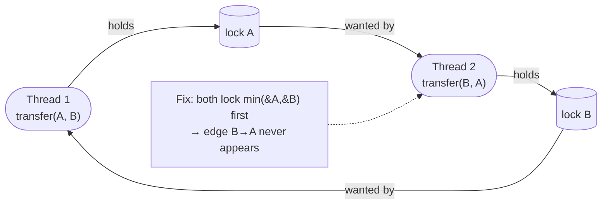

# 09 — Deadlock: Coffman conditions, detection, and lockdep

> Module 03 · Concurrency & Synchronization · Linux v6.18.63 · OpenBSD 8cada8c · Farsi: [09-deadlock-coffman-lockdep.fa.md](09-deadlock-coffman-lockdep.fa.md)

## 1. Summary

- A deadlock is a cycle of threads, each holding a resource the next one wants. It needs all four **Coffman conditions**: mutual exclusion, hold-and-wait, no preemption, circular wait. Remove one and deadlock is impossible.
- In real systems you break **circular wait** with a global lock order (by lock class, by level, or by address). Tools then check the order, not the hang: ThreadSanitizer and helgrind in user space, **lockdep** in Linux, **WITNESS** in OpenBSD.
- Starvation and livelock are different failures: the system makes progress, just not for everyone (starvation), or threads stay busy without progress (livelock).

## 2. Explanation

### 2.1 The four conditions

| Condition | Meaning | How to break it | Real example |
|---|---|---|---|
| Mutual exclusion | the resource can't be shared | make it shareable (RCU readers, lock-free) | RCU readers never block each other (note 08) |
| Hold and wait | hold one, wait for another | take all locks at once, or `trylock` and back off | `mutex_trylock()` + drop everything on failure |
| No preemption | a held resource can't be taken away | let the system revoke it | **ww_mutex**: an older transaction "wounds" a younger one, which drops its locks |
| Circular wait | a cycle in the wait-for graph | **global order** | lock by address (lab 06), lockdep-enforced class order |

### 2.2 Four strategies

| Strategy | Idea | Where used |
|---|---|---|
| Prevention | make one condition structurally impossible | lock ordering everywhere in the kernel |
| Avoidance | grant a request only if the state stays "safe" (**Banker's algorithm**: needs every thread's maximum demand in advance) | textbooks, some resource managers; impractical for locks |
| Detection + recovery | find cycles in the wait-for graph, then kill/rollback | databases (abort a transaction), `rt_mutex` chain walk returns `-EDEADLK` |
| Ostrich | ignore it, reboot when it happens | most user programs, honestly |

### 2.3 Lock ordering

If every thread acquires locks in one global order, a cycle is impossible: a cycle would need some thread to take a "lower" lock while holding a "higher" one. When two locks of the *same* kind must be taken (two accounts, two inodes), order them by a stable key: the address, an inode number, a pid. The kernel does exactly this, e.g. `lock_two_nondirectories()` orders inodes; `double_rq_lock()` orders runqueues.

### 2.4 lockdep in one paragraph

lockdep (`kernel/locking/lockdep.c`, `CONFIG_PROVE_LOCKING`) tracks **lock classes**, not instances: every lock initialised at the same source line is one class. Each time a task acquires class B while holding class A it records the edge A→B in a global dependency graph. Before adding a new edge, `check_noncircular()` does a breadth-first search for a path back; finding one means some interleaving *could* deadlock, so it prints a report — even if this run never hung. It also checks IRQ-safety (a lock taken in hardirq context and somewhere with IRQs on) and recursive locking. Cost: every lock operation goes through the slow path with bookkeeping (the mutex fast path is compiled out under `CONFIG_DEBUG_LOCK_ALLOC`), so distro kernels ship without it. Check yours with `grep PROVE_LOCKING /boot/config-$(uname -r)`.

### 2.5 Starvation and livelock

| Failure | System progress | Example | Fix |
|---|---|---|---|
| Deadlock | none for the cycle | AB-BA locks (lab 06) | lock order |
| Starvation | yes, but one thread never runs | writer under reader-preferring rwlock (lab 03) | fairness: FIFO queue, handoff flag (`MUTEX_FLAG_HANDOFF`, `RWSEM_FLAG_HANDOFF`) |
| Livelock | threads run, nothing completes | two threads both `trylock`, back off, retry in lock-step | randomized backoff, ordering |

## 3. Diagram



## 4. Worked example

### 4.1 The lab 06 transfer, buggy and fixed in one function

```c
// labs/06-deadlock/deadlock.c · transfer() (lab code)
static void transfer(struct account *from, struct account *to, long amount)
{
    struct account *first = from, *second = to;
    if (g_ordered && (uintptr_t)to < (uintptr_t)from) {   // global order: by address
        first = to;
        second = from;
    }
    pthread_mutex_lock(&first->lock);
    if (g_sleep)
        usleep(100000);            // widen the window: the other thread takes its first lock
    pthread_mutex_lock(&second->lock);
    from->balance -= amount;
    to->balance += amount;
    pthread_mutex_unlock(&second->lock);
    pthread_mutex_unlock(&first->lock);
}
```

- Without `g_ordered`, thread 1 takes A then B, thread 2 takes B then A: all four Coffman conditions hold. In `hang` mode the 100 ms sleep makes the cycle certain.
- With `g_ordered`, both threads take the lower address first; the order is total, so no cycle.

**What a hung process looks like** (what to look for; the captured VM output is in the lab README):

| Tool | Sign of this deadlock |
|---|---|
| `ps -L -o tid,stat,wchan:20,comm -p <pid>` | both worker threads in state `S`, `wchan` in the futex wait path |
| `sudo cat /proc/<pid>/task/<tid>/stack` | kernel stack ending in `futex_wait…` ← `do_futex` ← `__x64_sys_futex` |
| `gdb -p <pid> -batch -ex "thread apply all bt"` | each thread in `__lll_lock_wait` / `pthread_mutex_lock`, called from `transfer()` line with the *second* lock |
| `print *(pthread_mutex_t *)&g_acc_a.lock` in gdb | `__owner` field = the TID of the *other* thread: that's the cycle |

### 4.2 Detection without hanging: ThreadSanitizer

Real run: gcc 13 in Docker on the Windows host (WSL2), not the course VM — VM numbers are in the lab README. `deadlock-tsan quick` runs the two transfers one after the other, so it never hangs:

```text
WARNING: ThreadSanitizer: lock-order-inversion (potential deadlock) (pid=22)
  Cycle in lock order graph: M0 (0x0000004040e0) => M1 (0x0000004040a0) => M0

  Mutex M1 acquired here while holding mutex M0 in thread T1:
    #1 transfer 06-deadlock/deadlock.c:39 (dt+0x401285)
    #2 a_to_b 06-deadlock/deadlock.c:49 (dt+0x401350)

  Mutex M0 acquired here while holding mutex M1 in thread T2:
    #1 transfer 06-deadlock/deadlock.c:39 (dt+0x401285)
    #2 b_to_a 06-deadlock/deadlock.c:56 (dt+0x40131f)
...
done: A=1010 B=990
```

TSan saw the edge M0→M1 in T1 and M1→M0 in T2, and reported the cycle although the program finished normally (`done:`). `ordered` mode produced no warning. On aos-lab, valgrind 3.22 helgrind reported the same bug as `Thread #3: lock order "0x10C060 before 0x10C020" violated`, naming `g_acc_a` and `g_acc_b` (full output in the lab README).

### 4.3 The kernel version: lockdep

```c
linux/kernel/locking/lockdep.c · check_noncircular() · v6.18.63 · L2169-2188
 2169  /*
 2170   * Prove that the dependency graph starting at <src> can not
 2171   * lead to <target>. If it can, there is a circle when adding
 2172   * <target> -> <src> dependency.
 2173   *
 2174   * Print an error and return BFS_RMATCH if it does.
 2175   */
 2176  static noinline enum bfs_result
 2177  check_noncircular(struct held_lock *src, struct held_lock *target,
 2178  		  struct lock_trace **const trace)
 2179  {
 2180  	enum bfs_result ret;
 2181  	struct lock_list *target_entry;
 2182  	struct lock_list src_entry;
 2183  
 2184  	bfs_init_root(&src_entry, src);
 2185  
 2186  	debug_atomic_inc(nr_cyclic_checks);
 2187  
 2188  	ret = check_path(target, &src_entry, hlock_conflict, NULL, &target_entry);
```

Elixir: https://elixir.bootlin.com/linux/v6.18.63/source/kernel/locking/lockdep.c#L2169

- **L2170–2172**: the new edge is `target → src` (we hold `target`, we're acquiring `src`). If the graph already has a path `src → … → target`, the new edge closes a cycle.
- **L2184**: BFS starts at `src`.
- **L2186**: statistics (`/proc/lockdep_stats` on a lockdep kernel).
- **L2188**: `check_path()` does the BFS, using `hlock_conflict` to decide whether a found entry really conflicts (read/write lock subtleties).

```c
linux/kernel/locking/lockdep.c · print_circular_bug_header() · v6.18.63 · L1988-2000
 1988  	pr_warn("\n");
 1989  	pr_warn("======================================================\n");
 1990  	pr_warn("WARNING: possible circular locking dependency detected\n");
 1991  	print_kernel_ident();
 1992  	pr_warn("------------------------------------------------------\n");
 1993  	pr_warn("%s/%d is trying to acquire lock:\n",
 1994  		curr->comm, task_pid_nr(curr));
 1995  	print_lock(check_src);
 1996  
 1997  	pr_warn("\nbut task is already holding lock:\n");
 1998  
 1999  	print_lock(check_tgt);
 2000  	pr_warn("\nwhich lock already depends on the new lock.\n\n");
```

Elixir: https://elixir.bootlin.com/linux/v6.18.63/source/kernel/locking/lockdep.c#L1988

- **L1990**: the line to `grep` for in `dmesg`.
- **L1993–1999**: the report is phrased from the current task's view: "trying to acquire X but already holding Y, and X already depends on Y" — the same pair TSan calls M0/M1.
- The lab 06 `lockdep/lockdep_abba.c` module takes two mutexes A→B then B→A in one thread. On a `--lockdep` kernel (lab 00.3) it should print this header. That report is **UNVERIFIED**: the course VM runs a mainline kernel without `CONFIG_PROVE_LOCKING`, and that kernel was built with gcc-15, which the VM lacks, so the module does not even build against it (gcc 13 rejects `-fmin-function-alignment=16`); it builds on the self-built `--lockdep` kernel of lab 00.3.

### 4.4 OpenBSD: WITNESS and an immediate panic

OpenBSD's lock-order checker is WITNESS; `rw_do_enter_write()` calls `WITNESS_CHECKORDER(&rwl->rwl_lock_obj, lop_flags, NULL)` before trying the lock (`sys/kern/kern_rwlock.c` L234). It is enabled only in kernels built with `option WITNESS`, just as lockdep is a config option. Recursive write locking is caught without any checker: `rw_do_enter_write()` panics with `"%s rwlock %p: enter write deadlock"` (L244) when the owner is the caller. Linux instead blocks forever and only lockdep reports `WARNING: possible recursive locking detected` (`lockdep.c` L3050).

### 4.5 Avoiding deadlock instead: ww_mutex

`include/linux/ww_mutex.h` (header line 3: *"Wound/Wait Mutexes: blocking mutual exclusion locks with deadlock avoidance"*) lets GPU drivers lock an unordered set of buffers. Each acquire context gets a ticket (age). On conflict, either the younger context is wounded and must release everything and retry (wound-wait), or it backs off itself (wait-die; header line 9). This breaks *no preemption* / *hold and wait* instead of circular wait.

## 5. Edge cases & pitfalls

- **Lock classes, not instances**: lockdep reports AB-BA between two `inode` locks even if they are different inodes. Use `mutex_lock_nested()` / subclasses when the order is by key, or lockdep gives false positives.
- **Self-deadlock**: re-locking a non-recursive mutex in the same thread, or taking a spinlock in an IRQ handler that interrupted its holder on the same CPU.
- **Hidden locks**: `printk`, memory allocation and page faults (`mmap_lock`) take locks too. A deadlock can involve a lock you never wrote.
- **Condvar + lock order**: waiting on a condvar releases only *its* mutex. Holding another lock while waiting is hold-and-wait.
- **TSan/helgrind see only executed paths**: if the B→A path never runs in testing, nothing is reported.
- **Timeouts hide deadlocks**: `pthread_mutex_timedlock` turns a deadlock into a livelock-ish retry storm unless you back off and release.
- **Signal handlers** calling `malloc` or `printf` can self-deadlock on libc's internal locks.

## 6. Exam key points

- Coffman: mutual exclusion, hold-and-wait, no preemption, circular wait — all four needed.
- Prevention (break one condition), avoidance (Banker's, needs max demand), detection+recovery, ignore.
- Practical fix: global lock order; for same-type locks, order by address/ID.
- Diagnose a hang: thread dump (`gdb thread apply all bt`), `/proc/<pid>/task/*/stack`, mutex `__owner` field.
- TSan "lock-order-inversion", helgrind "lock order violated", lockdep "possible circular locking dependency detected" all report the *order*, even without a hang.
- lockdep works on lock classes, builds a dependency graph, runs BFS in `check_noncircular()`; it is off in production kernels.
- OpenBSD: WITNESS; recursive rwlock write = panic.
- Starvation ≠ deadlock: fix with fairness (FIFO, handoff). Livelock: fix with randomized backoff.

## 7. Links

- Lesson: [4.7 Why does everything stop?](../lesson.en.md#47-why-does-everything-stop)
- Walkthrough: [kernel-walkthrough.en.md](../kernel-walkthrough.en.md) (§5 lockdep and rt_mutex, §6.2 OpenBSD rwlock)
- Notes: [05 mutex](05-mutex-optimistic-spinning.en.md) (handoff) · [08 RCU](08-rcu.en.md) · [10 classic problems](10-classic-problems.en.md) (dining philosophers)
- Labs: [06 deadlock](../labs/06-deadlock/README.md) · [03 readers-writers](../labs/03-readers-writers/README.md) (starvation)
- Quiz: [Q6](../quiz.en.md) (Coffman conditions) · [Q12](../quiz.en.md) (reading a gdb deadlock dump)
