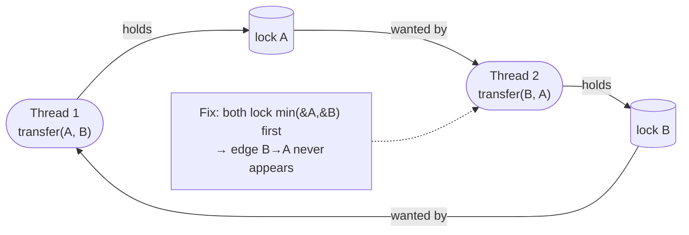

<div dir="rtl">

# ۰۹ — بن‌بست: شرایط Coffman، تشخیص و lockdep

> ماژول ۰۳ · همروندی و همگام‌سازی · Linux v6.18.63 · OpenBSD 8cada8c · نسخهٔ انگلیسی: [09-deadlock-coffman-lockdep.en.md](09-deadlock-coffman-lockdep.en.md)

## ۱. خلاصه

- بن‌بست (deadlock) چرخه‌ای از نخ‌هاست که هر کدام منبعی را نگه داشته که نفر بعدی می‌خواهد. هر چهار **شرط Coffman** لازم است: mutual exclusion، hold-and-wait، no preemption و circular wait. یکی را حذف کنید و بن‌بست ناممکن می‌شود.
- در سیستم‌های واقعی **circular wait** را با یک ترتیب سراسری قفل‌ها می‌شکنند (بر اساس کلاس قفل، سطح، یا آدرس). ابزارها هم ترتیب را بررسی می‌کنند، نه گیرکردن را: ThreadSanitizer و helgrind در فضای کاربر، **lockdep** در لینوکس، **WITNESS** در OpenBSD.
- Starvation و livelock خرابی‌های دیگری‌اند: سیستم پیش می‌رود ولی نه برای همه (starvation)، یا نخ‌ها مشغول‌اند ولی هیچ کاری تمام نمی‌شود (livelock).

## ۲. توضیح

### ۲.۱ چهار شرط

| شرط | معنا | چطور بشکنیم | نمونهٔ واقعی |
|---|---|---|---|
| Mutual exclusion | منبع قابل اشتراک نیست | اشتراک‌پذیرش کنیم (خواننده‌های RCU، lock-free) | خواننده‌های RCU هرگز همدیگر را مسدود نمی‌کنند (یادداشت ۰۸) |
| Hold and wait | یکی را نگه داشته‌ای و منتظر دیگری هستی | همهٔ قفل‌ها را یک‌جا بگیر، یا `trylock` و عقب‌نشینی | `mutex_trylock()` و رهاکردن همه در صورت شکست |
| No preemption | منبع گرفته‌شده را نمی‌شود پس گرفت | بگذار سیستم پسش بگیرد | **ww_mutex**: تراکنش قدیمی‌تر تراکنش جوان‌تر را «زخمی» می‌کند و او قفل‌هایش را رها می‌کند |
| Circular wait | چرخه در گراف انتظار | **ترتیب سراسری** | قفل بر اساس آدرس (آزمایش ۰۶)، ترتیب کلاس‌ها که lockdep اجبار می‌کند |

### ۲.۲ چهار راهبرد

| راهبرد | ایده | کجا |
|---|---|---|
| Prevention (پیشگیری) | یک شرط را ساختاراً ناممکن کن | ترتیب قفل در همه‌جای کرنل |
| Avoidance (اجتناب) | درخواستی را بده که وضعیت «امن» بماند (**الگوریتم Banker**: حداکثر نیاز هر نخ را از قبل لازم دارد) | کتاب‌های درسی و برخی مدیران منابع؛ برای قفل عملی نیست |
| Detection + recovery | چرخه را در گراف انتظار پیدا کن، بعد kill یا rollback | پایگاه‌داده‌ها (abort تراکنش)، پیمایش زنجیرهٔ `rt_mutex` که `-EDEADLK` برمی‌گرداند |
| Ostrich (شترمرغ) | نادیده بگیر، وقتی شد ریبوت کن | صادقانه بگوییم، بیشتر برنامه‌های کاربر |

### ۲.۳ ترتیب قفل‌ها

اگر همهٔ نخ‌ها قفل‌ها را به یک ترتیب سراسری بگیرند، چرخه ناممکن است: چرخه یعنی نخی قفل «پایین‌تر» را در حالی بگیرد که «بالاتر» را دارد. وقتی دو قفل از *یک* نوع لازم است (دو حساب، دو inode)، بر اساس کلیدی پایدار مرتبشان کنید: آدرس، شمارهٔ inode، pid. کرنل دقیقاً همین کار را می‌کند؛ مثلاً `lock_two_nondirectories()` inodeها را مرتب می‌کند و `double_rq_lock()` صف‌های اجرا را.

### ۲.۴ lockdep در یک بند

lockdep (<span dir="ltr">`kernel/locking/lockdep.c`</span>، `CONFIG_PROVE_LOCKING`) **کلاس قفل** را دنبال می‌کند، نه نمونه را: همهٔ قفل‌هایی که در یک خط از سورس مقداردهی شده‌اند یک کلاس‌اند. هر بار که taskی کلاس B را در حالی بگیرد که کلاس A را دارد، یال A→B در یک گراف وابستگی سراسری ثبت می‌شود. پیش از افزودن یال جدید، `check_noncircular()` یک جستجوی سطح‌اول برای مسیر برگشتی انجام می‌دهد؛ پیدا شدنش یعنی ترتیبی از اجرا *ممکن است* بن‌بست بسازد، پس گزارش چاپ می‌کند، حتی اگر این اجرا هرگز گیر نکرده باشد. ایمنی IRQ (قفلی که هم در hardirq و هم جایی با IRQ روشن گرفته می‌شود) و قفل بازگشتی را هم بررسی می‌کند. هزینه: هر عمل قفل از مسیر کند با حسابداری می‌گذرد (مسیر سریع mutex زیر `CONFIG_DEBUG_LOCK_ALLOC` حذف می‌شود)، پس کرنل‌های توزیع‌ها بدون آن منتشر می‌شوند. کرنل خودتان را با <span dir="ltr">`grep PROVE_LOCKING /boot/config-$(uname -r)`</span> بررسی کنید.

### ۲.۵ Starvation و livelock

| خرابی | پیشرفت سیستم | مثال | راه‌حل |
|---|---|---|---|
| Deadlock | برای اعضای چرخه هیچ | قفل‌های AB-BA (آزمایش ۰۶) | ترتیب قفل |
| Starvation | هست، ولی یک نخ هرگز اجرا نمی‌شود | نویسنده زیر rwlock طرفدار خواننده (آزمایش ۰۳) | انصاف: صف FIFO، پرچم handoff (`MUTEX_FLAG_HANDOFF`، `RWSEM_FLAG_HANDOFF`) |
| Livelock | نخ‌ها اجرا می‌شوند ولی چیزی تمام نمی‌شود | دو نخ هر دو `trylock`، عقب‌نشینی و تکرار هم‌گام | backoff تصادفی، ترتیب |

## ۳. نمودار

</div>



<div dir="rtl">

## ۴. مثال حل‌شده

### ۴.۱ تابع transfer آزمایش ۰۶، نسخهٔ معیوب و درست در یک تابع

</div>

```c
// labs/06-deadlock/deadlock.c · transfer() (lab code)
static void transfer(struct account *from, struct account *to, long amount)
{
    struct account *first = from, *second = to;
    if (g_ordered && (uintptr_t)to < (uintptr_t)from) {   // global order: by address
        first = to;
        second = from;
    }
    pthread_mutex_lock(&first->lock);
    if (g_sleep)
        usleep(100000);            // widen the window: the other thread takes its first lock
    pthread_mutex_lock(&second->lock);
    from->balance -= amount;
    to->balance += amount;
    pthread_mutex_unlock(&second->lock);
    pthread_mutex_unlock(&first->lock);
}
```

<div dir="rtl">

- بدون `g_ordered`، نخ ۱ اول A و بعد B را می‌گیرد و نخ ۲ اول B و بعد A را: هر چهار شرط Coffman برقرار است. در حالت `hang` خواب ۱۰۰ میلی‌ثانیه‌ای چرخه را قطعی می‌کند.
- با `g_ordered` هر دو نخ اول آدرس کوچک‌تر را می‌گیرند؛ ترتیب کامل است، پس چرخه‌ای نیست.

**فرایندِ گیرکرده چه شکلی است** (به چه چیزی نگاه کنیم؛ خروجی واقعی VM در README آزمایش است):

| ابزار | نشانهٔ این بن‌بست |
|---|---|
| <span dir="ltr">`ps -L -o tid,stat,wchan:20,comm -p <pid>`</span> | هر دو نخ کارگر در وضعیت `S`، و `wchan` در مسیر انتظار futex |
| <span dir="ltr">`sudo cat /proc/<pid>/task/<tid>/stack`</span> | stack کرنل که به <span dir="ltr">`futex_wait…` ← `do_futex` ← `__x64_sys_futex`</span> ختم می‌شود |
| <span dir="ltr">`gdb -p <pid> -batch -ex "thread apply all bt"`</span> | هر نخ در `__lll_lock_wait` / `pthread_mutex_lock` که از خط قفل *دوم* در `transfer()` صدا زده شده |
| <span dir="ltr">`print *(pthread_mutex_t *)&g_acc_a.lock`</span> در gdb | فیلد `__owner` برابر TID نخ *دیگر*: این همان چرخه است |

### ۴.۲ تشخیص بدون گیرکردن: ThreadSanitizer

real run: gcc 13 in Docker on the Windows host (WSL2), not the course VM — VM numbers are in the lab README. <span dir="ltr">`deadlock-tsan quick`</span> دو انتقال را پشت سر هم اجرا می‌کند، پس هرگز گیر نمی‌کند:

</div>

```text
WARNING: ThreadSanitizer: lock-order-inversion (potential deadlock) (pid=22)
  Cycle in lock order graph: M0 (0x0000004040e0) => M1 (0x0000004040a0) => M0

  Mutex M1 acquired here while holding mutex M0 in thread T1:
    #1 transfer 06-deadlock/deadlock.c:39 (dt+0x401285)
    #2 a_to_b 06-deadlock/deadlock.c:49 (dt+0x401350)

  Mutex M0 acquired here while holding mutex M1 in thread T2:
    #1 transfer 06-deadlock/deadlock.c:39 (dt+0x401285)
    #2 b_to_a 06-deadlock/deadlock.c:56 (dt+0x40131f)
...
done: A=1010 B=990
```

<div dir="rtl">

TSan یال M0→M1 را در T1 و M1→M0 را در T2 دید و چرخه را گزارش کرد، هرچند برنامه عادی تمام شد (`done:`). حالت `ordered` هیچ هشداری نداد. روی aos-lab، helgrind در valgrind 3.22 همین باگ را با پیام <span dir="ltr">`Thread #3: lock order "0x10C060 before 0x10C020" violated`</span> گزارش کرد و نام `g_acc_a` و `g_acc_b` را آورد (خروجی کامل در README آزمایش).

### ۴.۳ نسخهٔ کرنل: lockdep

</div>

```c
linux/kernel/locking/lockdep.c · check_noncircular() · v6.18.63 · L2169-2188
 2169  /*
 2170   * Prove that the dependency graph starting at <src> can not
 2171   * lead to <target>. If it can, there is a circle when adding
 2172   * <target> -> <src> dependency.
 2173   *
 2174   * Print an error and return BFS_RMATCH if it does.
 2175   */
 2176  static noinline enum bfs_result
 2177  check_noncircular(struct held_lock *src, struct held_lock *target,
 2178  		  struct lock_trace **const trace)
 2179  {
 2180  	enum bfs_result ret;
 2181  	struct lock_list *target_entry;
 2182  	struct lock_list src_entry;
 2183  
 2184  	bfs_init_root(&src_entry, src);
 2185  
 2186  	debug_atomic_inc(nr_cyclic_checks);
 2187  
 2188  	ret = check_path(target, &src_entry, hlock_conflict, NULL, &target_entry);
```

<div dir="rtl">

Elixir: <span dir="ltr">https://elixir.bootlin.com/linux/v6.18.63/source/kernel/locking/lockdep.c#L2169</span>

- **خط ۲۱۷۰ تا ۲۱۷۲**: یال جدید <span dir="ltr">`target → src`</span> است (`target` را داریم و داریم `src` را می‌گیریم). اگر گراف از قبل مسیری <span dir="ltr">`src → … → target`</span> داشته باشد، یال جدید چرخه را می‌بندد.
- **خط ۲۱۸۴**: جستجوی سطح‌اول از `src` شروع می‌شود.
- **خط ۲۱۸۶**: آمار (<span dir="ltr">`/proc/lockdep_stats`</span> روی کرنل lockdep).
- **خط ۲۱۸۸**: `check_path()` جستجو را انجام می‌دهد و با `hlock_conflict` تصمیم می‌گیرد که مدخل پیداشده واقعاً تعارض دارد یا نه (ظرافت‌های قفل خواندن/نوشتن).

</div>

```c
linux/kernel/locking/lockdep.c · print_circular_bug_header() · v6.18.63 · L1988-2000
 1988  	pr_warn("\n");
 1989  	pr_warn("======================================================\n");
 1990  	pr_warn("WARNING: possible circular locking dependency detected\n");
 1991  	print_kernel_ident();
 1992  	pr_warn("------------------------------------------------------\n");
 1993  	pr_warn("%s/%d is trying to acquire lock:\n",
 1994  		curr->comm, task_pid_nr(curr));
 1995  	print_lock(check_src);
 1996  
 1997  	pr_warn("\nbut task is already holding lock:\n");
 1998  
 1999  	print_lock(check_tgt);
 2000  	pr_warn("\nwhich lock already depends on the new lock.\n\n");
```

<div dir="rtl">

Elixir: <span dir="ltr">https://elixir.bootlin.com/linux/v6.18.63/source/kernel/locking/lockdep.c#L1988</span>

- **خط ۱۹۹۰**: همان خطی که باید در `dmesg` با `grep` دنبالش بگردید.
- **خط ۱۹۹۳ تا ۱۹۹۹**: گزارش از دید task جاری نوشته می‌شود: «دارد X را می‌گیرد ولی Y را از قبل دارد، و X از قبل به Y وابسته است»؛ همان جفتی که TSan اسمش را M0/M1 گذاشت.
- ماژول <span dir="ltr">`lockdep/lockdep_abba.c`</span> در آزمایش ۰۶ دو mutex را در یک نخ اول A→B و بعد B→A می‌گیرد. روی کرنل `--lockdep` (آزمایش ۰۰.۳) باید همین سرتیتر را چاپ کند. این گزارش **UNVERIFIED** است: VM درس کرنل mainline بدون `CONFIG_PROVE_LOCKING` را اجرا می‌کند.

### ۴.۴ OpenBSD: WITNESS و panic فوری

بررسی‌کنندهٔ ترتیب قفل در OpenBSD اسمش WITNESS است؛ `rw_do_enter_write()` قبل از امتحان قفل <span dir="ltr">`WITNESS_CHECKORDER(&rwl->rwl_lock_obj, lop_flags, NULL)`</span> را صدا می‌زند (<span dir="ltr">`sys/kern/kern_rwlock.c`</span> خط ۲۳۴). فقط در کرنل‌هایی فعال است که با <span dir="ltr">`option WITNESS`</span> ساخته شده‌اند، همان‌طور که lockdep یک گزینهٔ پیکربندی است. قفل‌گذاری نوشتنیِ بازگشتی بدون هیچ بررسی‌کننده‌ای گرفته می‌شود: وقتی صاحب قفل خودِ فراخواننده باشد، `rw_do_enter_write()` با پیام <span dir="ltr">`"%s rwlock %p: enter write deadlock"`</span> (خط ۲۴۴) panic می‌کند. لینوکس به‌جایش برای همیشه مسدود می‌ماند و فقط lockdep پیام <span dir="ltr">`WARNING: possible recursive locking detected`</span> (<span dir="ltr">`lockdep.c`</span> خط ۳۰۵۰) را می‌دهد.

### ۴.۵ به‌جای آن، اجتناب از بن‌بست: ww_mutex

<span dir="ltr">`include/linux/ww_mutex.h`</span> (خط ۳ سرآیند: <span dir="ltr">*"Wound/Wait Mutexes: blocking mutual exclusion locks with deadlock avoidance"*</span>) به درایورهای GPU اجازه می‌دهد مجموعه‌ای نامرتب از بافرها را قفل کنند. هر acquire context یک بلیت (سن) می‌گیرد. هنگام تعارض، یا context جوان‌تر زخمی می‌شود و باید همه چیز را رها کند و دوباره امتحان کند (wound-wait)، یا خودش عقب می‌کشد (wait-die؛ خط ۹ سرآیند). این روش به‌جای circular wait، شرط *no preemption* یا *hold and wait* را می‌شکند.

## ۵. حالت‌های مرزی و دام‌ها

- **کلاس قفل، نه نمونه**: lockdep بین دو قفل `inode` گزارش AB-BA می‌دهد حتی اگر inodeها متفاوت باشند. وقتی ترتیب بر اساس کلید است از `mutex_lock_nested()` یا subclassها استفاده کنید، وگرنه lockdep هشدار نادرست می‌دهد.
- **بن‌بست با خود**: قفل‌کردن دوبارهٔ mutex غیربازگشتی در همان نخ، یا گرفتن spinlock در IRQ handlerی که روی همان CPU وسط کار نگه‌دارنده آمده.
- **قفل‌های پنهان**: `printk`، تخصیص حافظه و page fault (`mmap_lock`) هم قفل می‌گیرند. بن‌بست می‌تواند شامل قفلی باشد که هرگز ننوشته‌اید.
- **Condvar و ترتیب قفل**: انتظار روی condvar فقط mutex *خودش* را آزاد می‌کند. نگه‌داشتن قفل دیگری حین انتظار یعنی hold-and-wait.
- **TSan و helgrind فقط مسیرهای اجراشده را می‌بینند**: اگر مسیر B→A در آزمون هرگز اجرا نشود، چیزی گزارش نمی‌شود.
- **Timeout بن‌بست را پنهان می‌کند**: `pthread_mutex_timedlock` بن‌بست را به طوفانی از تلاش‌های مکرر شبیه livelock تبدیل می‌کند، مگر عقب بکشید و آزاد کنید.
- **Signal handlerهایی** که `malloc` یا `printf` صدا می‌زنند می‌توانند روی قفل‌های داخلی libc با خودشان بن‌بست بسازند.

## ۶. نکته‌های کلیدی امتحان

- Coffman: mutual exclusion، hold-and-wait، no preemption، circular wait؛ هر چهار لازم است.
- پیشگیری (شکستن یک شرط)، اجتناب (Banker، نیازمند حداکثر تقاضا)، تشخیص و بازیابی، نادیده‌گرفتن.
- راه‌حل عملی: ترتیب سراسری قفل؛ برای قفل‌های هم‌نوع، ترتیب بر اساس آدرس یا شناسه.
- تشخیص گیرکردن: thread dump (<span dir="ltr">`gdb thread apply all bt`</span>)، <span dir="ltr">`/proc/<pid>/task/*/stack`</span>، فیلد `__owner` در mutex.
- پیام‌های TSan («lock-order-inversion»)، helgrind («lock order violated») و lockdep («possible circular locking dependency detected») همه *ترتیب* را گزارش می‌کنند، حتی بدون گیرکردن.
- lockdep روی کلاس‌های قفل کار می‌کند، گراف وابستگی می‌سازد و در `check_noncircular()` جستجوی سطح‌اول انجام می‌دهد؛ در کرنل‌های تولیدی خاموش است.
- OpenBSD: WITNESS؛ قفل نوشتنی بازگشتی روی rwlock یعنی panic.
- Starvation با deadlock فرق دارد: با انصاف (FIFO، handoff) درست می‌شود. Livelock: با backoff تصادفی.

## ۷. پیوندها

- درس: [۴.۷ چرا همه چیز متوقف می‌شود؟](../lesson.fa.md#47-why-does-everything-stop)
- مرور کد کرنل: [kernel-walkthrough.fa.md](../kernel-walkthrough.fa.md) (بخش ۵: lockdep و rt_mutex؛ بخش ۶.۲: rwlock در OpenBSD)
- یادداشت‌ها: [۰۵ mutex](05-mutex-optimistic-spinning.fa.md) (handoff) · [۰۸ RCU](08-rcu.fa.md) · [۱۰ مسائل کلاسیک](10-classic-problems.fa.md) (فیلسوفان غذاخور)
- آزمایش‌ها: [۰۶ بن‌بست](../labs/06-deadlock/README.md) · [۰۳ خوانندگان-نویسندگان](../labs/03-readers-writers/README.md) (starvation)
- آزمون: [پرسش ۶](../quiz.fa.md) (شرایط Coffman) · [پرسش ۱۲](../quiz.fa.md) (خواندن dump بن‌بست در gdb)

</div>
