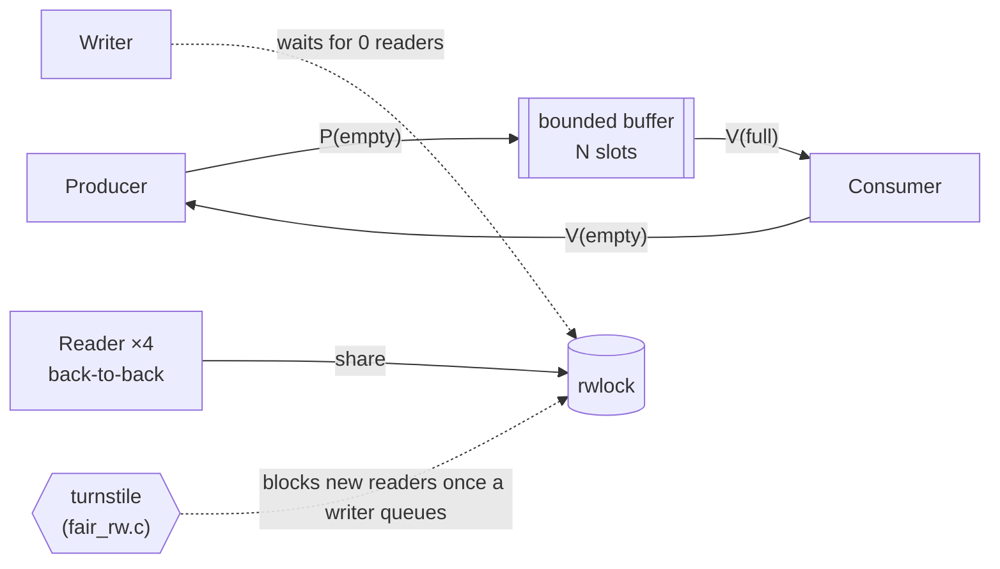

# 10 — Classic synchronization problems

> Module 03 · Concurrency & Synchronization · Linux v6.18.63 · OpenBSD 8cada8c · Farsi: [10-classic-problems.fa.md](10-classic-problems.fa.md)

## 1. Summary

- Four textbook problems capture almost every real synchronization pattern: **Producer-Consumer** (bounded buffer), **Readers-Writers**, **Dining Philosophers**, **Sleeping Barber**.
- Each one teaches a failure mode: lost wake-ups and busy waiting (P-C), starvation (R-W), deadlock (philosophers), and waiting with a bounded queue (barber).
- The kernel has a production version of each: `kfifo` + `wait_event()`, `rw_semaphore` with a handoff bit, `percpu_rw_semaphore`, lock ordering, and wait queues.

## 2. Explanation

### 2.1 Producer-Consumer (bounded buffer)

N slots, producers add, consumers remove. Two conditions must be waited on: "not full" for producers and "not empty" for consumers, plus mutual exclusion on the indices.

| Implementation | State | Waiting | Lab 02 file |
|---|---|---|---|
| Semaphores | `empty = N`, `full = 0`, mutex | `sem_wait(&empty)` / `sem_wait(&full)` | `pc_sem.c` |
| Mutex + 2 condvars | `count`, head, tail | `while (count == cap) cond_wait(&not_full)` | `pc_cond.c` |
| Go buffered channel | runtime queue | `ch <- v` / `v := <-ch` block | `pc_chan.go` |

The semaphore version encodes the conditions in the counters; the condvar version encodes them in a predicate you re-check in a `while` loop. With more than one consumer, `if` instead of `while` is a bug: a woken consumer can find the buffer already drained by another (see [note 06](06-semaphores-condition-variables.en.md)). The Go version hides both behind the runtime, and `close(ch)` gives a clean shutdown signal, which in C needs poison pills (lab 02 extension `solution/pc_mpmc.c`).

### 2.2 Readers-Writers

Many readers may share; a writer needs exclusion. The interesting part is **who waits** when both kinds arrive.

| Variant | Rule | Starves | Example |
|---|---|---|---|
| First problem (reader preference) | a reader enters if no *writer is active*, even if a writer waits | **writers** | glibc default `PTHREAD_RWLOCK_PREFER_READER_NP` |
| Second problem (writer preference) | once a writer waits, new readers wait | readers | `PTHREAD_RWLOCK_PREFER_WRITER_NONRECURSIVE_NP` |
| Third problem (no starvation) | arrival order through a turnstile | nobody (FIFO-ish) | Downey's turnstile, lab 03 `solution/fair_rw.c`; kernel rwsem handoff |

Lab 03's `rw.c` keeps four readers inside the lock back to back (each holds it 100 µs), so with reader preference there is never a moment with zero readers and the writer starves.

Note: glibc documents that `PTHREAD_RWLOCK_PREFER_WRITER_NP` is ignored; only the `_NONRECURSIVE_NP` variant actually prefers writers (it forbids a reader from recursively re-acquiring while a writer waits, which would otherwise deadlock). UNVERIFIED against the glibc source here (not in our checkouts); the lab output shows the behaviour.

### 2.3 Dining Philosophers

Five philosophers, five forks, each needs both neighbours' forks. If everyone picks up the left fork first, all hold one and wait for the other: a perfect circular wait (note 09).

| Fix | Breaks Coffman condition | Cost |
|---|---|---|
| Global order: pick the lower-numbered fork first (one philosopher is "left-handed") | circular wait | none; the usual kernel answer |
| Arbiter / waiter: a semaphore admits at most 4 to the table | hold-and-wait (some can always finish) | less concurrency |
| `trylock` the second fork, put the first back on failure | hold-and-wait | livelock risk without random backoff |
| Chandy-Misra: forks are "dirty/clean" tokens passed by request messages | circular wait (priority graph stays acyclic) | message passing; suits distributed systems (Module 06) |

### 2.4 Sleeping Barber

One barber, a waiting room with K chairs. A customer who finds no free chair leaves; otherwise they wait; the barber sleeps when nobody is there. It is Producer-Consumer where producers *don't block* when full (they drop). Typical implementation: a `customers` semaphore, a `barber` semaphore, a mutex around the free-chair count. Real analogue: a network driver's RX ring that drops packets when full and a NAPI poller that sleeps when it's empty.

### 2.5 Where these live in Linux

| Problem | Kernel primitive | File |
|---|---|---|
| Bounded buffer | `kfifo` (lock-free for one producer + one consumer), `wait_event()` / `wake_up()` | `include/linux/kfifo.h`, `include/linux/wait.h` |
| Readers-Writers | `rw_semaphore` (sleeping, with handoff), `rwlock_t` (spinning, reader-preferring) | `kernel/locking/rwsem.c`, `kernel/locking/qrwlock.c` |
| Read-mostly, writer very rare | `percpu_rw_semaphore` (readers touch only a per-CPU counter), RCU | `kernel/locking/percpu-rwsem.c`, note 08 |
| Philosophers | lock ordering (`double_rq_lock()` in `kernel/sched/core.c` L703 orders two runqueues) | — |

## 3. Diagram



## 4. Worked example

### 4.1 The turnstile (third readers-writers problem)

```c
// labs/03-readers-writers/solution/fair_rw.c · frw_rdlock / frw_wrlock (lab code)
static void frw_rdlock(struct fair_rw *l)
{
    sem_wait(&l->turnstile);              // blocks while a writer is waiting
    sem_post(&l->turnstile);
    sem_wait(&l->mutex);
    if (++l->readers == 1)
        sem_wait(&l->room_empty);         // first reader locks writers out
    sem_post(&l->mutex);
}

static void frw_wrlock(struct fair_rw *l)
{
    sem_wait(&l->turnstile);              // stop new readers from entering
    sem_wait(&l->room_empty);             // wait for current readers to drain
}
```

- A reader passes through the turnstile (wait + post immediately). A writer **keeps** the turnstile until it unlocks, so every reader that arrives after it queues behind it. Current readers drain; then `room_empty` is free and the writer enters.
- The first reader in takes `room_empty`, the last one out releases it (classic "lightswitch").

Real run: gcc 13 in Docker on the Windows host (WSL2), not the course VM — VM numbers are in the lab README. Four readers, 2 s:

```text
pref=reader readers=4 secs=2 reads=79165 writes=1 (+1 after stop) writer_wait max=1.366s avg=0.999501s
pref=writer readers=4 secs=2 reads=64466 writes=1388 (+1 after stop) writer_wait max=0.008s avg=0.000161s
pref=fair   readers=4 secs=2 reads=51975 writes=1271 writer_wait max=0.012s avg=0.000250s
```

- Reader preference: **one** write in 2 s, a 1.37 s wait. That one write got in only through a short gap; the second needed the readers to stop. Starvation.
- Writer preference and the turnstile: ~1300 writes (the writer sleeps 1 ms between writes, so ~1900 is the ceiling), max wait ≈ one reader's hold time. Readers pay: 19–35% fewer reads.

The same environment, Producer-Consumer with a 16-slot buffer: `sem ... ns/item=2390` vs `cond ... ns/item=2786 waits(full)=62516 waits(empty)=62566`. The wait counters show the threads alternated about every 16 items: each side slept when the buffer was full/empty, which is the futex sleep/wake cost of note 07.

### 4.2 The kernel's answer: rwsem with a handoff bit

```c
linux/kernel/locking/rwsem.c · count bits · v6.18.63 · L109-129
  109   * There are three places where the lock handoff bit may be set or cleared.
  110   * 1) rwsem_mark_wake() for readers		-- set, clear
  111   * 2) rwsem_try_write_lock() for writers	-- set, clear
  112   * 3) rwsem_del_waiter()			-- clear
  113   *
  114   * For all the above cases, wait_lock will be held. A writer must also
  115   * be the first one in the wait_list to be eligible for setting the handoff
  116   * bit. So concurrent setting/clearing of handoff bit is not possible.
  117   */
  118  #define RWSEM_WRITER_LOCKED	(1UL << 0)
  119  #define RWSEM_FLAG_WAITERS	(1UL << 1)
  120  #define RWSEM_FLAG_HANDOFF	(1UL << 2)
  121  #define RWSEM_FLAG_READFAIL	(1UL << (BITS_PER_LONG - 1))
  122  
  123  #define RWSEM_READER_SHIFT	8
  124  #define RWSEM_READER_BIAS	(1UL << RWSEM_READER_SHIFT)
  125  #define RWSEM_READER_MASK	(~(RWSEM_READER_BIAS - 1))
  126  #define RWSEM_WRITER_MASK	RWSEM_WRITER_LOCKED
  127  #define RWSEM_LOCK_MASK		(RWSEM_WRITER_MASK|RWSEM_READER_MASK)
  128  #define RWSEM_READ_FAILED_MASK	(RWSEM_WRITER_MASK|RWSEM_FLAG_WAITERS|\
  129  				 RWSEM_FLAG_HANDOFF|RWSEM_FLAG_READFAIL)
```

Elixir: https://elixir.bootlin.com/linux/v6.18.63/source/kernel/locking/rwsem.c#L109

- **L118**: bit 0 = a writer owns it.
- **L119**: bit 1 = the wait list is non-empty.
- **L120**: bit 2 = **handoff**: the first waiter has waited too long and the lock must be handed to it, not stolen by a newcomer.
- **L123–125**: the reader count lives above bit 8; `down_read()` adds `RWSEM_READER_BIAS` with one `atomic_long_add_return_acquire` (L251).
- **L128–129**: a reader's fast path **fails** if any of: writer present, *waiters present*, handoff set. So a queued writer makes new readers queue too: the kernel's rwsem is a "third problem" (no-starvation) solution, unlike glibc's default rwlock.
- **L114–116**: only the first waiter, holding `wait_lock`, may set handoff, so the bit has a single writer.

## 5. Edge cases & pitfalls

- **Semaphore order matters**: in P-C, `sem_wait(&empty)` must come *before* `mutex_lock`. Reversed, a producer holds the mutex while sleeping on `empty`, and the consumer can't get the mutex to free a slot: deadlock.
- **`signal` vs `broadcast`**: with one condvar for two predicates (not full / not empty), `signal` may wake the wrong kind of thread; use two condvars (as `pc_cond.c` does) or `broadcast`.
- **Writer preference starves readers** if writers are frequent; there is no free lunch, only a choice of who waits.
- **rwlocks are not always faster than mutexes**: for short read sections the reader count's cache line bounces just like a mutex. `percpu_rw_semaphore` or RCU fix that by not writing shared memory on the read side.
- **Recursive read locks + writer preference** deadlock: thread holds read, writer queues, thread asks read again → waits behind writer, which waits for the thread.
- **Philosophers with `trylock`** can livelock in lock-step; add random backoff.
- **Shutdown** is part of the problem: consumers blocked in `get()` need a sentinel or `close()`; otherwise `join` hangs.

## 6. Exam key points

- P-C: two conditions (not full, not empty) + mutual exclusion. Semaphores: `empty=N`, `full=0`; always P(counting) before P(mutex).
- Condvar waits are `while (!pred) wait;` — mandatory with multiple consumers and spurious wake-ups.
- R-W: 1st problem starves writers, 2nd starves readers, 3rd (turnstile / FIFO / handoff) starves nobody.
- glibc default rwlock prefers readers; Linux `rw_semaphore` blocks new readers once waiters exist and has `RWSEM_FLAG_HANDOFF`.
- Dining philosophers = circular wait; fix with ordering (asymmetric philosopher), an arbiter (≤ N−1 seated), or Chandy-Misra.
- Sleeping barber = bounded queue that drops when full.
- Lab 03 numbers: reader-preference → ~1 write in 2 s; writer-pref/fair → ~1300 writes, ms-level wait.

## 7. Links

- Lesson: [4.5 How do threads wait for a condition?](../lesson.en.md#45-how-do-threads-wait-for-a-condition)
- Walkthrough: [kernel-walkthrough.en.md](../kernel-walkthrough.en.md)
- Notes: [06 semaphores & condvars](06-semaphores-condition-variables.en.md) · [07 futex](07-futex-user-kernel-split.en.md) · [08 RCU](08-rcu.en.md) · [09 deadlock](09-deadlock-coffman-lockdep.en.md)
- Labs: [02 producer-consumer](../labs/02-producer-consumer/README.md) · [03 readers-writers](../labs/03-readers-writers/README.md)
- Quiz: [Q13](../quiz.en.md) (readers-writers starvation) · [Q14](../quiz.en.md) (condvar `if` vs `while`)
