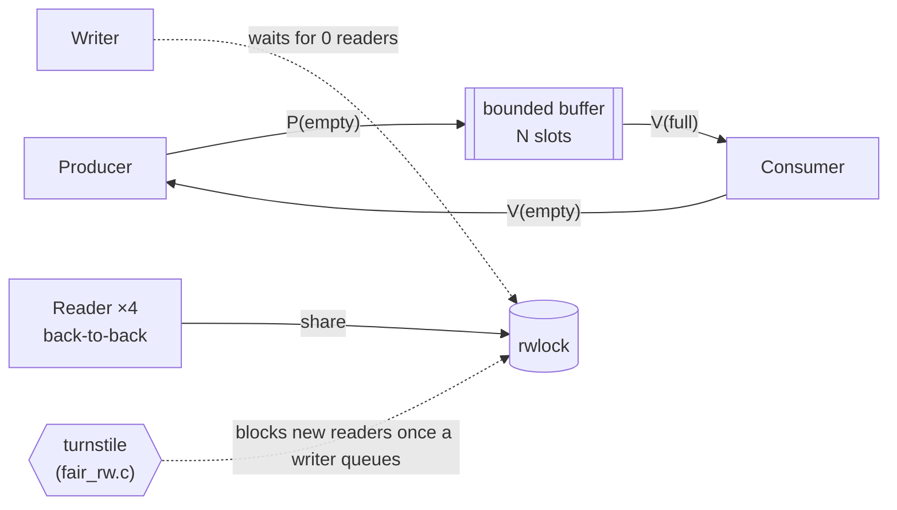

<div dir="rtl">

# ۱۰ — مسائل کلاسیک همگام‌سازی

> ماژول ۰۳ · همروندی و همگام‌سازی · Linux v6.18.63 · OpenBSD 8cada8c · نسخهٔ انگلیسی: [10-classic-problems.en.md](10-classic-problems.en.md)

## ۱. خلاصه

- چهار مسئلهٔ درسی تقریباً همهٔ الگوهای واقعی همگام‌سازی را پوشش می‌دهند: **Producer-Consumer** (بافر محدود)، **Readers-Writers**، **Dining Philosophers** و **Sleeping Barber**.
- هر کدام یک حالت خرابی را آموزش می‌دهد: lost wake-up و انتظار فعال (P-C)، starvation (R-W)، بن‌بست (فیلسوفان) و انتظار با صف محدود (آرایشگر).
- کرنل برای هر کدام نسخهٔ تولیدی دارد: `kfifo` همراه `wait_event()`، `rw_semaphore` با بیت handoff، `percpu_rw_semaphore`، ترتیب قفل و wait queueها.

## ۲. توضیح

### ۲.۱ Producer-Consumer (بافر محدود)

N خانه؛ تولیدکننده‌ها اضافه می‌کنند، مصرف‌کننده‌ها برمی‌دارند. باید منتظر دو شرط ماند: «پر نیست» برای تولیدکننده و «خالی نیست» برای مصرف‌کننده، به‌اضافهٔ mutual exclusion روی اندیس‌ها.

| پیاده‌سازی | وضعیت | انتظار | فایل آزمایش ۰۲ |
|---|---|---|---|
| Semaphore | <span dir="ltr">`empty = N`</span>، <span dir="ltr">`full = 0`</span>، mutex | <span dir="ltr">`sem_wait(&empty)`</span> / <span dir="ltr">`sem_wait(&full)`</span> | <span dir="ltr">`pc_sem.c`</span> |
| Mutex + دو condvar | `count`، head، tail | <span dir="ltr">`while (count == cap) cond_wait(&not_full)`</span> | <span dir="ltr">`pc_cond.c`</span> |
| کانال بافردار Go | صف runtime | <span dir="ltr">`ch <- v`</span> / <span dir="ltr">`v := <-ch`</span> مسدود می‌شوند | <span dir="ltr">`pc_chan.go`</span> |

نسخهٔ semaphore شرط‌ها را در شمارنده‌ها رمز می‌کند؛ نسخهٔ condvar آن‌ها را در predicateی که در حلقهٔ `while` دوباره بررسی می‌شود. با بیش از یک مصرف‌کننده، `if` به‌جای `while` باگ است: مصرف‌کنندهٔ بیدارشده ممکن است ببیند دیگری بافر را خالی کرده ([یادداشت ۰۶](06-semaphores-condition-variables.fa.md)). نسخهٔ Go هر دو را پشت runtime پنهان می‌کند و <span dir="ltr">`close(ch)`</span> یک سیگنال پایان تمیز می‌دهد که در C به poison pill نیاز دارد (تمرین تکمیلی آزمایش ۰۲، <span dir="ltr">`solution/pc_mpmc.c`</span>).

### ۲.۲ Readers-Writers

چند خواننده می‌توانند شریک باشند؛ نویسنده انحصار لازم دارد. بخش جالب این است که وقتی هر دو نوع می‌رسند **چه کسی منتظر می‌ماند**.

| گونه | قاعده | چه کسی گرسنه می‌ماند | مثال |
|---|---|---|---|
| مسئلهٔ اول (اولویت خواننده) | خواننده وارد می‌شود اگر *نویسندهٔ فعالی* نباشد، حتی اگر نویسنده منتظر باشد | **نویسنده‌ها** | پیش‌فرض glibc، `PTHREAD_RWLOCK_PREFER_READER_NP` |
| مسئلهٔ دوم (اولویت نویسنده) | وقتی نویسنده‌ای منتظر شد، خواننده‌های جدید منتظر می‌مانند | خواننده‌ها | `PTHREAD_RWLOCK_PREFER_WRITER_NONRECURSIVE_NP` |
| مسئلهٔ سوم (بدون starvation) | ترتیب ورود از طریق یک turnstile | هیچ‌کس (تقریباً FIFO) | turnstile داونی، <span dir="ltr">`solution/fair_rw.c`</span> آزمایش ۰۳؛ handoff در rwsem کرنل |

<span dir="ltr">`rw.c`</span> در آزمایش ۰۳ چهار خواننده را پشت سر هم داخل قفل نگه می‌دارد (هر کدام ۱۰۰ میکروثانیه)، پس با اولویت خواننده هیچ لحظه‌ای نیست که تعداد خواننده‌ها صفر باشد و نویسنده گرسنه می‌ماند.

نکته: مستندات glibc می‌گوید `PTHREAD_RWLOCK_PREFER_WRITER_NP` نادیده گرفته می‌شود؛ فقط گونهٔ `_NONRECURSIVE_NP` واقعاً نویسنده را ترجیح می‌دهد (اجازه نمی‌دهد خواننده در حالی که نویسنده منتظر است دوباره بازگشتی قفل بگیرد، که در غیر این صورت بن‌بست می‌شد). در برابر سورس glibc بررسی نشده و UNVERIFIED است (در checkoutهای ما نیست)؛ خروجی آزمایش رفتار را نشان می‌دهد.

### ۲.۳ Dining Philosophers

پنج فیلسوف، پنج چنگال، هر کدام چنگال هر دو همسایه را لازم دارد. اگر همه اول چنگال چپ را بردارند، همه یکی را نگه داشته‌اند و منتظر دیگری‌اند: یک circular wait کامل (یادداشت ۰۹).

| راه‌حل | کدام شرط Coffman را می‌شکند | هزینه |
|---|---|---|
| ترتیب سراسری: اول چنگال با شمارهٔ کوچک‌تر (یک فیلسوف «چپ‌دست» است) | circular wait | هیچ؛ جواب معمول کرنل |
| داور / گارسون: یک semaphore حداکثر ۴ نفر را سر میز راه می‌دهد | hold-and-wait (همیشه کسی می‌تواند تمام کند) | همروندی کم‌تر |
| `trylock` روی چنگال دوم و برگرداندن اولی در صورت شکست | hold-and-wait | خطر livelock بدون backoff تصادفی |
| Chandy-Misra: چنگال‌ها توکن‌های «کثیف/تمیز»اند که با پیام درخواست جابه‌جا می‌شوند | circular wait (گراف اولویت بی‌چرخه می‌ماند) | ارسال پیام؛ مناسب سیستم‌های توزیع‌شده (ماژول ۰۶) |

### ۲.۴ Sleeping Barber

یک آرایشگر، اتاق انتظار با K صندلی. مشتری‌ای که صندلی خالی پیدا نکند می‌رود؛ وگرنه منتظر می‌ماند؛ آرایشگر وقتی کسی نیست می‌خوابد. این همان Producer-Consumer است با این فرق که تولیدکننده وقتی پر است *مسدود نمی‌شود* (دور می‌ریزد). پیاده‌سازی معمول: semaphore به نام `customers`، semaphore به نام `barber`، و mutex دور شمارندهٔ صندلی خالی. نمونهٔ واقعی: حلقهٔ RX درایور شبکه که وقتی پر است بسته‌ها را دور می‌ریزد و poller از نوع NAPI که وقتی خالی است می‌خوابد.

### ۲.۵ این‌ها در لینوکس کجا هستند

| مسئله | ابزار کرنل | فایل |
|---|---|---|
| بافر محدود | `kfifo` (بدون قفل برای یک تولیدکننده و یک مصرف‌کننده)، `wait_event()` / `wake_up()` | <span dir="ltr">`include/linux/kfifo.h`</span>، <span dir="ltr">`include/linux/wait.h`</span> |
| Readers-Writers | `rw_semaphore` (خوابنده، با handoff)، `rwlock_t` (چرخنده، طرفدار خواننده) | <span dir="ltr">`kernel/locking/rwsem.c`</span>، <span dir="ltr">`kernel/locking/qrwlock.c`</span> |
| بیشتر خواندن، نویسندهٔ بسیار نادر | `percpu_rw_semaphore` (خواننده فقط به شمارندهٔ per-CPU دست می‌زند)، RCU | <span dir="ltr">`kernel/locking/percpu-rwsem.c`</span>، یادداشت ۰۸ |
| فیلسوفان | ترتیب قفل (`double_rq_lock()` در <span dir="ltr">`kernel/sched/core.c`</span> خط ۷۰۳ دو runqueue را مرتب می‌گیرد) | — |

## ۳. نمودار

</div>



<div dir="rtl">

## ۴. مثال حل‌شده

### ۴.۱ Turnstile (مسئلهٔ سوم خوانندگان-نویسندگان)

</div>

```c
// labs/03-readers-writers/solution/fair_rw.c · frw_rdlock / frw_wrlock (lab code)
static void frw_rdlock(struct fair_rw *l)
{
    sem_wait(&l->turnstile);              // blocks while a writer is waiting
    sem_post(&l->turnstile);
    sem_wait(&l->mutex);
    if (++l->readers == 1)
        sem_wait(&l->room_empty);         // first reader locks writers out
    sem_post(&l->mutex);
}

static void frw_wrlock(struct fair_rw *l)
{
    sem_wait(&l->turnstile);              // stop new readers from entering
    sem_wait(&l->room_empty);             // wait for current readers to drain
}
```

<div dir="rtl">

- خواننده از turnstile رد می‌شود (wait و بلافاصله post). نویسنده turnstile را تا unlock **نگه می‌دارد**، پس هر خواننده‌ای که بعد از او برسد پشتش صف می‌کشد. خواننده‌های فعلی خارج می‌شوند؛ بعد `room_empty` آزاد است و نویسنده وارد می‌شود.
- اولین خوانندهٔ واردشده `room_empty` را می‌گیرد و آخرین خوانندهٔ خارج‌شده آزادش می‌کند (الگوی کلاسیک «lightswitch»).

real run: gcc 13 in Docker on the Windows host (WSL2), not the course VM — VM numbers are in the lab README. چهار خواننده، ۲ ثانیه:

</div>

```text
pref=reader readers=4 secs=2 reads=79165 writes=1 (+1 after stop) writer_wait max=1.366s avg=0.999501s
pref=writer readers=4 secs=2 reads=64466 writes=1388 (+1 after stop) writer_wait max=0.008s avg=0.000161s
pref=fair   readers=4 secs=2 reads=51975 writes=1271 writer_wait max=0.012s avg=0.000250s
```

<div dir="rtl">

- اولویت خواننده: در ۲ ثانیه فقط **یک** نوشتن، با ۱٫۳۷ ثانیه انتظار. همان یک نوشتن هم فقط از یک شکاف کوتاه رد شد؛ دومی منتظر توقف خواننده‌ها ماند. این starvation است.
- اولویت نویسنده و turnstile: حدود ۱۳۰۰ نوشتن (نویسنده بین نوشتن‌ها ۱ میلی‌ثانیه می‌خوابد، پس سقف حدود ۱۹۰۰ است)، با بیشینهٔ انتظار در حد زمان نگه‌داشتن یک خواننده. هزینه را خواننده‌ها می‌دهند: ۱۹ تا ۳۵ درصد خواندن کم‌تر.

در همان محیط، Producer-Consumer با بافر ۱۶ خانه‌ای: <span dir="ltr">`sem ... ns/item=2390`</span> در برابر <span dir="ltr">`cond ... ns/item=2786 waits(full)=62516 waits(empty)=62566`</span>. شمارنده‌های انتظار نشان می‌دهند نخ‌ها تقریباً هر ۱۶ قلم جای خود را عوض کردند: هر طرف وقتی بافر پر یا خالی بود خوابید، و این همان هزینهٔ خواب و بیداری futex در یادداشت ۰۷ است.

### ۴.۲ جواب کرنل: rwsem با بیت handoff

</div>

```c
linux/kernel/locking/rwsem.c · count bits · v6.18.63 · L109-129
  109   * There are three places where the lock handoff bit may be set or cleared.
  110   * 1) rwsem_mark_wake() for readers		-- set, clear
  111   * 2) rwsem_try_write_lock() for writers	-- set, clear
  112   * 3) rwsem_del_waiter()			-- clear
  113   *
  114   * For all the above cases, wait_lock will be held. A writer must also
  115   * be the first one in the wait_list to be eligible for setting the handoff
  116   * bit. So concurrent setting/clearing of handoff bit is not possible.
  117   */
  118  #define RWSEM_WRITER_LOCKED	(1UL << 0)
  119  #define RWSEM_FLAG_WAITERS	(1UL << 1)
  120  #define RWSEM_FLAG_HANDOFF	(1UL << 2)
  121  #define RWSEM_FLAG_READFAIL	(1UL << (BITS_PER_LONG - 1))
  122  
  123  #define RWSEM_READER_SHIFT	8
  124  #define RWSEM_READER_BIAS	(1UL << RWSEM_READER_SHIFT)
  125  #define RWSEM_READER_MASK	(~(RWSEM_READER_BIAS - 1))
  126  #define RWSEM_WRITER_MASK	RWSEM_WRITER_LOCKED
  127  #define RWSEM_LOCK_MASK		(RWSEM_WRITER_MASK|RWSEM_READER_MASK)
  128  #define RWSEM_READ_FAILED_MASK	(RWSEM_WRITER_MASK|RWSEM_FLAG_WAITERS|\
  129  				 RWSEM_FLAG_HANDOFF|RWSEM_FLAG_READFAIL)
```

<div dir="rtl">

Elixir: <span dir="ltr">https://elixir.bootlin.com/linux/v6.18.63/source/kernel/locking/rwsem.c#L109</span>

- **خط ۱۱۸**: بیت ۰ یعنی یک نویسنده صاحب قفل است.
- **خط ۱۱۹**: بیت ۱ یعنی صف انتظار خالی نیست.
- **خط ۱۲۰**: بیت ۲ یعنی **handoff**: اولین منتظر بیش از حد صبر کرده و قفل باید به او داده شود، نه این‌که تازه‌واردی آن را بقاپد.
- **خط ۱۲۳ تا ۱۲۵**: تعداد خواننده‌ها بالای بیت ۸ نگه‌داری می‌شود؛ `down_read()` با یک `atomic_long_add_return_acquire` مقدار `RWSEM_READER_BIAS` را اضافه می‌کند (خط ۲۵۱).
- **خط ۱۲۸ و ۱۲۹**: مسیر سریع خواننده **شکست می‌خورد** اگر هر یک از این‌ها باشد: نویسنده، *وجود منتظر*، یا handoff. پس نویسندهٔ در صف باعث می‌شود خواننده‌های جدید هم صف بکشند: rwsem کرنل راه‌حلی برای «مسئلهٔ سوم» (بدون starvation) است، برخلاف rwlock پیش‌فرض glibc.
- **خط ۱۱۴ تا ۱۱۶**: فقط اولین منتظر، با در دست داشتن `wait_lock`، می‌تواند handoff را بگذارد، پس این بیت فقط یک نویسنده دارد.

## ۵. حالت‌های مرزی و دام‌ها

- **ترتیب semaphoreها مهم است**: در P-C، <span dir="ltr">`sem_wait(&empty)`</span> باید *قبل از* `mutex_lock` بیاید. برعکسش، تولیدکننده در حالی که روی `empty` خوابیده mutex را دارد و مصرف‌کننده نمی‌تواند mutex را بگیرد تا خانه‌ای آزاد کند: بن‌بست.
- **`signal` در برابر `broadcast`**: با یک condvar برای دو predicate (پر نیست / خالی نیست)، `signal` ممکن است نخ از نوع اشتباه را بیدار کند؛ دو condvar به کار ببرید (مثل <span dir="ltr">`pc_cond.c`</span>) یا `broadcast`.
- **اولویت نویسنده خواننده‌ها را گرسنه می‌کند** اگر نویسنده‌ها زیاد باشند؛ ناهار مجانی نیست، فقط انتخاب این‌که چه کسی صبر کند.
- **rwlock همیشه از mutex سریع‌تر نیست**: برای بخش‌های خواندنی کوتاه، cache line شمارندهٔ خواننده‌ها درست مثل mutex بین هسته‌ها جابه‌جا می‌شود. `percpu_rw_semaphore` یا RCU این را با ننوشتن در حافظهٔ مشترک در سمت خواندن حل می‌کنند.
- **قفل خواندنی بازگشتی همراه با اولویت نویسنده** بن‌بست می‌سازد: نخ قفل خواندن را دارد، نویسنده صف می‌کشد، نخ دوباره خواندن می‌خواهد ← پشت نویسنده منتظر می‌ماند، که خودش منتظر همین نخ است.
- **فیلسوفان با `trylock`** ممکن است هم‌گام دچار livelock شوند؛ backoff تصادفی اضافه کنید.
- **خاموش‌کردن** هم بخشی از مسئله است: مصرف‌کننده‌های مسدودشده در `get()` به نگهبان یا `close()` نیاز دارند؛ وگرنه `join` گیر می‌کند.

## ۶. نکته‌های کلیدی امتحان

- P-C: دو شرط (پر نیست، خالی نیست) به‌اضافهٔ mutual exclusion. با semaphore: <span dir="ltr">`empty=N`</span> و <span dir="ltr">`full=0`</span>؛ همیشه اول P روی شمارنده، بعد P روی mutex.
- انتظار condvar یعنی <span dir="ltr">`while (!pred) wait;`</span>؛ با چند مصرف‌کننده و بیداری کاذب الزامی است.
- R-W: مسئلهٔ اول نویسنده‌ها را گرسنه می‌کند، دومی خواننده‌ها را، سومی (turnstile / FIFO / handoff) هیچ‌کس را.
- rwlock پیش‌فرض glibc طرفدار خواننده است؛ `rw_semaphore` لینوکس وقتی منتظر وجود دارد خواننده‌های جدید را مسدود می‌کند و `RWSEM_FLAG_HANDOFF` دارد.
- فیلسوفان غذاخور = circular wait؛ راه‌حل: ترتیب (فیلسوف نامتقارن)، داور (حداکثر N−1 نفر نشسته)، یا Chandy-Misra.
- آرایشگر خوابیده = صف محدودی که وقتی پر است دور می‌ریزد.
- اعداد آزمایش ۰۳: اولویت خواننده ← حدود ۱ نوشتن در ۲ ثانیه؛ اولویت نویسنده یا منصفانه ← حدود ۱۳۰۰ نوشتن با انتظار در حد میلی‌ثانیه.

## ۷. پیوندها

- درس: [۴.۵ نخ‌ها چطور منتظر یک شرط می‌مانند؟](../lesson.fa.md#45-how-do-threads-wait-for-a-condition)
- مرور کد کرنل: [kernel-walkthrough.fa.md](../kernel-walkthrough.fa.md)
- یادداشت‌ها: [۰۶ semaphore و condvar](06-semaphores-condition-variables.fa.md) · [۰۷ futex](07-futex-user-kernel-split.fa.md) · [۰۸ RCU](08-rcu.fa.md) · [۰۹ بن‌بست](09-deadlock-coffman-lockdep.fa.md)
- آزمایش‌ها: [۰۲ تولیدکننده-مصرف‌کننده](../labs/02-producer-consumer/README.md) · [۰۳ خوانندگان-نویسندگان](../labs/03-readers-writers/README.md)
- آزمون: [پرسش ۱۳](../quiz.fa.md) (starvation در خوانندگان-نویسندگان) · [پرسش ۱۴](../quiz.fa.md) (`if` یا `while` در condvar)

</div>
