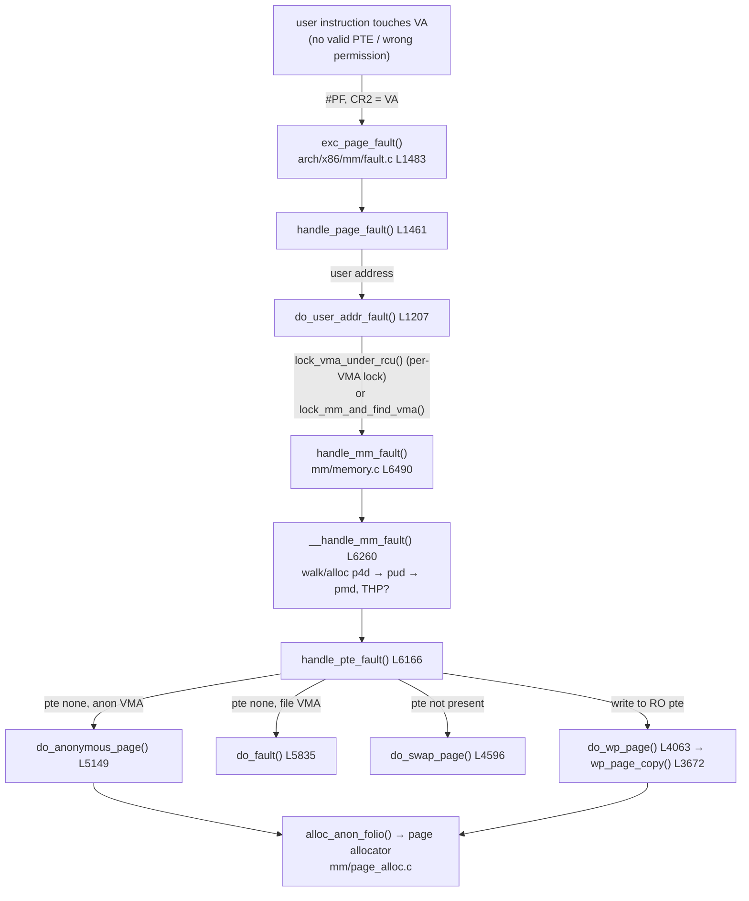

# 04 — Kernel walkthrough: from a faulting instruction to a mapped page

> Pins: Linux **v6.18.63** (`_shared/sources/linux/`), OpenBSD **`8cada8c`** (`_shared/sources/openbsd/`). All excerpts were printed with `bash _shared/sources/cite.sh` from the local checkout; nothing is typed from memory. `ARCH-SPECIFIC (x86-64)` for §1 and §7.
> Farsi version: [`kernel-walkthrough.fa.md`](kernel-walkthrough.fa.md) · Lesson: [`lesson.en.md`](lesson.en.md)

## 0. The call chain we follow



| § | File · function | Why it matters |
|---|---|---|
| 1 | `arch/x86/mm/fault.c` · `exc_page_fault()`, `do_user_addr_fault()` | where the CPU exception becomes a kernel decision |
| 2 | `mm/memory.c` · `handle_mm_fault()`, `__handle_mm_fault()` | architecture-independent entry; memcg OOM and MGLRU hooks |
| 3 | `mm/memory.c` · `handle_pte_fault()`, `do_anonymous_page()`, `do_wp_page()` | demand paging, the zero page, copy-on-write |
| 4 | `mm/mmap.c` · `do_mmap()` | mmap only creates a VMA; pages come later |
| 5 | `mm/page_alloc.c` · `__rmqueue_smallest()`, `expand()`, `__free_one_page()` | the buddy allocator split/merge |
| 6 | `mm/slub.c` · `__slab_alloc_node()` | lockless per-CPU fast path for small objects |
| 7 | `arch/x86/mm/tlb.c` · `choose_new_asid()`, `flush_tlb_mm_range()` | PCID reuse and TLB shootdowns |
| 8 | `mm/vmscan.c` · `shrink_lruvec()`, `kswapd()`; `mm/oom_kill.c` · `oom_badness()` | reclaim and the last resort |
| 9 | OpenBSD `sys/uvm/uvm_fault.c` · `uvm_fault()` | a different layering of the same problem |

---

## 1. The exception entry — `exc_page_fault()`

`linux/arch/x86/mm/fault.c · exc_page_fault() · v6.18.63` — [Elixir L1483](https://elixir.bootlin.com/linux/v6.18.63/source/arch/x86/mm/fault.c#L1483)

```c
DEFINE_IDTENTRY_RAW_ERRORCODE(exc_page_fault)
{
	irqentry_state_t state;
	unsigned long address;

	address = cpu_feature_enabled(X86_FEATURE_FRED) ? fred_event_data(regs) : read_cr2();
	/* ... 22-line comment on KVM async page faults (L1490-1510) ... */
	if (kvm_handle_async_pf(regs, (u32)address))
		return;
	/* ... comment on kernel-mode #PF entry (L1514-1523) ... */
	state = irqentry_enter(regs);

	instrumentation_begin();
	handle_page_fault(regs, error_code, address);
	instrumentation_end();

	irqentry_exit(regs, state);
}
```

| Line | Meaning |
|---|---|
| `DEFINE_IDTENTRY_RAW_ERRORCODE` | macro that generates the IDT vector 14 handler; the CPU pushes an **error code** (bits: P = present, W = write, U = user, I = instruction fetch, PK = protection key). `regs` and `error_code` are macro parameters. |
| `read_cr2()` | on #PF the CPU stores the faulting **virtual address** in CR2. With FRED (Flexible Return and Event Delivery, new Intel entry mechanism) it arrives in the event data instead. |
| `kvm_handle_async_pf` | when Linux is itself a KVM guest, the host can inject a "page not present" event through #PF. Not our case in VirtualBox. |
| `irqentry_enter/exit` | common entry code: RCU, lockdep, context tracking. Same family as syscall entry in Module 01. |
| `instrumentation_begin/end` | the entry is `noinstr`; tracing is only allowed between these marks (same rule as `do_syscall_64`, Module 00). |

`handle_page_fault()` (L1461) emits the `exceptions:page_fault_user/kernel` tracepoints and splits on `fault_in_kernel_space(address)`: kernel addresses go to `do_kern_addr_fault()` (vmalloc, spurious faults, oops), user addresses to `do_user_addr_fault()`.

### 1.1 Finding the VMA — `do_user_addr_fault()`

`linux/arch/x86/mm/fault.c · do_user_addr_fault() · v6.18.63 · L1322-1361` — [Elixir L1207](https://elixir.bootlin.com/linux/v6.18.63/source/arch/x86/mm/fault.c#L1207)

```c
	if (!(flags & FAULT_FLAG_USER))
		goto lock_mmap;

	vma = lock_vma_under_rcu(mm, address);
	if (!vma)
		goto lock_mmap;

	if (unlikely(access_error(error_code, vma))) {
		bad_area_access_error(regs, error_code, address, NULL, vma);
		count_vm_vma_lock_event(VMA_LOCK_SUCCESS);
		return;
	}
	fault = handle_mm_fault(vma, address, flags | FAULT_FLAG_VMA_LOCK, regs);
	if (!(fault & (VM_FAULT_RETRY | VM_FAULT_COMPLETED)))
		vma_end_read(vma);

	if (!(fault & VM_FAULT_RETRY)) {
		count_vm_vma_lock_event(VMA_LOCK_SUCCESS);
		goto done;
	}
	/* ... retry accounting, signal check (L1342-1353) ... */
lock_mmap:

retry:
	vma = lock_mm_and_find_vma(mm, address, regs);
	if (unlikely(!vma)) {
		bad_area_nosemaphore(regs, error_code, address);
		return;
	}
```

| Line | Meaning |
|---|---|
| `lock_vma_under_rcu` | **per-VMA lock** fast path (merged in 6.4): find the VMA in the maple tree under RCU and read-lock only that VMA, not the whole `mmap_lock`. Threads faulting in different VMAs no longer serialize. `VERSION-DEPENDENT` |
| `access_error` | compare the error code with `vma->vm_flags`: write to a VMA without `VM_WRITE`, exec without `VM_EXEC` → `SIGSEGV` (`SEGV_ACCERR`). |
| `FAULT_FLAG_VMA_LOCK` | tells the core that only the VMA lock is held; if the handler must sleep in a way that needs `mmap_lock` it returns `VM_FAULT_RETRY`. |
| `VMA_LOCK_SUCCESS/RETRY` | counters visible in `/proc/vmstat` as `vma_lock_success`, `vma_lock_retry` (with `CONFIG_PER_VMA_LOCK_STATS`). |
| `lock_mm_and_find_vma` | slow path: take `mmap_lock` for read, find the VMA, and grow the stack VMA if the address is just below it. |
| `bad_area_nosemaphore` | no VMA at all → `SIGSEGV` (`SEGV_MAPERR`): the classic NULL-pointer crash. |

---

## 2. The generic entry — `handle_mm_fault()`

`linux/mm/memory.c · handle_mm_fault() · v6.18.63 · L6490-6525` — [Elixir L6490](https://elixir.bootlin.com/linux/v6.18.63/source/mm/memory.c#L6490)

```c
vm_fault_t handle_mm_fault(struct vm_area_struct *vma, unsigned long address,
			   unsigned int flags, struct pt_regs *regs)
{
	/* If the fault handler drops the mmap_lock, vma may be freed */
	struct mm_struct *mm = vma->vm_mm;
	vm_fault_t ret;
	bool is_droppable;

	__set_current_state(TASK_RUNNING);

	ret = sanitize_fault_flags(vma, &flags);
	if (ret)
		goto out;
	/* ... arch_vma_access_permitted() → VM_FAULT_SIGSEGV (L6504-6509) ... */
	is_droppable = !!(vma->vm_flags & VM_DROPPABLE);

	if (flags & FAULT_FLAG_USER)
		mem_cgroup_enter_user_fault();

	lru_gen_enter_fault(vma);

	if (unlikely(is_vm_hugetlb_page(vma)))
		ret = hugetlb_fault(vma->vm_mm, vma, address, flags);
	else
		ret = __handle_mm_fault(vma, address, flags);
```

| Line | Meaning |
|---|---|
| `vm_fault_t` | a bitmask result: `VM_FAULT_OOM`, `VM_FAULT_SIGBUS`, `VM_FAULT_SIGSEGV`, `VM_FAULT_MAJOR`, `VM_FAULT_RETRY`… The arch code turns it into a signal or a retry. |
| `sanitize_fault_flags` | rejects impossible combinations (e.g. `FAULT_FLAG_UNSHARE` on a shared mapping). |
| `mem_cgroup_enter_user_fault` | arms **memcg OOM** handling for user faults; this is how the cgroup OOM kill in Lab 06 is triggered from a page fault. |
| `lru_gen_enter_fault` | MGLRU bookkeeping: remember the faulting VMA so reclaim can spot refaults. |
| `hugetlb_fault` | explicit `hugetlbfs` pages (pre-reserved pool) take a separate path; THP does not — it goes through `__handle_mm_fault`. |

After the call (L6533–6553): `lru_gen_exit_fault()`, clear `VM_FAULT_OOM` for droppable mappings, `mem_cgroup_oom_synchronize()`, and `mm_account_fault()` — which increments `current->maj_flt` or `min_flt` (what `getrusage()` and `perf stat -e major-faults,minor-faults` report in Lab 01) and emits the perf software event.

### 2.1 Walking the levels — `__handle_mm_fault()`

`linux/mm/memory.c · __handle_mm_fault() · v6.18.63 · L6260-6327` — [Elixir L6260](https://elixir.bootlin.com/linux/v6.18.63/source/mm/memory.c#L6260)

```c
	struct vm_fault vmf = {
		.vma = vma,
		.address = address & PAGE_MASK,
		.real_address = address,
		.flags = flags,
		.pgoff = linear_page_index(vma, address),
		.gfp_mask = __get_fault_gfp_mask(vma),
	};
	/* ... */
	pgd = pgd_offset(mm, address);
	p4d = p4d_alloc(mm, pgd, address);
	if (!p4d)
		return VM_FAULT_OOM;

	vmf.pud = pud_alloc(mm, p4d, address);
	/* ... PUD-sized THP (L6285-6310) ... */
	vmf.pmd = pmd_alloc(mm, vmf.pud, address);
	if (!vmf.pmd)
		return VM_FAULT_OOM;
	/* ... */
	if (pmd_none(*vmf.pmd) &&
	    thp_vma_allowable_order(vma, vm_flags, TVA_PAGEFAULT, PMD_ORDER)) {
		ret = create_huge_pmd(&vmf);
```

| Line | Meaning |
|---|---|
| `struct vm_fault vmf` | one descriptor carried through every handler: VMA, page-aligned address, file page index (`pgoff`), allocation flags. |
| `pgd_offset` → `p4d_alloc` → `pud_alloc` → `pmd_alloc` | the software walk of the 4/5-level table (note 02). Missing intermediate tables are **allocated here** — a page fault can allocate up to 4 page-table pages, which is why it can return `VM_FAULT_OOM`. With 4-level paging the p4d level is folded (`p4d_alloc` returns the pgd entry). |
| `thp_vma_allowable_order(..., PMD_ORDER)` | THP: if the PMD is empty and the VMA allows it (`/sys/kernel/mm/transparent_hugepage/enabled`, `MADV_HUGEPAGE`, alignment), map a whole **2 MiB** page with one PMD entry and no PTE table. Lab 01 `thp` and Lab 04 depend on this. |

---

## 3. Deciding what kind of fault it is — `handle_pte_fault()`

`linux/mm/memory.c · handle_pte_fault() · v6.18.63 · L6209-6229` — [Elixir L6166](https://elixir.bootlin.com/linux/v6.18.63/source/mm/memory.c#L6166)

```c
	if (!vmf->pte)
		return do_pte_missing(vmf);

	if (!pte_present(vmf->orig_pte))
		return do_swap_page(vmf);

	if (pte_protnone(vmf->orig_pte) && vma_is_accessible(vmf->vma))
		return do_numa_page(vmf);

	spin_lock(vmf->ptl);
	entry = vmf->orig_pte;
	if (unlikely(!pte_same(ptep_get(vmf->pte), entry))) {
		update_mmu_tlb(vmf->vma, vmf->address, vmf->pte);
		goto unlock;
	}
	if (vmf->flags & (FAULT_FLAG_WRITE|FAULT_FLAG_UNSHARE)) {
		if (!pte_write(entry))
			return do_wp_page(vmf);
		else if (likely(vmf->flags & FAULT_FLAG_WRITE))
			entry = pte_mkdirty(entry);
	}
	entry = pte_mkyoung(entry);
```

| Line | Meaning |
|---|---|
| `!vmf->pte` | no PTE yet → **demand paging**. `do_pte_missing()` (L4371) picks `do_anonymous_page()` for anonymous VMAs and `do_fault()` for file VMAs. |
| `!pte_present` | the PTE holds a **swap entry** (or migration entry) instead of a PFN → `do_swap_page()` reads it back: a major fault if I/O is needed. |
| `pte_protnone` | NUMA balancing made the PTE inaccessible on purpose to sample which node touches the page → `do_numa_page()` may migrate it (note 10). |
| `spin_lock(vmf->ptl)` / `pte_same` | page-table lock; if another thread already fixed this PTE, there is nothing to do (the fault was a race). |
| `!pte_write` on a write | write to a read-only PTE in a writable VMA → **copy-on-write** (`do_wp_page`). |
| `pte_mkdirty` / `pte_mkyoung` | set the software view of Dirty and Accessed bits; reclaim reads "young" to decide what is hot. |

### 3.1 Anonymous demand paging and the zero page — `do_anonymous_page()`

`linux/mm/memory.c · do_anonymous_page() · v6.18.63 · L5158-5198` — [Elixir L5149](https://elixir.bootlin.com/linux/v6.18.63/source/mm/memory.c#L5149)

```c
	/* File mapping without ->vm_ops ? */
	if (vma->vm_flags & VM_SHARED)
		return VM_FAULT_SIGBUS;

	/*
	 * Use pte_alloc() instead of pte_alloc_map(), so that OOM can
	 * be distinguished from a transient failure of pte_offset_map().
	 */
	if (pte_alloc(vma->vm_mm, vmf->pmd))
		return VM_FAULT_OOM;

	/* Use the zero-page for reads */
	if (!(vmf->flags & FAULT_FLAG_WRITE) &&
			!mm_forbids_zeropage(vma->vm_mm)) {
		entry = pte_mkspecial(pfn_pte(my_zero_pfn(vmf->address),
						vma->vm_page_prot));
		/* ... lock, recheck, userfaultfd (L5174-5189) ... */
		goto setpte;
	}

	/* Allocate our own private page. */
	ret = vmf_anon_prepare(vmf);
	if (ret)
		return ret;
	/* Returns NULL on OOM or ERR_PTR(-EAGAIN) if we must retry the fault */
	folio = alloc_anon_folio(vmf);
```

| Line | Meaning |
|---|---|
| `pte_alloc` | allocate the last-level PTE table if the PMD was empty. |
| zero page | a **read** of never-written anonymous memory maps the single global zero-filled page, read-only. RSS barely grows (Lab 01 `anon-read`). The first write later takes a COW fault from the zero page. |
| `vmf_anon_prepare` | sets up the `anon_vma` (reverse-map anchor used by reclaim and COW). |
| `alloc_anon_folio` | allocates a zeroed **folio** (one or more contiguous pages; mTHP can give 16 KiB–1 MiB orders, `VERSION-DEPENDENT`) from the page allocator, charged to the memcg. |

### 3.2 Copy-on-write — `do_wp_page()`

`linux/mm/memory.c · do_wp_page() · v6.18.63 · L4126-4155` — [Elixir L4063](https://elixir.bootlin.com/linux/v6.18.63/source/mm/memory.c#L4063)

```c
	/*
	 * Private mapping: create an exclusive anonymous page copy if reuse
	 * is impossible. We might miss VM_WRITE for FOLL_FORCE handling.
	 *
	 * If we encounter a page that is marked exclusive, we must reuse
	 * the page without further checks.
	 */
	if (folio && folio_test_anon(folio) &&
	    (PageAnonExclusive(vmf->page) || wp_can_reuse_anon_folio(folio, vma))) {
		if (!PageAnonExclusive(vmf->page))
			SetPageAnonExclusive(vmf->page);
		if (unlikely(unshare)) {
			pte_unmap_unlock(vmf->pte, vmf->ptl);
			return 0;
		}
		wp_page_reuse(vmf, folio);
		return 0;
	}
	/*
	 * Ok, we need to copy. Oh, well..
	 */
	if (folio)
		folio_get(folio);

	pte_unmap_unlock(vmf->pte, vmf->ptl);
	/* ... KSM counter ... */
	return wp_page_copy(vmf);
```

| Line | Meaning |
|---|---|
| `PageAnonExclusive` | a per-page flag: "only this process maps this anon page". After `fork()` it is cleared in both parent and child. Lab 02 sees the same story from outside: its `excl` column is pagemap bit 56, "page mapped by exactly one process", which drops to 0 after `fork` and returns to 1 once one side has its own copy. |
| `wp_can_reuse_anon_folio` | (L4000) if the refcount says we are the last user (`folio_ref_count(folio) > 1 + swapcache` is false), just make the PTE writable — no copy. This is why the **parent** often keeps its page after the child exits. |
| `wp_page_reuse` | flip the PTE to writable+dirty; no new page. |
| `wp_page_copy` | (L3672) allocate a new folio (`folio_prealloc`), copy 4 KiB (`__wp_page_copy_user`), install the new PTE, flush the old TLB entry, drop a reference on the old folio. One COW = one minor fault + one page copy. |

The shared-mapping case just above (L4111–4124) never copies: `MAP_SHARED` pages are made writable in place (`wp_page_shared`) and, for files, marked dirty for writeback. Lab 03 shows the visible consequence.

---

## 4. `mmap()` only creates a VMA — `do_mmap()`

`linux/mm/mmap.c · do_mmap() · v6.18.63 · L550-563` — [Elixir L334](https://elixir.bootlin.com/linux/v6.18.63/source/mm/mmap.c#L334)

```c
		if (sysctl_overcommit_memory != OVERCOMMIT_NEVER)
			vm_flags |= VM_NORESERVE;

		/* hugetlb applies strict overcommit unless MAP_NORESERVE */
		if (file && is_file_hugepages(file))
			vm_flags |= VM_NORESERVE;
	}

	addr = mmap_region(file, addr, len, vm_flags, pgoff, uf);
	if (!IS_ERR_VALUE(addr) &&
	    ((vm_flags & VM_LOCKED) ||
	     (flags & (MAP_POPULATE | MAP_NONBLOCK)) == MAP_POPULATE))
		*populate = len;
	return addr;
```

| Line | Meaning |
|---|---|
| `VM_NORESERVE` | with `MAP_NORESERVE` and overcommit not set to "never", no commit charge is taken — this is how `malloc(100 GB)` can "succeed". |
| `mmap_region` | find/merge/insert a `vm_area_struct` in the maple tree. **No page is allocated, no PTE is written.** |
| `*populate = len` | only `MAP_POPULATE` or `mlock` (`VM_LOCKED`) make the caller pre-fault the range (`__mm_populate`), i.e. run the fault path in advance. |

Earlier in the same function (L462–464) `MAP_SHARED` of a file sets `VM_SHARED | VM_MAYSHARE`, and clears `VM_SHARED` if the file was opened read-only — the bit that later sends write faults to `wp_page_shared` instead of `wp_page_copy`.

---

## 5. The buddy allocator — split and merge

`linux/mm/page_alloc.c · __rmqueue_smallest() · v6.18.63 · L1932-1955` — [Elixir L1932](https://elixir.bootlin.com/linux/v6.18.63/source/mm/page_alloc.c#L1932)

```c
struct page *__rmqueue_smallest(struct zone *zone, unsigned int order,
						int migratetype)
{
	unsigned int current_order;
	struct free_area *area;
	struct page *page;

	/* Find a page of the appropriate size in the preferred list */
	for (current_order = order; current_order < NR_PAGE_ORDERS; ++current_order) {
		area = &(zone->free_area[current_order]);
		page = get_page_from_free_area(area, migratetype);
		if (!page)
			continue;

		page_del_and_expand(zone, page, order, current_order,
				    migratetype);
		/* ... tracepoint ... */
		return page;
	}

	return NULL;
}
```

| Line | Meaning |
|---|---|
| `zone->free_area[order]` | one free list per **order** (block of 2^order pages; order 0 = 4 KiB, order 10 = 4 MiB) and per **migratetype** (movable, unmovable, reclaimable…) — `/proc/buddyinfo` prints the counts. |
| loop upward | take the smallest order that has a free block ≥ the request. |
| `page_del_and_expand` | remove the block and call `expand()` (L1745): repeatedly halve it, putting the upper half back on the next-lower free list (`__add_to_free_list(&page[size], zone, high, …)`), until it matches `order`. |

`linux/mm/page_alloc.c · __free_one_page() · v6.18.63 · L999-1049` — [Elixir L979](https://elixir.bootlin.com/linux/v6.18.63/source/mm/page_alloc.c#L979)

```c
	while (order < MAX_PAGE_ORDER) {
		int buddy_mt = migratetype;
		/* ... compaction capture ... */
		buddy = find_buddy_page_pfn(page, pfn, order, &buddy_pfn);
		if (!buddy)
			goto done_merging;
		/* ... do not merge across incompatible pageblock types (L1011-1024) ... */
		if (page_is_guard(buddy)) {
			clear_page_guard(zone, buddy, order);
			account_freepages(zone, 1 << order, migratetype);
		} else {
			__del_page_from_free_list(buddy, zone, order, buddy_mt);
		}
		/* ... */
		combined_pfn = buddy_pfn & pfn;
		page = page + (combined_pfn - pfn);
		pfn = combined_pfn;
		order++;
	}
```

| Line | Meaning |
|---|---|
| `find_buddy_page_pfn` | buddy PFN = `pfn ^ (1 << order)` (`__find_buddy_pfn`, `mm/internal.h` L678-681), then check that page is free and of the same order. |
| merge | take the buddy off its free list and treat the pair as one block of `order+1`. |
| `combined_pfn = buddy_pfn & pfn` | the merged block starts at the lower of the two addresses. |
| `order++` | repeat until the buddy is busy or `MAX_PAGE_ORDER` (10) is reached → external fragmentation is only fixed when *both* halves are free. |

Note: most order-0 frees never reach this loop immediately; they go to the **per-CPU page lists** (PCP) first and are drained in batches.

---

## 6. SLUB — the lockless per-CPU fast path

`linux/mm/slub.c · __slab_alloc_node() · v6.18.63 · L4887-4938` — [Elixir L4846](https://elixir.bootlin.com/linux/v6.18.63/source/mm/slub.c#L4846)

```c
	object = c->freelist;
	slab = c->slab;
	/* ... CONFIG_NUMA strict_numa mempolicy (L4890-4910) ... */
	if (!USE_LOCKLESS_FAST_PATH() ||
	    unlikely(!object || !slab || !node_match(slab, node))) {
		object = __slab_alloc(s, gfpflags, node, addr, c, orig_size);
	} else {
		void *next_object = get_freepointer_safe(s, object);

		/*
		 * The cmpxchg will only match if there was no additional
		 * operation and if we are on the right processor.
		 * ...
		 */
		if (unlikely(!__update_cpu_freelist_fast(s, object, next_object, tid))) {
			note_cmpxchg_failure("slab_alloc", s, tid);
			goto redo;
		}
		prefetch_freepointer(s, next_object);
		stat(s, ALLOC_FASTPATH);
	}

	return object;
```

| Line | Meaning |
|---|---|
| `c = raw_cpu_ptr(s->cpu_slab)` (L4867) | each CPU owns one "current" slab per cache, with its own free list. |
| `c->freelist` | free objects are chained through a **free pointer stored inside the free object itself**. |
| `get_freepointer_safe` | read the next free object (the pointer may be obfuscated with `CONFIG_SLAB_FREELIST_HARDENED`). |
| `__update_cpu_freelist_fast` | a `cmpxchg` on the pair (freelist, tid) — no lock, no IRQ disable. `tid` (transaction id) detects preemption/migration in between; on mismatch, `goto redo`. |
| `__slab_alloc` | slow path: take another partial slab, or get a new slab from the page allocator (buddy). |

`VERSION-DEPENDENT`: v6.18 also adds **sheaves** (per-CPU object arrays, `ALLOC_PCS` at `mm/slub.c` L371) for caches that opt in; the classic `cpu_slab` path above is still the default for most caches. The old SLAB allocator was removed in 6.8, so `/proc/slabinfo` on this kernel is always SLUB.

---

## 7. TLB: PCID reuse and shootdowns — `ARCH-SPECIFIC (x86-64)`

`linux/arch/x86/mm/tlb.c · choose_new_asid() · v6.18.63 · L252-273` — [Elixir L224](https://elixir.bootlin.com/linux/v6.18.63/source/arch/x86/mm/tlb.c#L224)

```c
	for (asid = 0; asid < TLB_NR_DYN_ASIDS; asid++) {
		if (this_cpu_read(cpu_tlbstate.ctxs[asid].ctx_id) !=
		    next->context.ctx_id)
			continue;

		ns.asid = asid;
		ns.need_flush = (this_cpu_read(cpu_tlbstate.ctxs[asid].tlb_gen) < next_tlb_gen);
		return ns;
	}

	/*
	 * We don't currently own an ASID slot on this CPU.
	 * Allocate a slot.
	 */
	ns.asid = this_cpu_add_return(cpu_tlbstate.next_asid, 1) - 1;
	if (ns.asid >= TLB_NR_DYN_ASIDS) {
		ns.asid = 0;
		this_cpu_write(cpu_tlbstate.next_asid, 1);
	}
	ns.need_flush = true;

	return ns;
```

| Line | Meaning |
|---|---|
| `TLB_NR_DYN_ASIDS` | **6** (`arch/x86/include/asm/tlbflush.h` L66): each CPU caches the last 6 address spaces it ran, each tagged with its own PCID, so switching back to one of them does not flush its TLB entries. |
| `ctx_id` match | this mm already has a slot here → reuse it. |
| `tlb_gen` | per-mm generation counter; if the mm's page tables changed since this CPU last flushed (`tlb_gen` < `next_tlb_gen`), flush now. |
| round-robin | no slot → evict one in round-robin order and flush. |

`linux/arch/x86/mm/tlb.c · flush_tlb_mm_range() · v6.18.63 · L1456-1478` — [Elixir L1448](https://elixir.bootlin.com/linux/v6.18.63/source/arch/x86/mm/tlb.c#L1448)

```c
	/* This is also a barrier that synchronizes with switch_mm(). */
	new_tlb_gen = inc_mm_tlb_gen(mm);

	info = get_flush_tlb_info(mm, start, end, stride_shift, freed_tables,
				  new_tlb_gen);
	/* ... */
	if (mm_global_asid(mm)) {
		broadcast_tlb_flush(info);
	} else if (cpumask_any_but(mm_cpumask(mm), cpu) < nr_cpu_ids) {
		info->trim_cpumask = should_trim_cpumask(mm);
		flush_tlb_multi(mm_cpumask(mm), info);
		consider_global_asid(mm);
	} else if (mm == this_cpu_read(cpu_tlbstate.loaded_mm)) {
		lockdep_assert_irqs_enabled();
		local_irq_disable();
		flush_tlb_func(info);
		local_irq_enable();
	}
```

| Line | Meaning |
|---|---|
| `inc_mm_tlb_gen` | bump the mm's generation; CPUs that switch to this mm later will see they are behind and flush. |
| `mm_global_asid` + `broadcast_tlb_flush` | new in 6.15+: on CPUs with AMD **INVLPGB** (or Intel RAR), busy multi-threaded processes get one global ASID and are flushed by a hardware broadcast — no IPIs. `VERSION-DEPENDENT` |
| `flush_tlb_multi(mm_cpumask(mm), …)` | otherwise send an **IPI** to every other CPU that may cache this mm's translations — the **TLB shootdown**. Its cost grows with thread count and CPU spread. |
| local only | single-CPU mm: flush locally (`INVLPG` per page, or a full flush above `tlb_single_page_flush_ceiling` = 33 pages, L1394). |

---

## 8. Reclaim and OOM

`linux/mm/vmscan.c · shrink_lruvec() · v6.18.63 · L5799-5815` — [Elixir L5799](https://elixir.bootlin.com/linux/v6.18.63/source/mm/vmscan.c#L5799)

```c
static void shrink_lruvec(struct lruvec *lruvec, struct scan_control *sc)
{
	unsigned long nr[NR_LRU_LISTS];
	unsigned long targets[NR_LRU_LISTS];
	unsigned long nr_to_scan;
	enum lru_list lru;
	unsigned long nr_reclaimed = 0;
	unsigned long nr_to_reclaim = sc->nr_to_reclaim;
	bool proportional_reclaim;
	struct blk_plug plug;

	if (lru_gen_enabled() && !root_reclaim(sc)) {
		lru_gen_shrink_lruvec(lruvec, sc);
		return;
	}

	get_scan_count(lruvec, sc, nr);
```

| Line | Meaning |
|---|---|
| `lruvec` | the LRU lists of one (memcg, NUMA node) pair. |
| `lru_gen_enabled()` | **MGLRU** is on (`/sys/kernel/mm/lru_gen/enabled`): cgroup reclaim goes to the generation-based code; root (global) reclaim with MGLRU is dispatched earlier in `shrink_node()` via `lru_gen_shrink_node()`. |
| `get_scan_count` | classic two-list LRU: decide how many anon vs file pages to scan from `swappiness` and recent refault cost, then `shrink_active_list`/`shrink_inactive_list`. |

`linux/mm/vmscan.c · kswapd() · v6.18.63 · L7380-7385` — [Elixir L7319](https://elixir.bootlin.com/linux/v6.18.63/source/mm/vmscan.c#L7319)

```c
		trace_mm_vmscan_kswapd_wake(pgdat->node_id, highest_zoneidx,
						alloc_order);
		reclaim_order = balance_pgdat(pgdat, alloc_order,
						highest_zoneidx);
		if (reclaim_order < alloc_order)
			goto kswapd_try_sleep;
```

One `kswapd` thread per NUMA node sleeps until an allocation finds a zone below its **low watermark** (`wakeup_kswapd`), then `balance_pgdat()` reclaims until the **high watermark**. If allocation hits the **min watermark**, the allocating task does **direct reclaim** itself — the latency spike that users notice.

`linux/mm/oom_kill.c · oom_badness() · v6.18.63 · L219-239` — [Elixir L202](https://elixir.bootlin.com/linux/v6.18.63/source/mm/oom_kill.c#L202)

```c
	adj = (long)p->signal->oom_score_adj;
	if (adj == OOM_SCORE_ADJ_MIN ||
			mm_flags_test(MMF_OOM_SKIP, p->mm) ||
			in_vfork(p)) {
		task_unlock(p);
		return LONG_MIN;
	}

	/*
	 * The baseline for the badness score is the proportion of RAM that each
	 * task's rss, pagetable and swap space use.
	 */
	points = get_mm_rss(p->mm) + get_mm_counter(p->mm, MM_SWAPENTS) +
		mm_pgtables_bytes(p->mm) / PAGE_SIZE;
	task_unlock(p);

	/* Normalize to oom_score_adj units */
	adj *= totalpages / 1000;
	points += adj;

	return points;
```

| Line | Meaning |
|---|---|
| `OOM_SCORE_ADJ_MIN` (-1000) | never kill this task (e.g. `sshd` can be protected this way). |
| `points = rss + swap + pagetables` | the score is just **memory footprint in pages** — no CPU time, no age, no "niceness" heuristics (those were removed in 2.6.36). |
| `adj *= totalpages / 1000` | `oom_score_adj` shifts the score by ‰ of the available memory (for a memcg OOM, `totalpages` = the cgroup limit). |

---

## 9. OpenBSD comparison — UVM

OpenBSD's VM is **UVM** (Chuck Cranor, 1998), written to replace the Mach-derived BSD VM. The fault handler is one function with a restart loop and two "layers".

`openbsd/sys/arch/amd64/amd64/trap.c · upageflttrap() · 8cada8c · L182-199`

```c
int
upageflttrap(struct trapframe *frame, uint64_t cr2)
{
	struct proc *p = curproc;
	vaddr_t va = trunc_page((vaddr_t)cr2);
	vm_prot_t access_type = pgex2access(frame->tf_err);
	union sigval sv;
	int signal, sicode, error;

	/*
	 * If NX is not enabled, we can't distinguish between PROT_READ
	 * and PROT_EXEC access, so try both.
	 */
	error = uvm_fault(&p->p_vmspace->vm_map, va, 0, access_type);
	if (pg_nx == 0 && error == EACCES && access_type == PROT_READ)
		error = uvm_fault(&p->p_vmspace->vm_map, va, 0, PROT_EXEC);
	if (error == 0) {
		uvm_grow(p, va);
		return 1;
	}
```

`openbsd/sys/uvm/uvm_fault.c · uvm_fault() · 8cada8c · L624-660`

```c
	error = ERESTART;
	while (error == ERESTART) { /* ReFault: */
		anons = anons_store;

		error = uvm_fault_check(&ufi, &flt, &anons, fault_type);
		if (error != 0)
			continue;

		/* True if there is an anon at the faulting address */
		shadowed = uvm_fault_upper_lookup(&ufi, &flt, anons, pages);
		if (shadowed == TRUE) {
			/* case 1: fault on an anon in our amap */
			error = uvm_fault_upper(&ufi, &flt, anons);
		} else {
			struct uvm_object *uobj = ufi.entry->object.uvm_obj;
			/* ... pgo_fault hook for device/special objects (L639-655) ... */
			} else {
				/* case 2: fault on backing obj or zero fill */
				error = uvm_fault_lower(&ufi, &flt, pages);
			}
		}
	}
```

| Line | Meaning |
|---|---|
| `trunc_page(cr2)`, `pgex2access(tf_err)` | same inputs as Linux: CR2 and the error code, turned into a VM protection. |
| `uvm_fault(&vm_map, ...)` | one machine-independent entry, called with the process **vm_map** (a red-black tree of `vm_map_entry`, the VMA equivalent). |
| `while (error == ERESTART)` | "ReFault": any step that had to drop locks returns `ERESTART` and the whole lookup is redone — the analogue of Linux `VM_FAULT_RETRY`. |
| `uvm_fault_check` | find the map entry, check protection, and resolve **needs-copy** (lazy amap copy after `fork`). |
| upper layer (**amap** of **anons**) | anonymous memory: each private page is a `vm_anon` with a reference count, grouped in an `amap` per map entry. |
| lower layer (**uvm_object**) | the backing object (vnode, aobj for shared anon). `uvm_fault_lower` either maps the object's page or "promotes" a private copy into a new anon (COW or zero-fill). |

The COW decision in UVM is an explicit reference count on the anon:

`openbsd/sys/uvm/uvm_fault.c · uvm_fault_upper() · 8cada8c · L1069-1081`

```c
	if ((flt->access_type & PROT_WRITE) != 0 && anon->an_ref > 1) {
		/* promoting requires a write lock. */
		error = uvm_fault_upper_upgrade(flt, amap);
		if (error != 0) {
			uvmfault_unlockall(ufi, amap, NULL);
			return error;
		}
		KASSERT(rw_write_held(amap->am_lock));

		counters_inc(uvmexp_counters, flt_acow);
		oanon = anon;		/* oanon = old */

		error = uvmfault_promote(ufi, oanon->an_page, &anon, &pg);
```

Linux reaches the same decision with `PageAnonExclusive` + the folio refcount (`wp_can_reuse_anon_folio`), without a separate anon object.

### Trade-off table

| Design choice | Linux v6.18.63 | OpenBSD 8cada8c | Trade-off |
|---|---|---|---|
| Fault entry | `exc_page_fault` → `do_user_addr_fault` → `handle_mm_fault` | `upageflttrap` → `uvm_fault` | equivalent layering; Linux splits arch/generic more finely |
| Region structure | `vm_area_struct` in a **maple tree** (RCU-safe B-tree) | `vm_map_entry` in a red-black tree (`uvm_map.c`) | maple tree allows lockless lookup under RCU |
| Locking on fault | **per-VMA lock** first, `mmap_lock` fallback | map read lock + amap/object rwlocks (`upper_lock_type = RW_READ` on amd64/arm64) | Linux scales multi-threaded faults better; UVM's lock order is simpler to audit |
| Anonymous memory | anon folios + `anon_vma` reverse map; COW via refcount + `PageAnonExclusive` | explicit `vm_anon` objects with `an_ref`, grouped in `vm_amap` | UVM COW is easy to read; Linux saves memory (no per-page anon object) |
| Retry protocol | `VM_FAULT_RETRY` back to the arch code | `ERESTART` loop inside `uvm_fault` | same idea |
| Physical allocator | buddy allocator, per-order free lists + PCP lists | `uvm_pmemrange` (free ranges in RB-trees by address and size) | buddy is O(1) for small orders; pmemrange handles arbitrary ranges/alignment constraints |
| Small objects | SLUB (per-CPU slabs, lockless cmpxchg) | `pool(9)` (`sys/kern/subr_pool.c`) with per-CPU caches | similar ideas; SLUB is more tuned for many-core |
| Page replacement | MGLRU (generations) or two-list active/inactive | `uvm_pdaemon.c`: active/inactive queues, `uvmpd_scan_inactive` | MGLRU adapts better to mixed workloads; classic queues are simpler |
| Huge pages | THP (PMD, mTHP, PUD for DAX), hugetlbfs | none for user memory (`grep -ri "superpage\|huge" sys/uvm` finds no such code) | Linux trades complexity for TLB reach |

## 10. How to check anything here yourself

```bash
cd _shared/sources/linux
git grep -n "^vm_fault_t handle_mm_fault" mm/          # mm/memory.c:6490
bash ../cite.sh linux mm/memory.c do_wp_page 30         # print + cite
grep -n "TLB_NR_DYN_ASIDS" arch/x86/include/asm/tlbflush.h
# on the VM: see the path live
sudo bpftrace -e 'kprobe:do_wp_page { @[comm] = count(); } interval:s:5 { exit(); }'
```
