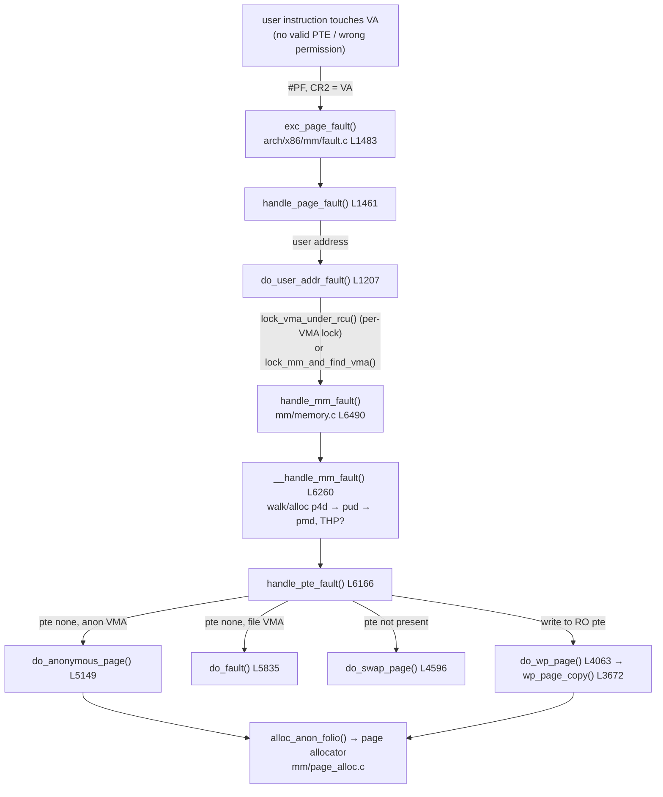

<div dir="rtl">

# ۰۴ — گشت در کد کرنل: از دستوری که fault می‌دهد تا صفحه‌ای که map می‌شود

> نسخه‌های ثابت: Linux **v6.18.63** (`_shared/sources/linux/`) و OpenBSD **`8cada8c`** (`_shared/sources/openbsd/`). همهٔ بخش‌های کد با `bash _shared/sources/cite.sh` از checkout محلی چاپ شده‌اند و هیچ‌کدام از حافظه نوشته نشده است. بخش‌های ۱ و ۷ `ARCH-SPECIFIC (x86-64)` هستند.
> نسخهٔ انگلیسی: [`kernel-walkthrough.en.md`](kernel-walkthrough.en.md) · درس: [`lesson.fa.md`](lesson.fa.md)

## ۰. زنجیرهٔ فراخوانی‌ای که دنبال می‌کنیم

</div>



<div dir="rtl">

| § | فایل · تابع | چرا مهم است |
|---|---|---|
| ۱ | `arch/x86/mm/fault.c` · `exc_page_fault()` و `do_user_addr_fault()` | جایی که exception سخت‌افزار به تصمیم کرنل تبدیل می‌شود |
| ۲ | `mm/memory.c` · `handle_mm_fault()` و `__handle_mm_fault()` | ورودی مستقل از معماری؛ hookهای OOM مربوط به memcg و MGLRU |
| ۳ | `mm/memory.c` · `handle_pte_fault()`، `do_anonymous_page()`، `do_wp_page()` | demand paging، zero page و copy-on-write |
| ۴ | `mm/mmap.c` · `do_mmap()` | `mmap` فقط VMA می‌سازد؛ صفحه‌ها بعداً می‌آیند |
| ۵ | `mm/page_alloc.c` · `__rmqueue_smallest()`، `expand()`، `__free_one_page()` | شکستن و ادغام بلوک‌ها در buddy allocator |
| ۶ | `mm/slub.c` · `__slab_alloc_node()` | مسیر سریع per-CPU و بدون قفل برای اشیای کوچک |
| ۷ | `arch/x86/mm/tlb.c` · `choose_new_asid()`، `flush_tlb_mm_range()` | استفادهٔ دوباره از PCID و TLB shootdown |
| ۸ | `mm/vmscan.c` · `shrink_lruvec()`، `kswapd()`؛ `mm/oom_kill.c` · `oom_badness()` | reclaim و آخرین راه‌حل |
| ۹ | OpenBSD `sys/uvm/uvm_fault.c` · `uvm_fault()` | لایه‌بندی متفاوت برای همین مسئله |

---

## ۱. ورود exception — `exc_page_fault()`

`linux/arch/x86/mm/fault.c · exc_page_fault() · v6.18.63` — [Elixir L1483](https://elixir.bootlin.com/linux/v6.18.63/source/arch/x86/mm/fault.c#L1483)

</div>

```c
DEFINE_IDTENTRY_RAW_ERRORCODE(exc_page_fault)
{
	irqentry_state_t state;
	unsigned long address;

	address = cpu_feature_enabled(X86_FEATURE_FRED) ? fred_event_data(regs) : read_cr2();
	/* ... 22-line comment on KVM async page faults (L1490-1510) ... */
	if (kvm_handle_async_pf(regs, (u32)address))
		return;
	/* ... comment on kernel-mode #PF entry (L1514-1523) ... */
	state = irqentry_enter(regs);

	instrumentation_begin();
	handle_page_fault(regs, error_code, address);
	instrumentation_end();

	irqentry_exit(regs, state);
}
```

<div dir="rtl">

| خط | معنی |
|---|---|
| `DEFINE_IDTENTRY_RAW_ERRORCODE` | ماکرویی که handler بردار ۱۴ در IDT را می‌سازد. CPU یک **error code** روی stack می‌گذارد که بیت‌هایش این‌ها هستند: P (present)، W (write)، U (user)، I (instruction fetch) و PK (protection key). `regs` و `error_code` پارامترهای ماکرو هستند. |
| `read_cr2()` | هنگام #PF، CPU **آدرس مجازی** خطادار را در ثبات CR2 می‌گذارد. اگر FRED فعال باشد (سازوکار جدید ورود اینتل)، این آدرس در event data می‌آید. |
| `kvm_handle_async_pf` | وقتی خود لینوکس مهمان KVM است، میزبان می‌تواند رویداد «صفحه حاضر نیست» را از راه #PF تزریق کند. این مورد در VirtualBox پیش نمی‌آید. |
| `irqentry_enter/exit` | کد ورود مشترک (RCU، lockdep، context tracking)؛ از همان خانواده‌ای که در ماژول ۰۱ برای ورود syscall دیدیم. |
| `instrumentation_begin/end` | تابع ورودی `noinstr` است و ردیابی فقط بین این دو علامت مجاز است؛ همان قاعدهٔ `do_syscall_64` در ماژول ۰۰. |

`handle_page_fault()` (خط ۱۴۶۱) tracepointهای `exceptions:page_fault_user/kernel` را تولید می‌کند و بر اساس `fault_in_kernel_space(address)` مسیر را دو تا می‌کند. آدرس‌های کرنل به `do_kern_addr_fault()` می‌روند (vmalloc، faultهای کاذب، oops) و آدرس‌های کاربر به `do_user_addr_fault()`.

### ۱.۱ پیدا کردن VMA — `do_user_addr_fault()`

`linux/arch/x86/mm/fault.c · do_user_addr_fault() · v6.18.63 · L1322-1361` — [Elixir L1207](https://elixir.bootlin.com/linux/v6.18.63/source/arch/x86/mm/fault.c#L1207)

</div>

```c
	if (!(flags & FAULT_FLAG_USER))
		goto lock_mmap;

	vma = lock_vma_under_rcu(mm, address);
	if (!vma)
		goto lock_mmap;

	if (unlikely(access_error(error_code, vma))) {
		bad_area_access_error(regs, error_code, address, NULL, vma);
		count_vm_vma_lock_event(VMA_LOCK_SUCCESS);
		return;
	}
	fault = handle_mm_fault(vma, address, flags | FAULT_FLAG_VMA_LOCK, regs);
	if (!(fault & (VM_FAULT_RETRY | VM_FAULT_COMPLETED)))
		vma_end_read(vma);

	if (!(fault & VM_FAULT_RETRY)) {
		count_vm_vma_lock_event(VMA_LOCK_SUCCESS);
		goto done;
	}
	/* ... retry accounting, signal check (L1342-1353) ... */
lock_mmap:

retry:
	vma = lock_mm_and_find_vma(mm, address, regs);
	if (unlikely(!vma)) {
		bad_area_nosemaphore(regs, error_code, address);
		return;
	}
```

<div dir="rtl">

| خط | معنی |
|---|---|
| `lock_vma_under_rcu` | مسیر سریع با **قفل per-VMA** (از نسخهٔ ۶٫۴). VMA زیر RCU در maple tree پیدا می‌شود و فقط همان VMA قفل خواندن می‌خورد، نه کل `mmap_lock`. نخ‌هایی که در VMAهای مختلف fault می‌دهند دیگر پشت سر هم صف نمی‌کشند. `VERSION-DEPENDENT` |
| `access_error` | error code را با `vma->vm_flags` مقایسه می‌کند. نوشتن در VMA بدون `VM_WRITE` یا اجرا بدون `VM_EXEC` به `SIGSEGV` با کد `SEGV_ACCERR` می‌رسد. |
| `FAULT_FLAG_VMA_LOCK` | به هستهٔ mm خبر می‌دهد که فقط قفل VMA گرفته شده است. اگر handler مجبور شود طوری بخوابد که به `mmap_lock` نیاز داشته باشد، `VM_FAULT_RETRY` برمی‌گرداند. |
| `VMA_LOCK_SUCCESS/RETRY` | شمارنده‌هایی که با `CONFIG_PER_VMA_LOCK_STATS` در `/proc/vmstat` دیده می‌شوند. |
| `lock_mm_and_find_vma` | مسیر کند: `mmap_lock` را برای خواندن می‌گیرد، VMA را پیدا می‌کند و اگر آدرس درست زیر stack باشد، VMA پشته را بزرگ می‌کند. |
| `bad_area_nosemaphore` | هیچ VMAای نیست، پس `SIGSEGV` با کد `SEGV_MAPERR`. این همان crash آشنای NULL pointer است. |

---

## ۲. ورودی عمومی — `handle_mm_fault()`

`linux/mm/memory.c · handle_mm_fault() · v6.18.63 · L6490-6525` — [Elixir L6490](https://elixir.bootlin.com/linux/v6.18.63/source/mm/memory.c#L6490)

</div>

```c
vm_fault_t handle_mm_fault(struct vm_area_struct *vma, unsigned long address,
			   unsigned int flags, struct pt_regs *regs)
{
	/* If the fault handler drops the mmap_lock, vma may be freed */
	struct mm_struct *mm = vma->vm_mm;
	vm_fault_t ret;
	bool is_droppable;

	__set_current_state(TASK_RUNNING);

	ret = sanitize_fault_flags(vma, &flags);
	if (ret)
		goto out;
	/* ... arch_vma_access_permitted() → VM_FAULT_SIGSEGV (L6504-6509) ... */
	is_droppable = !!(vma->vm_flags & VM_DROPPABLE);

	if (flags & FAULT_FLAG_USER)
		mem_cgroup_enter_user_fault();

	lru_gen_enter_fault(vma);

	if (unlikely(is_vm_hugetlb_page(vma)))
		ret = hugetlb_fault(vma->vm_mm, vma, address, flags);
	else
		ret = __handle_mm_fault(vma, address, flags);
```

<div dir="rtl">

| خط | معنی |
|---|---|
| `vm_fault_t` | نتیجه به شکل bitmask است، مثلاً `VM_FAULT_OOM`، `VM_FAULT_SIGBUS`، `VM_FAULT_SIGSEGV`، `VM_FAULT_MAJOR` یا `VM_FAULT_RETRY`. کد معماری آن را به signal یا تلاش دوباره تبدیل می‌کند. |
| `sanitize_fault_flags` | ترکیب‌های ناممکن را رد می‌کند، مثلاً `FAULT_FLAG_UNSHARE` روی mapping اشتراکی. |
| `mem_cgroup_enter_user_fault` | رسیدگی به **OOM در memcg** را برای faultهای کاربر آماده می‌کند. OOM kill داخل cgroup در آزمایش ۰۶ از همین‌جا شروع می‌شود. |
| `lru_gen_enter_fault` | ثبت اطلاعات برای MGLRU: VMA خطادار را نگه می‌دارد تا reclaim بتواند refaultها را تشخیص دهد. |
| `hugetlb_fault` | صفحه‌های صریح `hugetlbfs` (مخزنی که از قبل رزرو شده) مسیر جدا دارند. THP این‌طور نیست و از `__handle_mm_fault` می‌گذرد. |

بعد از این فراخوانی (خط‌های ۶۵۳۳ تا ۶۵۵۳) این کارها انجام می‌شود: `lru_gen_exit_fault()`، پاک کردن `VM_FAULT_OOM` برای mappingهای droppable، `mem_cgroup_oom_synchronize()` و `mm_account_fault()`. تابع آخر `current->maj_flt` یا `min_flt` را زیاد می‌کند (همان چیزی که `getrusage()` و `perf stat -e major-faults,minor-faults` در آزمایش ۰۱ نشان می‌دهند) و رویداد نرم‌افزاری perf را هم تولید می‌کند.

### ۲.۱ پیمودن سطح‌ها — `__handle_mm_fault()`

`linux/mm/memory.c · __handle_mm_fault() · v6.18.63 · L6260-6327` — [Elixir L6260](https://elixir.bootlin.com/linux/v6.18.63/source/mm/memory.c#L6260)

</div>

```c
	struct vm_fault vmf = {
		.vma = vma,
		.address = address & PAGE_MASK,
		.real_address = address,
		.flags = flags,
		.pgoff = linear_page_index(vma, address),
		.gfp_mask = __get_fault_gfp_mask(vma),
	};
	/* ... */
	pgd = pgd_offset(mm, address);
	p4d = p4d_alloc(mm, pgd, address);
	if (!p4d)
		return VM_FAULT_OOM;

	vmf.pud = pud_alloc(mm, p4d, address);
	/* ... PUD-sized THP (L6285-6310) ... */
	vmf.pmd = pmd_alloc(mm, vmf.pud, address);
	if (!vmf.pmd)
		return VM_FAULT_OOM;
	/* ... */
	if (pmd_none(*vmf.pmd) &&
	    thp_vma_allowable_order(vma, vm_flags, TVA_PAGEFAULT, PMD_ORDER)) {
		ret = create_huge_pmd(&vmf);
```

<div dir="rtl">

| خط | معنی |
|---|---|
| `struct vm_fault vmf` | یک توصیف‌گر که در همهٔ handlerها دست‌به‌دست می‌شود: VMA، آدرس هم‌تراز با صفحه، شمارهٔ صفحه در فایل (`pgoff`) و پرچم‌های تخصیص. |
| `pgd_offset` ← `p4d_alloc` ← `pud_alloc` ← `pmd_alloc` | پیمایش نرم‌افزاری جدول ۴ یا ۵ سطحی (یادداشت ۰۲). جدول‌های میانی که وجود ندارند **همین‌جا تخصیص داده می‌شوند**. یک page fault ممکن است تا ۴ صفحهٔ page table بگیرد و به همین دلیل می‌تواند `VM_FAULT_OOM` برگرداند. در paging چهارسطحی سطح p4d تا شده است (folded) و `p4d_alloc` همان مدخل pgd را برمی‌گرداند. |
| `thp_vma_allowable_order(..., PMD_ORDER)` | THP: اگر PMD خالی باشد و VMA اجازه بدهد (تنظیم `/sys/kernel/mm/transparent_hugepage/enabled`، `MADV_HUGEPAGE` و هم‌ترازی آدرس)، یک صفحهٔ **۲ مگابایتی** کامل با یک مدخل PMD و بدون جدول PTE map می‌شود. حالت `thp` در آزمایش ۰۱ و آزمایش ۰۴ به همین وابسته‌اند. |

---

## ۳. تشخیص نوع fault — `handle_pte_fault()`

`linux/mm/memory.c · handle_pte_fault() · v6.18.63 · L6209-6229` — [Elixir L6166](https://elixir.bootlin.com/linux/v6.18.63/source/mm/memory.c#L6166)

</div>

```c
	if (!vmf->pte)
		return do_pte_missing(vmf);

	if (!pte_present(vmf->orig_pte))
		return do_swap_page(vmf);

	if (pte_protnone(vmf->orig_pte) && vma_is_accessible(vmf->vma))
		return do_numa_page(vmf);

	spin_lock(vmf->ptl);
	entry = vmf->orig_pte;
	if (unlikely(!pte_same(ptep_get(vmf->pte), entry))) {
		update_mmu_tlb(vmf->vma, vmf->address, vmf->pte);
		goto unlock;
	}
	if (vmf->flags & (FAULT_FLAG_WRITE|FAULT_FLAG_UNSHARE)) {
		if (!pte_write(entry))
			return do_wp_page(vmf);
		else if (likely(vmf->flags & FAULT_FLAG_WRITE))
			entry = pte_mkdirty(entry);
	}
	entry = pte_mkyoung(entry);
```

<div dir="rtl">

| خط | معنی |
|---|---|
| `!vmf->pte` | هنوز PTEای نیست، پس **demand paging**. `do_pte_missing()` (خط ۴۳۷۱) برای VMA ناشناس `do_anonymous_page()` و برای VMA فایل `do_fault()` را صدا می‌زند. |
| `!pte_present` | در PTE به‌جای PFN یک **swap entry** (یا migration entry) هست. `do_swap_page()` صفحه را برمی‌گرداند و اگر I/O لازم باشد، fault از نوع major است. |
| `pte_protnone` | NUMA balancing عمداً PTE را غیرقابل‌دسترس کرده تا ببیند کدام node به صفحه دست می‌زند. `do_numa_page()` ممکن است صفحه را جابه‌جا کند (یادداشت ۱۰). |
| `spin_lock(vmf->ptl)` / `pte_same` | قفل page table. اگر نخ دیگری همین PTE را قبلاً درست کرده باشد، کاری نمانده است و fault فقط یک race بوده. |
| `!pte_write` هنگام نوشتن | نوشتن در PTE فقط‌خواندنی داخل VMA قابل‌نوشتن، یعنی **copy-on-write** (`do_wp_page`). |
| `pte_mkdirty` / `pte_mkyoung` | بیت‌های Dirty و Accessed را در نسخهٔ نرم‌افزاری روشن می‌کند. reclaim از روی بیت young تشخیص می‌دهد کدام صفحه داغ است. |

### ۳.۱ demand paging ناشناس و zero page — `do_anonymous_page()`

`linux/mm/memory.c · do_anonymous_page() · v6.18.63 · L5158-5198` — [Elixir L5149](https://elixir.bootlin.com/linux/v6.18.63/source/mm/memory.c#L5149)

</div>

```c
	/* File mapping without ->vm_ops ? */
	if (vma->vm_flags & VM_SHARED)
		return VM_FAULT_SIGBUS;

	/*
	 * Use pte_alloc() instead of pte_alloc_map(), so that OOM can
	 * be distinguished from a transient failure of pte_offset_map().
	 */
	if (pte_alloc(vma->vm_mm, vmf->pmd))
		return VM_FAULT_OOM;

	/* Use the zero-page for reads */
	if (!(vmf->flags & FAULT_FLAG_WRITE) &&
			!mm_forbids_zeropage(vma->vm_mm)) {
		entry = pte_mkspecial(pfn_pte(my_zero_pfn(vmf->address),
						vma->vm_page_prot));
		/* ... lock, recheck, userfaultfd (L5174-5189) ... */
		goto setpte;
	}

	/* Allocate our own private page. */
	ret = vmf_anon_prepare(vmf);
	if (ret)
		return ret;
	/* Returns NULL on OOM or ERR_PTR(-EAGAIN) if we must retry the fault */
	folio = alloc_anon_folio(vmf);
```

<div dir="rtl">

| خط | معنی |
|---|---|
| `pte_alloc` | اگر PMD خالی بوده، جدول PTE سطح آخر را تخصیص می‌دهد. |
| zero page | **خواندن** از حافظهٔ ناشناسی که هرگز نوشته نشده، تنها صفحهٔ سراسری پر از صفر را به‌صورت فقط‌خواندنی map می‌کند. RSS تقریباً بزرگ نمی‌شود (حالت `anon-read` در آزمایش ۰۱). اولین نوشتن بعدی یک COW fault روی zero page می‌دهد. |
| `vmf_anon_prepare` | `anon_vma` را آماده می‌کند. این لنگرِ reverse map است که reclaim و COW به آن نیاز دارند. |
| `alloc_anon_folio` | یک **folio** صفرشده از page allocator می‌گیرد و هزینه‌اش را به memcg می‌نویسد. folio یعنی یک یا چند صفحهٔ پیوسته. با mTHP اندازهٔ آن می‌تواند از ۱۶ کیلوبایت تا ۱ مگابایت باشد (`VERSION-DEPENDENT`). |

### ۳.۲ Copy-on-write — `do_wp_page()`

`linux/mm/memory.c · do_wp_page() · v6.18.63 · L4126-4155` — [Elixir L4063](https://elixir.bootlin.com/linux/v6.18.63/source/mm/memory.c#L4063)

</div>

```c
	/*
	 * Private mapping: create an exclusive anonymous page copy if reuse
	 * is impossible. We might miss VM_WRITE for FOLL_FORCE handling.
	 *
	 * If we encounter a page that is marked exclusive, we must reuse
	 * the page without further checks.
	 */
	if (folio && folio_test_anon(folio) &&
	    (PageAnonExclusive(vmf->page) || wp_can_reuse_anon_folio(folio, vma))) {
		if (!PageAnonExclusive(vmf->page))
			SetPageAnonExclusive(vmf->page);
		if (unlikely(unshare)) {
			pte_unmap_unlock(vmf->pte, vmf->ptl);
			return 0;
		}
		wp_page_reuse(vmf, folio);
		return 0;
	}
	/*
	 * Ok, we need to copy. Oh, well..
	 */
	if (folio)
		folio_get(folio);

	pte_unmap_unlock(vmf->pte, vmf->ptl);
	/* ... KSM counter ... */
	return wp_page_copy(vmf);
```

<div dir="rtl">

| خط | معنی |
|---|---|
| `PageAnonExclusive` | پرچمی روی هر صفحه به این معنی که «فقط همین پردازه این صفحهٔ ناشناس را map کرده است». بعد از `fork()` این پرچم هم در والد و هم در فرزند پاک می‌شود. آزمایش ۰۲ همین را از بیرون می‌بیند: ستون `excl` آن بیت ۵۶ در pagemap است، یعنی «صفحه فقط در یک پردازه map شده». این بیت بعد از `fork` صفر می‌شود و وقتی یکی از دو طرف کپی خودش را گرفت، دوباره یک می‌شود. |
| `wp_can_reuse_anon_folio` | (خط ۴۰۰۰) اگر شمارندهٔ ارجاع نشان دهد آخرین کاربر صفحه ما هستیم (یعنی شرط `folio_ref_count(folio) > 1 + swapcache` برقرار نیست)، PTE فقط قابل‌نوشتن می‌شود و کپی‌ای در کار نیست. به همین دلیل **والد** معمولاً بعد از خروج فرزند صفحهٔ خودش را نگه می‌دارد. |
| `wp_page_reuse` | PTE را قابل‌نوشتن و dirty می‌کند، بدون صفحهٔ جدید. |
| `wp_page_copy` | (خط ۳۶۷۲) folio جدید می‌گیرد (`folio_prealloc`)، ۴ کیلوبایت کپی می‌کند (`__wp_page_copy_user`)، PTE جدید را نصب می‌کند، مدخل قدیمی را از TLB پاک می‌کند و یک ارجاع از folio قدیمی کم می‌کند. هر COW یعنی یک minor fault و یک کپی صفحه. |

حالت mapping اشتراکی که درست بالای این کد است (خط‌های ۴۱۱۱ تا ۴۱۲۴) هیچ‌وقت کپی نمی‌کند. صفحه‌های `MAP_SHARED` در جای خود قابل‌نوشتن می‌شوند (`wp_page_shared`) و اگر متعلق به فایل باشند، برای writeback dirty علامت می‌خورند. آزمایش ۰۳ نتیجهٔ قابل‌مشاهدهٔ این رفتار را نشان می‌دهد.

---

## ۴. `mmap()` فقط VMA می‌سازد — `do_mmap()`

`linux/mm/mmap.c · do_mmap() · v6.18.63 · L550-563` — [Elixir L334](https://elixir.bootlin.com/linux/v6.18.63/source/mm/mmap.c#L334)

</div>

```c
		if (sysctl_overcommit_memory != OVERCOMMIT_NEVER)
			vm_flags |= VM_NORESERVE;

		/* hugetlb applies strict overcommit unless MAP_NORESERVE */
		if (file && is_file_hugepages(file))
			vm_flags |= VM_NORESERVE;
	}

	addr = mmap_region(file, addr, len, vm_flags, pgoff, uf);
	if (!IS_ERR_VALUE(addr) &&
	    ((vm_flags & VM_LOCKED) ||
	     (flags & (MAP_POPULATE | MAP_NONBLOCK)) == MAP_POPULATE))
		*populate = len;
	return addr;
```

<div dir="rtl">

| خط | معنی |
|---|---|
| `VM_NORESERVE` | با `MAP_NORESERVE`، وقتی overcommit روی «never» نیست، هیچ commit charge گرفته نمی‌شود. به همین دلیل `malloc(100 GB)` می‌تواند «موفق» شود. |
| `mmap_region` | یک `vm_area_struct` را در maple tree پیدا یا ادغام یا درج می‌کند. **نه صفحه‌ای تخصیص داده می‌شود و نه PTEای نوشته می‌شود.** |
| `*populate = len` | فقط `MAP_POPULATE` یا `mlock` (`VM_LOCKED`) باعث می‌شوند فراخواننده بازه را از قبل fault کند (`__mm_populate`)، یعنی مسیر fault را جلوتر اجرا کند. |

بالاتر در همین تابع (خط‌های ۴۶۲ تا ۴۶۴)، `MAP_SHARED` روی فایل پرچم‌های `VM_SHARED | VM_MAYSHARE` را روشن می‌کند و اگر فایل فقط‌خواندنی باز شده باشد، `VM_SHARED` را پاک می‌کند. همین بیت است که بعداً faultهای نوشتن را به `wp_page_shared` می‌فرستد و نه به `wp_page_copy`.

---

## ۵. Buddy allocator — شکستن و ادغام

`linux/mm/page_alloc.c · __rmqueue_smallest() · v6.18.63 · L1932-1955` — [Elixir L1932](https://elixir.bootlin.com/linux/v6.18.63/source/mm/page_alloc.c#L1932)

</div>

```c
struct page *__rmqueue_smallest(struct zone *zone, unsigned int order,
						int migratetype)
{
	unsigned int current_order;
	struct free_area *area;
	struct page *page;

	/* Find a page of the appropriate size in the preferred list */
	for (current_order = order; current_order < NR_PAGE_ORDERS; ++current_order) {
		area = &(zone->free_area[current_order]);
		page = get_page_from_free_area(area, migratetype);
		if (!page)
			continue;

		page_del_and_expand(zone, page, order, current_order,
				    migratetype);
		/* ... tracepoint ... */
		return page;
	}

	return NULL;
}
```

<div dir="rtl">

| خط | معنی |
|---|---|
| `zone->free_area[order]` | برای هر **order** یک فهرست آزاد هست (بلوکی از ۲ به توان order صفحه؛ order صفر یعنی ۴ کیلوبایت و order ده یعنی ۴ مگابایت) و برای هر **migratetype** (movable، unmovable، reclaimable و…) فهرست جدا. `/proc/buddyinfo` تعدادها را نشان می‌دهد. |
| حلقهٔ رو به بالا | کوچک‌ترین orderای را برمی‌دارد که بلوک آزادی بزرگ‌تر یا مساوی درخواست دارد. |
| `page_del_and_expand` | بلوک را از فهرست برمی‌دارد و `expand()` (خط ۱۷۴۵) را صدا می‌زند. این تابع بلوک را پشت سر هم نصف می‌کند و هر بار نیمهٔ بالایی را به فهرست order پایین‌تر برمی‌گرداند (`__add_to_free_list(&page[size], zone, high, …)`)، تا اندازه به `order` درخواستی برسد. |

`linux/mm/page_alloc.c · __free_one_page() · v6.18.63 · L999-1049` — [Elixir L979](https://elixir.bootlin.com/linux/v6.18.63/source/mm/page_alloc.c#L979)

</div>

```c
	while (order < MAX_PAGE_ORDER) {
		int buddy_mt = migratetype;
		/* ... compaction capture ... */
		buddy = find_buddy_page_pfn(page, pfn, order, &buddy_pfn);
		if (!buddy)
			goto done_merging;
		/* ... do not merge across incompatible pageblock types (L1011-1024) ... */
		if (page_is_guard(buddy)) {
			clear_page_guard(zone, buddy, order);
			account_freepages(zone, 1 << order, migratetype);
		} else {
			__del_page_from_free_list(buddy, zone, order, buddy_mt);
		}
		/* ... */
		combined_pfn = buddy_pfn & pfn;
		page = page + (combined_pfn - pfn);
		pfn = combined_pfn;
		order++;
	}
```

<div dir="rtl">

| خط | معنی |
|---|---|
| `find_buddy_page_pfn` | PFN رفیق (buddy) برابر است با `pfn ^ (1 << order)` (تابع `__find_buddy_pfn` در `mm/internal.h`، خط‌های ۶۷۸ تا ۶۸۱). بعد بررسی می‌کند که آن صفحه آزاد و هم‌order باشد. |
| ادغام | رفیق را از فهرست آزادش برمی‌دارد و دو بلوک را یک بلوک با order به‌علاوهٔ یک حساب می‌کند. |
| `combined_pfn = buddy_pfn & pfn` | بلوک ادغام‌شده از آدرس کوچک‌تر شروع می‌شود. |
| `order++` | تا وقتی تکرار می‌شود که رفیق مشغول باشد یا به `MAX_PAGE_ORDER` (۱۰) برسیم. پس external fragmentation فقط وقتی برطرف می‌شود که *هر دو* نیمه آزاد باشند. |

نکته: بیشتر آزادسازی‌های order صفر فوراً به این حلقه نمی‌رسند. آن‌ها اول به **فهرست‌های صفحهٔ per-CPU** (PCP) می‌روند و به‌صورت دسته‌ای خالی می‌شوند.

---

## ۶. SLUB — مسیر سریع per-CPU بدون قفل

`linux/mm/slub.c · __slab_alloc_node() · v6.18.63 · L4887-4938` — [Elixir L4846](https://elixir.bootlin.com/linux/v6.18.63/source/mm/slub.c#L4846)

</div>

```c
	object = c->freelist;
	slab = c->slab;
	/* ... CONFIG_NUMA strict_numa mempolicy (L4890-4910) ... */
	if (!USE_LOCKLESS_FAST_PATH() ||
	    unlikely(!object || !slab || !node_match(slab, node))) {
		object = __slab_alloc(s, gfpflags, node, addr, c, orig_size);
	} else {
		void *next_object = get_freepointer_safe(s, object);

		/*
		 * The cmpxchg will only match if there was no additional
		 * operation and if we are on the right processor.
		 * ...
		 */
		if (unlikely(!__update_cpu_freelist_fast(s, object, next_object, tid))) {
			note_cmpxchg_failure("slab_alloc", s, tid);
			goto redo;
		}
		prefetch_freepointer(s, next_object);
		stat(s, ALLOC_FASTPATH);
	}

	return object;
```

<div dir="rtl">

| خط | معنی |
|---|---|
| `c = raw_cpu_ptr(s->cpu_slab)` (خط ۴۸۶۷) | هر CPU برای هر cache یک slab «فعلی» با فهرست آزاد خودش دارد. |
| `c->freelist` | اشیای آزاد با یک **اشاره‌گر آزاد که داخل خود شیء آزاد ذخیره شده** به هم زنجیر شده‌اند. |
| `get_freepointer_safe` | شیء آزاد بعدی را می‌خواند. اگر `CONFIG_SLAB_FREELIST_HARDENED` روشن باشد، این اشاره‌گر مبهم‌سازی (obfuscate) شده است. |
| `__update_cpu_freelist_fast` | یک `cmpxchg` روی جفت (freelist، tid)، بدون قفل و بدون خاموش کردن IRQ. `tid` (شناسهٔ تراکنش) preemption یا مهاجرت به CPU دیگر در این فاصله را تشخیص می‌دهد. اگر مقدارها جور نباشند، `goto redo`. |
| `__slab_alloc` | مسیر کند: slab نیمه‌پر دیگری برمی‌دارد یا slab تازه‌ای از page allocator (buddy) می‌گیرد. |

`VERSION-DEPENDENT`: در v6.18 **sheaves** هم اضافه شده‌اند. sheaves آرایه‌های per-CPU از اشیا هستند (`ALLOC_PCS` در `mm/slub.c` خط ۳۷۱) و فقط برای cacheهایی کار می‌کنند که خودشان فعالشان کرده باشند. مسیر کلاسیک `cpu_slab` که بالا دیدیم هنوز برای بیشتر cacheها پیش‌فرض است. تخصیص‌دهندهٔ قدیمی SLAB در نسخهٔ ۶٫۸ حذف شد، پس `/proc/slabinfo` روی این کرنل همیشه مال SLUB است.

---

## ۷. TLB: استفادهٔ دوباره از PCID و shootdown — `ARCH-SPECIFIC (x86-64)`

`linux/arch/x86/mm/tlb.c · choose_new_asid() · v6.18.63 · L252-273` — [Elixir L224](https://elixir.bootlin.com/linux/v6.18.63/source/arch/x86/mm/tlb.c#L224)

</div>

```c
	for (asid = 0; asid < TLB_NR_DYN_ASIDS; asid++) {
		if (this_cpu_read(cpu_tlbstate.ctxs[asid].ctx_id) !=
		    next->context.ctx_id)
			continue;

		ns.asid = asid;
		ns.need_flush = (this_cpu_read(cpu_tlbstate.ctxs[asid].tlb_gen) < next_tlb_gen);
		return ns;
	}

	/*
	 * We don't currently own an ASID slot on this CPU.
	 * Allocate a slot.
	 */
	ns.asid = this_cpu_add_return(cpu_tlbstate.next_asid, 1) - 1;
	if (ns.asid >= TLB_NR_DYN_ASIDS) {
		ns.asid = 0;
		this_cpu_write(cpu_tlbstate.next_asid, 1);
	}
	ns.need_flush = true;

	return ns;
```

<div dir="rtl">

| خط | معنی |
|---|---|
| `TLB_NR_DYN_ASIDS` | مقدارش **۶** است (`arch/x86/include/asm/tlbflush.h` خط ۶۶). هر CPU شش فضای آدرس آخری را که اجرا کرده نگه می‌دارد و هر کدام PCID خودش را دارد، پس برگشتن به یکی از آن‌ها مدخل‌های TLBاش را پاک نمی‌کند. |
| تطبیق `ctx_id` | این mm روی همین CPU از قبل slot دارد، پس از همان استفاده می‌شود. |
| `tlb_gen` | شمارندهٔ نسل برای هر mm. اگر page tableهای mm بعد از آخرین flush این CPU تغییر کرده باشند (`tlb_gen` کمتر از `next_tlb_gen` باشد)، همین حالا flush می‌شود. |
| چرخشی (round-robin) | اگر slotی نباشد، یکی به ترتیب چرخشی بیرون انداخته و flush می‌شود. |

`linux/arch/x86/mm/tlb.c · flush_tlb_mm_range() · v6.18.63 · L1456-1478` — [Elixir L1448](https://elixir.bootlin.com/linux/v6.18.63/source/arch/x86/mm/tlb.c#L1448)

</div>

```c
	/* This is also a barrier that synchronizes with switch_mm(). */
	new_tlb_gen = inc_mm_tlb_gen(mm);

	info = get_flush_tlb_info(mm, start, end, stride_shift, freed_tables,
				  new_tlb_gen);
	/* ... */
	if (mm_global_asid(mm)) {
		broadcast_tlb_flush(info);
	} else if (cpumask_any_but(mm_cpumask(mm), cpu) < nr_cpu_ids) {
		info->trim_cpumask = should_trim_cpumask(mm);
		flush_tlb_multi(mm_cpumask(mm), info);
		consider_global_asid(mm);
	} else if (mm == this_cpu_read(cpu_tlbstate.loaded_mm)) {
		lockdep_assert_irqs_enabled();
		local_irq_disable();
		flush_tlb_func(info);
		local_irq_enable();
	}
```

<div dir="rtl">

| خط | معنی |
|---|---|
| `inc_mm_tlb_gen` | نسل mm را یکی بالا می‌برد. CPUهایی که بعداً به این mm سوئیچ کنند می‌بینند عقب‌اند و flush می‌کنند. |
| `mm_global_asid` و `broadcast_tlb_flush` | از نسخهٔ ۶٫۱۵ به بعد: روی CPUهایی که **INVLPGB** دارند (AMD) یا RAR (اینتل)، به پردازه‌های چندنخی پرکار یک ASID سراسری داده می‌شود و flush آن‌ها با پخش سخت‌افزاری انجام می‌شود، بدون IPI. `VERSION-DEPENDENT` |
| `flush_tlb_multi(mm_cpumask(mm), …)` | در غیر این صورت به هر CPU دیگری که ممکن است ترجمه‌های این mm را در cache داشته باشد یک **IPI** فرستاده می‌شود. این همان **TLB shootdown** است و هزینه‌اش با تعداد نخ‌ها و پخش آن‌ها روی CPUها بالا می‌رود. |
| فقط محلی | اگر mm فقط روی یک CPU باشد، flush محلی انجام می‌شود: `INVLPG` برای هر صفحه، یا flush کامل اگر تعداد صفحه‌ها از `tlb_single_page_flush_ceiling` بیشتر باشد (۳۳ صفحه، خط ۱۳۹۴). |

---

## ۸. Reclaim و OOM

`linux/mm/vmscan.c · shrink_lruvec() · v6.18.63 · L5799-5815` — [Elixir L5799](https://elixir.bootlin.com/linux/v6.18.63/source/mm/vmscan.c#L5799)

</div>

```c
static void shrink_lruvec(struct lruvec *lruvec, struct scan_control *sc)
{
	unsigned long nr[NR_LRU_LISTS];
	unsigned long targets[NR_LRU_LISTS];
	unsigned long nr_to_scan;
	enum lru_list lru;
	unsigned long nr_reclaimed = 0;
	unsigned long nr_to_reclaim = sc->nr_to_reclaim;
	bool proportional_reclaim;
	struct blk_plug plug;

	if (lru_gen_enabled() && !root_reclaim(sc)) {
		lru_gen_shrink_lruvec(lruvec, sc);
		return;
	}

	get_scan_count(lruvec, sc, nr);
```

<div dir="rtl">

| خط | معنی |
|---|---|
| `lruvec` | فهرست‌های LRU برای یک جفت (memcg، NUMA node). |
| `lru_gen_enabled()` | **MGLRU** روشن است (`/sys/kernel/mm/lru_gen/enabled`). در این حالت reclaim داخل cgroup به کد نسلی می‌رود. reclaim سراسری (root) با MGLRU زودتر، در `shrink_node()` و از راه `lru_gen_shrink_node()`، جدا می‌شود. |
| `get_scan_count` | LRU کلاسیک دوفهرستی: بر اساس `swappiness` و هزینهٔ refaultهای اخیر تعیین می‌کند چند صفحهٔ anon و چند صفحهٔ file بررسی شود. بعد `shrink_active_list` و `shrink_inactive_list` اجرا می‌شوند. |

`linux/mm/vmscan.c · kswapd() · v6.18.63 · L7380-7385` — [Elixir L7319](https://elixir.bootlin.com/linux/v6.18.63/source/mm/vmscan.c#L7319)

</div>

```c
		trace_mm_vmscan_kswapd_wake(pgdat->node_id, highest_zoneidx,
						alloc_order);
		reclaim_order = balance_pgdat(pgdat, alloc_order,
						highest_zoneidx);
		if (reclaim_order < alloc_order)
			goto kswapd_try_sleep;
```

<div dir="rtl">

برای هر NUMA node یک نخ `kswapd` هست. این نخ می‌خوابد تا وقتی که یک تخصیص ببیند zoneای زیر **low watermark** رفته (`wakeup_kswapd`). آن‌وقت `balance_pgdat()` تا رسیدن به **high watermark** حافظه آزاد می‌کند. اگر تخصیص به **min watermark** برسد، خود task تخصیص‌دهنده **direct reclaim** انجام می‌دهد. این همان جهش تأخیری است که کاربر حس می‌کند.

`linux/mm/oom_kill.c · oom_badness() · v6.18.63 · L219-239` — [Elixir L202](https://elixir.bootlin.com/linux/v6.18.63/source/mm/oom_kill.c#L202)

</div>

```c
	adj = (long)p->signal->oom_score_adj;
	if (adj == OOM_SCORE_ADJ_MIN ||
			mm_flags_test(MMF_OOM_SKIP, p->mm) ||
			in_vfork(p)) {
		task_unlock(p);
		return LONG_MIN;
	}

	/*
	 * The baseline for the badness score is the proportion of RAM that each
	 * task's rss, pagetable and swap space use.
	 */
	points = get_mm_rss(p->mm) + get_mm_counter(p->mm, MM_SWAPENTS) +
		mm_pgtables_bytes(p->mm) / PAGE_SIZE;
	task_unlock(p);

	/* Normalize to oom_score_adj units */
	adj *= totalpages / 1000;
	points += adj;

	return points;
```

<div dir="rtl">

| خط | معنی |
|---|---|
| `OOM_SCORE_ADJ_MIN` (منفی ۱۰۰۰) | این task هرگز کشته نمی‌شود. مثلاً `sshd` را می‌شود این‌طور محافظت کرد. |
| `points = rss + swap + pagetables` | امتیاز فقط **اندازهٔ حافظه بر حسب صفحه** است. زمان CPU، سن پردازه و «niceness» حساب نمی‌شوند؛ این heuristicها در نسخهٔ ۲٫۶٫۳۶ حذف شدند. |
| `adj *= totalpages / 1000` | `oom_score_adj` امتیاز را به اندازهٔ چند هزارم از حافظهٔ در دسترس جابه‌جا می‌کند. در OOM مربوط به memcg، `totalpages` همان حد cgroup است. |

---

## ۹. مقایسه با OpenBSD — UVM

سیستم حافظهٔ مجازی OpenBSD **UVM** نام دارد (Chuck Cranor، ۱۹۹۸) و برای جایگزینی VM قدیمی BSD نوشته شد که از Mach آمده بود. fault handler آن یک تابع با یک حلقهٔ restart و دو «لایه» است.

`openbsd/sys/arch/amd64/amd64/trap.c · upageflttrap() · 8cada8c · L182-199`

</div>

```c
int
upageflttrap(struct trapframe *frame, uint64_t cr2)
{
	struct proc *p = curproc;
	vaddr_t va = trunc_page((vaddr_t)cr2);
	vm_prot_t access_type = pgex2access(frame->tf_err);
	union sigval sv;
	int signal, sicode, error;

	/*
	 * If NX is not enabled, we can't distinguish between PROT_READ
	 * and PROT_EXEC access, so try both.
	 */
	error = uvm_fault(&p->p_vmspace->vm_map, va, 0, access_type);
	if (pg_nx == 0 && error == EACCES && access_type == PROT_READ)
		error = uvm_fault(&p->p_vmspace->vm_map, va, 0, PROT_EXEC);
	if (error == 0) {
		uvm_grow(p, va);
		return 1;
	}
```

<div dir="rtl">

`openbsd/sys/uvm/uvm_fault.c · uvm_fault() · 8cada8c · L624-660`

</div>

```c
	error = ERESTART;
	while (error == ERESTART) { /* ReFault: */
		anons = anons_store;

		error = uvm_fault_check(&ufi, &flt, &anons, fault_type);
		if (error != 0)
			continue;

		/* True if there is an anon at the faulting address */
		shadowed = uvm_fault_upper_lookup(&ufi, &flt, anons, pages);
		if (shadowed == TRUE) {
			/* case 1: fault on an anon in our amap */
			error = uvm_fault_upper(&ufi, &flt, anons);
		} else {
			struct uvm_object *uobj = ufi.entry->object.uvm_obj;
			/* ... pgo_fault hook for device/special objects (L639-655) ... */
			} else {
				/* case 2: fault on backing obj or zero fill */
				error = uvm_fault_lower(&ufi, &flt, pages);
			}
		}
	}
```

<div dir="rtl">

| خط | معنی |
|---|---|
| `trunc_page(cr2)` و `pgex2access(tf_err)` | ورودی‌ها همان ورودی‌های لینوکس‌اند: CR2 و error code، که به یک VM protection تبدیل می‌شوند. |
| `uvm_fault(&vm_map, ...)` | یک ورودی مستقل از ماشین که با **vm_map** پردازه صدا زده می‌شود. vm_map یک درخت red-black از `vm_map_entry` است و `vm_map_entry` معادل VMA است. |
| `while (error == ERESTART)` | «ReFault»: هر مرحله‌ای که مجبور به رها کردن قفل‌ها شود `ERESTART` برمی‌گرداند و کل جستجو از نو انجام می‌شود. این معادل `VM_FAULT_RETRY` در لینوکس است. |
| `uvm_fault_check` | entry را پیدا می‌کند، دسترسی را بررسی می‌کند و **needs-copy** را حل می‌کند، یعنی کپی تنبل amap بعد از `fork`. |
| لایهٔ بالا (**amap** از **anon**ها) | حافظهٔ ناشناس. هر صفحهٔ خصوصی یک `vm_anon` با شمارندهٔ ارجاع است و anonها برای هر map entry در یک `amap` جمع می‌شوند. |
| لایهٔ پایین (**uvm_object**) | شیء پشتیبان، مثلاً vnode، یا aobj برای حافظهٔ ناشناس اشتراکی. `uvm_fault_lower` یا صفحهٔ شیء را map می‌کند یا یک کپی خصوصی را در anon تازه‌ای «ارتقا» (promote) می‌دهد؛ این همان COW یا zero-fill است. |

تصمیم COW در UVM با شمارندهٔ ارجاع صریح روی anon گرفته می‌شود:

`openbsd/sys/uvm/uvm_fault.c · uvm_fault_upper() · 8cada8c · L1069-1081`

</div>

```c
	if ((flt->access_type & PROT_WRITE) != 0 && anon->an_ref > 1) {
		/* promoting requires a write lock. */
		error = uvm_fault_upper_upgrade(flt, amap);
		if (error != 0) {
			uvmfault_unlockall(ufi, amap, NULL);
			return error;
		}
		KASSERT(rw_write_held(amap->am_lock));

		counters_inc(uvmexp_counters, flt_acow);
		oanon = anon;		/* oanon = old */

		error = uvmfault_promote(ufi, oanon->an_page, &anon, &pg);
```

<div dir="rtl">

لینوکس به همین تصمیم با `PageAnonExclusive` و شمارندهٔ ارجاع folio می‌رسد (`wp_can_reuse_anon_folio`)، بدون شیء anon جداگانه.

### جدول بده‌بستان‌ها

| انتخاب طراحی | Linux v6.18.63 | OpenBSD 8cada8c | بده‌بستان |
|---|---|---|---|
| ورود fault | `exc_page_fault` ← `do_user_addr_fault` ← `handle_mm_fault` | `upageflttrap` ← `uvm_fault` | لایه‌بندی معادل است؛ لینوکس مرز معماری و کد عمومی را ریزتر جدا می‌کند |
| ساختار ناحیه‌ها | `vm_area_struct` در **maple tree** (یک B-tree امن برای RCU) | `vm_map_entry` در درخت red-black (`uvm_map.c`) | maple tree جستجوی بدون قفل زیر RCU را ممکن می‌کند |
| قفل‌گذاری هنگام fault | اول **قفل per-VMA** و در صورت لزوم `mmap_lock` | قفل خواندن روی map به‌اضافهٔ rwlockهای amap و object (روی amd64 و arm64 `upper_lock_type = RW_READ`) | لینوکس faultهای چندنخی را بهتر مقیاس‌پذیر می‌کند؛ ترتیب قفل‌ها در UVM برای بازبینی ساده‌تر است |
| حافظهٔ ناشناس | folioهای ناشناس و reverse map از راه `anon_vma`؛ COW با refcount و `PageAnonExclusive` | اشیای صریح `vm_anon` با `an_ref` که در `vm_amap` جمع می‌شوند | خواندن COW در UVM ساده است؛ لینوکس حافظه صرفه‌جویی می‌کند چون برای هر صفحه شیء anon ندارد |
| پروتکل تلاش دوباره | `VM_FAULT_RETRY` به کد معماری برمی‌گردد | حلقهٔ `ERESTART` داخل `uvm_fault` | ایده یکی است |
| تخصیص‌دهندهٔ فیزیکی | buddy allocator، فهرست آزاد برای هر order و فهرست‌های PCP | `uvm_pmemrange` (بازه‌های آزاد در درخت‌های RB بر اساس آدرس و اندازه) | buddy برای orderهای کوچک O(1) است؛ pmemrange بازه‌ها و قیدهای هم‌ترازی دلخواه را بهتر پوشش می‌دهد |
| اشیای کوچک | SLUB (slabهای per-CPU و cmpxchg بدون قفل) | `pool(9)` (`sys/kern/subr_pool.c`) با cacheهای per-CPU | ایده‌ها مشابه‌اند؛ SLUB برای ماشین‌های پرهسته بیشتر تنظیم شده است |
| جایگزینی صفحه | MGLRU (نسل‌ها) یا active/inactive دوفهرستی | `uvm_pdaemon.c`: صف‌های active و inactive و `uvmpd_scan_inactive` | MGLRU با بارهای کاری مخلوط بهتر سازگار می‌شود؛ صف‌های کلاسیک ساده‌ترند |
| صفحه‌های بزرگ | THP (PMD، mTHP، PUD برای DAX) و hugetlbfs | برای حافظهٔ کاربر وجود ندارد (`grep -ri "superpage\|huge" sys/uvm` چنین کدی پیدا نمی‌کند) | لینوکس پیچیدگی می‌پذیرد تا برد TLB بیشتر شود |

## ۱۰. چطور هر چیز این صفحه را خودتان بررسی کنید

</div>

```bash
cd _shared/sources/linux
git grep -n "^vm_fault_t handle_mm_fault" mm/          # mm/memory.c:6490
bash ../cite.sh linux mm/memory.c do_wp_page 30         # print + cite
grep -n "TLB_NR_DYN_ASIDS" arch/x86/include/asm/tlbflush.h
# on the VM: see the path live
sudo bpftrace -e 'kprobe:do_wp_page { @[comm] = count(); } interval:s:5 { exit(); }'
```
