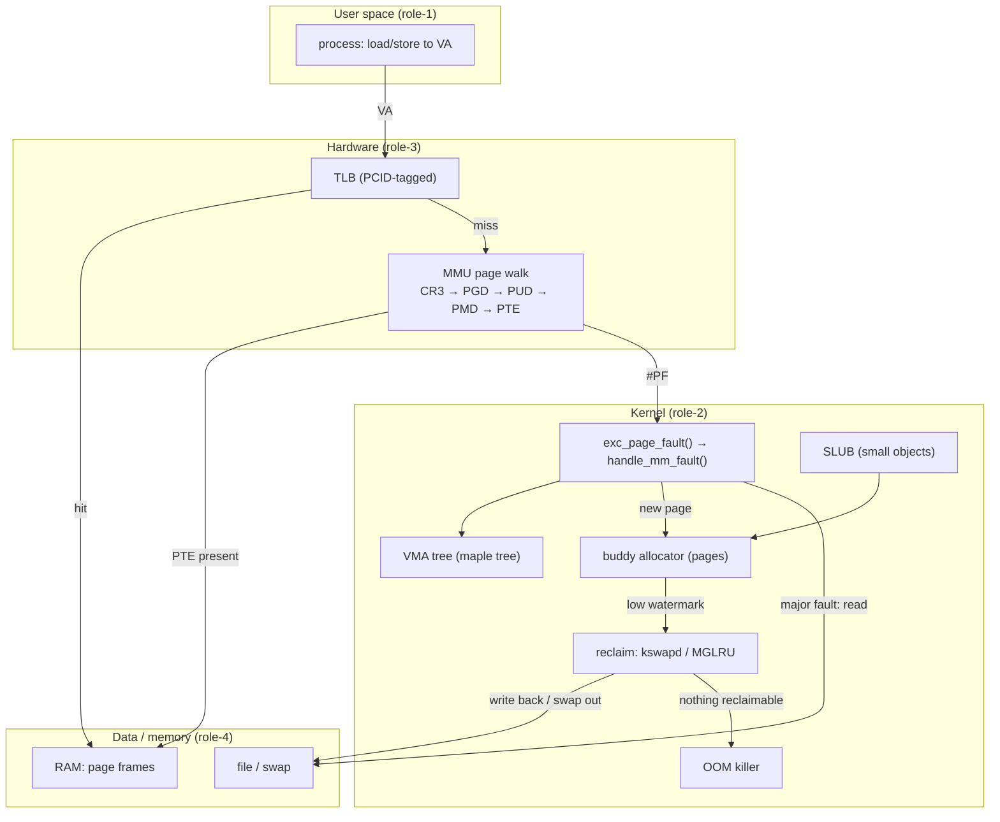
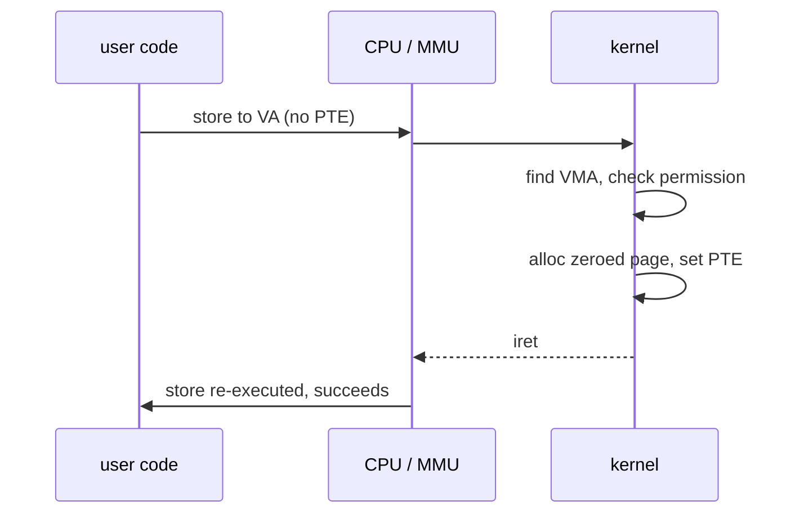

# 04 — Memory Management

> Course: Advanced Operating Systems · Term 1 · Pins: Linux **v6.18.63**, OpenBSD **`8cada8c`** · Arch: **x86-64**
> Time: ~18 h (lesson + 10 notes ≈ 7 h, 6 labs ≈ 11 h) · Farsi: [`lesson.fa.md`](lesson.fa.md) · Slides: [`slides/`](slides/)
> **Depends on:** Module 01 (privilege levels, exceptions/IDT, `CR3`, syscall entry), Module 02 (`fork`/`exec`, `task_struct` → `mm_struct`), Module 03 (atomics/`cmpxchg`, spinlocks, RCU — used by the per-VMA lock and SLUB fast path).
> **Used by:** Module 05 (page cache, `mmap` of files, writeback), Module 06 (cgroups `memory.max`, KVM EPT).

## Learning goals

- Translate a virtual address by hand through the 4-level x86-64 page table and say what the TLB caches.
- Follow a page fault from `exc_page_fault()` to `do_anonymous_page()` / `do_wp_page()` in real v6.18.63 code, and classify minor vs major faults.
- Explain demand paging and copy-on-write, and prove them on a live system with `/proc/<pid>/smaps` and `pagemap`.
- Describe how the buddy allocator and SLUB hand out memory, and read `/proc/buddyinfo` and `/proc/slabinfo`.
- Explain reclaim (LRU/MGLRU, kswapd, direct reclaim), thrashing, and the OOM killer, and trigger them safely inside a cgroup.
- Measure what huge pages buy you (TLB reach) without hardware counters.

## Glossary

| Term | Definition |
|---|---|
| **Virtual address (VA)** | the address a program uses; 48 bits are significant on x86-64 with 4-level paging (57 with 5-level). |
| **Physical address / PFN** | the real RAM address; PFN (page frame number) = physical address / 4096. |
| **Page** | the unit of mapping: 4 KiB base page; 2 MiB and 1 GiB huge pages on x86-64. |
| **Page table / PTE** | the radix tree that maps VA → PFN; a PTE (page-table entry) holds the PFN plus bits (Present, R/W, U/S, Accessed, Dirty, NX). |
| **`CR3`** | the x86 register holding the physical address of the top-level table (PGD) of the current process (plus its PCID). |
| **MMU** | the hardware unit that walks the page table on every access that misses the TLB. |
| **TLB** | Translation Lookaside Buffer: small cache of recent VA→PA translations. A miss costs a page walk. |
| **PCID / ASID** | tag on TLB entries naming the address space, so a context switch need not flush the TLB. Linux uses 6 dynamic PCIDs per CPU. |
| **TLB shootdown** | sending IPIs to other CPUs so they drop stale TLB entries after a PTE change. |
| **`mm_struct`** | the kernel's description of one address space (page-table root, VMA tree, counters); threads share one. |
| **VMA (`vm_area_struct`)** | one contiguous range with the same permissions and backing (a line of `/proc/<pid>/maps`). |
| **Page fault (#PF)** | CPU exception 14, raised when the PTE is missing or forbids the access. |
| **Minor / major fault** | minor = resolved without I/O (zero page, page already in cache, COW); major = had to read from disk/swap. |
| **Demand paging** | pages are allocated or read only when first touched, not at `mmap`/`exec` time. |
| **COW** | copy-on-write: after `fork()` both processes share pages read-only; the first write copies the page. |
| **Zero page** | a single shared zero-filled page used for reads of untouched anonymous memory. |
| **Folio** | the kernel's type for a power-of-two group of contiguous pages managed as one unit. |
| **Buddy allocator** | physical page allocator with free lists per order (2^order pages); splits and merges "buddies". |
| **SLUB** | Linux's slab allocator for small kernel objects (`kmalloc`, `dentry`, `inode`…). |
| **LRU / MGLRU** | page-replacement lists; MGLRU (multi-gen LRU) sorts pages into generations by age. |
| **kswapd** | per-NUMA-node kernel thread that reclaims memory in the background. |
| **Direct reclaim** | an allocating task reclaims memory itself because free memory fell below the min watermark. |
| **Thrashing** | the working set does not fit in memory, so the system spends its time refaulting evicted pages. |
| **OOM killer** | picks and kills a task when memory cannot be reclaimed (`oom_badness()`); per-cgroup with `memory.max`. |
| **THP / hugetlbfs** | transparent huge pages (automatic 2 MiB pages) vs explicitly reserved huge pages. |
| **NUMA** | non-uniform memory access: RAM attached to different sockets has different latency. |
| **`mmap`** | system call that creates a VMA: anonymous or file-backed, private or shared. |

## 1. Big picture

## 2. Concepts

### 2.1 What does the address `0x7ffd1c3a2b40` actually point to?

Nothing, until the kernel maps it. Every process gets a private **virtual address space**: a 128 TiB user half (`0` – `0x00007fffffffffff`) and the kernel half above `0xffff800000000000`. The kernel describes the user half as a set of **VMAs**, which you can read in `/proc/<pid>/maps`: text, data, heap, shared libraries, anonymous `mmap`s, stack, `[vdso]`. → [note 01](notes/01-virtual-address-space.en.md)

### 2.2 How does the CPU translate it?

On x86-64 with 4-level paging, the VA is split into 9+9+9+9 index bits and a 12-bit offset. `CR3` points to the PGD; each level is a 4 KiB table of 512 8-byte entries. A 2 MiB huge page stops the walk at the PMD; a 1 GiB page at the PUD. 5-level paging (LA57) adds the P4D level and 57-bit addresses. → [note 02](notes/02-page-tables.en.md)

| Level | Bits of VA | Shift (`pgtable_64_types.h`) | One entry covers |
|---|---|---|---|
| PGD | 47–39 | `PGDIR_SHIFT` = 39 (4-level) | 512 GiB |
| PUD | 38–30 | `PUD_SHIFT` = 30 | 1 GiB |
| PMD | 29–21 | `PMD_SHIFT` = 21 | 2 MiB |
| PTE | 20–12 | `PAGE_SHIFT` = 12 | 4 KiB |

### 2.3 Why isn't every memory access four extra memory reads?

The **TLB** caches translations. A typical x86 core has ~64 L1 dTLB entries and ~1.5–2 K shared L2 TLB entries: with 4 KiB pages that is only a few MiB of **TLB reach**. PCIDs let entries survive context switches; changing a PTE that other CPUs may cache requires a **shootdown** (IPIs). Lab 04 measures the cost with a pointer chase. → [note 03](notes/03-tlb-pcid-shootdown.en.md)

### 2.4 What happens on a page fault?

`#PF` → `exc_page_fault()` reads `CR2` → `do_user_addr_fault()` finds the VMA (per-VMA lock first) → `handle_mm_fault()` → `__handle_mm_fault()` allocates missing table levels → `handle_pte_fault()` decides: missing PTE (demand paging), swap entry (swap-in), NUMA hint, or write-protect (COW). No VMA or wrong permission → `SIGSEGV`. → [note 04](notes/04-page-fault-path.en.md), [walkthrough §1–3](kernel-walkthrough.en.md)

### 2.5 Why does `malloc(1 GB)` return instantly?

Because `mmap` only creates a VMA. Pages are allocated on the **first touch** (demand paging), and reads of untouched anonymous memory map the shared **zero page**. After `fork()`, parent and child share all pages read-only; the first write by either side takes a **COW** fault and copies one page. Lab 01 counts the faults; Lab 02 watches PFNs split. → [note 05](notes/05-demand-paging-cow.en.md)

### 2.6 Where do physical pages come from?

The **buddy allocator** keeps, per zone, free lists of blocks of 2^order pages (order 0–10). Allocation takes the smallest sufficient block and splits it; freeing merges a block with its buddy (`pfn ^ (1 << order)`) as long as the buddy is free. `/proc/buddyinfo` shows the free counts per order; many order-0 blocks and few high-order ones = **external fragmentation**. → [note 06](notes/06-buddy-allocator.en.md)

### 2.7 How does the kernel allocate a 192-byte `dentry`?

Not from buddy directly: **SLUB** carves slabs (one or more pages) into same-size objects, keeps a per-CPU current slab, and allocates with a lockless `cmpxchg` on the per-CPU free list. `/proc/slabinfo` and `slabtop` show each cache. Lab 05 grows the `dentry` and inode caches by creating files. → [note 07](notes/07-slub.en.md)

### 2.8 What happens when RAM is full?

Reclaim. Pages sit on LRU lists (classic active/inactive, or **MGLRU** generations). `kswapd` wakes at the low watermark and reclaims until the high watermark; below the min watermark, allocators do **direct reclaim**. Clean file pages are just dropped; dirty ones are written back; anonymous pages need swap (or zswap). → [note 08](notes/08-reclaim-lru-mglru.en.md)

### 2.9 File vs anonymous, private vs shared

| `mmap` flags | Backed by | Writes visible to other mappers? | Written to file? |
|---|---|---|---|
| `MAP_PRIVATE` + file | page cache, COW on write | no | never |
| `MAP_SHARED` + file | page cache | yes | yes (writeback / `msync`) |
| `MAP_PRIVATE \| MAP_ANONYMOUS` | zero page → private anon pages | no (COW after fork) | — (swap) |
| `MAP_SHARED \| MAP_ANONYMOUS` | shmem (tmpfs object) | yes, across `fork` | — (swap) |

Lab 03 runs all four. → [note 09](notes/09-mmap.en.md)

### 2.10 Huge pages, NUMA, thrashing and OOM

A 2 MiB page replaces 512 PTEs with one PMD entry: 512× fewer faults and 512× more TLB reach, at the cost of internal fragmentation and compaction work. On NUMA machines, the kernel prefers the local node and NUMA balancing migrates pages. When the working set exceeds memory, refaults explode (**thrashing**, visible as `workingset_refault_*` and PSI `memory.pressure`). When nothing can be reclaimed, the **OOM killer** kills the task with the highest `oom_badness()` (RSS + swap + page tables, shifted by `oom_score_adj`). With cgroup v2 `memory.max`, all of this happens inside the cgroup. Labs 04 and 06. → [note 10](notes/10-hugepages-numa-oom.en.md)

## 3. Where this lives in Linux

| Topic | File · function (v6.18.63) | Walkthrough |
|---|---|---|
| #PF entry | `arch/x86/mm/fault.c` · `exc_page_fault()` L1483, `do_user_addr_fault()` L1207 | [§1](kernel-walkthrough.en.md#1-the-exception-entry--exc_page_fault) |
| Generic fault | `mm/memory.c` · `handle_mm_fault()` L6490, `handle_pte_fault()` L6166 | [§2–3](kernel-walkthrough.en.md#2-the-generic-entry--handle_mm_fault) |
| COW | `mm/memory.c` · `do_wp_page()` L4063, `wp_page_copy()` L3672 | [§3.2](kernel-walkthrough.en.md#32-copy-on-write--do_wp_page) |
| mmap | `mm/mmap.c` · `do_mmap()` L334 | [§4](kernel-walkthrough.en.md#4-mmap-only-creates-a-vma--do_mmap) |
| Buddy | `mm/page_alloc.c` · `__rmqueue_smallest()` L1932, `__free_one_page()` L979 | [§5](kernel-walkthrough.en.md#5-the-buddy-allocator--split-and-merge) |
| SLUB | `mm/slub.c` · `__slab_alloc_node()` L4846 | [§6](kernel-walkthrough.en.md#6-slub--the-lockless-per-cpu-fast-path) |
| TLB | `arch/x86/mm/tlb.c` · `choose_new_asid()` L224, `flush_tlb_mm_range()` L1448 | [§7](kernel-walkthrough.en.md#7-tlb-pcid-reuse-and-shootdowns--arch-specific-x86-64) |
| Reclaim / OOM | `mm/vmscan.c` · `shrink_lruvec()` L5799, `kswapd()` L7319; `mm/oom_kill.c` · `oom_badness()` L202 | [§8](kernel-walkthrough.en.md#8-reclaim-and-oom) |
| OpenBSD | `sys/uvm/uvm_fault.c` · `uvm_fault()` L593 | [§9](kernel-walkthrough.en.md#9-openbsd-comparison--uvm) |

## 4. Labs

| # | Lab | Tools | Proves |
|---|---|---|---|
| 04.1 | [Count page faults](labs/01-page-faults/README.md) | `perf stat`, `getrusage` | demand paging, zero page, readahead, THP |
| 04.2 | [COW through pagemap](labs/02-cow-pagemap/README.md) | `/proc/self/pagemap`, `smaps` | shared PFN until the first write |
| 04.3 | [mmap: shared vs private](labs/03-mmap-shared/README.md) | `mmap`, `od` | who sees writes, what reaches the file |
| 04.4 | [TLB reach and huge pages](labs/04-tlb-hugepages/README.md) | C timing, `smaps` | the cost of TLB misses without PMU |
| 04.5 | [Slab caches](labs/05-slab-files/README.md) | `/proc/slabinfo`, `slabtop` | kernel objects per file |
| 04.6 | [Thrashing and OOM in a cgroup](labs/06-oom-thrashing/README.md) | cgroup v2, `dmesg`, PSI | refaults, memcg OOM kill |

## 5. Common misconceptions

| Misconception | Reality |
|---|---|
| "`malloc` allocates RAM." | It reserves virtual space; RAM comes on first write, one page (or folio) per fault. |
| "A page fault is an error." | Almost all faults are normal (demand paging, COW). Only faults with no VMA or wrong permission become `SIGSEGV`. |
| "Major fault = slow, minor fault = free." | A minor fault still costs a trap, a page allocation and zeroing (~1 µs+); 1 M of them is visible. |
| "`fork()` copies the address space." | It copies page *tables* (and marks them read-only); data is copied lazily on write. |
| "Free memory in `free -m` should be large." | Linux uses idle RAM as page cache; look at `available`, not `free`. |
| "Context switches always flush the TLB." | With PCID, Linux keeps up to 6 address spaces' entries per CPU; only KPTI and the round-robin eviction force flushes. |
| "Huge pages are always faster." | They help TLB-bound random access; they cost latency (compaction, zeroing 2 MiB) and RSS bloat. |
| "The OOM killer kills the process that asked for memory." | It kills the highest `oom_badness()` task in the constrained scope (system, cgroup, cpuset). |
| "Swap off = no thrashing." | File-backed pages (program text, mmapped files) are still evicted and refaulted. Lab 06 thrashes with zero swap. |

## 6. Self-check

1. Split `0x00007f3a12345678` into PGD/PUD/PMD/PTE indexes and offset.
2. Why does reading 256 MiB of untouched `malloc` memory leave RSS almost unchanged?
3. Name the four branches of `handle_pte_fault()` and one user action that reaches each.
4. After `fork()`, the child writes one byte. How many pages are copied, and which function copies them?
5. What does `/proc/buddyinfo` showing `0 0 0 0 0 …` in high orders tell you, and which allocations fail first?
6. Why does SLUB not need a lock on its fast path?
7. When does `kswapd` wake, and when does an allocating task reclaim memory itself?
8. In a cgroup with `memory.max=64M` and no swap, why can a program reading a 128 MiB file never get faster on the second pass?
9. Which three quantities make up `oom_badness()`?
10. Compare how Linux and OpenBSD decide whether a write fault needs a copy.

Answers: work them out, then check against [`quiz.en.md`](quiz.en.md) and the notes.
