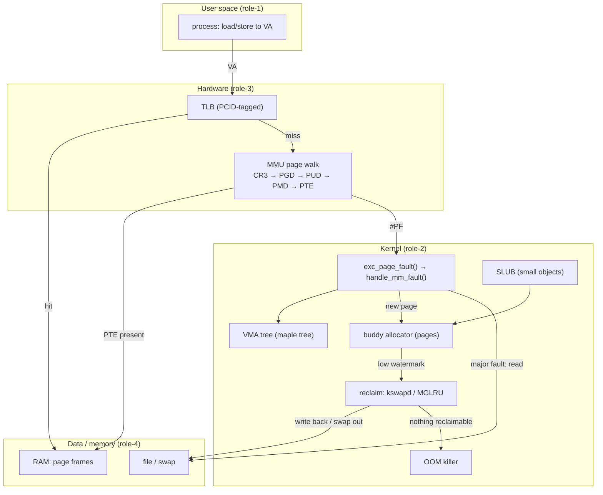
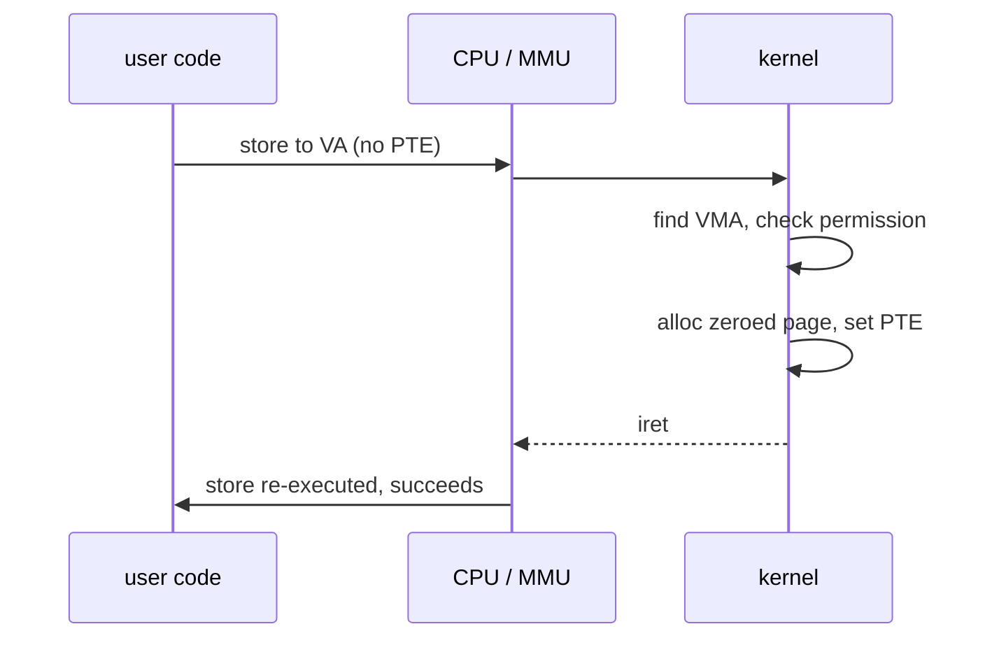

# ۰۴ — مدیریت حافظه

> درس: سیستم‌عامل پیشرفته · ترم ۱ · نسخه‌های ثابت: Linux **v6.18.63** و OpenBSD **`8cada8c`** · معماری: **x86-64**
> زمان: حدود ۱۸ ساعت (درس و ۱۰ یادداشت حدود ۷ ساعت، ۶ آزمایش حدود ۱۱ ساعت) · نسخهٔ انگلیسی: [`lesson.en.md`](lesson.en.md) · اسلایدها: [`slides/`](slides/)
> **پیش‌نیازها:** ماژول ۰۱ (سطح‌های امتیاز، exceptionها و IDT، ثبات `CR3`، ورود syscall)، ماژول ۰۲ (`fork` و `exec`، رابطهٔ `task_struct` با `mm_struct`)، ماژول ۰۳ (atomicها و `cmpxchg`، spinlock و RCU که قفل per-VMA و مسیر سریع SLUB از آن‌ها استفاده می‌کنند).
> **ماژول‌هایی که از این درس استفاده می‌کنند:** ماژول ۰۵ (page cache، `mmap` فایل‌ها، writeback) و ماژول ۰۶ (`memory.max` در cgroupها، EPT در KVM).

## هدف‌های یادگیری

- یک آدرس مجازی را با دست از جدول صفحهٔ چهارسطحی x86-64 عبور دهید و بگویید TLB دقیقاً چه چیزی را cache می‌کند.
- یک page fault را در کد واقعی v6.18.63 از `exc_page_fault()` تا `do_anonymous_page()` یا `do_wp_page()` دنبال کنید و fault کوچک (minor) و بزرگ (major) را از هم تشخیص دهید.
- demand paging و copy-on-write را توضیح دهید و هر دو را روی سیستم زنده با `/proc/<pid>/smaps` و `pagemap` ثابت کنید.
- بگویید buddy allocator و SLUB چطور حافظه می‌دهند و `/proc/buddyinfo` و `/proc/slabinfo` را بخوانید.
- reclaim (LRU و MGLRU، kswapd، direct reclaim)، thrashing و OOM killer را توضیح دهید و آن‌ها را بی‌خطر داخل یک cgroup ایجاد کنید.
- بدون شمارنده‌های سخت‌افزاری اندازه بگیرید صفحه‌های بزرگ چه سودی دارند (برد TLB).

## واژه‌نامه

| اصطلاح | تعریف |
|---|---|
| **Virtual address (VA)** | آدرسی که برنامه به کار می‌برد. در x86-64 با paging چهارسطحی ۴۸ بیت آن معنی دارد و با paging پنج‌سطحی ۵۷ بیت. |
| **Physical address / PFN** | آدرس واقعی در RAM. PFN (شمارهٔ قاب صفحه) برابر است با آدرس فیزیکی تقسیم بر ۴۰۹۶. |
| **Page** | واحد نگاشت: صفحهٔ پایه ۴ کیلوبایتی؛ در x86-64 صفحه‌های بزرگ ۲ مگابایتی و ۱ گیگابایتی هم هست. |
| **Page table / PTE** | درخت radix که VA را به PFN نگاشت می‌کند. هر PTE (مدخل جدول صفحه) شامل PFN و چند بیت است: Present، R/W، U/S، Accessed، Dirty و NX. |
| **`CR3`** | ثبات x86 که آدرس فیزیکی جدول سطح بالا (PGD) پردازهٔ فعلی را نگه می‌دارد، همراه PCID آن. |
| **MMU** | واحد سخت‌افزاری که در هر دسترسی‌ای که در TLB پیدا نشود، جدول صفحه را می‌پیماید. |
| **TLB** | Translation Lookaside Buffer؛ cache کوچکی از ترجمه‌های اخیر VA به PA. هر miss یک پیمایش جدول هزینه دارد. |
| **PCID / ASID** | برچسبی روی مدخل‌های TLB که فضای آدرس را مشخص می‌کند، تا context switch لازم نباشد TLB را پاک کند. لینوکس برای هر CPU شش PCID پویا دارد. |
| **TLB shootdown** | فرستادن IPI به CPUهای دیگر تا بعد از تغییر یک PTE مدخل‌های کهنهٔ TLB خود را دور بریزند. |
| **`mm_struct`** | توصیف کرنل از یک فضای آدرس: ریشهٔ page table، درخت VMAها و شمارنده‌ها. نخ‌های یک پردازه یک `mm_struct` مشترک دارند. |
| **VMA (`vm_area_struct`)** | یک بازهٔ پیوسته با دسترسی‌ها و پشتیبان یکسان؛ هر خط از `/proc/<pid>/maps` یک VMA است. |
| **Page fault (#PF)** | exception شمارهٔ ۱۴ در CPU. وقتی PTE نیست یا دسترسی را اجازه نمی‌دهد، رخ می‌دهد. |
| **Minor / major fault** | minor بدون I/O حل می‌شود (zero page، صفحه‌ای که در cache هست، COW). major یعنی مجبور شدیم از دیسک یا swap بخوانیم. |
| **Demand paging** | صفحه‌ها فقط هنگام اولین دسترسی تخصیص داده یا خوانده می‌شوند، نه هنگام `mmap` یا `exec`. |
| **COW** | copy-on-write: بعد از `fork()` هر دو پردازه صفحه‌ها را فقط‌خواندنی مشترک دارند و اولین نوشتن، صفحه را کپی می‌کند. |
| **Zero page** | یک صفحهٔ سراسری پر از صفر که برای خواندن حافظهٔ ناشناسِ دست‌نخورده به کار می‌رود. |
| **Folio** | نوع داده‌ای در کرنل برای گروهی از صفحه‌های پیوسته به اندازهٔ توانی از دو که مثل یک واحد مدیریت می‌شوند. |
| **Buddy allocator** | تخصیص‌دهندهٔ صفحه‌های فیزیکی با فهرست آزاد برای هر order (یعنی بلوک‌هایی به اندازهٔ ۲ به توان order صفحه). «رفیق‌ها» (buddies) را می‌شکند و دوباره ادغام می‌کند. |
| **SLUB** | slab allocator لینوکس برای اشیای کوچک کرنل، مثل `kmalloc`، `dentry` و `inode`. |
| **LRU / MGLRU** | فهرست‌های جایگزینی صفحه. MGLRU (LRU چندنسلی) صفحه‌ها را بر اساس سن در چند نسل مرتب می‌کند. |
| **kswapd** | نخ کرنل برای هر NUMA node که در پس‌زمینه حافظه آزاد می‌کند. |
| **Direct reclaim** | وقتی حافظهٔ آزاد زیر min watermark برود، خود taskی که تخصیص می‌خواهد حافظه آزاد می‌کند. |
| **Thrashing** | مجموعهٔ کاری (working set) در حافظه جا نمی‌شود و سیستم وقتش را صرف refault صفحه‌هایی می‌کند که تازه بیرون انداخته است. |
| **OOM killer** | وقتی نتوان حافظه آزاد کرد، یک task را انتخاب می‌کند و می‌کشد (`oom_badness()`). با `memory.max` این کار داخل همان cgroup انجام می‌شود. |
| **THP / hugetlbfs** | THP یعنی صفحه‌های بزرگ شفاف (صفحه‌های ۲ مگابایتی خودکار)؛ hugetlbfs یعنی صفحه‌های بزرگی که صریحاً از قبل رزرو می‌شوند. |
| **NUMA** | دسترسی غیریکنواخت به حافظه: RAMی که به سوکت‌های مختلف وصل است، تأخیر متفاوتی دارد. |
| **`mmap`** | syscallی که VMA می‌سازد: ناشناس یا با پشتیبان فایل، خصوصی یا اشتراکی. |

## ۱. تصویر کلی

## ۲. مفاهیم

### ۲.۱ آدرس `0x7ffd1c3a2b40` در واقع به کجا اشاره می‌کند؟

تا وقتی کرنل آن را map نکند، به هیچ‌جا. هر پردازه یک **فضای آدرس مجازی** خصوصی دارد: نیمهٔ کاربر ۱۲۸ ترابایت است (از `0` تا `0x00007fffffffffff`) و نیمهٔ کرنل از `0xffff800000000000` به بالاست. کرنل نیمهٔ کاربر را به شکل مجموعه‌ای از **VMA**ها توصیف می‌کند و آن‌ها را در `/proc/<pid>/maps` می‌بینید: text، data، heap، کتابخانه‌های اشتراکی، `mmap`های ناشناس، stack و `[vdso]`. ← [یادداشت ۰۱](notes/01-virtual-address-space.fa.md)

### ۲.۲ CPU آن را چطور ترجمه می‌کند؟

در x86-64 با paging چهارسطحی، VA به چهار تکهٔ ۹ بیتی برای اندیس‌ها و یک offset دوازده‌بیتی تقسیم می‌شود. `CR3` به PGD اشاره می‌کند. هر سطح یک جدول ۴ کیلوبایتی با ۵۱۲ مدخل هشت‌بایتی است. صفحهٔ بزرگ ۲ مگابایتی پیمایش را در PMD تمام می‌کند و صفحهٔ ۱ گیگابایتی در PUD. paging پنج‌سطحی (LA57) سطح P4D و آدرس ۵۷ بیتی را اضافه می‌کند. ← [یادداشت ۰۲](notes/02-page-tables.fa.md)

| سطح | بیت‌های VA | Shift در `pgtable_64_types.h` | پوشش یک مدخل |
|---|---|---|---|
| PGD | ۴۷ تا ۳۹ | `PGDIR_SHIFT` = 39 (چهارسطحی) | ۵۱۲ گیگابایت |
| PUD | ۳۸ تا ۳۰ | `PUD_SHIFT` = 30 | ۱ گیگابایت |
| PMD | ۲۹ تا ۲۱ | `PMD_SHIFT` = 21 | ۲ مگابایت |
| PTE | ۲۰ تا ۱۲ | `PAGE_SHIFT` = 12 | ۴ کیلوبایت |

### ۲.۳ چرا هر دسترسی به حافظه چهار خواندن اضافه نمی‌خواهد؟

چون **TLB** ترجمه‌ها را cache می‌کند. یک هستهٔ معمولی x86 حدود ۶۴ مدخل L1 dTLB و حدود ۱٫۵ تا ۲ هزار مدخل L2 TLB مشترک دارد. با صفحه‌های ۴ کیلوبایتی، این فقط چند مگابایت **برد TLB** است. PCIDها اجازه می‌دهند مدخل‌ها بعد از context switch باقی بمانند. اما تغییر PTEای که شاید CPUهای دیگر cache کرده باشند به **shootdown** (فرستادن IPI) نیاز دارد. آزمایش ۰۴ این هزینه را با یک pointer chase اندازه می‌گیرد. ← [یادداشت ۰۳](notes/03-tlb-pcid-shootdown.fa.md)

### ۲.۴ هنگام page fault چه اتفاقی می‌افتد؟

این مراحل به ترتیب اجرا می‌شوند:

1. `#PF` رخ می‌دهد و `exc_page_fault()` ثبات `CR2` را می‌خواند.
2. `do_user_addr_fault()` VMA را پیدا می‌کند و اول قفل per-VMA را امتحان می‌کند.
3. `handle_mm_fault()` صدا زده می‌شود.
4. `__handle_mm_fault()` سطح‌های جدولی را که وجود ندارند تخصیص می‌دهد.
5. `handle_pte_fault()` تصمیم می‌گیرد کدام حالت است: PTE وجود ندارد (demand paging)، swap entry است (swap-in)، NUMA hint است، یا محافظت در برابر نوشتن است (COW).

اگر VMAای نباشد یا دسترسی مجاز نباشد، نتیجه `SIGSEGV` است. ← [یادداشت ۰۴](notes/04-page-fault-path.fa.md) و [گشت در کد، بخش‌های ۱ تا ۳](kernel-walkthrough.fa.md)

### ۲.۵ چرا `malloc(1 GB)` فوراً برمی‌گردد؟

چون `mmap` فقط یک VMA می‌سازد. صفحه‌ها در **اولین لمس** تخصیص داده می‌شوند (demand paging) و خواندن حافظهٔ ناشناسِ دست‌نخورده فقط **zero page** مشترک را map می‌کند. بعد از `fork()` والد و فرزند همهٔ صفحه‌ها را فقط‌خواندنی مشترک دارند. اولین نوشتن هر کدام یک fault از نوع **COW** می‌دهد و یک صفحه کپی می‌شود. آزمایش ۰۱ faultها را می‌شمارد و آزمایش ۰۲ جدا شدن PFNها را نشان می‌دهد. ← [یادداشت ۰۵](notes/05-demand-paging-cow.fa.md)

### ۲.۶ صفحه‌های فیزیکی از کجا می‌آیند؟

**buddy allocator** برای هر zone فهرست‌های آزادی از بلوک‌های ۲ به توان order صفحه نگه می‌دارد (order از ۰ تا ۱۰). هنگام تخصیص، کوچک‌ترین بلوک کافی را برمی‌دارد و می‌شکند. هنگام آزادسازی، بلوک را تا وقتی رفیقش (`pfn ^ (1 << order)`) آزاد باشد با آن ادغام می‌کند. `/proc/buddyinfo` تعداد بلوک‌های آزاد هر order را نشان می‌دهد. تعداد زیاد بلوک order صفر در کنار تعداد کم بلوک‌های order بالا یعنی **external fragmentation**. ← [یادداشت ۰۶](notes/06-buddy-allocator.fa.md)

### ۲.۷ کرنل یک `dentry` با اندازهٔ ۱۹۲ بایت را چطور تخصیص می‌دهد؟

مستقیم از buddy نه. **SLUB** slabها را (که یک یا چند صفحه‌اند) به اشیای هم‌اندازه تقسیم می‌کند. برای هر CPU یک slab فعلی نگه می‌دارد و با یک `cmpxchg` بدون قفل روی فهرست آزاد per-CPU تخصیص می‌دهد. `/proc/slabinfo` و `slabtop` همهٔ cacheها را نشان می‌دهند. آزمایش ۰۵ با ساختن فایل، cacheهای `dentry` و inode را بزرگ می‌کند. ← [یادداشت ۰۷](notes/07-slub.fa.md)

### ۲.۸ وقتی RAM پر شود چه می‌شود؟

reclaim شروع می‌شود. صفحه‌ها روی فهرست‌های LRU هستند: active و inactive کلاسیک، یا نسل‌های **MGLRU**. `kswapd` در low watermark بیدار می‌شود و تا high watermark حافظه آزاد می‌کند. زیر min watermark، خود تخصیص‌دهنده‌ها **direct reclaim** انجام می‌دهند. صفحه‌های فایلِ تمیز فقط دور ریخته می‌شوند، صفحه‌های dirty اول نوشته می‌شوند، و صفحه‌های ناشناس به swap (یا zswap) نیاز دارند. ← [یادداشت ۰۸](notes/08-reclaim-lru-mglru.fa.md)

### ۲.۹ فایل یا ناشناس، خصوصی یا اشتراکی

| پرچم‌های `mmap` | پشتیبان | نوشتن برای بقیه دیده می‌شود؟ | به فایل می‌رسد؟ |
|---|---|---|---|
| `MAP_PRIVATE` + فایل | page cache، با COW هنگام نوشتن | نه | هرگز |
| `MAP_SHARED` + فایل | page cache | بله | بله (writeback یا `msync`) |
| `MAP_PRIVATE \| MAP_ANONYMOUS` | zero page و بعد صفحه‌های ناشناس خصوصی | نه (بعد از fork با COW) | ندارد (swap) |
| `MAP_SHARED \| MAP_ANONYMOUS` | shmem (شیء tmpfs) | بله، در طول `fork` | ندارد (swap) |

آزمایش ۰۳ هر چهار حالت را اجرا می‌کند. ← [یادداشت ۰۹](notes/09-mmap.fa.md)

### ۲.۱۰ صفحه‌های بزرگ، NUMA، thrashing و OOM

یک صفحهٔ ۲ مگابایتی جای ۵۱۲ PTE را با یک مدخل PMD می‌گیرد. نتیجه ۵۱۲ برابر fault کمتر و ۵۱۲ برابر برد TLB بیشتر است، به قیمت internal fragmentation و کار compaction.

در ماشین‌های NUMA، کرنل node محلی را ترجیح می‌دهد و NUMA balancing صفحه‌ها را جابه‌جا می‌کند.

وقتی مجموعهٔ کاری از حافظه بزرگ‌تر شود، refaultها منفجر می‌شوند. این **thrashing** است و در `workingset_refault_*` و `memory.pressure` (PSI) دیده می‌شود.

وقتی هیچ چیزی قابل آزادسازی نباشد، **OOM killer** taskی را می‌کشد که بیشترین `oom_badness()` را دارد. این امتیاز از RSS، swap و page tableها ساخته می‌شود و `oom_score_adj` آن را جابه‌جا می‌کند. با `memory.max` در cgroup v2 همهٔ این‌ها داخل همان cgroup رخ می‌دهد. آزمایش‌های ۰۴ و ۰۶ این‌ها را نشان می‌دهند. ← [یادداشت ۱۰](notes/10-hugepages-numa-oom.fa.md)

## ۳. این‌ها کجای لینوکس هستند

| موضوع | فایل · تابع (v6.18.63) | گشت در کد |
|---|---|---|
| ورود #PF | `arch/x86/mm/fault.c` · `exc_page_fault()` خط ۱۴۸۳، `do_user_addr_fault()` خط ۱۲۰۷ | [بخش ۱](kernel-walkthrough.fa.md) |
| fault عمومی | `mm/memory.c` · `handle_mm_fault()` خط ۶۴۹۰، `handle_pte_fault()` خط ۶۱۶۶ | [بخش‌های ۲ و ۳](kernel-walkthrough.fa.md) |
| COW | `mm/memory.c` · `do_wp_page()` خط ۴۰۶۳، `wp_page_copy()` خط ۳۶۷۲ | [بخش ۳.۲](kernel-walkthrough.fa.md) |
| mmap | `mm/mmap.c` · `do_mmap()` خط ۳۳۴ | [بخش ۴](kernel-walkthrough.fa.md) |
| Buddy | `mm/page_alloc.c` · `__rmqueue_smallest()` خط ۱۹۳۲، `__free_one_page()` خط ۹۷۹ | [بخش ۵](kernel-walkthrough.fa.md) |
| SLUB | `mm/slub.c` · `__slab_alloc_node()` خط ۴۸۴۶ | [بخش ۶](kernel-walkthrough.fa.md) |
| TLB | `arch/x86/mm/tlb.c` · `choose_new_asid()` خط ۲۲۴، `flush_tlb_mm_range()` خط ۱۴۴۸ | [بخش ۷](kernel-walkthrough.fa.md) |
| reclaim و OOM | `mm/vmscan.c` · `shrink_lruvec()` خط ۵۷۹۹، `kswapd()` خط ۷۳۱۹؛ `mm/oom_kill.c` · `oom_badness()` خط ۲۰۲ | [بخش ۸](kernel-walkthrough.fa.md) |
| OpenBSD | `sys/uvm/uvm_fault.c` · `uvm_fault()` خط ۵۹۳ | [بخش ۹](kernel-walkthrough.fa.md) |

## ۴. آزمایش‌ها

| # | آزمایش | ابزار | چه چیزی را ثابت می‌کند |
|---|---|---|---|
| 04.1 | [شمردن page faultها](labs/01-page-faults/README.md) | `perf stat`، `getrusage` | demand paging، zero page، readahead، THP |
| 04.2 | [COW از راه pagemap](labs/02-cow-pagemap/README.md) | `/proc/self/pagemap`، `smaps` | PFN تا اولین نوشتن مشترک می‌ماند |
| 04.3 | [mmap: اشتراکی یا خصوصی](labs/03-mmap-shared/README.md) | `mmap`، `od` | چه کسی نوشته‌ها را می‌بیند و چه چیزی به فایل می‌رسد |
| 04.4 | [برد TLB و صفحه‌های بزرگ](labs/04-tlb-hugepages/README.md) | زمان‌سنجی در C، `smaps` | هزینهٔ TLB miss بدون PMU |
| 04.5 | [cacheهای slab](labs/05-slab-files/README.md) | `/proc/slabinfo`، `slabtop` | اشیای کرنل به ازای هر فایل |
| 04.6 | [thrashing و OOM در cgroup](labs/06-oom-thrashing/README.md) | cgroup v2، `dmesg`، PSI | refaultها و OOM kill در memcg |

## ۵. برداشت‌های غلط رایج

| برداشت غلط | واقعیت |
|---|---|
| «`malloc` حافظهٔ RAM می‌گیرد.» | فقط فضای مجازی رزرو می‌کند. RAM در اولین نوشتن می‌آید، یک صفحه (یا یک folio) برای هر fault. |
| «page fault یعنی خطا.» | تقریباً همهٔ faultها عادی‌اند (demand paging، COW). فقط faultی که VMA ندارد یا دسترسی‌اش غلط است `SIGSEGV` می‌شود. |
| «fault بزرگ کند است و fault کوچک مجانی.» | fault کوچک هم هزینهٔ trap، تخصیص صفحه و صفر کردن دارد (یک میکروثانیه یا بیشتر). یک میلیون از آن‌ها کاملاً دیده می‌شود. |
| «`fork()` فضای آدرس را کپی می‌کند.» | *جدول‌های صفحه* را کپی و فقط‌خواندنی می‌کند. داده‌ها تنبل و هنگام نوشتن کپی می‌شوند. |
| «حافظهٔ free در `free -m` باید زیاد باشد.» | لینوکس RAM بیکار را برای page cache به کار می‌برد. به ستون `available` نگاه کنید، نه `free`. |
| «context switch همیشه TLB را پاک می‌کند.» | با PCID، لینوکس مدخل‌های تا ۶ فضای آدرس را روی هر CPU نگه می‌دارد. فقط KPTI و بیرون‌اندازی چرخشی flush اجباری ایجاد می‌کنند. |
| «صفحه‌های بزرگ همیشه سریع‌ترند.» | به دسترسی تصادفی‌ای کمک می‌کنند که TLB گلوگاهش است. در عوض تأخیر دارند (compaction، صفر کردن ۲ مگابایت) و RSS را باد می‌کنند. |
| «OOM killer همان پردازه‌ای را می‌کشد که حافظه خواسته.» | taskی را می‌کشد که در محدودهٔ محدودشده (کل سیستم، cgroup یا cpuset) بیشترین `oom_badness()` را دارد. |
| «swap خاموش یعنی thrashing نداریم.» | صفحه‌های فایل (کد برنامه، فایل‌های mmap شده) همچنان بیرون انداخته و دوباره fault می‌شوند. آزمایش ۰۶ بدون swap هم thrash می‌کند. |

## ۶. خودآزمایی

1. آدرس `0x00007f3a12345678` را به اندیس‌های PGD، PUD، PMD و PTE و offset تقسیم کنید.
2. چرا خواندن ۲۵۶ مگابایت حافظهٔ `malloc`ِ دست‌نخورده RSS را تقریباً تغییر نمی‌دهد؟
3. چهار شاخهٔ `handle_pte_fault()` را نام ببرید و برای هر کدام یک کار کاربر را بگویید که به آن می‌رسد.
4. بعد از `fork()`، فرزند یک بایت می‌نویسد. چند صفحه کپی می‌شود و کدام تابع آن را کپی می‌کند؟
5. اگر `/proc/buddyinfo` در orderهای بالا `0 0 0 0 0 …` نشان دهد، چه می‌فهمید و کدام تخصیص‌ها اول شکست می‌خورند؟
6. چرا مسیر سریع SLUB قفل لازم ندارد؟
7. `kswapd` کی بیدار می‌شود و کی خود task تخصیص‌دهنده حافظه آزاد می‌کند؟
8. در cgroupی با `memory.max=64M` و بدون swap، چرا برنامه‌ای که فایلی ۱۲۸ مگابایتی را می‌خواند در دور دوم هیچ‌وقت سریع‌تر نمی‌شود؟
9. سه کمیتی که `oom_badness()` را می‌سازند کدام‌اند؟
10. مقایسه کنید لینوکس و OpenBSD چطور تصمیم می‌گیرند که یک fault نوشتن به کپی نیاز دارد یا نه.

پاسخ‌ها: اول خودتان حلشان کنید، بعد با [`quiz.fa.md`](quiz.fa.md) و یادداشت‌ها مقایسه کنید.

