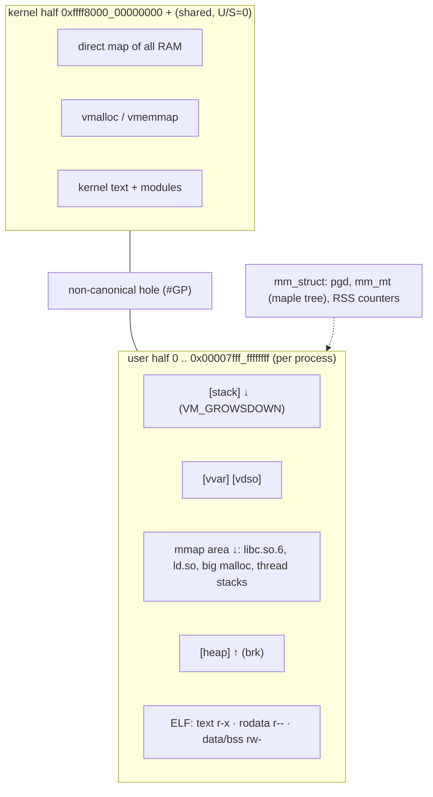

# 01 — The virtual address space layout

> Module 04 · Memory Management · Linux v6.18.63 · `ARCH-SPECIFIC (x86-64)` · Farsi: [`01-virtual-address-space.fa.md`](01-virtual-address-space.fa.md)

## 1. Summary

- Every process sees a private 128 TiB user address space (`0` – `0x00007fffffffffff`); the kernel lives in the upper half and is shared by all processes.
- The kernel describes the user half with **VMAs** (`struct vm_area_struct`) kept in a maple tree inside `struct mm_struct`; `/proc/<pid>/maps` prints them one per line.
- A VMA is a *promise*, not memory: pages appear only when touched (note 05).

## 2. Detailed explanation

**Intuition.** A pointer in your program is a number in a private, per-process space. Two processes can both have a valid pointer `0x55d4c0a01000` that refers to different physical bytes. The hardware (MMU) translates every access through the page table of the running process (note 02); the kernel decides what that table contains.

**Canonical addresses.** x86-64 with 4-level paging uses 48-bit virtual addresses. Bits 63–48 must be copies of bit 47 ("canonical"); anything else faults with #GP. This splits the 64-bit space into two halves with a huge hole between them:

| Range | Who | Size |
|---|---|---|
| `0x0000000000000000` – `0x00007fffffffffff` | user (per process) | 128 TiB |
| non-canonical hole | nobody | ~16 M TiB |
| `0xffff800000000000` – `0xffffffffffffffff` | kernel (shared) | 128 TiB |

With 5-level paging (LA57; in v6.18 the kernel is always built with `CONFIG_PGTABLE_LEVELS=5` and picks 4 or 5 levels at boot) user space grows to 56 bits (64 PiB), but Linux only hands out addresses above 47 bits if `mmap` is given a hint above that boundary, so old programs that hide tags in high pointer bits keep working.

**The kernel half.** It is mapped in every process's page table (with the U/S bit cleared, so user mode cannot touch it), which makes system calls cheap: no CR3 switch is needed to reach kernel data. Layout (from `docs.kernel.org/arch/x86/x86_64/mm.html`; that file is outside our sparse checkout): the **direct map** of all physical RAM at `page_offset_base`, `vmalloc` space, the `vmemmap` array of `struct page`, and the kernel text near the top. KASLR randomizes these bases at boot. With KPTI (Meltdown mitigation), user mode actually runs on a second page table that maps only a tiny entry trampoline of the kernel.

**The user half: VMAs.** `struct mm_struct` (one per process, shared by its threads) holds:
- `pgd` — the top-level page table (what goes into CR3);
- `mm_mt` — a **maple tree** of VMAs, indexed by address (it replaced the rbtree + linked list in 6.1);
- counters: `total_vm`, RSS per type (`MM_FILEPAGES`, `MM_ANONPAGES`, `MM_SHMEMPAGES`, `MM_SWAPENTS`).

Each `vm_area_struct` has `vm_start`, `vm_end` (exclusive), `vm_flags` (`VM_READ`, `VM_WRITE`, `VM_EXEC`, `VM_SHARED`, `VM_GROWSDOWN`…), `vm_file` + `vm_pgoff` for file mappings, `anon_vma` for anonymous pages, and `vm_ops` (the fault handler for files). The fault handler's first job is to find the VMA that contains the faulting address (walkthrough §1.1).

**Typical layout of a dynamically linked program**, low to high:

1. the executable (PIE, randomized near `0x55…`/`0x56…`): text `r-xp`, rodata `r--p`, data/bss `rw-p`;
2. `[heap]` — grown by `brk()`; glibc `malloc` uses it for small allocations;
3. a gap, then the **mmap area** growing downward from below the stack: shared libraries (`libc.so.6` in 4–5 VMAs with different permissions), large `malloc`s (≥ 128 KiB by default use `mmap`), anonymous mappings, thread stacks;
4. `[stack]` — the main thread stack, `VM_GROWSDOWN`, randomized;
5. `[vvar]`, `[vdso]` — kernel-provided pages for fast `clock_gettime()` without a syscall.

`[vsyscall]` at `0xffffffffff600000` is the legacy exception: a fixed kernel-half address that user mode can execute (emulated; see `emulate_vsyscall()` in `do_user_addr_fault`).

## 3. Diagram



## 4. Worked example (real, aos-lab VM)

```bash
cat /proc/self/maps            # 'cat' prints its own address space
grep -E 'Rss|Size' /proc/self/smaps_rollup
```

```
$ cat /proc/self/maps
5f0905b65000-5f0905b67000 r--p 00000000 08:01 1712                       /usr/bin/cat
5f0905b67000-5f0905b6c000 r-xp 00002000 08:01 1712                       /usr/bin/cat
5f0905b6c000-5f0905b6e000 r--p 00007000 08:01 1712                       /usr/bin/cat
5f0905b6e000-5f0905b6f000 r--p 00008000 08:01 1712                       /usr/bin/cat
5f0905b6f000-5f0905b70000 rw-p 00009000 08:01 1712                       /usr/bin/cat
5f09403be000-5f09403df000 rw-p 00000000 00:00 0                          [heap]
7170ba400000-7170ba6eb000 r--p 00000000 08:01 26434                      /usr/lib/locale/locale-archive
...
7170ba800000-7170ba828000 r--p 00000000 08:01 3067                       /usr/lib/x86_64-linux-gnu/libc.so.6
7170ba828000-7170ba9b1000 r-xp 00028000 08:01 3067                       /usr/lib/x86_64-linux-gnu/libc.so.6
7170ba9b1000-7170baa00000 r--p 001b1000 08:01 3067                       /usr/lib/x86_64-linux-gnu/libc.so.6
7170baa00000-7170baa04000 r--p 001ff000 08:01 3067                       /usr/lib/x86_64-linux-gnu/libc.so.6
7170baa04000-7170baa06000 rw-p 00203000 08:01 3067                       /usr/lib/x86_64-linux-gnu/libc.so.6
...
7170bab91000-7170bab95000 r--p 00000000 00:00 0                          [vvar]
7170bab97000-7170bab99000 r-xp 00000000 00:00 0                          [vdso]
7ffc55ee8000-7ffc55f09000 rw-p 00000000 00:00 0                          [stack]
ffffffffff600000-ffffffffff601000 --xp 00000000 00:00 0                  [vsyscall]
Rss:                2152 kB
```

Read it: each line is one VMA: `start-end perms offset dev inode path`. `p` = private (COW), `s` = shared. The libc mapping is split into several VMAs because ELF segments have different permissions. Compare the VMA sizes with `Rss` (resident, 2152 kB here): libc alone spans about 2 MiB and the locale archive about 3 MiB, yet the whole process has only 2 MiB resident.

The kernel side: the same data comes from `show_map_vma()` in `fs/proc/task_mmu.c`, and the VMA type is

`linux/include/linux/mm_types.h · struct vm_area_struct · v6.18.63 · L815-875` ([Elixir](https://elixir.bootlin.com/linux/v6.18.63/source/include/linux/mm_types.h#L815))

```c
struct vm_area_struct {
	/* The first cache line has the info for VMA tree walking. */

	union {
		struct {
			/* VMA covers [vm_start; vm_end) addresses within mm */
			unsigned long vm_start;
			unsigned long vm_end;
		};
		freeptr_t vm_freeptr; /* Pointer used by SLAB_TYPESAFE_BY_RCU */
	};

	struct mm_struct *vm_mm;
	pgprot_t vm_page_prot;          /* Access permissions of this VMA. */
	/* ... vm_flags union, vm_lock_seq (CONFIG_PER_VMA_LOCK) ... */
	struct list_head anon_vma_chain; /* Serialized by mmap_lock &
					  * page_table_lock */
	struct anon_vma *anon_vma;	/* Serialized by page_table_lock */

	/* Function pointers to deal with this struct. */
	const struct vm_operations_struct *vm_ops;

	/* Information about our backing store: */
	unsigned long vm_pgoff;		/* Offset (within vm_file) in PAGE_SIZE
```

| Field | Meaning |
|---|---|
| `vm_start`, `vm_end` | the half-open range; the first two columns of `maps`. |
| `vm_freeptr` | VMAs are freed with `SLAB_TYPESAFE_BY_RCU`, which is what lets `lock_vma_under_rcu()` look them up without `mmap_lock`. |
| `vm_mm` | back-pointer to the owning `mm_struct` (whose `mm_mt` maple tree, L963, and `pgd`, L973, hold the VMAs and the page table). |
| `vm_page_prot` | the PTE protection bits derived from `vm_flags`; copied into every PTE this VMA installs. |
| `anon_vma` | reverse-map anchor for anonymous pages (needed by reclaim and COW). |
| `vm_ops` | `->fault()` etc. for file and special mappings; NULL for anonymous memory. |
| `vm_pgoff` | file offset in pages — the `offset` column of `maps`. |

## 5. Edge cases & pitfalls

- **`maps` hides holes and guard pages.** Thread stacks have a guard gap; a stack overflow faults in the gap and becomes `SIGSEGV`.
- **VMA merging.** Adjacent anonymous mappings with identical flags are merged into one VMA, so one `mmap` call ≠ one line.
- **`vm.max_map_count`** (default 65530) limits VMAs per process; programs that `mprotect` many small regions (JITs, allocators with guard pages) hit it with `ENOMEM`.
- **ASLR** changes every address between runs; disable for a single run with `setarch -R ./prog` when you compare outputs.
- **Kernel addresses are hidden** from unprivileged users in `/proc/kallsyms` (`kptr_restrict`); don't conclude that the kernel is "not mapped".
- `Size` in `/proc/<pid>/status` (`VmSize`) is not memory use. `VmRSS`, `Pss` (proportional share) and cgroup `memory.current` are.

## 6. Exam-style key points

- x86-64 4-level: 48-bit canonical VA, 128 TiB user + 128 TiB kernel.
- One `mm_struct` per process (shared by threads, `CLONE_VM`); `task_struct->mm` is NULL for kernel threads.
- VMA = `[vm_start, vm_end)`, flags, backing (file+offset or anon); stored in a maple tree since 6.1 (`VERSION-DEPENDENT`).
- The kernel half is mapped in every process (U/S=0) so syscalls need no CR3 switch — except under KPTI.
- `/proc/<pid>/maps` = VMAs; `smaps` = per-VMA RSS/PSS/swap; `pagemap` = per-page PFN (Lab 02).

## 7. Links

- Lesson: [§2.1](../lesson.en.md#21-what-does-the-address-0x7ffd1c3a2b40-actually-point-to)
- Walkthrough: [§1.1 finding the VMA](../kernel-walkthrough.en.md#11-finding-the-vma--do_user_addr_fault)
- Labs: [04.2 COW through pagemap](../labs/02-cow-pagemap/README.md) (reads `smaps`)
- Quiz: Q1, Q11
