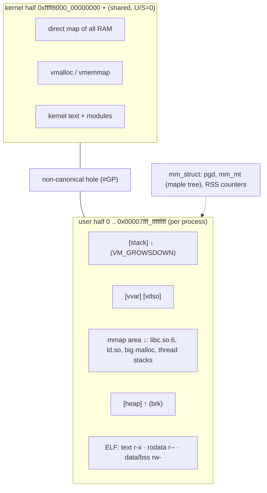

<div dir="rtl">

# ۰۱ — چیدمان فضای آدرس مجازی

> ماژول ۰۴ · مدیریت حافظه · Linux v6.18.63 · `ARCH-SPECIFIC (x86-64)` · نسخهٔ انگلیسی: [`01-virtual-address-space.en.md`](01-virtual-address-space.en.md)

## ۱. خلاصه

- هر پردازه فضای آدرس کاربرِ خصوصی خودش را می‌بیند که ۱۲۸ ترابایت است (`0` تا `0x00007fffffffffff`). کرنل در نیمهٔ بالایی است و همهٔ پردازه‌ها در آن شریک‌اند.
- کرنل نیمهٔ کاربر را با **VMA**ها (`struct vm_area_struct`) توصیف می‌کند. VMAها در یک maple tree داخل `struct mm_struct` نگه داشته می‌شوند و `/proc/<pid>/maps` هر کدام را در یک خط چاپ می‌کند.
- VMA یک *وعده* است، نه حافظه. صفحه‌ها فقط وقتی لمس شوند پیدا می‌شوند (یادداشت ۰۵).

## ۲. توضیح مفصل

**شهود.** هر اشاره‌گر در برنامهٔ شما عددی است در یک فضای خصوصیِ مخصوص همان پردازه. دو پردازه می‌توانند هر دو اشاره‌گر معتبر `0x55d4c0a01000` داشته باشند که به بایت‌های فیزیکی متفاوتی اشاره کند. سخت‌افزار (MMU) هر دسترسی را از جدول صفحهٔ پردازهٔ در حال اجرا ترجمه می‌کند (یادداشت ۰۲) و کرنل تعیین می‌کند آن جدول چه محتوایی داشته باشد.

**آدرس‌های canonical.** x86-64 با paging چهارسطحی آدرس مجازی ۴۸ بیتی دارد. بیت‌های ۶۳ تا ۴۸ باید کپی بیت ۴۷ باشند (canonical)، وگرنه دسترسی با #GP شکست می‌خورد. این قاعده فضای ۶۴ بیتی را به دو نیمه با یک حفرهٔ بزرگ بینشان تقسیم می‌کند:

| بازه | متعلق به | اندازه |
|---|---|---|
| `0x0000000000000000` تا `0x00007fffffffffff` | کاربر (جدا برای هر پردازه) | ۱۲۸ ترابایت |
| حفرهٔ غیر canonical | هیچ‌کس | حدود ۱۶ میلیون ترابایت |
| `0xffff800000000000` تا `0xffffffffffffffff` | کرنل (مشترک) | ۱۲۸ ترابایت |

با paging پنج‌سطحی (LA57؛ در v6.18 کرنل همیشه با `CONFIG_PGTABLE_LEVELS=5` ساخته می‌شود و هنگام بوت ۴ یا ۵ سطح را انتخاب می‌کند) فضای کاربر به ۵۶ بیت (۶۴ پتابایت) می‌رسد. ولی لینوکس آدرس بالای ۴۷ بیت را فقط وقتی می‌دهد که در `mmap` یک hint بالاتر از این مرز داده شود. به این ترتیب برنامه‌های قدیمی که در بیت‌های بالای اشاره‌گر برچسب پنهان می‌کنند خراب نمی‌شوند.

**نیمهٔ کرنل.** این نیمه در جدول صفحهٔ همهٔ پردازه‌ها map شده است، با بیت U/S خاموش تا حالت کاربر نتواند به آن دست بزند. همین باعث می‌شود syscall ارزان باشد: برای رسیدن به داده‌های کرنل لازم نیست CR3 عوض شود. چیدمان آن این است (طبق `docs.kernel.org/arch/x86/x86_64/mm.html`؛ این فایل در sparse checkout ما نیست):

- **direct map** کل RAM فیزیکی در `page_offset_base`؛
- فضای `vmalloc`؛
- آرایهٔ `vmemmap` از `struct page`؛
- کد کرنل نزدیک بالای فضا.

KASLR این پایه‌ها را هنگام بوت تصادفی می‌کند. با KPTI (راهکار مقابله با Meltdown)، حالت کاربر در واقع روی یک جدول صفحهٔ دوم اجرا می‌شود که از کرنل فقط یک trampoline ورودی کوچک را map کرده است.

**نیمهٔ کاربر: VMAها.** `struct mm_struct` (یکی برای هر پردازه، که نخ‌هایش در آن شریک‌اند) این‌ها را نگه می‌دارد:
- `pgd`: جدول صفحهٔ سطح بالا، یعنی همان چیزی که در CR3 نوشته می‌شود؛
- `mm_mt`: یک **maple tree** از VMAها که بر اساس آدرس مرتب شده است (از نسخهٔ ۶٫۱ جای rbtree و فهرست پیوندی را گرفت)؛
- شمارنده‌ها: `total_vm` و RSS به تفکیک نوع (`MM_FILEPAGES`، `MM_ANONPAGES`، `MM_SHMEMPAGES`، `MM_SWAPENTS`).

هر `vm_area_struct` این فیلدها را دارد:
- `vm_start` و `vm_end` (`vm_end` خودش جزو بازه نیست)؛
- `vm_flags` (`VM_READ`، `VM_WRITE`، `VM_EXEC`، `VM_SHARED`، `VM_GROWSDOWN` و…)؛
- `vm_file` و `vm_pgoff` برای mappingهای فایل؛
- `anon_vma` برای صفحه‌های ناشناس؛
- `vm_ops`، یعنی fault handler فایل‌ها.

اولین کار fault handler پیدا کردن VMAای است که آدرس خطادار را در بر دارد (گشت در کد، بخش ۱.۱).

**چیدمان معمول یک برنامهٔ dynamically linked**، از پایین به بالا:

1. فایل اجرایی (PIE، که تصادفی نزدیک `0x55…` یا `0x56…` قرار می‌گیرد): text با `r-xp`، rodata با `r--p`، و data/bss با `rw-p`؛
2. `[heap]` که با `brk()` بزرگ می‌شود و `malloc` در glibc تخصیص‌های کوچک را از آن می‌دهد؛
3. یک فاصله و بعد **ناحیهٔ mmap** که از زیر stack رو به پایین رشد می‌کند. کتابخانه‌های اشتراکی اینجا هستند (`libc.so.6` در ۴ یا ۵ VMA با دسترسی‌های مختلف)، همین‌طور `malloc`های بزرگ (به‌طور پیش‌فرض ۱۲۸ کیلوبایت به بالا از `mmap` استفاده می‌کنند)، mappingهای ناشناس و stack نخ‌ها؛
4. `[stack]`، پشتهٔ نخ اصلی، با `VM_GROWSDOWN` و آدرس تصادفی؛
5. `[vvar]` و `[vdso]`، صفحه‌هایی که کرنل می‌دهد تا `clock_gettime()` بدون syscall و سریع اجرا شود.

`[vsyscall]` در `0xffffffffff600000` استثنای قدیمی است: آدرسی ثابت در نیمهٔ کرنل که حالت کاربر می‌تواند آن را اجرا کند. این دسترسی شبیه‌سازی می‌شود؛ `emulate_vsyscall()` را در `do_user_addr_fault` ببینید.

## ۳. نمودار

</div>



<div dir="rtl">

## ۴. مثال کاربردی (خروجی واقعی از VM آزمایشگاه)

</div>

```bash
cat /proc/self/maps            # 'cat' prints its own address space
grep -E 'Rss|Size' /proc/self/smaps_rollup
```

```
$ cat /proc/self/maps
5f0905b65000-5f0905b67000 r--p 00000000 08:01 1712                       /usr/bin/cat
5f0905b67000-5f0905b6c000 r-xp 00002000 08:01 1712                       /usr/bin/cat
5f0905b6c000-5f0905b6e000 r--p 00007000 08:01 1712                       /usr/bin/cat
5f0905b6e000-5f0905b6f000 r--p 00008000 08:01 1712                       /usr/bin/cat
5f0905b6f000-5f0905b70000 rw-p 00009000 08:01 1712                       /usr/bin/cat
5f09403be000-5f09403df000 rw-p 00000000 00:00 0                          [heap]
7170ba400000-7170ba6eb000 r--p 00000000 08:01 26434                      /usr/lib/locale/locale-archive
...
7170ba800000-7170ba828000 r--p 00000000 08:01 3067                       /usr/lib/x86_64-linux-gnu/libc.so.6
7170ba828000-7170ba9b1000 r-xp 00028000 08:01 3067                       /usr/lib/x86_64-linux-gnu/libc.so.6
7170ba9b1000-7170baa00000 r--p 001b1000 08:01 3067                       /usr/lib/x86_64-linux-gnu/libc.so.6
7170baa00000-7170baa04000 r--p 001ff000 08:01 3067                       /usr/lib/x86_64-linux-gnu/libc.so.6
7170baa04000-7170baa06000 rw-p 00203000 08:01 3067                       /usr/lib/x86_64-linux-gnu/libc.so.6
...
7170bab91000-7170bab95000 r--p 00000000 00:00 0                          [vvar]
7170bab97000-7170bab99000 r-xp 00000000 00:00 0                          [vdso]
7ffc55ee8000-7ffc55f09000 rw-p 00000000 00:00 0                          [stack]
ffffffffff600000-ffffffffff601000 --xp 00000000 00:00 0                  [vsyscall]
Rss:                2152 kB
```

<div dir="rtl">

هر خط یک VMA است با این ستون‌ها: `start-end perms offset dev inode path`. حرف `p` یعنی خصوصی (COW) و `s` یعنی اشتراکی. mapping کتابخانهٔ libc به چند VMA تقسیم شده، چون segmentهای ELF دسترسی‌های متفاوتی دارند. اندازهٔ VMAها را با `Rss` (ساکن در حافظه، اینجا ۲۱۵۲ کیلوبایت) مقایسه کنید: فقط libc حدود ۲ مگابایت و locale-archive حدود ۳ مگابایت فضا گرفته‌اند، ولی کل پردازه فقط ۲ مگابایت در RAM دارد.

در سمت کرنل، همین داده را `show_map_vma()` در `fs/proc/task_mmu.c` تولید می‌کند. نوع VMA این است:

`linux/include/linux/mm_types.h · struct vm_area_struct · v6.18.63 · L815-875` ([Elixir](https://elixir.bootlin.com/linux/v6.18.63/source/include/linux/mm_types.h#L815))

</div>

```c
struct vm_area_struct {
	/* The first cache line has the info for VMA tree walking. */

	union {
		struct {
			/* VMA covers [vm_start; vm_end) addresses within mm */
			unsigned long vm_start;
			unsigned long vm_end;
		};
		freeptr_t vm_freeptr; /* Pointer used by SLAB_TYPESAFE_BY_RCU */
	};

	struct mm_struct *vm_mm;
	pgprot_t vm_page_prot;          /* Access permissions of this VMA. */
	/* ... vm_flags union, vm_lock_seq (CONFIG_PER_VMA_LOCK) ... */
	struct list_head anon_vma_chain; /* Serialized by mmap_lock &
					  * page_table_lock */
	struct anon_vma *anon_vma;	/* Serialized by page_table_lock */

	/* Function pointers to deal with this struct. */
	const struct vm_operations_struct *vm_ops;

	/* Information about our backing store: */
	unsigned long vm_pgoff;		/* Offset (within vm_file) in PAGE_SIZE
```

<div dir="rtl">

| فیلد | معنی |
|---|---|
| `vm_start` و `vm_end` | بازهٔ نیمه‌باز؛ دو ستون اول `maps`. |
| `vm_freeptr` | VMAها با `SLAB_TYPESAFE_BY_RCU` آزاد می‌شوند. همین است که به `lock_vma_under_rcu()` اجازه می‌دهد بدون `mmap_lock` آن‌ها را پیدا کند. |
| `vm_mm` | اشاره‌گر به `mm_struct` صاحب این VMA. maple tree `mm_mt` (خط ۹۶۳) و `pgd` (خط ۹۷۳) در آن ساختار هستند. |
| `vm_page_prot` | بیت‌های حفاظت PTE که از `vm_flags` ساخته شده‌اند و در هر PTEای که این VMA نصب کند کپی می‌شوند. |
| `anon_vma` | لنگر reverse map برای صفحه‌های ناشناس؛ reclaim و COW به آن نیاز دارند. |
| `vm_ops` | توابعی مثل `->fault()` برای فایل‌ها و mappingهای ویژه. برای حافظهٔ ناشناس NULL است. |
| `vm_pgoff` | offset داخل فایل بر حسب صفحه؛ همان ستون `offset` در `maps`. |

## ۵. حالت‌های مرزی و دام‌ها

- **`maps` حفره‌ها و صفحه‌های نگهبان را نشان نمی‌دهد.** stack نخ‌ها یک فاصلهٔ نگهبان دارد. سرریز stack در همین فاصله fault می‌دهد و به `SIGSEGV` تبدیل می‌شود.
- **ادغام VMAها.** mappingهای ناشناس مجاور که پرچم‌های یکسان دارند در یک VMA ادغام می‌شوند. پس هر فراخوانی `mmap` لزوماً یک خط نیست.
- **`vm.max_map_count`** (پیش‌فرض ۶۵۵۳۰) تعداد VMA هر پردازه را محدود می‌کند. برنامه‌هایی که روی ناحیه‌های کوچک زیادی `mprotect` می‌زنند (JITها، allocatorهایی که guard page می‌گذارند) به آن می‌رسند و `ENOMEM` می‌گیرند.
- **ASLR** همهٔ آدرس‌ها را بین اجراها عوض می‌کند. اگر می‌خواهید خروجی‌ها را مقایسه کنید، برای یک اجرا آن را با `setarch -R ./prog` خاموش کنید.
- **آدرس‌های کرنل** در `/proc/kallsyms` از کاربر بی‌امتیاز پنهان‌اند (`kptr_restrict`). از این نتیجه نگیرید که کرنل «map نشده».
- `VmSize` در `/proc/<pid>/status` مصرف حافظه نیست. مصرف واقعی را `VmRSS`، `Pss` (سهم تناسبی) و `memory.current` در cgroup نشان می‌دهند.

## ۶. نکته‌های امتحانی

- x86-64 چهارسطحی: آدرس مجازی canonical ۴۸ بیتی، ۱۲۸ ترابایت برای کاربر و ۱۲۸ ترابایت برای کرنل.
- هر پردازه یک `mm_struct` دارد که نخ‌هایش با `CLONE_VM` در آن شریک‌اند. برای نخ‌های کرنل `task_struct->mm` برابر NULL است.
- VMA یعنی بازهٔ `[vm_start, vm_end)` با پرچم‌ها و پشتیبان (فایل و offset، یا ناشناس). از نسخهٔ ۶٫۱ در maple tree ذخیره می‌شود (`VERSION-DEPENDENT`).
- نیمهٔ کرنل در همهٔ پردازه‌ها map شده است (با U/S=0)، پس syscall به عوض کردن CR3 نیاز ندارد، مگر زیر KPTI.
- `/proc/<pid>/maps` یعنی VMAها؛ `smaps` یعنی RSS و PSS و swap برای هر VMA؛ `pagemap` یعنی PFN برای هر صفحه (آزمایش ۰۲).

## ۷. پیوندها

- درس: [بخش ۲.۱](../lesson.fa.md)
- گشت در کد: [بخش ۱.۱، پیدا کردن VMA](../kernel-walkthrough.fa.md)
- آزمایش: [04.2، COW از راه pagemap](../labs/02-cow-pagemap/README.md) (`smaps` را می‌خواند)
- آزمون: پرسش‌های ۱ و ۱۱

</div>
