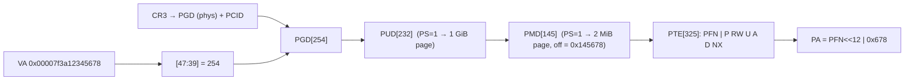

# 02 — 4- and 5-level page tables

> Module 04 · Memory Management · Linux v6.18.63 · `ARCH-SPECIFIC (x86-64)` · Farsi: [`02-page-tables.fa.md`](02-page-tables.fa.md)

## 1. Summary

- x86-64 translates a 48-bit VA with a 4-level radix tree (PGD → PUD → PMD → PTE), each level a 4 KiB page of 512 eight-byte entries; LA57 adds a fifth level (P4D) for 57-bit VAs.
- Each entry holds a physical frame number plus permission and status bits (P, R/W, U/S, A, D, PS, NX); a huge page is simply a PMD (2 MiB) or PUD (1 GiB) entry with PS=1 that ends the walk early.
- Linux uses one generic 5-level model (`pgd/p4d/pud/pmd/pte`) and "folds" unused levels at compile/boot time.

## 2. Detailed explanation

**Why a tree?** A flat table for 2^36 pages × 8 bytes = 512 GiB per process. A radix tree only allocates tables for regions actually in use: a small program needs a handful of 4 KiB tables.

**The walk (4-level).** The MMU takes `CR3` (physical address of the PGD + PCID), then:

| Step | Index bits | Table | Entry points to |
|---|---|---|---|
| 1 | VA[47:39] | PGD | a PUD table |
| 2 | VA[38:30] | PUD | a PMD table, or a **1 GiB page** if PS=1 |
| 3 | VA[29:21] | PMD | a PTE table, or a **2 MiB page** if PS=1 |
| 4 | VA[20:12] | PTE | a 4 KiB frame |
| — | VA[11:0] | offset inside the page | |

Each step is a memory read (possibly cached in L1/L2/L3 and in the MMU's paging-structure caches). A TLB miss on a 4 KiB page therefore costs up to 4 dependent reads; under virtualization with EPT/NPT it is a **2-D walk** of up to 24 reads, because every guest-physical table address must itself be translated by the host tables. That matters for this course's VM (Lab 04).

**Entry bits** (`arch/x86/include/asm/pgtable_types.h`, v6.18.63):

| Bit | Name | Set by | Used for |
|---|---|---|---|
| 0 | `_PAGE_BIT_PRESENT` | kernel | 0 → any access faults (#PF); the rest of the entry is free for software (swap entry) |
| 1 | `_PAGE_BIT_RW` | kernel | 0 → writes fault (COW, write-protect) |
| 2 | `_PAGE_BIT_USER` | kernel | 0 → user mode cannot access (kernel half) |
| 5 | `_PAGE_BIT_ACCESSED` | **CPU** | reclaim ageing ("young") |
| 6 | `_PAGE_BIT_DIRTY` | **CPU** | page must be written back before reuse |
| 7 | `_PAGE_BIT_PSE` | kernel | huge page at PMD/PUD level |
| 8 | `_PAGE_BIT_GLOBAL` | kernel | entry survives CR3 switches (kernel mappings) |
| 63 | `_PAGE_BIT_NX` | kernel | no instruction fetch |

Bits 12–51 hold the PFN (up to 52 physical address bits, `MAX_POSSIBLE_PHYSMEM_BITS`).

**Linux's generic model.** Core mm code is written for five levels: `pgd_t`, `p4d_t`, `pud_t`, `pmd_t`, `pte_t`, with helpers `pgd_offset()`, `p4d_alloc()`, `pud_alloc()`, `pmd_alloc()`, `pte_offset_map()`. On a 4-level machine, the p4d level is folded: `p4d_alloc()` simply returns the PGD entry reinterpreted. On x86-64 the choice is made **at boot** (`pgtable_l5_enabled()`), which is why `PGDIR_SHIFT` is a variable (`pgdir_shift` = 39 or 48) and not a constant. You saw this walk in `__handle_mm_fault()` (walkthrough §2.1): `pgd_offset → p4d_alloc → pud_alloc → pmd_alloc`, then `handle_pte_fault()`.

**Who allocates tables?** The page-fault path, on demand. A process that touches one byte in a fresh 1 GiB region needs one new PUD entry, one PMD table, one PTE table: three 4 KiB allocations besides the data page. Page tables are accounted in `/proc/<pid>/status` as `VmPTE` and in `oom_badness()` (`mm_pgtables_bytes`). Large sparse address spaces (e.g. a JVM, or a database touching terabytes of `mmap`) can spend gigabytes on page tables — one reason for huge pages.

**Huge pages in the tree.** A 2 MiB THP is a PMD entry with PS=1: no PTE table at all, 1 TLB entry instead of 512. Splitting it (e.g. `mprotect` on half of it) means allocating a PTE table and writing 512 PTEs.

## 3. Diagram



## 4. Worked example

**Split an address by hand** (real computation, Python on the host):

```bash
python -c "
va=0x00007f3a12345678
print('pgd',(va>>39)&511,'pud',(va>>30)&511,'pmd',(va>>21)&511,'pte',(va>>12)&511,'off',hex(va&4095))
print('2M off',hex(va&((1<<21)-1)))"
```

```
pgd 254 pud 232 pmd 145 pte 325 off 0x678
2M off 0x145678
```

If the address is in a THP, the walk stops at PMD[145] and the offset inside the 2 MiB page is `0x145678`.

**The constants in the source** — `linux/arch/x86/include/asm/pgtable_64_types.h · v6.18.63 · L50-80` ([Elixir](https://elixir.bootlin.com/linux/v6.18.63/source/arch/x86/include/asm/pgtable_64_types.h#L50)):

```c
#define PGDIR_SHIFT	pgdir_shift
#define PTRS_PER_PGD	512

/*
 * 4th level page in 5-level paging case
 */
#define P4D_SHIFT		39
#define MAX_PTRS_PER_P4D	512
#define PTRS_PER_P4D		ptrs_per_p4d
/* ... */
#define MAX_POSSIBLE_PHYSMEM_BITS	52
/* ... */
#define PUD_SHIFT	30
#define PTRS_PER_PUD	512
/* ... */
#define PMD_SHIFT	21
#define PTRS_PER_PMD	512
/* ... */
#define PTRS_PER_PTE	512
```

| Line | Meaning |
|---|---|
| `PGDIR_SHIFT pgdir_shift` | a variable: 39 with 4 levels, 48 with LA57 — decided at boot. |
| `P4D_SHIFT 39` | in 5-level mode the P4D covers what the PGD covers in 4-level mode. |
| `PTRS_PER_P4D ptrs_per_p4d` | 1 when folded (4-level), 512 with LA57. |
| `PUD_SHIFT 30`, `PMD_SHIFT 21` | one PUD entry = 1 GiB, one PMD entry = 2 MiB. |
| `PTRS_PER_* 512` | 4096 B / 8 B per entry. |

**On the VM:** is 5-level paging on, and how much memory do page tables use?

```bash
grep -o -w la57 /proc/cpuinfo | head -1 ; grep PageTables /proc/meminfo ; grep VmPTE /proc/self/status
```

```
PageTables:         6440 kB
SecPageTables:         0 kB
VmPTE:	      56 kB
```

The `la57` grep prints nothing, so this VM uses 4-level paging.

## 5. Edge cases & pitfalls

- **"Page table" means four (or five) tables**, and the kernel half's upper-level entries are shared by all processes (copied into each new PGD at `fork`).
- **Present=0 entries are not empty.** A non-present PTE may hold a swap entry, a migration entry, or a PTE marker (userfaultfd); `handle_pte_fault()` distinguishes `pte_none()` from `!pte_present()`.
- **Accessed/Dirty bits are set by hardware** without a fault; clearing them requires a TLB flush to be reliable, which is why reclaim batches flushes.
- **1 GiB pages** are only for hugetlbfs (and DAX); THP for anonymous memory is PMD-sized (plus smaller mTHP orders since 6.8). `VERSION-DEPENDENT`
- **LA57** needs the `la57` CPU flag at boot (v6.18 always builds with `CONFIG_PGTABLE_LEVELS=5`; the aos-lab config shows it); most VMs, including ours, do not expose the flag, so the kernel runs 4-level.

## 6. Exam-style key points

- 4 levels × 9 bits + 12-bit offset = 48 bits; 5 levels → 57 bits.
- 512 entries × 8 B = one 4 KiB page per table.
- PMD with PS=1 → 2 MiB page; PUD with PS=1 → 1 GiB page.
- A/D bits are written by the CPU; P/RW/U/NX by the kernel.
- Linux core mm is 5-level generic; x86-64 folds p4d at boot when LA57 is absent.
- Page tables are allocated lazily by the fault path; they count toward OOM badness.

## 7. Links

- Lesson: [§2.2](../lesson.en.md#22-how-does-the-cpu-translate-it)
- Walkthrough: [§2.1 walking the levels](../kernel-walkthrough.en.md#21-walking-the-levels--__handle_mm_fault)
- Labs: [04.4 TLB reach](../labs/04-tlb-hugepages/README.md)
- Quiz: Q1, Q2
