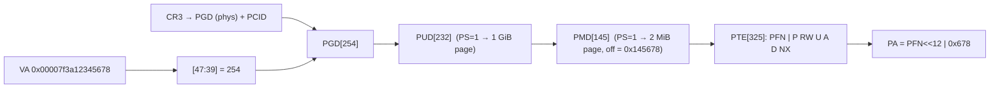

<div dir="rtl">

# ۰۲ — جدول‌های صفحهٔ چهار و پنج‌سطحی

> ماژول ۰۴ · مدیریت حافظه · Linux v6.18.63 · `ARCH-SPECIFIC (x86-64)` · نسخهٔ انگلیسی: [`02-page-tables.en.md`](02-page-tables.en.md)

## ۱. خلاصه

- x86-64 آدرس مجازی ۴۸ بیتی را با یک درخت radix چهارسطحی ترجمه می‌کند: PGD، PUD، PMD و PTE. هر سطح یک صفحهٔ ۴ کیلوبایتی با ۵۱۲ مدخل هشت‌بایتی است. LA57 سطح پنجم (P4D) را برای آدرس‌های ۵۷ بیتی اضافه می‌کند.
- هر مدخل یک شمارهٔ قاب فیزیکی و چند بیت دسترسی و وضعیت دارد: P، R/W، U/S، A، D، PS و NX. صفحهٔ بزرگ صرفاً یک مدخل PMD (۲ مگابایت) یا PUD (۱ گیگابایت) با PS=1 است که پیمایش را زودتر تمام می‌کند.
- لینوکس یک مدل عمومی پنج‌سطحی دارد (`pgd/p4d/pud/pmd/pte`) و سطح‌هایی را که به کار نمی‌آیند هنگام کامپایل یا بوت «تا» می‌کند (fold).

## ۲. توضیح مفصل

**چرا درخت؟** یک جدول تخت برای ۲ به توان ۳۶ صفحه با ۸ بایت برای هر مدخل، برای هر پردازه ۵۱۲ گیگابایت می‌شد. درخت radix فقط برای ناحیه‌هایی که واقعاً استفاده می‌شوند جدول می‌سازد، و یک برنامهٔ کوچک با چند جدول ۴ کیلوبایتی سر می‌کند.

**پیمایش چهارسطحی.** MMU از `CR3` شروع می‌کند که آدرس فیزیکی PGD و PCID را دارد. بعد:

| گام | بیت‌های اندیس | جدول | مدخل به چه اشاره می‌کند |
|---|---|---|---|
| ۱ | VA[47:39] | PGD | یک جدول PUD |
| ۲ | VA[38:30] | PUD | یک جدول PMD، یا اگر PS=1 باشد یک **صفحهٔ ۱ گیگابایتی** |
| ۳ | VA[29:21] | PMD | یک جدول PTE، یا اگر PS=1 باشد یک **صفحهٔ ۲ مگابایتی** |
| ۴ | VA[20:12] | PTE | یک قاب ۴ کیلوبایتی |
| — | VA[11:0] | offset داخل صفحه | |

هر گام یک خواندن از حافظه است که ممکن است از L1، L2 یا L3 یا از cacheهای ساختار paging داخل MMU جواب بگیرد. پس TLB miss روی صفحهٔ ۴ کیلوبایتی تا ۴ خواندن وابسته به هم هزینه دارد. زیر مجازی‌سازی با EPT یا NPT پیمایش **دوبعدی** می‌شود و تا ۲۴ خواندن لازم است، چون آدرس فیزیکیِ مهمانِ هر جدول باید خودش با جدول‌های میزبان ترجمه شود. این برای VM این درس اهمیت دارد (آزمایش ۰۴).

**بیت‌های مدخل** (`arch/x86/include/asm/pgtable_types.h`، v6.18.63):

| بیت | نام | چه کسی می‌نویسد | کاربرد |
|---|---|---|---|
| 0 | `_PAGE_BIT_PRESENT` | کرنل | اگر صفر باشد هر دسترسی fault می‌دهد (#PF) و بقیهٔ مدخل در اختیار نرم‌افزار است (مثلاً swap entry) |
| 1 | `_PAGE_BIT_RW` | کرنل | اگر صفر باشد نوشتن fault می‌دهد (COW، محافظت در برابر نوشتن) |
| 2 | `_PAGE_BIT_USER` | کرنل | اگر صفر باشد حالت کاربر دسترسی ندارد (نیمهٔ کرنل) |
| 5 | `_PAGE_BIT_ACCESSED` | **CPU** | پیرشدن صفحه در reclaim (حالت «young») |
| 6 | `_PAGE_BIT_DIRTY` | **CPU** | صفحه باید قبل از استفادهٔ دوباره نوشته شود |
| 7 | `_PAGE_BIT_PSE` | کرنل | صفحهٔ بزرگ در سطح PMD یا PUD |
| 8 | `_PAGE_BIT_GLOBAL` | کرنل | مدخل بعد از عوض شدن CR3 هم می‌ماند (mappingهای کرنل) |
| 63 | `_PAGE_BIT_NX` | کرنل | اجرای دستور ممنوع است |

بیت‌های ۱۲ تا ۵۱ PFN را نگه می‌دارند (تا ۵۲ بیت آدرس فیزیکی، `MAX_POSSIBLE_PHYSMEM_BITS`).

**مدل عمومی لینوکس.** کد هستهٔ mm برای پنج سطح نوشته شده است: انواع `pgd_t`، `p4d_t`، `pud_t`، `pmd_t` و `pte_t`، و توابع کمکی `pgd_offset()`، `p4d_alloc()`، `pud_alloc()`، `pmd_alloc()` و `pte_offset_map()`. روی ماشین چهارسطحی، سطح p4d تا شده است و `p4d_alloc()` فقط همان مدخل PGD را با نوع دیگر برمی‌گرداند. در x86-64 این انتخاب **هنگام بوت** انجام می‌شود (`pgtable_l5_enabled()`). به همین دلیل `PGDIR_SHIFT` یک متغیر است (`pgdir_shift` برابر ۳۹ یا ۴۸) و نه ثابت. این پیمایش را در `__handle_mm_fault()` دیدید (گشت در کد، بخش ۲.۱): اول `pgd_offset`، بعد `p4d_alloc`، `pud_alloc` و `pmd_alloc`، و در آخر `handle_pte_fault()`.

**چه کسی جدول‌ها را تخصیص می‌دهد؟** مسیر page fault، و آن هم وقتی لازم شود. پردازه‌ای که یک بایت در ناحیهٔ تازهٔ ۱ گیگابایتی لمس کند، یک مدخل PUD جدید، یک جدول PMD و یک جدول PTE لازم دارد. یعنی جدا از صفحهٔ داده، سه تخصیص ۴ کیلوبایتی. page tableها در `/proc/<pid>/status` زیر `VmPTE` و در `oom_badness()` با `mm_pgtables_bytes` حساب می‌شوند. فضاهای آدرس بزرگ و پراکنده می‌توانند گیگابایت‌ها حافظه صرف page table کنند؛ مثلاً JVM، یا پایگاه داده‌ای که ترابایت‌ها داده را با `mmap` لمس می‌کند. این یکی از دلیل‌های استفاده از صفحه‌های بزرگ است.

**صفحه‌های بزرگ در درخت.** یک THP دو مگابایتی یک مدخل PMD با PS=1 است، یعنی اصلاً جدول PTE ندارد و به‌جای ۵۱۲ مدخل TLB یک مدخل می‌گیرد. شکستن آن (مثلاً با `mprotect` روی نیمی از آن) یعنی تخصیص یک جدول PTE و نوشتن ۵۱۲ PTE.

## ۳. نمودار

</div>



<div dir="rtl">

## ۴. مثال کاربردی

**تقسیم یک آدرس با دست** (محاسبهٔ واقعی با Python روی میزبان):

</div>

```bash
python -c "
va=0x00007f3a12345678
print('pgd',(va>>39)&511,'pud',(va>>30)&511,'pmd',(va>>21)&511,'pte',(va>>12)&511,'off',hex(va&4095))
print('2M off',hex(va&((1<<21)-1)))"
```

```
pgd 254 pud 232 pmd 145 pte 325 off 0x678
2M off 0x145678
```

<div dir="rtl">

اگر آدرس داخل یک THP باشد، پیمایش در PMD[145] تمام می‌شود و offset داخل صفحهٔ ۲ مگابایتی `0x145678` است.

**ثابت‌ها در سورس:** `linux/arch/x86/include/asm/pgtable_64_types.h · v6.18.63 · L50-80` ([Elixir](https://elixir.bootlin.com/linux/v6.18.63/source/arch/x86/include/asm/pgtable_64_types.h#L50))

</div>

```c
#define PGDIR_SHIFT	pgdir_shift
#define PTRS_PER_PGD	512

/*
 * 4th level page in 5-level paging case
 */
#define P4D_SHIFT		39
#define MAX_PTRS_PER_P4D	512
#define PTRS_PER_P4D		ptrs_per_p4d
/* ... */
#define MAX_POSSIBLE_PHYSMEM_BITS	52
/* ... */
#define PUD_SHIFT	30
#define PTRS_PER_PUD	512
/* ... */
#define PMD_SHIFT	21
#define PTRS_PER_PMD	512
/* ... */
#define PTRS_PER_PTE	512
```

<div dir="rtl">

| خط | معنی |
|---|---|
| `PGDIR_SHIFT pgdir_shift` | یک متغیر است: با چهار سطح ۳۹ و با LA57 برابر ۴۸. مقدارش هنگام بوت تعیین می‌شود. |
| `P4D_SHIFT 39` | در حالت پنج‌سطحی، P4D همان بازه‌ای را می‌پوشاند که PGD در حالت چهارسطحی می‌پوشاند. |
| `PTRS_PER_P4D ptrs_per_p4d` | وقتی سطح تا شده باشد (چهارسطحی) ۱ است و با LA57 برابر ۵۱۲. |
| `PUD_SHIFT 30` و `PMD_SHIFT 21` | هر مدخل PUD یک گیگابایت را می‌پوشاند و هر مدخل PMD دو مگابایت را. |
| `PTRS_PER_* 512` | ۴۰۹۶ بایت تقسیم بر ۸ بایت برای هر مدخل. |

**روی VM:** آیا paging پنج‌سطحی روشن است و page tableها چقدر حافظه مصرف می‌کنند؟

</div>

```bash
grep -o -w la57 /proc/cpuinfo | head -1 ; grep PageTables /proc/meminfo ; grep VmPTE /proc/self/status
```

```
PageTables:         6440 kB
SecPageTables:         0 kB
VmPTE:	      56 kB
```

<div dir="rtl">

دستور grep برای `la57` چیزی چاپ نمی‌کند، پس این VM از paging چهارسطحی استفاده می‌کند.

</div>

<div dir="rtl">

## ۵. حالت‌های مرزی و دام‌ها

- **«page table» یعنی چهار (یا پنج) جدول.** مدخل‌های سطح بالای نیمهٔ کرنل بین همهٔ پردازه‌ها مشترک‌اند و هنگام `fork` در هر PGD تازه کپی می‌شوند.
- **مدخل با Present=0 خالی نیست.** یک PTE غیرحاضر می‌تواند swap entry، migration entry یا PTE marker (برای userfaultfd) باشد. `handle_pte_fault()` حالت `pte_none()` را از `!pte_present()` جدا می‌کند.
- **بیت‌های Accessed و Dirty را سخت‌افزار** بدون fault روشن می‌کند. پاک کردن قابل‌اعتماد آن‌ها به TLB flush نیاز دارد و به همین دلیل reclaim flushها را دسته‌ای انجام می‌دهد.
- **صفحه‌های ۱ گیگابایتی** فقط برای hugetlbfs (و DAX) هستند. THP برای حافظهٔ ناشناس اندازهٔ PMD دارد، به‌اضافهٔ orderهای کوچک‌تر mTHP از نسخهٔ ۶٫۸. `VERSION-DEPENDENT`
- **LA57** هنگام بوت به پرچم `la57` در CPU نیاز دارد (v6.18 همیشه با `CONFIG_PGTABLE_LEVELS=5` ساخته می‌شود و پیکربندی aos-lab هم همین را نشان می‌دهد). بیشتر VMها، از جمله VM ما، این پرچم را به مهمان نمی‌دهند و کرنل چهارسطحی اجرا می‌شود.

## ۶. نکته‌های امتحانی

- ۴ سطح ضرب در ۹ بیت به‌اضافهٔ ۱۲ بیت offset برابر ۴۸ بیت است؛ با ۵ سطح، ۵۷ بیت.
- ۵۱۲ مدخل ضرب در ۸ بایت، یعنی هر جدول یک صفحهٔ ۴ کیلوبایتی.
- PMD با PS=1 یعنی صفحهٔ ۲ مگابایتی؛ PUD با PS=1 یعنی صفحهٔ ۱ گیگابایتی.
- بیت‌های A و D را CPU می‌نویسد؛ بیت‌های P، RW، U و NX را کرنل.
- هستهٔ mm لینوکس به‌صورت عمومی پنج‌سطحی است و x86-64 وقتی LA57 نباشد، p4d را هنگام بوت تا می‌کند.
- مسیر fault page tableها را تنبل تخصیص می‌دهد و آن‌ها در امتیاز OOM حساب می‌شوند.

## ۷. پیوندها

- درس: [بخش ۲.۲](../lesson.fa.md)
- گشت در کد: [بخش ۲.۱، پیمودن سطح‌ها](../kernel-walkthrough.fa.md)
- آزمایش: [04.4، برد TLB](../labs/04-tlb-hugepages/README.md)
- آزمون: پرسش‌های ۱ و ۲

</div>
