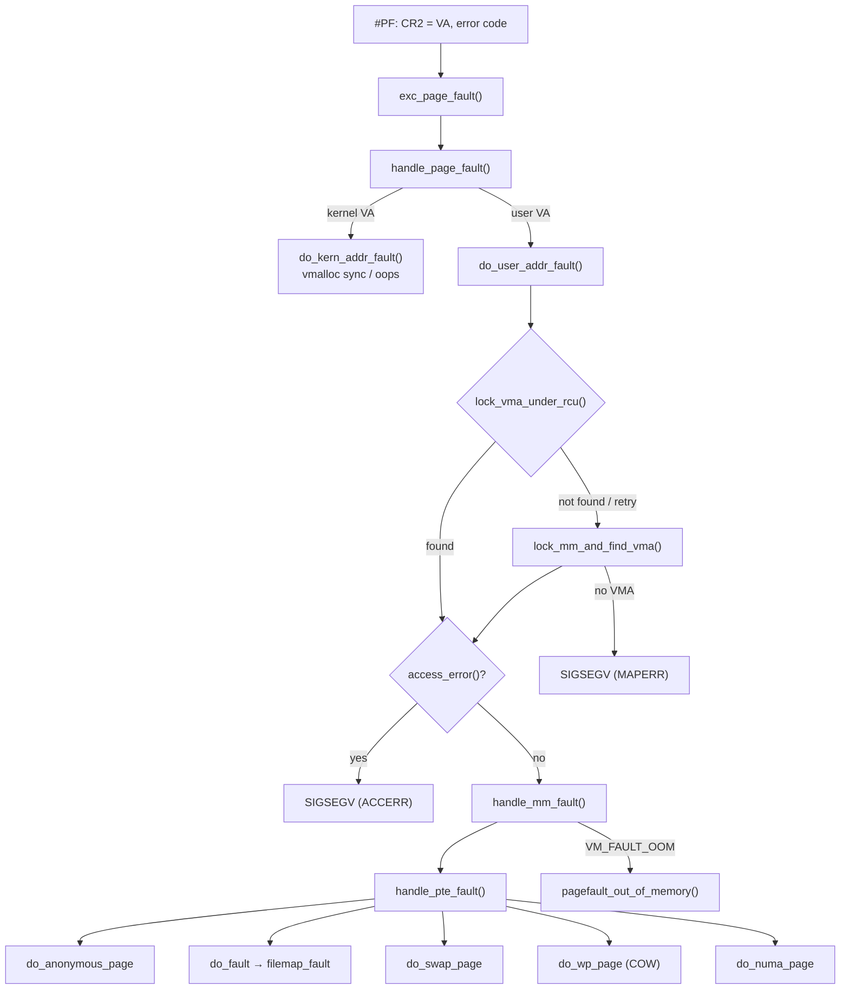

# 04 — The page fault path

> Module 04 · Memory Management · Linux v6.18.63 · Farsi: [`04-page-fault-path.fa.md`](04-page-fault-path.fa.md)

## 1. Summary

- A page fault is CPU exception 14 (#PF): the MMU found no valid PTE, or the PTE forbids the access. The CPU saves the faulting VA in `CR2` and an error code, and enters `exc_page_fault()`.
- The kernel finds the VMA (per-VMA lock first, `mmap_lock` as fallback), checks permissions, and calls the generic `handle_mm_fault()`, which walks/allocates the table levels and dispatches in `handle_pte_fault()`.
- The result is either a fixed mapping (the instruction is re-executed), a retry, or a signal (`SIGSEGV`, `SIGBUS`), or — for an unfixable allocation failure — the OOM killer.

## 2. Detailed explanation

**Step 0 — hardware.** A load/store/instruction fetch misses the TLB, the walk finds `P=0` or a permission violation. The CPU pushes an error code — `X86_PF_PROT` (bit 0: 1 = protection violation, 0 = not present), `X86_PF_WRITE` (bit 1), `X86_PF_USER` (bit 2), `X86_PF_INSTR` (bit 4), `X86_PF_PK` (bit 5) — writes `CR2`, and vectors to the IDT entry (Module 01: exceptions are synchronous, attributable to one instruction, and restartable).

**Step 1 — arch entry** (`arch/x86/mm/fault.c`).
- `exc_page_fault()` (L1483): read CR2 (or FRED event data), handle KVM async-PF, `irqentry_enter()`, call `handle_page_fault()`.
- `handle_page_fault()` (L1461): tracepoint `exceptions:page_fault_user`/`page_fault_kernel`; split on kernel vs user address.
- `do_user_addr_fault()` (L1207): reject impossible cases (kernel touching user memory with SMAP on, faults in atomic context → `bad_area`/oops), build `flags` (`FAULT_FLAG_WRITE`, `FAULT_FLAG_USER`, `FAULT_FLAG_INSTRUCTION`), enable interrupts, then:
  1. `lock_vma_under_rcu()` — RCU lookup in the maple tree plus a read lock on just that VMA;
  2. `access_error()` — the VMA's `vm_flags` must allow the access;
  3. `handle_mm_fault(…, FAULT_FLAG_VMA_LOCK)`;
  4. on `VM_FAULT_RETRY`, fall back to `lock_mm_and_find_vma()` (takes `mmap_lock` for read, may expand the stack VMA), and call `handle_mm_fault()` again.
  5. at label `done:` (L1414–1446) the result is turned into an action: `VM_FAULT_OOM` → `pagefault_out_of_memory()` (L1438), `VM_FAULT_SIGBUS`/`HWPOISON` → `SIGBUS`, `VM_FAULT_SIGSEGV` → `SIGSEGV`.

**Step 2 — generic entry** (`mm/memory.c`). `handle_mm_fault()` (L6490): memcg OOM arming, MGLRU hooks, hugetlbfs split, and fault accounting (`mm_account_fault()` → `maj_flt`/`min_flt` and perf events `major-faults`/`minor-faults`). `__handle_mm_fault()` (L6260) fills `struct vm_fault`, walks `pgd → p4d → pud → pmd` allocating missing tables, tries THP at PUD/PMD level, then calls `handle_pte_fault()`.

**Step 3 — dispatch** (`handle_pte_fault()`, L6166):

| Condition | Handler | Typical cause | Minor/Major |
|---|---|---|---|
| no PTE, anonymous VMA | `do_anonymous_page()` | first touch of heap/stack/`malloc` | minor |
| no PTE, file VMA | `do_fault()` → `do_read_fault` / `do_cow_fault` / `do_shared_fault` → `vm_ops->fault` (`filemap_fault`) | first touch of mmapped file, program text | minor if in page cache, else **major** |
| PTE not present (swap entry) | `do_swap_page()` | page was swapped out | **major** unless still in swap cache |
| PROT_NONE + accessible VMA | `do_numa_page()` | NUMA balancing hint fault | minor |
| write to read-only PTE | `do_wp_page()` | COW after `fork`, write to zero page, dirty tracking | minor |
| PTE fine | update Accessed/Dirty, maybe spurious flush | race with another thread | — |

**Major vs minor.** A fault is *major* (`VM_FAULT_MAJOR`) when the handler had to wait for I/O. `filemap_fault()` triggers readahead, so one major fault can bring in many pages; neighbours are then mapped by **fault-around** (`do_fault_around()`, default 64 KiB) without more faults. Lab 01 shows both effects, and `MADV_RANDOM` disabling them.

**Retry and locks.** Handlers may need to sleep for I/O. To avoid holding `mmap_lock` during disk reads, `filemap_fault` can drop the lock and return `VM_FAULT_RETRY`; the arch code then retries with `FAULT_FLAG_TRIED`. Since 6.4 most anonymous faults never touch `mmap_lock` at all thanks to per-VMA locks.

**Kernel-mode faults on user addresses.** `copy_from_user()` can fault; the same path handles it. If the address is bad, the **exception table** (`fixup_exception()`, `arch/x86/mm/extable.c`) redirects execution to the fixup code, which makes the syscall return `-EFAULT` instead of crashing the kernel.

## 3. Diagram



## 4. Worked example

Watch the path live with the `exceptions:page_fault_user` tracepoint and the kernel functions it reaches (Lab 01's `touch` program):

```bash
sudo bpftrace -e '
tracepoint:exceptions:page_fault_user /comm == "touch"/ { @faults = count(); }
kprobe:do_anonymous_page /comm == "touch"/ { @anon = count(); }
kprobe:handle_mm_fault  /comm == "touch"/ { @hmf = count(); }' -c './touch anon 64'
```

```
Attaching 3 probes...
mode=anon      pages=16384  minflt=16387  majflt=0  rss: 1544 -> 67212 KiB  50.9 ms
@anon: 16397
@faults: 16445
@hmf: 16452
```

`@anon`, `@faults` and `@hmf` are all ≈ 16 384 touched pages plus program start-up. Every fault went `exc_page_fault` → `handle_mm_fault` → `do_anonymous_page`. bpftrace `kprobe`s are safe here, but never run an unfiltered ftrace function tracer on the shared VM.

The excerpt that does the dispatch — `linux/mm/memory.c · handle_pte_fault() · v6.18.63 · L6209-6216` ([Elixir](https://elixir.bootlin.com/linux/v6.18.63/source/mm/memory.c#L6166)):

```c
	if (!vmf->pte)
		return do_pte_missing(vmf);

	if (!pte_present(vmf->orig_pte))
		return do_swap_page(vmf);

	if (pte_protnone(vmf->orig_pte) && vma_is_accessible(vmf->vma))
		return do_numa_page(vmf);
```

| Line | Meaning |
|---|---|
| `!vmf->pte` | `pte_none()` was seen earlier → never mapped → demand paging. |
| `!pte_present` | the entry has content but P=0 → a swap/migration entry. |
| `pte_protnone` | a NUMA hinting entry (P cleared on purpose by `change_prot_numa`). |

## 5. Edge cases & pitfalls

- **Counting:** `perf stat -e page-faults` counts every fault, including retried ones and kernel-mode faults on user addresses; `ru_minflt + ru_majflt` from `getrusage()` counts only completed user faults. Small differences are normal.
- **Stack growth** is a page fault below the stack VMA that extends it (`lock_mm_and_find_vma` → `expand_stack`); a fault far below (more than the guard gap) is a `SIGSEGV`.
- **`SIGBUS`** — not `SIGSEGV` — when accessing a file mapping past EOF, or on a hardware-poisoned page.
- **Faults in atomic context** (with `pagefault_disable()`, e.g. inside `copy_from_user_nofault`) are never handled — they go straight to the fixup.
- **Do not trace with `kprobe:do_wp_page` blindly**: static functions can be inlined; check `/sys/kernel/tracing/available_filter_functions` first.

## 6. Exam-style key points

- #PF delivers VA in CR2 + error code (P/W/U/I/PK); exception, synchronous, restartable.
- Chain: `exc_page_fault → handle_page_fault → do_user_addr_fault → handle_mm_fault → __handle_mm_fault → handle_pte_fault → do_*`.
- Per-VMA lock (6.4+) first; `mmap_lock` only on retry/fallback.
- Major = waited for I/O; readahead + fault-around make one major fault map many pages.
- Bad VMA → SIGSEGV MAPERR; wrong permission → SIGSEGV ACCERR; past EOF → SIGBUS; kernel `copy_*_user` → `-EFAULT` via exception table.

## 7. Links

- Lesson: [§2.4](../lesson.en.md#24-what-happens-on-a-page-fault)
- Walkthrough: [§1–3](../kernel-walkthrough.en.md#1-the-exception-entry--exc_page_fault)
- Labs: [04.1 count page faults](../labs/01-page-faults/README.md)
- Quiz: Q4, Q5, Q12
