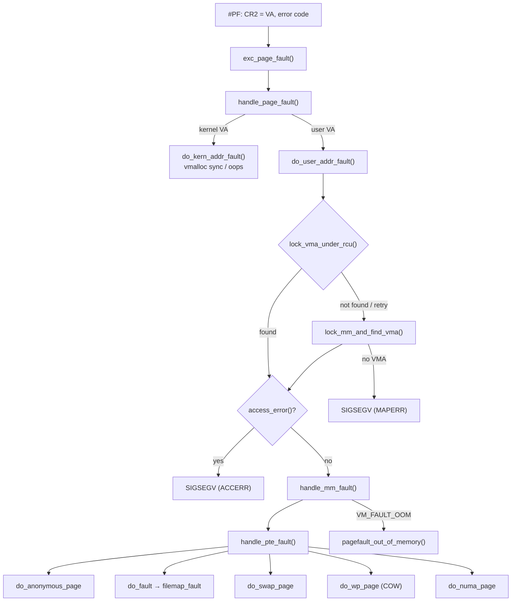

<div dir="rtl">

# ۰۴ — مسیر page fault

> ماژول ۰۴ · مدیریت حافظه · Linux v6.18.63 · نسخهٔ انگلیسی: [`04-page-fault-path.en.md`](04-page-fault-path.en.md)

## ۱. خلاصه

- page fault همان exception شمارهٔ ۱۴ در CPU است (#PF). یعنی MMU یا PTE معتبری پیدا نکرده یا PTE اجازهٔ این دسترسی را نمی‌دهد. CPU آدرس مجازی خطادار را در `CR2` و یک error code را روی stack می‌گذارد و وارد `exc_page_fault()` می‌شود.
- کرنل VMA را پیدا می‌کند (اول با قفل per-VMA و در صورت لزوم با `mmap_lock`)، دسترسی را بررسی می‌کند و `handle_mm_fault()` عمومی را صدا می‌زند. این تابع سطح‌های جدول را می‌پیماید یا تخصیص می‌دهد و در `handle_pte_fault()` تصمیم می‌گیرد کدام handler اجرا شود.
- نتیجه یکی از این‌هاست: mapping درست شده و دستور دوباره اجرا می‌شود، تلاش دوباره، یک signal (`SIGSEGV` یا `SIGBUS`)، یا اگر تخصیص به هیچ شکلی ممکن نباشد، OOM killer.

## ۲. توضیح مفصل

**گام ۰: سخت‌افزار.** یک load، store یا fetch دستور در TLB پیدا نمی‌شود و پیمایش جدول به `P=0` یا نقض دسترسی می‌رسد. CPU یک error code روی stack می‌گذارد:

- `X86_PF_PROT` (بیت ۰): اگر ۱ باشد نقض دسترسی است و اگر ۰ باشد صفحه حاضر نیست؛
- `X86_PF_WRITE` (بیت ۱)؛
- `X86_PF_USER` (بیت ۲)؛
- `X86_PF_INSTR` (بیت ۴)؛
- `X86_PF_PK` (بیت ۵).

بعد `CR2` را می‌نویسد و به مدخل IDT می‌پرد. از ماژول ۰۱ یادتان هست که exceptionها همگام‌اند، به یک دستور مشخص نسبت داده می‌شوند و قابل اجرای دوباره‌اند.

**گام ۱: ورود وابسته به معماری** (`arch/x86/mm/fault.c`).
- `exc_page_fault()` (خط ۱۴۸۳): CR2 را می‌خواند (یا با FRED، event data را)، async-PF مربوط به KVM را رسیدگی می‌کند، `irqentry_enter()` را صدا می‌زند و بعد `handle_page_fault()` را.
- `handle_page_fault()` (خط ۱۴۶۱): tracepoint `exceptions:page_fault_user` یا `page_fault_kernel` را تولید می‌کند و مسیر آدرس کرنل را از آدرس کاربر جدا می‌کند.
- `do_user_addr_fault()` (خط ۱۲۰۷): اول حالت‌های ناممکن را رد می‌کند. مثلاً اگر کرنل با SMAP روشن به حافظهٔ کاربر دست بزند، یا fault در context اتمی رخ دهد، نتیجه `bad_area` یا oops است. بعد `flags` را می‌سازد (`FAULT_FLAG_WRITE`، `FAULT_FLAG_USER`، `FAULT_FLAG_INSTRUCTION`)، وقفه‌ها را روشن می‌کند و این مراحل را اجرا می‌کند:
  1. `lock_vma_under_rcu()`: جستجو در maple tree زیر RCU و قفل خواندن فقط روی همان VMA؛
  2. `access_error()`: پرچم‌های `vm_flags` آن VMA باید این دسترسی را اجازه بدهند؛
  3. `handle_mm_fault(…, FAULT_FLAG_VMA_LOCK)`؛
  4. اگر نتیجه `VM_FAULT_RETRY` باشد، به `lock_mm_and_find_vma()` برمی‌گردد که `mmap_lock` را برای خواندن می‌گیرد و شاید VMA پشته را بزرگ کند، و دوباره `handle_mm_fault()` را صدا می‌زند؛
  5. در برچسب `done:` (خط‌های ۱۴۱۴ تا ۱۴۴۶) نتیجه به کار تبدیل می‌شود: `VM_FAULT_OOM` به `pagefault_out_of_memory()` (خط ۱۴۳۸)، `VM_FAULT_SIGBUS` یا `HWPOISON` به `SIGBUS`، و `VM_FAULT_SIGSEGV` به `SIGSEGV`.

**گام ۲: ورود عمومی** (`mm/memory.c`). `handle_mm_fault()` (خط ۶۴۹۰) این کارها را انجام می‌دهد: آماده‌سازی OOM در memcg، hookهای MGLRU، جدا کردن مسیر hugetlbfs، و شمارش fault. شمارش با `mm_account_fault()` انجام می‌شود که `maj_flt` یا `min_flt` را زیاد می‌کند و رویدادهای perf به نام `major-faults` و `minor-faults` را تولید می‌کند. `__handle_mm_fault()` (خط ۶۲۶۰) ساختار `struct vm_fault` را پر می‌کند، `pgd → p4d → pud → pmd` را می‌پیماید و هر جدولی که نباشد تخصیص می‌دهد، THP را در سطح PUD یا PMD امتحان می‌کند و بعد `handle_pte_fault()` را صدا می‌زند.

**گام ۳: انتخاب handler** (`handle_pte_fault()`، خط ۶۱۶۶):

| شرط | Handler | علت معمول | minor یا major |
|---|---|---|---|
| PTE نیست، VMA ناشناس | `do_anonymous_page()` | اولین لمس heap، stack یا `malloc` | minor |
| PTE نیست، VMA فایل | `do_fault()` ← `do_read_fault` / `do_cow_fault` / `do_shared_fault` ← `vm_ops->fault` (`filemap_fault`) | اولین لمس فایل mmapشده یا کد برنامه | اگر در page cache باشد minor، وگرنه **major** |
| PTE حاضر نیست (swap entry) | `do_swap_page()` | صفحه swap شده بود | **major**، مگر هنوز در swap cache باشد |
| PROT_NONE روی VMA قابل‌دسترس | `do_numa_page()` | fault راهنمای NUMA balancing | minor |
| نوشتن در PTE فقط‌خواندنی | `do_wp_page()` | COW بعد از `fork`، نوشتن در zero page، ردیابی dirty | minor |
| PTE درست است | به‌روزرسانی Accessed و Dirty، شاید flush کاذب | race با نخ دیگر | — |

**major یا minor.** fault وقتی *major* است (`VM_FAULT_MAJOR`) که handler مجبور شده منتظر I/O بماند. `filemap_fault()` readahead راه می‌اندازد، پس یک fault بزرگ ممکن است چند صفحه را بیاورد. صفحه‌های همسایه را بعد **fault-around** بدون fault دیگر map می‌کند (`do_fault_around()`، پیش‌فرض ۶۴ کیلوبایت). آزمایش ۰۱ هر دو اثر را نشان می‌دهد، و همین‌طور نشان می‌دهد که `MADV_RANDOM` هر دو را خاموش می‌کند.

**تلاش دوباره و قفل‌ها.** handlerها ممکن است برای I/O بخوابند. برای اینکه `mmap_lock` در طول خواندن دیسک نگه داشته نشود، `filemap_fault` می‌تواند قفل را رها کند و `VM_FAULT_RETRY` برگرداند. بعد کد معماری با `FAULT_FLAG_TRIED` دوباره امتحان می‌کند. از نسخهٔ ۶٫۴، به لطف قفل‌های per-VMA، بیشتر faultهای ناشناس اصلاً به `mmap_lock` دست نمی‌زنند.

**fault در حالت کرنل روی آدرس کاربر.** `copy_from_user()` ممکن است fault بدهد و همین مسیر رسیدگی‌اش می‌کند. اگر آدرس بد باشد، **exception table** (`fixup_exception()` در `arch/x86/mm/extable.c`) اجرا را به کد fixup می‌فرستد. نتیجه این است که syscall به‌جای خراب کردن کرنل، `-EFAULT` برمی‌گرداند.

## ۳. نمودار

</div>



<div dir="rtl">

## ۴. مثال کاربردی

مسیر را زنده ببینید، با tracepoint `exceptions:page_fault_user` و توابع کرنلی که به آن‌ها می‌رسد. برنامه همان `touch` آزمایش ۰۱ است:

</div>

```bash
sudo bpftrace -e '
tracepoint:exceptions:page_fault_user /comm == "touch"/ { @faults = count(); }
kprobe:do_anonymous_page /comm == "touch"/ { @anon = count(); }
kprobe:handle_mm_fault  /comm == "touch"/ { @hmf = count(); }' -c './touch anon 64'
```

```
Attaching 3 probes...
mode=anon      pages=16384  minflt=16387  majflt=0  rss: 1544 -> 67212 KiB  50.9 ms
@anon: 16397
@faults: 16445
@hmf: 16452
```

<div dir="rtl">

`@anon`، `@faults` و `@hmf` هر سه تقریباً برابر ۱۶٬۳۸۴ صفحهٔ لمس‌شده به‌اضافهٔ faultهای شروع برنامه‌اند. هر fault از مسیر `exc_page_fault` ← `handle_mm_fault` ← `do_anonymous_page` گذشته است. kprobeهای bpftrace اینجا بی‌خطرند، ولی هرگز ردیاب تابع ftrace را بدون فیلتر روی VM مشترک اجرا نکنید.

</div>

<div dir="rtl">

بخشی از کد که handler را انتخاب می‌کند: `linux/mm/memory.c · handle_pte_fault() · v6.18.63 · L6209-6216` ([Elixir](https://elixir.bootlin.com/linux/v6.18.63/source/mm/memory.c#L6166))

</div>

```c
	if (!vmf->pte)
		return do_pte_missing(vmf);

	if (!pte_present(vmf->orig_pte))
		return do_swap_page(vmf);

	if (pte_protnone(vmf->orig_pte) && vma_is_accessible(vmf->vma))
		return do_numa_page(vmf);
```

<div dir="rtl">

| خط | معنی |
|---|---|
| `!vmf->pte` | قبلاً `pte_none()` دیده شده، پس صفحه هرگز map نشده و این demand paging است. |
| `!pte_present` | مدخل محتوا دارد ولی P=0 است، پس swap entry یا migration entry است. |
| `pte_protnone` | مدخل راهنمای NUMA است؛ `change_prot_numa` بیت P را عمداً پاک کرده. |

## ۵. حالت‌های مرزی و دام‌ها

- **شمارش:** `perf stat -e page-faults` همهٔ faultها را می‌شمارد، از جمله faultهایی که دوباره امتحان شده‌اند و faultهای حالت کرنل روی آدرس کاربر. اما `ru_minflt + ru_majflt` از `getrusage()` فقط faultهای کاربرِ کامل‌شده را می‌شمارد. پس اختلاف کوچک بینشان عادی است.
- **رشد stack** با یک page fault درست زیر VMA پشته انجام می‌شود که آن را بزرگ می‌کند (`lock_mm_and_find_vma` ← `expand_stack`). faultی که خیلی پایین‌تر باشد (بیشتر از فاصلهٔ نگهبان)، `SIGSEGV` است.
- **`SIGBUS`** (و نه `SIGSEGV`) وقتی رخ می‌دهد که به mapping فایل بعد از EOF دسترسی پیدا کنید، یا به صفحه‌ای که سخت‌افزار آن را مسموم (poisoned) علامت زده.
- **faultهای داخل context اتمی** (با `pagefault_disable()`، مثلاً داخل `copy_from_user_nofault`) هیچ‌وقت رسیدگی نمی‌شوند و مستقیم به fixup می‌روند.
- **با `kprobe:do_wp_page` چشم‌بسته ردیابی نکنید.** توابع static ممکن است inline شده باشند. اول `/sys/kernel/tracing/available_filter_functions` را نگاه کنید.

## ۶. نکته‌های امتحانی

- #PF آدرس مجازی را در CR2 و یک error code (P/W/U/I/PK) می‌دهد. یک exception است: همگام و قابل اجرای دوباره.
- زنجیره: `exc_page_fault → handle_page_fault → do_user_addr_fault → handle_mm_fault → __handle_mm_fault → handle_pte_fault → do_*`.
- از ۶٫۴ اول قفل per-VMA امتحان می‌شود و `mmap_lock` فقط برای تلاش دوباره یا مسیر جایگزین است.
- major یعنی منتظر I/O ماندیم. readahead و fault-around باعث می‌شوند یک fault بزرگ چند صفحه را map کند.
- VMA نامعتبر: SIGSEGV با MAPERR. دسترسی غلط: SIGSEGV با ACCERR. بعد از EOF: SIGBUS. `copy_*_user` در کرنل: `-EFAULT` از راه exception table.

## ۷. پیوندها

- درس: [بخش ۲.۴](../lesson.fa.md)
- گشت در کد: [بخش‌های ۱ تا ۳](../kernel-walkthrough.fa.md)
- آزمایش: [04.1، شمردن page faultها](../labs/01-page-faults/README.md)
- آزمون: پرسش‌های ۴، ۵ و ۱۲

</div>
