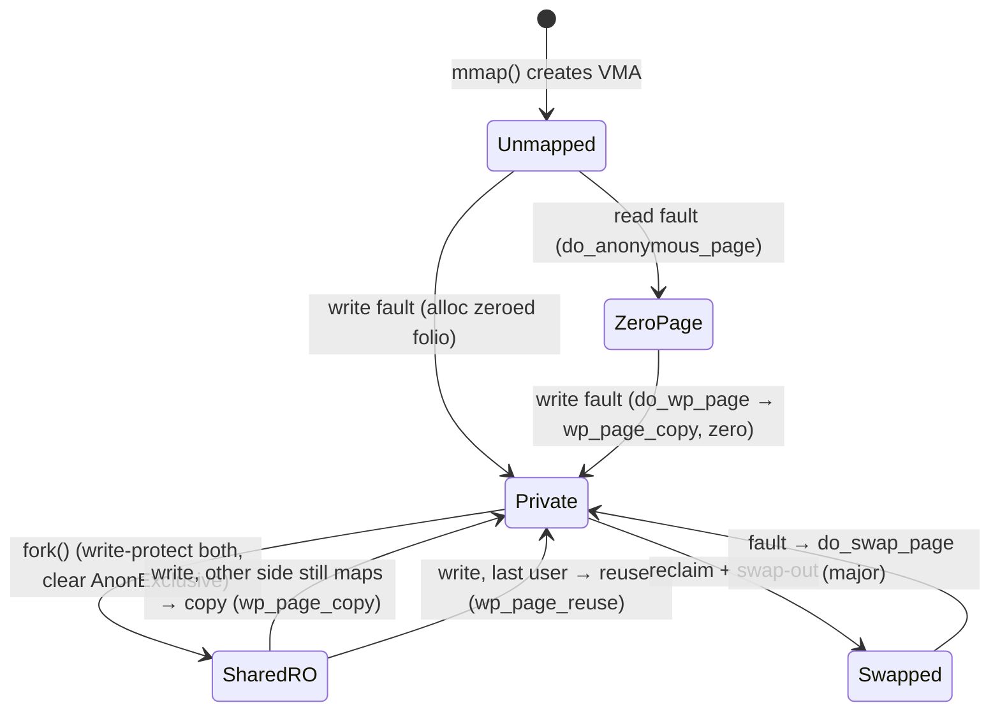

# 05 — Demand paging and copy-on-write

> Module 04 · Memory Management · Linux v6.18.63 · Farsi: [`05-demand-paging-cow.fa.md`](05-demand-paging-cow.fa.md)

## 1. Summary

- **Demand paging:** `mmap`, `brk`, `execve` only create VMAs; a physical page is allocated (anonymous) or read (file) at the **first touch**, by the page-fault handler.
- Reads of never-written anonymous memory map the single shared **zero page**; the first write replaces it with a private zeroed page.
- **Copy-on-write:** `fork()` copies page tables, marks private writable pages read-only in both processes, and shares the frames; the first write by either side copies one page (`do_wp_page()` → `wp_page_copy()`), unless the writer is already the only user (reuse).

## 2. Detailed explanation

**Why lazy?** Most programs reserve far more than they use (big `malloc` arenas, thread stacks of 8 MiB, sparse arrays, libraries with unused code). Allocating at `mmap` time would waste RAM and make `fork()`/`exec()` slow. Laziness turns "reserve" into a cheap tree insertion and pays per page actually used.

**Anonymous first touch** (`do_anonymous_page()`, walkthrough §3.1):
- *read* → install a read-only PTE to the zero page (`my_zero_pfn()`), marked special. RSS does not grow.
- *write* → `alloc_anon_folio()` gets a zeroed folio from the page allocator (charged to the memcg), `folio_add_new_anon_rmap()` links it into the `anon_vma`, PTE becomes writable + dirty, `MM_ANONPAGES` counter +1.
- *write after a read* → first a zero-page mapping, then a write-protect fault: `do_wp_page()` sees the zero PFN and `wp_page_copy()` allocates a new zeroed page (`pfn_is_zero` → no copy, just zero).

**File first touch** (`do_fault()`): `do_read_fault()` maps the page-cache page; `filemap_fault()` reads it if absent (major fault) and starts readahead. A *write* to a `MAP_PRIVATE` file page goes to `do_cow_fault()`: allocate an anon page, copy the file data, map the copy. A write to `MAP_SHARED` goes to `do_shared_fault()`: map the page-cache page writable and mark it dirty (note 09).

**`fork()` and COW.** `copy_page_range()` (`mm/memory.c` L1505, called from `dup_mmap()` in `mm/mmap.c` L1719, itself called from `kernel/fork.c`) walks the parent's tables. For each private writable anonymous PTE it:
1. clears the write bit **in the parent and the child** (`ptep_set_wrprotect`),
2. clears `PageAnonExclusive` (the page is now shared),
3. increments the folio's map count and refcount.
Then the parent's TLB entries for those pages must be flushed, because they still say "writable". Shared mappings (`MAP_SHARED`) are not write-protected — both processes keep writing the same frames.

After that, a write by either process faults with "present, write, protection" → `handle_pte_fault()` → `do_wp_page()`:
- if `PageAnonExclusive` is set, or `wp_can_reuse_anon_folio()` finds no other reference (e.g. the other process already exited or already copied) → **reuse**: just set RW.
- otherwise **copy**: `wp_page_copy()` allocates, copies 4 KiB, installs the new PTE, flushes the TLB entry, drops one reference on the old page.

**Before 5.8/5.9** Linux decided reuse by `page_mapcount()` and swap count; that logic had real bugs (e.g. `vmsplice`-based leaks, CVE-2020-29374 family) and was replaced by refcount-based reuse plus the `PageAnonExclusive` flag in 5.19. `VERSION-DEPENDENT`: old textbooks describe the mapcount rule.

**`exec()` throws it away.** The common `fork(); exec()` pattern copies page tables only to destroy them; `vfork()`/`posix_spawn()` (which uses `CLONE_VM|CLONE_VFORK`) avoid even that.

**Cost model.** One COW = one minor fault (~1–2 µs incl. trap) + a 4 KiB copy. A Redis `BGSAVE` child, while the parent keeps writing, can duplicate the whole dataset page by page — the famous "fork doubles memory" effect. With THP, a COW on a 2 MiB page copies (or splits) 2 MiB.

## 3. Diagram



## 4. Worked example

Lab 02's `cow.c` (64 MiB, child writes the first half) on the aos-lab VM:

```bash
gcc -Wall -Wextra -O2 -o cow cow.c && sudo ./cow 64
```

```
$ sudo ./cow 64
parent before fork  va=0x7de3eda00000 present=1 excl=1 pfn=0x11e516
parent before fork  Rss=65536 kB  Shared_Dirty=0 kB  Private_Dirty=65536 kB
child  after fork   va=0x7de3eda00000 present=1 excl=0 pfn=0x11e516
child  after fork   Rss=65536 kB  Shared_Dirty=65536 kB  Private_Dirty=0 kB
child  after write  va=0x7de3eda00000 present=1 excl=1 pfn=0x11d498
child  after write  Rss=65536 kB  Shared_Dirty=32768 kB  Private_Dirty=32768 kB
child  wrote 8192 pages -> 8193 minor faults (COW)
parent child wrote  va=0x7de3eda00000 present=1 excl=1 pfn=0x11e516
parent byte[0]=0xaa (child wrote 0x55 into its own copy)
parent child exited va=0x7de3eda00000 present=1 excl=1 pfn=0x11e516
```

Read it:
- after `fork` the child's PFN equals the parent's and `excl=0`: same frame, shared, read-only;
- the child's `Shared_Dirty` ≈ 64 MiB before its writes; after writing 32 MiB, `Private_Dirty` ≈ 32 MiB;
- there are 8193 minor faults for 8192 pages written: one COW per page, plus one;
- the parent's PFN never changes — the *writer* gets the copy.

The decision in code — `linux/mm/memory.c · do_wp_page() · v6.18.63 · L4133-4143` ([Elixir](https://elixir.bootlin.com/linux/v6.18.63/source/mm/memory.c#L4063)):

```c
	if (folio && folio_test_anon(folio) &&
	    (PageAnonExclusive(vmf->page) || wp_can_reuse_anon_folio(folio, vma))) {
		if (!PageAnonExclusive(vmf->page))
			SetPageAnonExclusive(vmf->page);
		if (unlikely(unshare)) {
			pte_unmap_unlock(vmf->pte, vmf->ptl);
			return 0;
		}
		wp_page_reuse(vmf, folio);
		return 0;
	}
```

| Line | Meaning |
|---|---|
| `folio_test_anon` | only anonymous pages can be reused; a private *file* page must be copied. |
| `PageAnonExclusive` | fast path: we are known to be the only mapper. |
| `wp_can_reuse_anon_folio` | slow check: refcount ≤ 1 (+1 if in swap cache) → nobody else holds it. |
| `SetPageAnonExclusive` | remember exclusivity so the next write fault is cheap. |
| `unshare` | `FAULT_FLAG_UNSHARE` (from GUP pinning): break sharing without writing. |
| `wp_page_reuse` | make the PTE writable in place — no allocation, no copy. |

## 5. Edge cases & pitfalls

- **Overcommit.** Since pages are not allocated at `mmap`, the kernel may promise more than it has (`vm.overcommit_memory` 0 = heuristic, 1 = always, 2 = strict). The bill arrives at fault time — as the OOM killer, not as `malloc` returning NULL.
- **`MAP_POPULATE` / `mlock`** pre-fault everything (walkthrough §4); useful for latency-critical code.
- **The parent pays too.** After `fork`, the parent's own writes also take COW faults until each page is copied or found reusable.
- **THP and COW.** A write to a shared THP may split it into 4 KiB pages first; `Private_Dirty` jumps differ from the 4 KiB case. Lab 02 uses `MADV_NOHUGEPAGE` to keep it simple.
- **Pinned pages (GUP, RDMA, `O_DIRECT`).** A page pinned in the parent must not be shared with a child, or the child's writes could reach the device; Linux copies such pages eagerly at `fork` (`folio_needs_cow_for_dma()`, `include/linux/mm.h` L2077).
- **`MADV_DONTFORK` / `MADV_WIPEONFORK`** exclude regions from the child or give it zero pages.

## 6. Exam-style key points

- `mmap` = VMA only; first touch = fault; read of untouched anon = zero page.
- `fork` = copy page tables + write-protect private pages + shared frames; COW on first write.
- Writer gets the copy; reuse when exclusive or refcount says last user (5.19+ rule).
- One COW = one minor fault + 4 KiB copy (2 MiB for a THP, or a split).
- `MAP_SHARED` pages are never COW'd; `MAP_PRIVATE` file pages are COW'd into anonymous pages.

## 7. Links

- Lesson: [§2.5](../lesson.en.md#25-why-does-malloc1-gb-return-instantly)
- Walkthrough: [§3.1 zero page](../kernel-walkthrough.en.md#31-anonymous-demand-paging-and-the-zero-page--do_anonymous_page), [§3.2 COW](../kernel-walkthrough.en.md#32-copy-on-write--do_wp_page)
- Labs: [04.1](../labs/01-page-faults/README.md), [04.2](../labs/02-cow-pagemap/README.md)
- Quiz: Q5, Q6, Q13
