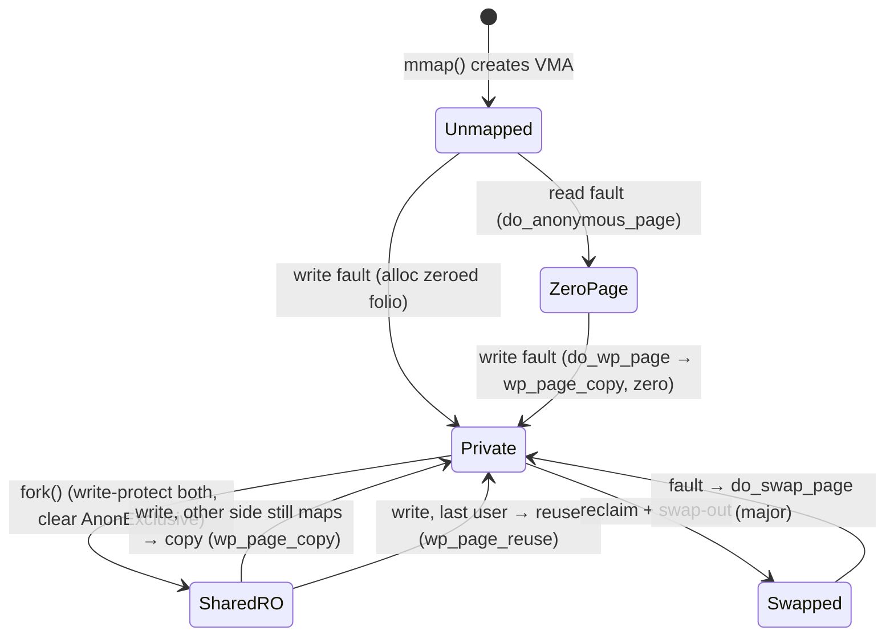

<div dir="rtl">

# ۰۵ — demand paging و copy-on-write

> ماژول ۰۴ · مدیریت حافظه · Linux v6.18.63 · نسخهٔ انگلیسی: [`05-demand-paging-cow.en.md`](05-demand-paging-cow.en.md)

## ۱. خلاصه

- **Demand paging:** فراخوانی‌های `mmap`، `brk` و `execve` فقط VMA می‌سازند. صفحهٔ فیزیکی در **اولین لمس** توسط page fault handler تخصیص داده می‌شود (برای حافظهٔ ناشناس) یا از دیسک خوانده می‌شود (برای فایل).
- خواندن از حافظهٔ ناشناسی که هرگز نوشته نشده فقط **zero page** مشترک را map می‌کند. اولین نوشتن، آن را با یک صفحهٔ خصوصیِ صفرشده جایگزین می‌کند.
- **Copy-on-write:** `fork()` جدول‌های صفحه را کپی می‌کند، صفحه‌های خصوصیِ قابل‌نوشتن را در هر دو پردازه فقط‌خواندنی می‌کند و قاب‌ها را بینشان مشترک نگه می‌دارد. اولین نوشتن هر طرف یک صفحه را کپی می‌کند (`do_wp_page()` ← `wp_page_copy()`)، مگر اینکه نویسنده از قبل تنها کاربر صفحه باشد؛ در آن صورت صفحه دوباره استفاده می‌شود (reuse).

## ۲. توضیح مفصل

**چرا تنبل؟** بیشتر برنامه‌ها خیلی بیشتر از مصرف واقعی‌شان رزرو می‌کنند: arenaهای بزرگ `malloc`، stack هشت‌مگابایتی برای هر نخ، آرایه‌های پراکنده، کتابخانه‌هایی با کد استفاده‌نشده. تخصیص در لحظهٔ `mmap` هم RAM را هدر می‌داد و هم `fork()` و `exec()` را کند می‌کرد. با تنبلی، «رزرو» فقط یک درج ارزان در درخت است و هزینه فقط برای صفحه‌هایی پرداخت می‌شود که واقعاً استفاده می‌شوند.

**اولین لمس حافظهٔ ناشناس** (`do_anonymous_page()`، گشت در کد بخش ۳.۱):
- *خواندن*: یک PTE فقط‌خواندنی به zero page (`my_zero_pfn()`) نصب می‌شود و special علامت می‌خورد. RSS بزرگ نمی‌شود.
- *نوشتن*: `alloc_anon_folio()` یک folio صفرشده از page allocator می‌گیرد و هزینه‌اش را به memcg می‌نویسد. `folio_add_new_anon_rmap()` آن را به `anon_vma` وصل می‌کند. PTE قابل‌نوشتن و dirty می‌شود و شمارندهٔ `MM_ANONPAGES` یکی زیاد می‌شود.
- *نوشتن بعد از خواندن*: اول یک mapping به zero page هست. نوشتن یک fault محافظت در برابر نوشتن می‌دهد. `do_wp_page()` می‌بیند PFN مال zero page است و `wp_page_copy()` یک صفحهٔ صفرشدهٔ تازه می‌گیرد. چون `pfn_is_zero` درست است، چیزی کپی نمی‌شود و فقط صفر می‌شود.

**اولین لمس فایل** (`do_fault()`):
- `do_read_fault()` صفحهٔ page cache را map می‌کند. اگر صفحه در cache نباشد، `filemap_fault()` آن را می‌خواند (fault بزرگ) و readahead را راه می‌اندازد.
- *نوشتن* در صفحهٔ فایلی با `MAP_PRIVATE` به `do_cow_fault()` می‌رود: یک صفحهٔ ناشناس می‌گیرد، دادهٔ فایل را در آن کپی می‌کند و کپی را map می‌کند.
- نوشتن در `MAP_SHARED` به `do_shared_fault()` می‌رود: صفحهٔ page cache را قابل‌نوشتن map می‌کند و dirty علامت می‌زند (یادداشت ۰۹).

**`fork()` و COW.** تابع `copy_page_range()` (`mm/memory.c` خط ۱۵۰۵) جدول‌های والد را می‌پیماید. این تابع را `dup_mmap()` در `mm/mmap.c` (خط ۱۷۱۹) صدا می‌زند و آن را `kernel/fork.c`. برای هر PTE ناشناسِ خصوصیِ قابل‌نوشتن این کارها را می‌کند:
1. بیت نوشتن را **هم در والد و هم در فرزند** پاک می‌کند (`ptep_set_wrprotect`)؛
2. `PageAnonExclusive` را پاک می‌کند، چون صفحه حالا مشترک است؛
3. map count و refcount آن folio را زیاد می‌کند.

بعد مدخل‌های TLB والد برای این صفحه‌ها باید flush شوند، چون هنوز می‌گویند «قابل‌نوشتن». mappingهای اشتراکی (`MAP_SHARED`) محافظت در برابر نوشتن نمی‌گیرند و هر دو پردازه همچنان در همان قاب‌ها می‌نویسند.

بعد از این، نوشتن هر پردازه یک fault با ویژگی‌های «حاضر، نوشتن، نقض دسترسی» می‌دهد و مسیر `handle_pte_fault()` ← `do_wp_page()` اجرا می‌شود:
- اگر `PageAnonExclusive` روشن باشد، یا `wp_can_reuse_anon_folio()` ارجاع دیگری پیدا نکند (مثلاً پردازهٔ دیگر خارج شده یا صفحه را قبلاً کپی کرده)، **reuse** انجام می‌شود: فقط RW روشن می‌شود.
- در غیر این صورت **کپی** انجام می‌شود: `wp_page_copy()` صفحه می‌گیرد، ۴ کیلوبایت کپی می‌کند، PTE جدید را نصب می‌کند، مدخل TLB را flush می‌کند و یک ارجاع از صفحهٔ قدیمی کم می‌کند.

**تا نسخهٔ ۵٫۸ و ۵٫۹** لینوکس تصمیم reuse را بر اساس `page_mapcount()` و شمار swap می‌گرفت. آن منطق باگ‌های واقعی داشت، مثلاً نشت داده از راه `vmsplice` در خانوادهٔ CVE-2020-29374. بعداً با reuse مبتنی بر refcount جایگزین شد و در ۵٫۱۹ پرچم `PageAnonExclusive` هم اضافه شد. `VERSION-DEPENDENT`: کتاب‌های درسی قدیمی قاعدهٔ mapcount را توضیح می‌دهند.

**`exec()` همه را دور می‌ریزد.** در الگوی رایج `fork(); exec()`، جدول‌های صفحه فقط برای این کپی می‌شوند که بلافاصله نابود شوند. `vfork()` و `posix_spawn()` (که از `CLONE_VM|CLONE_VFORK` استفاده می‌کند) همین را هم انجام نمی‌دهند.

**مدل هزینه.** هر COW یعنی یک minor fault (حدود ۱ تا ۲ میکروثانیه با trap) به‌اضافهٔ کپی ۴ کیلوبایت. وقتی فرزندی که Redis برای `BGSAVE` می‌سازد کار می‌کند و والد همچنان می‌نویسد، کل مجموعهٔ داده ممکن است صفحه به صفحه دو نسخه شود. این همان اثر معروف «fork حافظه را دو برابر می‌کند» است. با THP، COW روی صفحهٔ ۲ مگابایتی یعنی کپی (یا شکستن) ۲ مگابایت.

## ۳. نمودار

</div>



<div dir="rtl">

## ۴. مثال کاربردی

برنامهٔ `cow.c` از آزمایش ۰۲ را روی VM آزمایشگاه اجرا می‌کنیم: ناحیه‌ای ۶۴ مگابایتی که فرزند نیمهٔ اول آن را می‌نویسد.

</div>

```bash
gcc -Wall -Wextra -O2 -o cow cow.c && sudo ./cow 64
```

```
$ sudo ./cow 64
parent before fork  va=0x7de3eda00000 present=1 excl=1 pfn=0x11e516
parent before fork  Rss=65536 kB  Shared_Dirty=0 kB  Private_Dirty=65536 kB
child  after fork   va=0x7de3eda00000 present=1 excl=0 pfn=0x11e516
child  after fork   Rss=65536 kB  Shared_Dirty=65536 kB  Private_Dirty=0 kB
child  after write  va=0x7de3eda00000 present=1 excl=1 pfn=0x11d498
child  after write  Rss=65536 kB  Shared_Dirty=32768 kB  Private_Dirty=32768 kB
child  wrote 8192 pages -> 8193 minor faults (COW)
parent child wrote  va=0x7de3eda00000 present=1 excl=1 pfn=0x11e516
parent byte[0]=0xaa (child wrote 0x55 into its own copy)
parent child exited va=0x7de3eda00000 present=1 excl=1 pfn=0x11e516
```

<div dir="rtl">

خواندن خروجی:
- بعد از `fork`، PFN فرزند با PFN والد برابر است و `excl=0` است. یعنی همان قاب، مشترک و فقط‌خواندنی.
- `Shared_Dirty` در فرزند قبل از نوشتن حدود ۶۴ مگابایت است. بعد از نوشتن ۳۲ مگابایت، `Private_Dirty` حدود ۳۲ مگابایت می‌شود.
- برای ۸۱۹۲ صفحهٔ نوشته‌شده ۸۱۹۳ minor fault ثبت شده است: یک COW برای هر صفحه و یکی اضافه.
- PFN والد هیچ‌وقت عوض نمی‌شود. کپی به *نویسنده* می‌رسد.

تصمیم در کد: `linux/mm/memory.c · do_wp_page() · v6.18.63 · L4133-4143` ([Elixir](https://elixir.bootlin.com/linux/v6.18.63/source/mm/memory.c#L4063))

</div>

```c
	if (folio && folio_test_anon(folio) &&
	    (PageAnonExclusive(vmf->page) || wp_can_reuse_anon_folio(folio, vma))) {
		if (!PageAnonExclusive(vmf->page))
			SetPageAnonExclusive(vmf->page);
		if (unlikely(unshare)) {
			pte_unmap_unlock(vmf->pte, vmf->ptl);
			return 0;
		}
		wp_page_reuse(vmf, folio);
		return 0;
	}
```

<div dir="rtl">

| خط | معنی |
|---|---|
| `folio_test_anon` | فقط صفحه‌های ناشناس می‌توانند دوباره استفاده شوند. صفحهٔ *فایل* خصوصی باید کپی شود. |
| `PageAnonExclusive` | مسیر سریع: می‌دانیم تنها پردازه‌ای هستیم که این صفحه را map کرده. |
| `wp_can_reuse_anon_folio` | بررسی کند: اگر refcount حداکثر ۱ باشد (و اگر در swap cache است، حداکثر ۲)، کس دیگری آن را نگه نداشته. |
| `SetPageAnonExclusive` | انحصاری بودن را ثبت می‌کند تا fault نوشتن بعدی ارزان باشد. |
| `unshare` | پرچم `FAULT_FLAG_UNSHARE` (که از pin کردن با GUP می‌آید): اشتراک را بدون نوشتن بشکن. |
| `wp_page_reuse` | PTE را در جای خود قابل‌نوشتن می‌کند، بدون تخصیص و بدون کپی. |

## ۵. حالت‌های مرزی و دام‌ها

- **Overcommit.** چون صفحه‌ها هنگام `mmap` تخصیص داده نمی‌شوند، کرنل ممکن است بیش از آنچه دارد قول بدهد. `vm.overcommit_memory` سه حالت دارد: ۰ یعنی heuristic، ۱ یعنی همیشه، ۲ یعنی سخت‌گیرانه. صورتحساب هنگام fault می‌رسد، به شکل OOM killer و نه به شکل `malloc`ی که NULL برمی‌گرداند.
- **`MAP_POPULATE` و `mlock`** همه چیز را از قبل fault می‌کنند (گشت در کد، بخش ۴). برای کدی که تأخیر برایش حیاتی است مفید است.
- **والد هم هزینه می‌دهد.** بعد از `fork`، نوشتن‌های خود والد هم COW fault می‌دهند، تا وقتی که هر صفحه کپی شود یا قابل استفادهٔ دوباره تشخیص داده شود.
- **THP و COW.** نوشتن در یک THP مشترک ممکن است اول آن را به صفحه‌های ۴ کیلوبایتی بشکند، و پرش‌های `Private_Dirty` با حالت ۴ کیلوبایتی فرق می‌کند. آزمایش ۰۲ برای سادگی از `MADV_NOHUGEPAGE` استفاده می‌کند.
- **صفحه‌های pinشده (GUP، RDMA، `O_DIRECT`).** صفحه‌ای که در والد pin شده نباید با فرزند مشترک شود، وگرنه نوشته‌های فرزند ممکن است به دستگاه برسد. لینوکس این صفحه‌ها را هنگام `fork` فوراً کپی می‌کند (`folio_needs_cow_for_dma()`، `include/linux/mm.h` خط ۲۰۷۷).
- **`MADV_DONTFORK` و `MADV_WIPEONFORK`** ناحیه‌ها را از فرزند حذف می‌کنند یا به فرزند صفحهٔ صفر می‌دهند.

## ۶. نکته‌های امتحانی

- `mmap` فقط VMA می‌سازد، اولین لمس fault می‌دهد، و خواندن حافظهٔ ناشناسِ دست‌نخورده zero page را map می‌کند.
- `fork` یعنی کپی جدول‌های صفحه، محافظت صفحه‌های خصوصی در برابر نوشتن و قاب‌های مشترک. COW در اولین نوشتن رخ می‌دهد.
- نویسنده کپی را می‌گیرد. اگر صفحه انحصاری باشد یا refcount نشان دهد آخرین کاربر هستیم، صفحه دوباره استفاده می‌شود (قاعدهٔ ۵٫۱۹ به بعد).
- هر COW یعنی یک minor fault و کپی ۴ کیلوبایت (برای THP، ۲ مگابایت یا شکستن آن).
- صفحه‌های `MAP_SHARED` هرگز COW نمی‌شوند. صفحه‌های فایلِ `MAP_PRIVATE` با COW به صفحهٔ ناشناس تبدیل می‌شوند.

## ۷. پیوندها

- درس: [بخش ۲.۵](../lesson.fa.md)
- گشت در کد: [بخش ۳.۱، zero page](../kernel-walkthrough.fa.md) و [بخش ۳.۲، COW](../kernel-walkthrough.fa.md)
- آزمایش‌ها: [04.1](../labs/01-page-faults/README.md) و [04.2](../labs/02-cow-pagemap/README.md)
- آزمون: پرسش‌های ۵، ۶ و ۱۳

</div>
