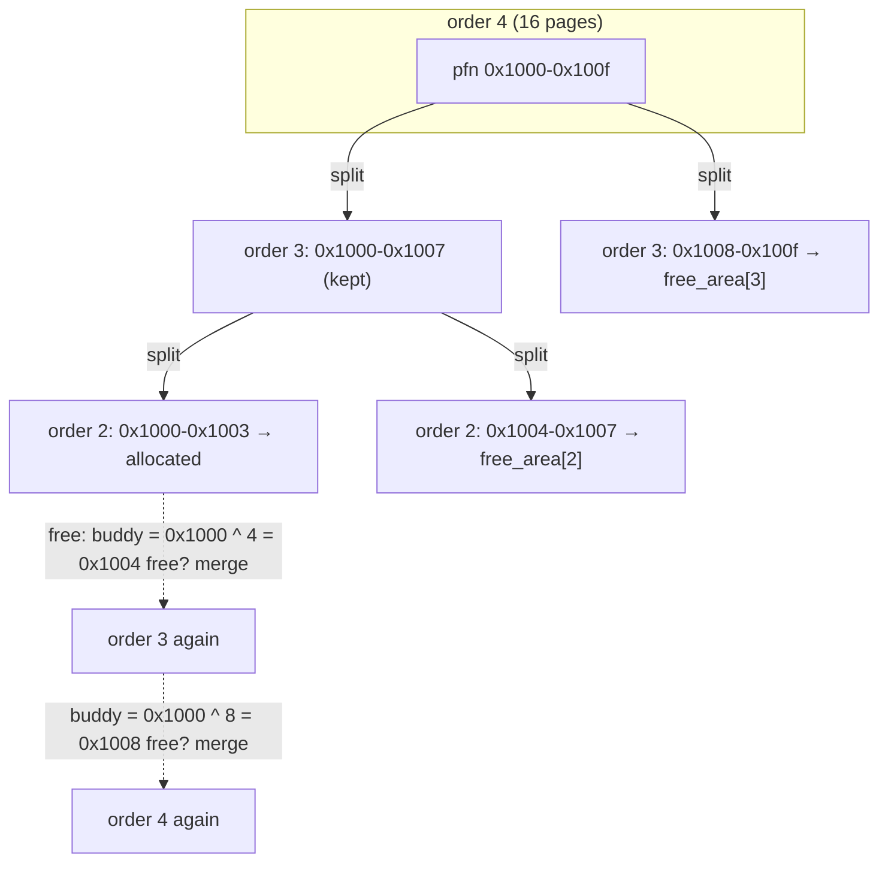

# 06 — The buddy allocator

> Module 04 · Memory Management · Linux v6.18.63 · Farsi: [`06-buddy-allocator.fa.md`](06-buddy-allocator.fa.md)

## 1. Summary

- Linux manages physical memory in **page frames** grouped into NUMA **nodes** and **zones** (DMA, DMA32, Normal, Movable); each zone has free lists for **orders** 0–10 (blocks of 2^order contiguous pages), split by **migratetype**.
- Allocation takes the smallest free block ≥ the request and **splits** it, returning the unused halves to lower orders; freeing **merges** a block with its buddy (`pfn ^ (1 << order)`) as long as the buddy is free.
- Order-0 traffic mostly hits **per-CPU page lists (PCP)**; fragmentation is fought with migratetypes, compaction (`kcompactd`) and watermarks.

## 2. Detailed explanation

**Intuition.** Picture memory as a row of blocks of size 2^k. To serve 3 pages you round up to 4 (order 2). If only an order-4 (16-page) block is free, split it: 16 → 8 + 8, keep one 8, split it → 4 + 4, return one 4 to the order-2 list and give out the other. When the 4 is freed, check its "buddy" — the other half of the 8 it came from. If the buddy is also free, merge into 8, then check the 8's buddy, and so on. Buddies are found by arithmetic, not by searching: for a block at frame number `pfn` of order `o`, the buddy is at `pfn ^ (1 << o)` and the merged block starts at `pfn & buddy_pfn`.

**Data structures.**
- `struct page` — one per 4 KiB frame (64 bytes, in the `vmemmap` array ≈ 1.6 % of RAM). Free blocks are linked through the head page; `PageBuddy` + `buddy_order` mark a free block head.
- `struct zone` — `free_area[NR_PAGE_ORDERS]`, each with `free_list[MIGRATE_TYPES]` and `nr_free`; watermarks `min`/`low`/`high`; `lock` (spinlock).
- `struct per_cpu_pages` — per-CPU lists of small-order pages; allocations and frees of order ≤ `PAGE_ALLOC_COSTLY_ORDER` (3) and THP order go here first, without taking the zone lock, and move to/from the buddy lists in batches.

**Allocation path** (`__alloc_frozen_pages_noprof()` → `get_page_from_freelist()` → `rmqueue()`):
1. Walk the zonelist (preferred node first, then fallbacks), skipping zones below the watermark for this request.
2. Try the PCP list; otherwise take the zone lock and call `__rmqueue_smallest()` (walkthrough §5) — loop orders upward, split with `expand()`.
3. If the preferred migratetype has nothing, fall back to another type: `__rmqueue_claim()` (L2407) converts a whole 2 MiB pageblock to our type, `__rmqueue_steal()` (L2462) takes a single block (`VERSION-DEPENDENT`: older kernels have one `__rmqueue_fallback()`; the release that split it is UNVERIFIED — check with `git log -S __rmqueue_steal` in a history clone).
4. If everything is below watermarks → slow path `__alloc_pages_slowpath()`: wake `kswapd`, try compaction, direct reclaim, retry, and finally the OOM killer (for non-costly orders).

**Migratetypes.** Each 2 MiB pageblock has a type: `MIGRATE_UNMOVABLE` (kernel objects, can't move), `MIGRATE_MOVABLE` (user pages, page cache — can be migrated), `MIGRATE_RECLAIMABLE` (slab caches that can be shrunk), plus `HIGHATOMIC`, `CMA`, `ISOLATE`. Grouping by mobility keeps unmovable allocations from scattering across memory, so compaction can still build high-order blocks out of movable regions.

**Fragmentation.**
- *External*: enough free pages in total, but not contiguous — `/proc/buddyinfo` shows many order-0/1 blocks and zeros at high orders; THP and order-3+ allocations (e.g. some network drivers, `kmalloc` > 8 KiB) fail or stall in compaction.
- *Internal*: rounding up (a 5-page request uses an order-3 block of 8). The buddy allocator's own overhead is internal fragmentation; SLUB (note 07) exists to avoid it for small objects.

**Compaction** (`mm/compaction.c`): migrate movable pages from the bottom of a zone to free pages at the top, creating free contiguous runs. Triggered by allocations (direct compaction), by `kcompactd`, proactively (`vm.compaction_proactiveness`), or manually (`/proc/sys/vm/compact_memory`).

## 3. Diagram



## 4. Worked example

**The free counts per order** (aos-lab VM):

```bash
cat /proc/buddyinfo
sudo grep -A3 -E '^Free pages count per migrate type' /proc/pagetypeinfo | head -12
grep -E 'min|low|high' /proc/zoneinfo | head -6
```

```
Node 0, zone      DMA      0      0      0      0      0      0      0      0      1      2      2 
Node 0, zone    DMA32      3      1      0      2      2      2      3      2      2      1    873 
Node 0, zone   Normal   1527    935   3915   3484   1872    783    385    241    166    119   1672 
Free pages count per migrate type at order       0      1      2      3      4      5      6      7      8      9     10 
Node    0, zone      DMA, type    Unmovable      0      0      0      0      0      0      0      0      1      1      0 
Node    0, zone      DMA, type      Movable      0      0      0      0      0      0      0      0      0      1      2 
Node    0, zone      DMA, type  Reclaimable      0      0      0      0      0      0      0      0      0      0      0 
        min      21
        low      26
        high     31
              high:     5
              high_min: 4
              high_max: 60
```

Each column of `buddyinfo` is an order (0 = 4 KiB … 10 = 4 MiB). Multiply: free bytes at order *k* = count × 4 KiB × 2^k.

**The split loop** — `linux/mm/page_alloc.c · expand() · v6.18.63 · L1745-1771` ([Elixir](https://elixir.bootlin.com/linux/v6.18.63/source/mm/page_alloc.c#L1745)):

```c
static inline unsigned int expand(struct zone *zone, struct page *page, int low,
				  int high, int migratetype)
{
	unsigned int size = 1 << high;
	unsigned int nr_added = 0;

	while (high > low) {
		high--;
		size >>= 1;
		VM_BUG_ON_PAGE(bad_range(zone, &page[size]), &page[size]);

		/* ... guard pages (CONFIG_DEBUG_PAGEALLOC) ... */
		if (set_page_guard(zone, &page[size], high))
			continue;

		__add_to_free_list(&page[size], zone, high, migratetype, false);
		set_buddy_order(&page[size], high);
		nr_added += size;
	}

	return nr_added;
}
```

| Line | Meaning |
|---|---|
| `low`, `high` | requested order and the order of the block we found. |
| `high--; size >>= 1` | halve the block each iteration. |
| `&page[size]` | the **upper** half is returned to the free list; the lower half continues to be split (and is eventually returned to the caller). |
| `set_buddy_order` | mark the head of the returned half as a free buddy of that order (what `find_buddy_page_pfn` checks later). |

And the buddy formula — `linux/mm/internal.h · __find_buddy_pfn() · v6.18.63 · L677-681`:

```c
static inline unsigned long
__find_buddy_pfn(unsigned long page_pfn, unsigned int order)
{
	return page_pfn ^ (1 << order);
}
```

## 5. Edge cases & pitfalls

- **`MemFree` low ≠ trouble.** Free RAM is wasted RAM; page cache will be reclaimed. Watch `MemAvailable`, PSI and allocation stalls (`allocstall_*` in `/proc/vmstat`), not `MemFree`.
- **High-order allocations are fragile.** `kmalloc(64 KiB)` needs order 4; under fragmentation prefer `kvmalloc()` (falls back to `vmalloc`, which needs only order-0 pages).
- **`GFP_ATOMIC`** cannot sleep, so it cannot reclaim; it may dip below `min` into reserves (`ALLOC_NON_BLOCK`, `ALLOC_MIN_RESERVE`, `ALLOC_HIGHATOMIC` in `mm/internal.h` L1295-1309).
- **NUMA:** a zone exists per node; `numactl -H` and `/proc/zoneinfo` show per-node free memory. The VM here has one node.
- **`MAX_PAGE_ORDER` is 10** on x86-64 by default (`include/linux/mmzone.h` L30) → 4 MiB is the largest buddy block; a 1 GiB huge page must come from boot-time reservation or CMA.

## 6. Exam-style key points

- Zones × orders × migratetypes = the free lists; `/proc/buddyinfo` shows counts per order.
- Buddy of `pfn` at order `o` = `pfn ^ (1 << o)`; merged block starts at `pfn & buddy`.
- Allocation: smallest order ≥ request, split with `expand()`; free: merge upward in `__free_one_page()`.
- PCP lists absorb order-0 churn without the zone lock.
- External fragmentation → compaction + migratetype grouping; internal fragmentation → SLUB for small objects.
- Watermarks min/low/high drive kswapd (low→high) and direct reclaim (below min).

## 7. Links

- Lesson: [§2.6](../lesson.en.md#26-where-do-physical-pages-come-from)
- Walkthrough: [§5](../kernel-walkthrough.en.md#5-the-buddy-allocator--split-and-merge)
- Labs: [04.6](../labs/06-oom-thrashing/README.md) (watermarks and reclaim under a limit)
- Quiz: Q7, Q14
