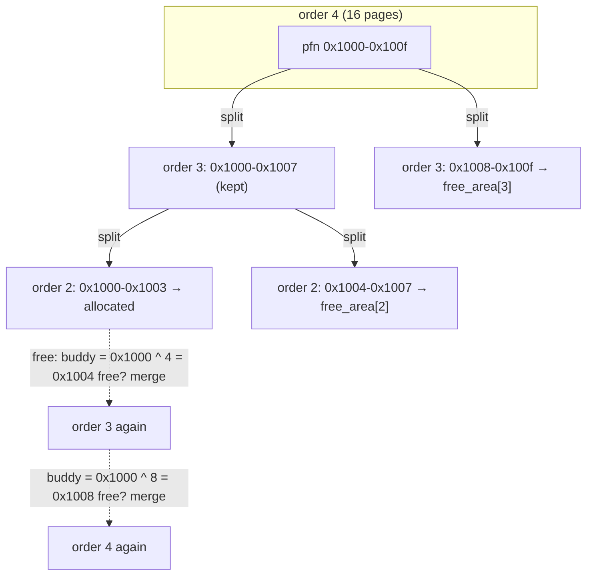

<div dir="rtl">

# ۰۶ — buddy allocator

> ماژول ۰۴ · مدیریت حافظه · Linux v6.18.63 · نسخهٔ انگلیسی: [`06-buddy-allocator.en.md`](06-buddy-allocator.en.md)

## ۱. خلاصه

- لینوکس حافظهٔ فیزیکی را به شکل **page frame** مدیریت می‌کند. قاب‌ها در NUMA **node**ها و **zone**ها (DMA، DMA32، Normal، Movable) گروه‌بندی شده‌اند. هر zone برای هر **order** از ۰ تا ۱۰ فهرست آزاد دارد (بلوک‌هایی از ۲ به توان order صفحهٔ پیوسته) و این فهرست‌ها بر اساس **migratetype** هم تفکیک شده‌اند.
- تخصیص، کوچک‌ترین بلوک آزادی را که از درخواست کوچک‌تر نیست برمی‌دارد و آن را **می‌شکند**. نیمه‌های اضافه به orderهای پایین‌تر برمی‌گردند. آزادسازی بلوک را تا وقتی رفیقش (`pfn ^ (1 << order)`) آزاد باشد با آن **ادغام** می‌کند.
- بیشتر ترافیک order صفر به **فهرست‌های صفحهٔ per-CPU (PCP)** می‌خورد. با fragmentation از سه راه مقابله می‌شود: migratetypeها، compaction (`kcompactd`) و watermarkها.

## ۲. توضیح مفصل

**شهود.** حافظه را یک ردیف بلوک به اندازهٔ ۲ به توان k تصور کنید. برای ۳ صفحه، درخواست به ۴ گرد می‌شود (order 2). اگر فقط یک بلوک order 4 (۱۶ صفحه) آزاد باشد، آن را می‌شکنیم: ۱۶ به ۸ و ۸. یک ۸ را نگه می‌داریم و آن را به ۴ و ۴ می‌شکنیم. یک ۴ به فهرست order 2 برمی‌گردد و دیگری تحویل داده می‌شود.

وقتی آن ۴ آزاد شد، «رفیقش» را بررسی می‌کنیم، یعنی نیمهٔ دیگرِ همان ۸ که از آن جدا شده بود. اگر رفیق هم آزاد باشد، با هم ادغام می‌شوند و ۸ می‌شوند. بعد رفیق آن ۸ بررسی می‌شود، و همین‌طور الی آخر.

رفیق‌ها با حساب پیدا می‌شوند، نه با جستجو. برای بلوکی که از قاب `pfn` شروع می‌شود و order آن `o` است، رفیق در `pfn ^ (1 << o)` است و بلوک ادغام‌شده از `pfn & buddy_pfn` شروع می‌شود.

**ساختارهای داده.**
- `struct page`: برای هر قاب ۴ کیلوبایتی یکی، ۶۴ بایتی و در آرایهٔ `vmemmap`؛ حدود ۱٫۶ درصد RAM. بلوک‌های آزاد از راه صفحهٔ سرشان به هم وصل‌اند و `PageBuddy` به‌اضافهٔ `buddy_order` سر یک بلوک آزاد را علامت می‌زند.
- `struct zone`: شامل `free_area[NR_PAGE_ORDERS]` که هر کدام `free_list[MIGRATE_TYPES]` و `nr_free` دارد، watermarkهای `min`، `low` و `high`، و `lock` (یک spinlock).
- `struct per_cpu_pages`: فهرست‌های per-CPU از صفحه‌های order کوچک. تخصیص و آزادسازی تا `PAGE_ALLOC_COSTLY_ORDER` (یعنی ۳) و order مربوط به THP اول به این فهرست‌ها می‌رود، بدون گرفتن قفل zone، و دسته‌ای از فهرست‌های buddy برداشته یا به آن‌ها برگردانده می‌شود.

**مسیر تخصیص** (`__alloc_frozen_pages_noprof()` ← `get_page_from_freelist()` ← `rmqueue()`):
1. zonelist را پیمایش می‌کند: اول node ترجیحی، بعد جایگزین‌ها. zoneهایی که برای این درخواست زیر watermark هستند رد می‌شوند.
2. فهرست PCP را امتحان می‌کند. اگر نشد، قفل zone را می‌گیرد و `__rmqueue_smallest()` را صدا می‌زند (گشت در کد، بخش ۵). این تابع orderها را رو به بالا امتحان می‌کند و با `expand()` می‌شکند.
3. اگر migratetype ترجیحی هیچ بلوکی نداشته باشد، سراغ نوع دیگر می‌رود. `__rmqueue_claim()` (خط ۲۴۰۷) یک pageblock دو مگابایتی کامل را به نوع ما تبدیل می‌کند و `__rmqueue_steal()` (خط ۲۴۶۲) فقط یک بلوک برمی‌دارد. `VERSION-DEPENDENT`: کرنل‌های قدیمی یک تابع `__rmqueue_fallback()` دارند و نسخه‌ای که آن را دو تکه کرد UNVERIFIED است. در یک clone با تاریخچه، با `git log -S __rmqueue_steal` بررسی کنید.
4. اگر همه چیز زیر watermark باشد، مسیر کند `__alloc_pages_slowpath()` اجرا می‌شود. به ترتیب: بیدار کردن `kswapd`، امتحان compaction، direct reclaim، تلاش دوباره، و در آخر OOM killer (برای orderهایی که پرهزینه نیستند).

**Migratetypeها.** هر pageblock دو مگابایتی یک نوع دارد:
- `MIGRATE_UNMOVABLE`: اشیای کرنل که جابه‌جا نمی‌شوند؛
- `MIGRATE_MOVABLE`: صفحه‌های کاربر و page cache که قابل مهاجرت‌اند؛
- `MIGRATE_RECLAIMABLE`: cacheهای slab که می‌شود کوچکشان کرد؛
- و `HIGHATOMIC`، `CMA` و `ISOLATE`.

گروه‌بندی بر اساس تحرک نمی‌گذارد تخصیص‌های غیرقابل‌جابه‌جایی در کل حافظه پخش شوند. به این ترتیب compaction همچنان می‌تواند از ناحیه‌های movable بلوک‌های order بالا بسازد.

**Fragmentation.**
- *External*: صفحهٔ آزاد در مجموع کافی است ولی پیوسته نیست. `/proc/buddyinfo` تعداد زیادی بلوک order صفر و یک نشان می‌دهد و در orderهای بالا صفر. تخصیص‌های THP و order سه به بالا (مثلاً بعضی درایورهای شبکه، یا `kmalloc` بیشتر از ۸ کیلوبایت) شکست می‌خورند یا در compaction گیر می‌کنند.
- *Internal*: گرد کردن رو به بالا. مثلاً درخواست ۵ صفحه یک بلوک order 3 (۸ صفحه) مصرف می‌کند. سربار خود buddy allocator از نوع internal fragmentation است و SLUB (یادداشت ۰۷) برای این ساخته شده که همین را برای اشیای کوچک حذف کند.

**Compaction** (`mm/compaction.c`): صفحه‌های movable را از پایین یک zone به صفحه‌های آزاد بالای آن منتقل می‌کند تا رشته‌های آزاد پیوسته ساخته شود. این کار را چند چیز راه می‌اندازد: خود تخصیص‌ها (direct compaction)، `kcompactd`، حالت پیش‌دستانه (`vm.compaction_proactiveness`)، یا اجرای دستی (`/proc/sys/vm/compact_memory`).

## ۳. نمودار

</div>



<div dir="rtl">

## ۴. مثال کاربردی

**تعداد بلوک‌های آزاد در هر order** (VM آزمایشگاه):

</div>

```bash
cat /proc/buddyinfo
sudo grep -A3 -E '^Free pages count per migrate type' /proc/pagetypeinfo | head -12
grep -E 'min|low|high' /proc/zoneinfo | head -6
```

```
Node 0, zone      DMA      0      0      0      0      0      0      0      0      1      2      2 
Node 0, zone    DMA32      3      1      0      2      2      2      3      2      2      1    873 
Node 0, zone   Normal   1527    935   3915   3484   1872    783    385    241    166    119   1672 
Free pages count per migrate type at order       0      1      2      3      4      5      6      7      8      9     10 
Node    0, zone      DMA, type    Unmovable      0      0      0      0      0      0      0      0      1      1      0 
Node    0, zone      DMA, type      Movable      0      0      0      0      0      0      0      0      0      1      2 
Node    0, zone      DMA, type  Reclaimable      0      0      0      0      0      0      0      0      0      0      0 
        min      21
        low      26
        high     31
              high:     5
              high_min: 4
              high_max: 60
```

<div dir="rtl">

هر ستون `buddyinfo` یک order است (۰ یعنی ۴ کیلوبایت و ۱۰ یعنی ۴ مگابایت). حجم آزاد در order k برابر است با تعداد ضرب در ۴ کیلوبایت ضرب در ۲ به توان k.

**حلقهٔ شکستن:** `linux/mm/page_alloc.c · expand() · v6.18.63 · L1745-1771` ([Elixir](https://elixir.bootlin.com/linux/v6.18.63/source/mm/page_alloc.c#L1745))

</div>

```c
static inline unsigned int expand(struct zone *zone, struct page *page, int low,
				  int high, int migratetype)
{
	unsigned int size = 1 << high;
	unsigned int nr_added = 0;

	while (high > low) {
		high--;
		size >>= 1;
		VM_BUG_ON_PAGE(bad_range(zone, &page[size]), &page[size]);

		/* ... guard pages (CONFIG_DEBUG_PAGEALLOC) ... */
		if (set_page_guard(zone, &page[size], high))
			continue;

		__add_to_free_list(&page[size], zone, high, migratetype, false);
		set_buddy_order(&page[size], high);
		nr_added += size;
	}

	return nr_added;
}
```

<div dir="rtl">

| خط | معنی |
|---|---|
| `low` و `high` | order درخواستی و order بلوکی که پیدا شده. |
| `high--; size >>= 1` | در هر دور بلوک نصف می‌شود. |
| `&page[size]` | نیمهٔ **بالایی** به فهرست آزاد برمی‌گردد. نیمهٔ پایینی شکسته‌شدن را ادامه می‌دهد و در آخر به فراخواننده تحویل داده می‌شود. |
| `set_buddy_order` | سر نیمهٔ برگشتی را به‌عنوان رفیق آزاد با همان order علامت می‌زند. `find_buddy_page_pfn` بعداً همین را بررسی می‌کند. |

و فرمول رفیق: `linux/mm/internal.h · __find_buddy_pfn() · v6.18.63 · L677-681`

</div>

```c
static inline unsigned long
__find_buddy_pfn(unsigned long page_pfn, unsigned int order)
{
	return page_pfn ^ (1 << order);
}
```

<div dir="rtl">

## ۵. حالت‌های مرزی و دام‌ها

- **کم بودن `MemFree` به معنی مشکل نیست.** RAM آزاد یعنی RAM هدررفته، و page cache در صورت نیاز آزاد می‌شود. به `MemAvailable`، PSI و توقف‌های تخصیص (`allocstall_*` در `/proc/vmstat`) نگاه کنید، نه `MemFree`.
- **تخصیص‌های order بالا شکننده‌اند.** `kmalloc(64 KiB)` به order 4 نیاز دارد. زیر fragmentation بهتر است از `kvmalloc()` استفاده شود که در صورت شکست سراغ `vmalloc` می‌رود و فقط صفحه‌های order صفر لازم دارد.
- **`GFP_ATOMIC`** نمی‌تواند بخوابد، پس نمی‌تواند reclaim کند. ولی ممکن است تا زیر `min` و در ذخیره‌ها برود؛ پرچم‌های `ALLOC_NON_BLOCK`، `ALLOC_MIN_RESERVE` و `ALLOC_HIGHATOMIC` در `mm/internal.h` خط‌های ۱۲۹۵ تا ۱۳۰۹ را ببینید.
- **NUMA:** برای هر node یک zone جدا هست. `numactl -H` و `/proc/zoneinfo` حافظهٔ آزاد هر node را نشان می‌دهند. VM ما یک node دارد.
- **`MAX_PAGE_ORDER` روی x86-64 به‌طور پیش‌فرض ۱۰ است** (`include/linux/mmzone.h` خط ۳۰)، پس بزرگ‌ترین بلوک buddy چهار مگابایت است. صفحهٔ بزرگ یک‌گیگابایتی باید از رزرو هنگام بوت یا CMA بیاید.

## ۶. نکته‌های امتحانی

- فهرست‌های آزاد برای هر ترکیب از zone، order و migratetype جدا هستند. `/proc/buddyinfo` تعداد را برای هر order نشان می‌دهد.
- رفیق `pfn` در order `o` برابر `pfn ^ (1 << o)` است و بلوک ادغام‌شده از `pfn & buddy` شروع می‌شود.
- تخصیص: کوچک‌ترین order که از درخواست کمتر نیست، و شکستن با `expand()`. آزادسازی: ادغام رو به بالا در `__free_one_page()`.
- فهرست‌های PCP تغییرات پرتکرار order صفر را بدون قفل zone جذب می‌کنند.
- علاج external fragmentation، compaction و گروه‌بندی migratetype است. علاج internal fragmentation برای اشیای کوچک، SLUB است.
- watermarkهای min، low و high رفتار kswapd (از low تا high) و direct reclaim (زیر min) را تعیین می‌کنند.

## ۷. پیوندها

- درس: [بخش ۲.۶](../lesson.fa.md)
- گشت در کد: [بخش ۵](../kernel-walkthrough.fa.md)
- آزمایش: [04.6](../labs/06-oom-thrashing/README.md) (watermarkها و reclaim زیر محدودیت)
- آزمون: پرسش‌های ۷ و ۱۴

</div>
