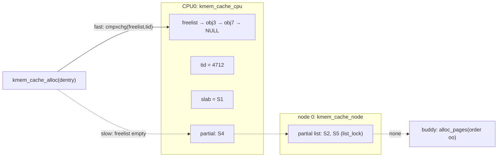

# 07 — SLUB, the slab allocator

> Module 04 · Memory Management · Linux v6.18.63 · Farsi: [`07-slub.fa.md`](07-slub.fa.md)

## 1. Summary

- The kernel allocates millions of small, same-sized objects (`dentry`, `inode`, `task_struct`, `sk_buff`, `kmalloc-64`…). SLUB serves them from **caches** (`struct kmem_cache`), each carving **slabs** (one or more buddy pages) into equal objects.
- The fast path is per-CPU and **lockless**: pop the first object from the CPU's current slab free list with a `cmpxchg` on (freelist, tid).
- SLUB is the only slab allocator since 6.8 (SLOB removed in 6.4, SLAB in 6.8); `/proc/slabinfo`, `slabtop` and `/sys/kernel/slab/` show every cache.

## 2. Detailed explanation

**Why not just buddy?** The smallest buddy block is 4 KiB. A 192-byte `dentry` from buddy would waste 95 % (internal fragmentation) and every allocation would touch the zone lock. Caching same-type objects also keeps them warm in CPU caches and lets constructors run once per object, not per use.

**Structures** (`mm/slab.h`, `mm/slub.c`):
- `struct kmem_cache` — one per object type: `size`, `object_size`, `offset` (where the free pointer lives inside a free object), `oo` (slab order + objects per slab), `cpu_slab` (per-CPU), `node[]` (per-node partial lists), flags (`SLAB_HWCACHE_ALIGN`, `SLAB_ACCOUNT`, `SLAB_TYPESAFE_BY_RCU`…).
- `struct slab` — overlays the `struct page` of the slab's first page: `freelist`, `inuse`, `objects`, `frozen`.
- `struct kmem_cache_cpu` — `freelist`, `tid`, `slab` (the current slab), `partial` (a per-CPU partial list).

**Free pointer inside the object.** A free object's bytes are unused, so SLUB stores the "next free" pointer in it (at `s->offset`). No separate metadata array. With `CONFIG_SLAB_FREELIST_HARDENED` the pointer is XORed with a per-cache random value and its own address, so a use-after-free write cannot easily redirect the next allocation.

**Allocation** (`slab_alloc_node()` → `__slab_alloc_node()`, walkthrough §6):
1. Read `c = this CPU's kmem_cache_cpu`, then `tid`, then `c->freelist`.
2. If there is an object and the slab is on the right node: compute `next = *(object + offset)` and `cmpxchg(c->freelist_tid, {object, tid}, {next, tid+1})`. Success → return `object`. Failure (we were preempted/migrated, or an IRQ allocated in between) → retry.
3. Otherwise slow path `___slab_alloc()`: take the current slab's remote-freed objects, or a slab from the per-CPU partial list, or the node partial list (`n->list_lock`), or allocate a new slab from buddy (`allocate_slab()` → `alloc_pages`).

**Free** (`do_slab_free()`): if the object belongs to the CPU's current slab, push it back with the same `cmpxchg` trick. Otherwise (`__slab_free`) `cmpxchg` it onto *that slab's* freelist; a slab that becomes partially free goes to a partial list, and an empty slab may be returned to buddy (keeping `min_partial` slabs per node).

**`kmalloc`.** Generic sizes are served by caches `kmalloc-8` … `kmalloc-8k` (plus `kmalloc-cg-*` for memcg-accounted allocations and `kmalloc-rcl-*` for reclaimable ones, and random per-callsite copies with `CONFIG_RANDOM_KMALLOC_CACHES`). Larger requests go straight to the page allocator.

**Merging.** Caches with compatible size/flags are merged (aliases), so `slabinfo` may show fewer caches than `kmem_cache_create()` calls; `/sys/kernel/slab/` shows the symlinks. Boot with `slab_nomerge` to see them separately.

**Reclaim.** Slab memory is unmovable but some caches are *reclaimable*: the dentry and inode caches register **shrinkers**; under memory pressure `shrink_slab()` asks them to drop unused objects (`vfs_cache_pressure` scales it). `SReclaimable` vs `SUnreclaim` in `/proc/meminfo` split the two. Lab 05 grows the dentry/inode caches by 200 000 files.

**`VERSION-DEPENDENT`:** 6.18 adds **sheaves** — per-CPU arrays of objects for caches that opt in (first the maple-tree node and VMA caches); later kernels make them the default. The `cpu_slab` fast path described here is still what most caches use on v6.18.63.

## 3. Diagram



## 4. Worked example

The cache table on the VM (Lab 05 shows how it moves):

```bash
sudo head -2 /proc/slabinfo
sudo grep -E '^(dentry|ext4_inode_cache|kmalloc-64|task_struct|vm_area_struct) ' /proc/slabinfo
sudo cat /sys/kernel/slab/dentry/order /sys/kernel/slab/dentry/objs_per_slab
grep -E 'Slab|SReclaimable|SUnreclaim' /proc/meminfo
```

```
slabinfo - version: 2.1
# name            <active_objs> <num_objs> <objsize> <objperslab> <pagesperslab> : tunables <limit> <batchcount> <sharedfactor> : slabdata <active_slabs> <num_slabs> <sharedavail>
ext4_inode_cache     991   2610   1128   29    8 : tunables    0    0    0 : slabdata     90     90      0
dentry              6810  15624    192   21    1 : tunables    0    0    0 : slabdata    744    744      0
vm_area_struct     11358  12243    192   21    1 : tunables    0    0    0 : slabdata    583    583      0
task_struct          371    381  10880    3    8 : tunables    0    0    0 : slabdata    127    127      0
kmalloc-64          3392   3392     64   64    1 : tunables    0    0    0 : slabdata     53     53      0
$ sudo cat /sys/kernel/slab/dentry/order /sys/kernel/slab/dentry/objs_per_slab
0
21
$ grep -E 'Slab|SReclaimable|SUnreclaim' /proc/meminfo
Slab:              90828 kB
SReclaimable:      17544 kB
SUnreclaim:        73284 kB
```

Columns: `active_objs num_objs objsize objperslab pagesperslab`. Memory used ≈ `num_objs × objsize` (plus slab rounding).

The fast path — `linux/mm/slub.c · __slab_alloc_node() · v6.18.63 · L4912-4937` ([Elixir](https://elixir.bootlin.com/linux/v6.18.63/source/mm/slub.c#L4846)):

```c
	if (!USE_LOCKLESS_FAST_PATH() ||
	    unlikely(!object || !slab || !node_match(slab, node))) {
		object = __slab_alloc(s, gfpflags, node, addr, c, orig_size);
	} else {
		void *next_object = get_freepointer_safe(s, object);
		/* ... comment: cmpxchg semantics (L4918-4931) ... */
		if (unlikely(!__update_cpu_freelist_fast(s, object, next_object, tid))) {
			note_cmpxchg_failure("slab_alloc", s, tid);
			goto redo;
		}
		prefetch_freepointer(s, next_object);
		stat(s, ALLOC_FASTPATH);
	}
```

| Line | Meaning |
|---|---|
| `USE_LOCKLESS_FAST_PATH()` | false on PREEMPT_RT, which uses a local lock instead. |
| `!object` | per-CPU freelist empty → slow path. |
| `get_freepointer_safe` | read `next` from inside the free object (de-obfuscated if hardened). |
| `__update_cpu_freelist_fast` | `this_cpu_try_cmpxchg` on the 128-bit (freelist, tid) pair (L4437). |
| `goto redo` | lost the race (preempted/IRQ) → reread and retry; no lock was ever held. |
| `prefetch_freepointer` | warm the cache line of the next object for the next allocation. |

## 5. Edge cases & pitfalls

- **Slab memory is not process memory**: it shows in `/proc/meminfo` `Slab`, not in any RSS. A "memory leak" with flat RSS may be a dentry/inode or `kmalloc` growth — check `slabtop`.
- **Negative dentries** (cached "file does not exist" results) can grow without bound on workloads that probe many missing paths.
- **Debugging**: boot with `slab_debug=FZPU` (red zones, poisoning, user tracking) or per cache via `slab_debug=,dentry`; KASAN for use-after-free.
- **`kmalloc` rounds up** to the next cache size: `kmalloc(65)` uses `kmalloc-96`; `ksize()` reports the real size.
- **`SLAB_TYPESAFE_BY_RCU`** does *not* delay object reuse, only slab-page freeing — readers must recheck identity (used by VMAs for the per-VMA lock, see note 01).

## 6. Exam-style key points

- cache (`kmem_cache`) → slabs (buddy pages) → objects of one size.
- Free pointer stored inside the free object at `s->offset`; hardened with XOR.
- Fast path: per-CPU freelist, `cmpxchg` on (freelist, tid), no lock, no IRQ disable.
- Slow path order: CPU slab → CPU partial → node partial (`list_lock`) → new slab from buddy.
- Shrinkers reclaim dentry/inode caches; `SReclaimable` vs `SUnreclaim`.
- Only SLUB remains since 6.8; v6.18 adds opt-in sheaves.

## 7. Links

- Lesson: [§2.7](../lesson.en.md#27-how-does-the-kernel-allocate-a-192-byte-dentry)
- Walkthrough: [§6](../kernel-walkthrough.en.md#6-slub--the-lockless-per-cpu-fast-path)
- Labs: [04.5 slab caches](../labs/05-slab-files/README.md)
- Quiz: Q8, Q14
