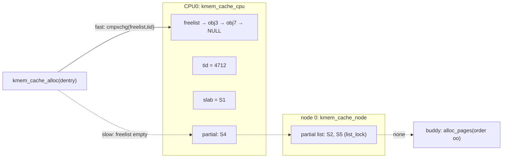

<div dir="rtl">

# ۰۷ — SLUB، تخصیص‌دهندهٔ slab

> ماژول ۰۴ · مدیریت حافظه · Linux v6.18.63 · نسخهٔ انگلیسی: [`07-slub.en.md`](07-slub.en.md)

## ۱. خلاصه

- کرنل میلیون‌ها شیء کوچک و هم‌اندازه تخصیص می‌دهد: `dentry`، `inode`، `task_struct`، `sk_buff`، `kmalloc-64` و… . SLUB این اشیا را از **cache**ها (`struct kmem_cache`) می‌دهد. هر cache **slab**هایی دارد (یک یا چند صفحه از buddy) که به اشیای مساوی تقسیم شده‌اند.
- مسیر سریع per-CPU و **بدون قفل** است. اولین شیء از فهرست آزاد slab فعلیِ CPU با یک `cmpxchg` روی جفت (freelist، tid) برداشته می‌شود.
- از نسخهٔ ۶٫۸، SLUB تنها slab allocator است: SLOB در ۶٫۴ و SLAB در ۶٫۸ حذف شدند. `/proc/slabinfo`، `slabtop` و `/sys/kernel/slab/` همهٔ cacheها را نشان می‌دهند.

## ۲. توضیح مفصل

**چرا همان buddy نه؟** کوچک‌ترین بلوک buddy چهار کیلوبایت است. یک `dentry` با اندازهٔ ۱۹۲ بایت اگر از buddy می‌آمد، ۹۵ درصد حافظه هدر می‌رفت (internal fragmentation) و هر تخصیص به قفل zone دست می‌زد. cache کردن اشیای هم‌نوع مزیت‌های دیگری هم دارد: اشیا در cacheهای CPU گرم می‌مانند و constructor برای هر شیء یک بار اجرا می‌شود، نه برای هر بار استفاده.

**ساختارها** (`mm/slab.h` و `mm/slub.c`):
- `struct kmem_cache`: یکی برای هر نوع شیء. شامل `size`، `object_size`، `offset` (اشاره‌گر آزاد کجای شیء آزاد نوشته می‌شود)، `oo` (order هر slab و تعداد شیء در آن)، `cpu_slab` (per-CPU)، `node[]` (فهرست‌های نیمه‌پر برای هر node) و پرچم‌ها (`SLAB_HWCACHE_ALIGN`، `SLAB_ACCOUNT`، `SLAB_TYPESAFE_BY_RCU`…).
- `struct slab`: روی `struct page` اولین صفحهٔ slab قرار می‌گیرد و فیلدهای `freelist`، `inuse`، `objects` و `frozen` را دارد.
- `struct kmem_cache_cpu`: شامل `freelist`، `tid`، `slab` (slab فعلی) و `partial` (فهرست نیمه‌پر per-CPU).

**اشاره‌گر آزاد داخل خود شیء.** بایت‌های شیء آزاد بلااستفاده‌اند، پس SLUB اشاره‌گر «آزاد بعدی» را در خود شیء می‌نویسد (در `s->offset`) و به آرایهٔ metadata جداگانه نیازی ندارد. با `CONFIG_SLAB_FREELIST_HARDENED` این اشاره‌گر با یک مقدار تصادفی مخصوص cache و با آدرس خودش XOR می‌شود. نتیجه این است که نوشتن use-after-free به این سادگی نمی‌تواند تخصیص بعدی را منحرف کند.

**تخصیص** (`slab_alloc_node()` ← `__slab_alloc_node()`، گشت در کد بخش ۶):
1. `c` (ساختار `kmem_cache_cpu` همین CPU) خوانده می‌شود، بعد `tid` و بعد `c->freelist`.
2. اگر شیئی باشد و slab روی node درست باشد، `next = *(object + offset)` حساب می‌شود و `cmpxchg(c->freelist_tid, {object, tid}, {next, tid+1})` اجرا می‌شود. اگر موفق شود `object` برگردانده می‌شود. اگر شکست بخورد (preempt یا مهاجرت شده‌ایم، یا یک IRQ در این فاصله تخصیص داده)، از اول امتحان می‌شود.
3. در غیر این صورت مسیر کند `___slab_alloc()` اجرا می‌شود. به ترتیب امتحان می‌کند: اشیایی که CPUهای دیگر در slab فعلی آزاد کرده‌اند، یک slab از فهرست نیمه‌پر per-CPU، فهرست نیمه‌پر node (با قفل `n->list_lock`)، و در آخر slab تازه از buddy (`allocate_slab()` ← `alloc_pages`).

**آزادسازی** (`do_slab_free()`): اگر شیء مال slab فعلی CPU باشد، با همان ترفند `cmpxchg` به فهرست برمی‌گردد. در غیر این صورت (`__slab_free`) با `cmpxchg` روی فهرست آزادِ *همان slab* گذاشته می‌شود. slabی که نیمه‌خالی شود به یک فهرست نیمه‌پر می‌رود و slabی که کاملاً خالی شود ممکن است به buddy برگردد؛ برای هر node تعداد `min_partial` slab نگه داشته می‌شود.

**`kmalloc`.** اندازه‌های عمومی را cacheهای `kmalloc-8` تا `kmalloc-8k` می‌دهند. کنارشان `kmalloc-cg-*` برای تخصیص‌هایی که به memcg نوشته می‌شوند، `kmalloc-rcl-*` برای تخصیص‌های قابل آزادسازی، و با `CONFIG_RANDOM_KMALLOC_CACHES` چند نسخهٔ تصادفی برای هر callsite هست. درخواست‌های بزرگ‌تر مستقیم به page allocator می‌روند.

**ادغام.** cacheهایی که اندازه و پرچم‌های سازگار دارند ادغام می‌شوند (alias). به همین دلیل `slabinfo` ممکن است cacheهای کمتری از تعداد فراخوانی‌های `kmem_cache_create()` نشان دهد. `/sys/kernel/slab/` این symlinkها را نشان می‌دهد. اگر می‌خواهید جدا ببینید، با `slab_nomerge` بوت کنید.

**آزادسازی تحت فشار.** حافظهٔ slab قابل‌جابه‌جایی نیست، ولی بعضی cacheها *قابل آزادسازی* هستند. cacheهای dentry و inode **shrinker** ثبت کرده‌اند. زیر فشار حافظه، `shrink_slab()` از آن‌ها می‌خواهد اشیای بلااستفاده را دور بریزند و `vfs_cache_pressure` شدت آن را تعیین می‌کند. در `/proc/meminfo`، `SReclaimable` و `SUnreclaim` این دو نوع را جدا نشان می‌دهند. آزمایش ۰۵ با ۲۰۰ هزار فایل cacheهای dentry و inode را بزرگ می‌کند.

**`VERSION-DEPENDENT`:** در ۶٫۱۸ **sheaves** اضافه شده‌اند: آرایه‌های per-CPU از اشیا برای cacheهایی که خودشان فعالشان کنند (اول cacheهای گره‌های maple tree و VMA). کرنل‌های بعدی آن‌ها را پیش‌فرض کرده‌اند. در v6.18.63 بیشتر cacheها هنوز از همان مسیر سریع `cpu_slab` استفاده می‌کنند که اینجا توضیح داده شد.

## ۳. نمودار

</div>



<div dir="rtl">

## ۴. مثال کاربردی

جدول cacheها روی VM (آزمایش ۰۵ نشان می‌دهد چطور تغییر می‌کند):

</div>

```bash
sudo head -2 /proc/slabinfo
sudo grep -E '^(dentry|ext4_inode_cache|kmalloc-64|task_struct|vm_area_struct) ' /proc/slabinfo
sudo cat /sys/kernel/slab/dentry/order /sys/kernel/slab/dentry/objs_per_slab
grep -E 'Slab|SReclaimable|SUnreclaim' /proc/meminfo
```

```
slabinfo - version: 2.1
# name            <active_objs> <num_objs> <objsize> <objperslab> <pagesperslab> : tunables <limit> <batchcount> <sharedfactor> : slabdata <active_slabs> <num_slabs> <sharedavail>
ext4_inode_cache     991   2610   1128   29    8 : tunables    0    0    0 : slabdata     90     90      0
dentry              6810  15624    192   21    1 : tunables    0    0    0 : slabdata    744    744      0
vm_area_struct     11358  12243    192   21    1 : tunables    0    0    0 : slabdata    583    583      0
task_struct          371    381  10880    3    8 : tunables    0    0    0 : slabdata    127    127      0
kmalloc-64          3392   3392     64   64    1 : tunables    0    0    0 : slabdata     53     53      0
$ sudo cat /sys/kernel/slab/dentry/order /sys/kernel/slab/dentry/objs_per_slab
0
21
$ grep -E 'Slab|SReclaimable|SUnreclaim' /proc/meminfo
Slab:              90828 kB
SReclaimable:      17544 kB
SUnreclaim:        73284 kB
```

<div dir="rtl">

ستون‌ها: `active_objs num_objs objsize objperslab pagesperslab`. حافظهٔ مصرفی تقریباً `num_objs × objsize` است، به‌اضافهٔ گرد شدن slab.

مسیر سریع: `linux/mm/slub.c · __slab_alloc_node() · v6.18.63 · L4912-4937` ([Elixir](https://elixir.bootlin.com/linux/v6.18.63/source/mm/slub.c#L4846))

</div>

```c
	if (!USE_LOCKLESS_FAST_PATH() ||
	    unlikely(!object || !slab || !node_match(slab, node))) {
		object = __slab_alloc(s, gfpflags, node, addr, c, orig_size);
	} else {
		void *next_object = get_freepointer_safe(s, object);
		/* ... comment: cmpxchg semantics (L4918-4931) ... */
		if (unlikely(!__update_cpu_freelist_fast(s, object, next_object, tid))) {
			note_cmpxchg_failure("slab_alloc", s, tid);
			goto redo;
		}
		prefetch_freepointer(s, next_object);
		stat(s, ALLOC_FASTPATH);
	}
```

<div dir="rtl">

| خط | معنی |
|---|---|
| `USE_LOCKLESS_FAST_PATH()` | روی PREEMPT_RT نادرست است و آنجا به‌جایش یک قفل محلی به کار می‌رود. |
| `!object` | فهرست آزاد per-CPU خالی است، پس مسیر کند. |
| `get_freepointer_safe` | `next` را از داخل شیء آزاد می‌خواند (اگر hardened باشد، ابهامش را برمی‌دارد). |
| `__update_cpu_freelist_fast` | `this_cpu_try_cmpxchg` روی جفت ۱۲۸ بیتی (freelist، tid) (خط ۴۴۳۷). |
| `goto redo` | در race باختیم (preempt یا IRQ)، پس دوباره می‌خوانیم و امتحان می‌کنیم. هیچ قفلی گرفته نشده بود. |
| `prefetch_freepointer` | خط cache شیء بعدی را برای تخصیص بعدی گرم می‌کند. |

## ۵. حالت‌های مرزی و دام‌ها

- **حافظهٔ slab حافظهٔ پردازه نیست.** در `Slab` داخل `/proc/meminfo` دیده می‌شود، نه در RSS هیچ پردازه‌ای. «نشت حافظه» با RSS ثابت ممکن است رشد dentry، inode یا `kmalloc` باشد. `slabtop` را نگاه کنید.
- **dentryهای منفی** (نتیجهٔ cacheشدهٔ «این فایل وجود ندارد») در بارهایی که مسیرهای ناموجود زیادی را امتحان می‌کنند، می‌توانند بی‌حد رشد کنند.
- **اشکال‌زدایی:** با `slab_debug=FZPU` بوت کنید تا red zone، poisoning و ردیابی کاربر روشن شود، یا برای یک cache خاص با `slab_debug=,dentry`. برای use-after-free از KASAN استفاده کنید.
- **`kmalloc` رو به بالا گرد می‌کند** و به اندازهٔ cache بعدی می‌رسد: `kmalloc(65)` از `kmalloc-96` می‌آید. `ksize()` اندازهٔ واقعی را گزارش می‌کند.
- **`SLAB_TYPESAFE_BY_RCU`** استفادهٔ دوباره از شیء را عقب *نمی‌اندازد*، فقط آزاد شدن صفحهٔ slab را. پس خواننده‌ها باید هویت شیء را دوباره بررسی کنند. VMAها برای قفل per-VMA از همین استفاده می‌کنند (یادداشت ۰۱).

## ۶. نکته‌های امتحانی

- cache (`kmem_cache`) شامل slabهاست (صفحه‌های buddy) و slab شامل اشیای یک اندازه.
- اشاره‌گر آزاد داخل خود شیء آزاد و در `s->offset` ذخیره می‌شود و با XOR مقاوم‌سازی شده.
- مسیر سریع: فهرست آزاد per-CPU و `cmpxchg` روی (freelist، tid)؛ بدون قفل و بدون خاموش کردن IRQ.
- ترتیب مسیر کند: slab فعلی CPU، فهرست نیمه‌پر CPU، فهرست نیمه‌پر node (`list_lock`)، slab تازه از buddy.
- shrinkerها cacheهای dentry و inode را آزاد می‌کنند. `SReclaimable` را از `SUnreclaim` جدا کنید.
- از ۶٫۸ فقط SLUB مانده است. در v6.18 گزینهٔ sheaves هم اضافه شده که هر cache خودش فعالش می‌کند.

## ۷. پیوندها

- درس: [بخش ۲.۷](../lesson.fa.md)
- گشت در کد: [بخش ۶](../kernel-walkthrough.fa.md)
- آزمایش: [04.5، cacheهای slab](../labs/05-slab-files/README.md)
- آزمون: پرسش‌های ۸ و ۱۴

</div>
