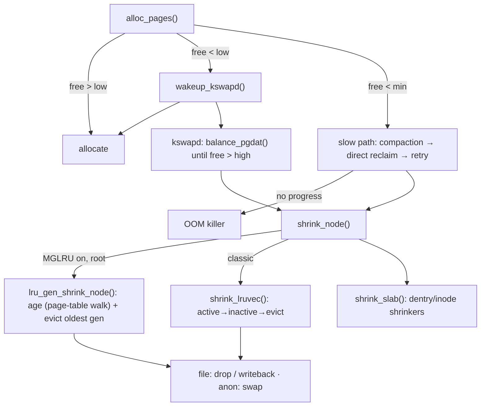

# 08 — Reclaim: LRU, MGLRU and kswapd

> Module 04 · Memory Management · Linux v6.18.63 · Farsi: [`08-reclaim-lru-mglru.fa.md`](08-reclaim-lru-mglru.fa.md)

## 1. Summary

- When free memory falls below a zone's **low watermark**, the per-node `kswapd` thread reclaims pages until the **high watermark**; below **min**, the allocating task does **direct reclaim** itself (a latency hit).
- Reclaim picks victims from LRU lists per (memcg, node) — the classic **active/inactive × anon/file** lists, or **MGLRU** generations when `/sys/kernel/mm/lru_gen/enabled` is on.
- Clean file pages are dropped, dirty ones written back, anonymous pages need swap/zswap; slab caches are shrunk by shrinkers. If nothing works → OOM (note 10).

## 2. Detailed explanation

**What can be reclaimed?**

| Page type | How it is freed | Cost to get back |
|---|---|---|
| clean page cache (file read, program text) | drop it (unmap via rmap first) | major fault / read |
| dirty page cache | writeback, then drop | write + later read |
| anonymous (heap, stack, private COW) | write to swap (or compress into zswap), then drop | swap-in (major fault) |
| slab caches (dentry, inode) | shrinker callbacks | lookup cost |
| unevictable (`mlock`, ramfs) | not reclaimable | — |

Without swap, anonymous memory is pinned in RAM; reclaim can only take file pages. That is why a no-swap system can still **thrash** on program text and mapped files (Lab 06).

**Watermarks.** Each zone has `min`, `low`, `high` (in `/proc/zoneinfo`), derived from `vm.min_free_kbytes` and `vm.watermark_scale_factor`. The allocator checks them (`zone_watermark_ok`):
- above `low`: just allocate;
- below `low`: `wakeup_kswapd()`, still allocate;
- below `min`: only `GFP_ATOMIC`/`PF_MEMALLOC` may continue; others enter the slow path — direct compaction, **direct reclaim** (`try_to_free_pages()`), retry, OOM.

**kswapd** (`kswapd()`, walkthrough §8): sleeps on `pgdat->kswapd_wait`, wakes with an order and zone index, runs `balance_pgdat()` — repeated `shrink_node()` passes with rising priority (scanning 1/4096 of the LRU at priority 12, the whole LRU at priority 0) until the zone is above `high` — then wakes `kcompactd` for high-order requests and sleeps again.

**Classic two-list LRU.** Four evictable lists per lruvec: `inactive_anon`, `active_anon`, `inactive_file`, `active_file`. New pages start inactive; a second access (seen through the PTE Accessed bit via rmap, or `folio_mark_accessed()` for `read()`) promotes to active; `shrink_active_list()` demotes cold active pages; `shrink_inactive_list()` evicts from the tail. `get_scan_count()` balances anon vs file using `vm.swappiness` (0–200) and the measured **refault cost**. Workingset detection stores a **shadow entry** in the page cache when a file page is evicted; if it is faulted back soon (`workingset_refault_file`), the kernel learns the inactive list is too small.

**MGLRU** (multi-generational LRU, merged in 6.1, by Yu Zhao). Instead of two lists, pages are in up to `MAX_NR_GENS` = 4 generations (`include/linux/mmzone.h` L399), numbered by `min_seq`…`max_seq`:
- **aging** (`try_to_inc_max_seq()`) creates a new youngest generation and moves pages found accessed — by scanning **page tables** of active processes (walking `mm_struct`s, cheap because it reads PTE Accessed bits in bulk) rather than following rmap for every page;
- **eviction** takes pages from the oldest generation, checking the Accessed bit once more; a PID controller balances anon vs file by refault rates across **tiers** (how often a page was accessed through file descriptors);
- `min_ttl_ms` protects the working set for a minimum time to prevent thrashing (`/sys/kernel/mm/lru_gen/min_ttl_ms`).
Google and others reported lower CPU use for reclaim and fewer OOM kills/low-memory kills in production; it is the default in many distros (Ubuntu enables `CONFIG_LRU_GEN_ENABLED`). In v6.18.63 the dispatch is: global (root) reclaim → `shrink_node()` → `lru_gen_shrink_node()`; memcg reclaim → `shrink_lruvec()` → `lru_gen_shrink_lruvec()`.

**Reverse mapping (rmap).** To evict a page that is mapped in several processes, the kernel must clear every PTE pointing to it: for anon pages through `anon_vma` (from `vma->anon_vma`), for file pages through the file's `i_mmap` interval tree. `try_to_unmap()` does this, followed by a TLB flush (batched).

**memcg reclaim.** With cgroup v2, each cgroup has its own lruvecs; hitting `memory.high` throttles and reclaims inside the cgroup, hitting `memory.max` forces reclaim and then a memcg OOM. `memory.low`/`memory.min` protect a cgroup's working set from global reclaim.

## 3. Diagram



## 4. Worked example

**On the VM:** is MGLRU on, what are the watermarks, how much reclaim has happened?

```bash
cat /sys/kernel/mm/lru_gen/enabled           # 0x0007 = all features on
grep -E '^(pgscan|pgsteal|allocstall|workingset_refault)_' /proc/vmstat | head -12
grep -E 'Node|pages free|  min|  low|  high' /proc/zoneinfo | head -10
cat /proc/pressure/memory
```

```
0x0007
workingset_refault_anon 0
workingset_refault_file 64385
allocstall_dma 0
allocstall_dma32 0
allocstall_normal 0
allocstall_movable 0
allocstall_device 0
pgsteal_kswapd 0
pgsteal_direct 0
pgsteal_khugepaged 0
pgsteal_proactive 0
pgscan_kswapd 0
Node 0, zone      DMA
  pages free     3328
        min      21
        low      26
        high     31
              high:     5
              high_min: 4
              high_max: 60
              high:     0
              high_min: 4
some avg10=0.00 avg60=0.06 avg300=0.10 total=1857930
full avg10=0.00 avg60=0.05 avg300=0.07 total=1757787
```

`workingset_refault_file 64385` comes from Lab 04.6's thrashing run. `pgsteal_kswapd 0` and `allocstall_* 0` show that the VM as a whole was never short of memory; all reclaim happened inside the lab's cgroups.

The MGLRU/classic switch — `linux/mm/vmscan.c · shrink_lruvec() · v6.18.63 · L5810-5815` ([Elixir](https://elixir.bootlin.com/linux/v6.18.63/source/mm/vmscan.c#L5799)):

```c
	if (lru_gen_enabled() && !root_reclaim(sc)) {
		lru_gen_shrink_lruvec(lruvec, sc);
		return;
	}

	get_scan_count(lruvec, sc, nr);
```

and its twin in `shrink_node()` (L6071-6075):

```c
	if (lru_gen_enabled() && root_reclaim(sc)) {
		memset(&sc->nr, 0, sizeof(sc->nr));
		lru_gen_shrink_node(pgdat, sc);
		return;
	}
```

| Line | Meaning |
|---|---|
| `lru_gen_enabled()` | static key, flipped by writing to `/sys/kernel/mm/lru_gen/enabled`. |
| `root_reclaim(sc)` | global reclaim (kswapd, or direct reclaim not targeted at a memcg). |
| `lru_gen_shrink_node` | MGLRU walks all memcgs of the node itself (it keeps its own memcg ordering). |
| `get_scan_count` | classic path: compute how many pages to scan per list from swappiness and refault cost. |

## 5. Edge cases & pitfalls

- **`drop_caches` is not a tuning knob.** It drops clean caches globally and destroys the working set (and on this shared VM, disturbs everyone). Use cgroup limits to test.
- **Swappiness 0 ≠ no swap**; it biases strongly toward file pages, but anon can still be swapped under severe pressure.
- **Direct reclaim latency** appears as `allocstall_*` in `/proc/vmstat` and as PSI `memory` `some`/`full`; raising `vm.watermark_scale_factor` makes kswapd start earlier.
- **Dirty pages throttle writers** (`balance_dirty_pages`, Module 05) — reclaim of dirty file pages relies on writeback.
- **MGLRU sysfs** values are hex bitmasks; `enabled=0x0007` means base + page-table walk + non-leaf PMD Accessed bit support. `VERSION-DEPENDENT`

## 6. Exam-style key points

- Watermarks: `low` wakes kswapd, `high` lets it sleep, `min` forces direct reclaim.
- Classic LRU = 4 evictable lists; promotion on second access; swappiness + refault cost balance anon/file.
- MGLRU (6.1+) = up to 4 generations; aging scans page tables; eviction from oldest generation.
- rmap (`anon_vma`, `i_mmap`) finds every PTE to clear before eviction; then TLB flush.
- Without swap only file pages and slab can be reclaimed.
- Refaults (`workingset_refault_*`) and PSI are the signals of thrashing.

## 7. Links

- Lesson: [§2.8](../lesson.en.md#28-what-happens-when-ram-is-full)
- Walkthrough: [§8](../kernel-walkthrough.en.md#8-reclaim-and-oom)
- Labs: [04.6 thrashing and OOM](../labs/06-oom-thrashing/README.md)
- Quiz: Q10, Q15
