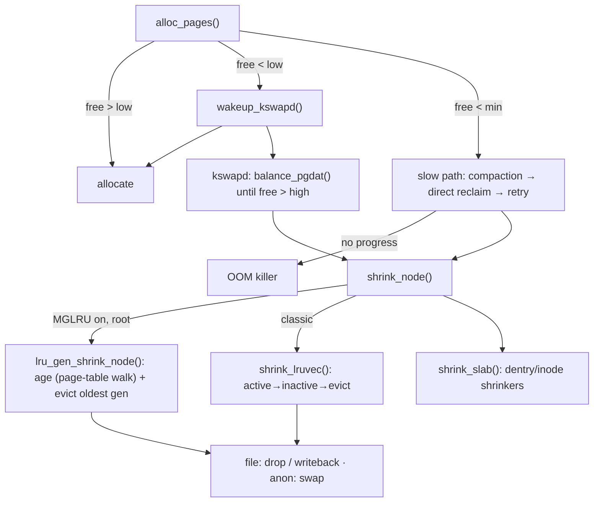

<div dir="rtl">

# ۰۸ — آزادسازی حافظه (reclaim): LRU، MGLRU و kswapd

> ماژول ۰۴ · مدیریت حافظه · Linux v6.18.63 · نسخهٔ انگلیسی: [`08-reclaim-lru-mglru.en.md`](08-reclaim-lru-mglru.en.md)

## ۱. خلاصه

- وقتی حافظهٔ آزاد یک zone زیر **low watermark** برود، نخ `kswapd` مخصوص آن node تا رسیدن به **high watermark** صفحه آزاد می‌کند. زیر **min**، خود taskی که تخصیص می‌خواهد **direct reclaim** انجام می‌دهد، که یعنی ضربهٔ تأخیر.
- reclaim قربانی‌ها را از فهرست‌های LRU مخصوص هر جفت (memcg، node) انتخاب می‌کند. این فهرست‌ها یا همان فهرست‌های کلاسیک **active/inactive × anon/file** هستند، یا اگر `/sys/kernel/mm/lru_gen/enabled` روشن باشد، نسل‌های **MGLRU**.
- صفحه‌های فایلِ تمیز دور ریخته می‌شوند، صفحه‌های dirty اول نوشته می‌شوند، صفحه‌های ناشناس swap یا zswap لازم دارند، و cacheهای slab را shrinkerها کوچک می‌کنند. اگر هیچ‌کدام جواب ندهد، نوبت OOM است (یادداشت ۱۰).

## ۲. توضیح مفصل

**چه چیزی آزادشدنی است؟**

| نوع صفحه | چطور آزاد می‌شود | هزینهٔ برگرداندن |
|---|---|---|
| page cache تمیز (فایل خوانده‌شده، کد برنامه) | دور انداختن، بعد از unmap از راه rmap | fault بزرگ و خواندن |
| page cache کثیف (dirty) | writeback و بعد دور انداختن | نوشتن، و بعداً خواندن |
| ناشناس (heap، stack، COW خصوصی) | نوشتن در swap (یا فشرده‌سازی در zswap) و بعد دور انداختن | swap-in (fault بزرگ) |
| cacheهای slab (dentry، inode) | callbackهای shrinker | هزینهٔ lookup دوباره |
| غیرقابل‌بیرون‌انداختن (`mlock`، ramfs) | آزادشدنی نیست | — |

بدون swap، حافظهٔ ناشناس در RAM قفل می‌ماند و reclaim فقط می‌تواند صفحه‌های فایل را بگیرد. به همین دلیل سیستم بدون swap همچنان می‌تواند روی کد برنامه و فایل‌های map شده **thrash** کند (آزمایش ۰۶).

**watermarkها.** هر zone مقدارهای `min`، `low` و `high` دارد (در `/proc/zoneinfo`) که از `vm.min_free_kbytes` و `vm.watermark_scale_factor` به دست می‌آیند. تخصیص‌دهنده آن‌ها را با `zone_watermark_ok` بررسی می‌کند:
- بالای `low`: فقط تخصیص بده.
- زیر `low`: `wakeup_kswapd()` و همچنان تخصیص بده.
- زیر `min`: فقط `GFP_ATOMIC` یا `PF_MEMALLOC` می‌توانند ادامه دهند. بقیه وارد مسیر کند می‌شوند: direct compaction، **direct reclaim** (`try_to_free_pages()`)، تلاش دوباره، و OOM.

**kswapd** (`kswapd()`، گشت در کد بخش ۸): روی `pgdat->kswapd_wait` می‌خوابد و با یک order و zone index بیدار می‌شود. بعد `balance_pgdat()` را اجرا می‌کند، یعنی گذرهای پیاپی `shrink_node()` با اولویت رو به افزایش: در اولویت ۱۲، یک ۴۰۹۶ام LRU پیمایش می‌شود و در اولویت ۰ کل آن. این ادامه دارد تا zone بالای `high` برود. بعد برای درخواست‌های order بالا `kcompactd` را بیدار می‌کند و دوباره می‌خوابد.

**LRU کلاسیک دوفهرستی.** هر lruvec چهار فهرست بیرون‌انداختنی دارد: `inactive_anon`، `active_anon`، `inactive_file` و `active_file`.
- صفحه‌های تازه در فهرست inactive شروع می‌کنند.
- دسترسی دوم صفحه را به active ارتقا می‌دهد. این دسترسی یا از روی بیت Accessed در PTE و از راه rmap دیده می‌شود، یا برای `read()` با `folio_mark_accessed()`.
- `shrink_active_list()` صفحه‌های سرد active را پایین می‌آورد و `shrink_inactive_list()` از دُم فهرست بیرون می‌اندازد.
- `get_scan_count()` با `vm.swappiness` (۰ تا ۲۰۰) و **هزینهٔ refault** اندازه‌گیری‌شده بین anon و file تعادل برقرار می‌کند.

تشخیص workingset این‌طور کار می‌کند: وقتی صفحهٔ فایلی بیرون انداخته می‌شود، یک **shadow entry** در page cache می‌ماند. اگر صفحه زود دوباره fault شود (`workingset_refault_file`)، کرنل می‌فهمد فهرست inactive زیادی کوچک است.

**MGLRU** (LRU چندنسلی، از نسخهٔ ۶٫۱، کار Yu Zhao). به‌جای دو فهرست، صفحه‌ها در حداکثر `MAX_NR_GENS` = ۴ نسل قرار می‌گیرند (`include/linux/mmzone.h` خط ۳۹۹) که از `min_seq` تا `max_seq` شماره دارند:
- **پیرسازی (aging)** با `try_to_inc_max_seq()` یک نسل جوان‌تر می‌سازد و صفحه‌هایی را که دسترسی خورده‌اند به آن منتقل می‌کند. برای پیدا کردن این صفحه‌ها **page tableهای** پردازه‌های فعال را می‌پیماید، یعنی `mm_struct`ها را مرور می‌کند. این ارزان است، چون بیت‌های Accessed در PTEها را دسته‌ای می‌خواند و لازم نیست برای هر صفحه rmap را دنبال کند.
- **بیرون‌اندازی (eviction)** از قدیمی‌ترین نسل صفحه برمی‌دارد و یک بار دیگر بیت Accessed را بررسی می‌کند. یک کنترل‌کنندهٔ PID بین anon و file بر اساس نرخ refault در **tier**ها تعادل برقرار می‌کند. tier یعنی صفحه چند بار از راه file descriptor دسترسی خورده.
- `min_ttl_ms` مجموعهٔ کاری را برای حداقل مدتی محافظت می‌کند تا thrashing پیش نیاید (`/sys/kernel/mm/lru_gen/min_ttl_ms`).

Google و دیگران در محیط تولید مصرف CPU کمتر برای reclaim و OOM kill و low-memory kill کمتری گزارش کرده‌اند. در بسیاری از توزیع‌ها پیش‌فرض است (اوبونتو `CONFIG_LRU_GEN_ENABLED` را روشن می‌کند). در v6.18.63 مسیرها این‌طور جدا می‌شوند: reclaim سراسری (root) از `shrink_node()` به `lru_gen_shrink_node()` می‌رود و reclaim مربوط به memcg از `shrink_lruvec()` به `lru_gen_shrink_lruvec()`.

**Reverse mapping (rmap).** برای بیرون انداختن صفحه‌ای که در چند پردازه map شده، کرنل باید همهٔ PTEهایی را که به آن اشاره می‌کنند پاک کند. برای صفحه‌های ناشناس این کار از راه `anon_vma` (که از `vma->anon_vma` می‌آید) و برای صفحه‌های فایل از راه درخت بازه‌ای `i_mmap` فایل انجام می‌شود. `try_to_unmap()` این کار را می‌کند و بعد یک TLB flush دسته‌ای انجام می‌شود.

**reclaim در memcg.** در cgroup v2 هر cgroup lruvecهای خودش را دارد. رسیدن به `memory.high` cgroup را کند می‌کند و reclaim را داخل همان cgroup انجام می‌دهد. رسیدن به `memory.max` reclaim را اجباری می‌کند و اگر کافی نباشد، OOM مخصوص memcg رخ می‌دهد. `memory.low` و `memory.min` مجموعهٔ کاری یک cgroup را در برابر reclaim سراسری محافظت می‌کنند.

## ۳. نمودار

</div>



<div dir="rtl">

## ۴. مثال کاربردی

**روی VM:** آیا MGLRU روشن است، watermarkها چه مقداری دارند، و تا حالا چقدر reclaim انجام شده؟

</div>

```bash
cat /sys/kernel/mm/lru_gen/enabled           # 0x0007 = all features on
grep -E '^(pgscan|pgsteal|allocstall|workingset_refault)_' /proc/vmstat | head -12
grep -E 'Node|pages free|  min|  low|  high' /proc/zoneinfo | head -10
cat /proc/pressure/memory
```

```
0x0007
workingset_refault_anon 0
workingset_refault_file 64385
allocstall_dma 0
allocstall_dma32 0
allocstall_normal 0
allocstall_movable 0
allocstall_device 0
pgsteal_kswapd 0
pgsteal_direct 0
pgsteal_khugepaged 0
pgsteal_proactive 0
pgscan_kswapd 0
Node 0, zone      DMA
  pages free     3328
        min      21
        low      26
        high     31
              high:     5
              high_min: 4
              high_max: 60
              high:     0
              high_min: 4
some avg10=0.00 avg60=0.06 avg300=0.10 total=1857930
full avg10=0.00 avg60=0.05 avg300=0.07 total=1757787
```

<div dir="rtl">

`workingset_refault_file 64385` از اجرای thrashing آزمایش 04.6 آمده است. `pgsteal_kswapd 0` و `allocstall_* 0` نشان می‌دهند که خود VM هیچ‌وقت کمبود حافظه نداشته و همهٔ reclaim داخل cgroupهای آزمایش رخ داده است.

</div>

<div dir="rtl">

جایی که بین MGLRU و مسیر کلاسیک انتخاب می‌شود: `linux/mm/vmscan.c · shrink_lruvec() · v6.18.63 · L5810-5815` ([Elixir](https://elixir.bootlin.com/linux/v6.18.63/source/mm/vmscan.c#L5799))

</div>

```c
	if (lru_gen_enabled() && !root_reclaim(sc)) {
		lru_gen_shrink_lruvec(lruvec, sc);
		return;
	}

	get_scan_count(lruvec, sc, nr);
```

<div dir="rtl">

و قرینه‌اش در `shrink_node()` (خط‌های ۶۰۷۱ تا ۶۰۷۵):

</div>

```c
	if (lru_gen_enabled() && root_reclaim(sc)) {
		memset(&sc->nr, 0, sizeof(sc->nr));
		lru_gen_shrink_node(pgdat, sc);
		return;
	}
```

<div dir="rtl">

| خط | معنی |
|---|---|
| `lru_gen_enabled()` | یک static key که با نوشتن در `/sys/kernel/mm/lru_gen/enabled` تغییر می‌کند. |
| `root_reclaim(sc)` | reclaim سراسری: یا kswapd، یا direct reclaimی که هدفش یک memcg خاص نیست. |
| `lru_gen_shrink_node` | MGLRU خودش همهٔ memcgهای آن node را مرور می‌کند و ترتیب memcgها را خودش نگه می‌دارد. |
| `get_scan_count` | مسیر کلاسیک: از روی swappiness و هزینهٔ refault حساب می‌کند هر فهرست را چقدر پیمایش کند. |

## ۵. حالت‌های مرزی و دام‌ها

- **`drop_caches` ابزار تنظیم نیست.** همهٔ cacheهای تمیز را در کل سیستم دور می‌ریزد و مجموعهٔ کاری را نابود می‌کند. روی این VM مشترک کار بقیه را هم به هم می‌ریزد. برای آزمایش از محدودیت cgroup استفاده کنید.
- **swappiness صفر یعنی «بدون swap» نیست.** فقط به‌شدت به سمت صفحه‌های فایل متمایل می‌شود و زیر فشار شدید، حافظهٔ ناشناس همچنان ممکن است swap شود.
- **تأخیر direct reclaim** به شکل `allocstall_*` در `/proc/vmstat` و به شکل `some` و `full` در PSI حافظه دیده می‌شود. بالا بردن `vm.watermark_scale_factor` باعث می‌شود kswapd زودتر شروع کند.
- **صفحه‌های dirty نویسنده‌ها را کند می‌کنند** (`balance_dirty_pages`، ماژول ۰۵). reclaim صفحه‌های فایلِ dirty به writeback وابسته است.
- **مقدارهای sysfs در MGLRU** bitmask شانزده‌شانزدهی‌اند. `enabled=0x0007` یعنی کلید اصلی، پاک کردن دسته‌ای Accessed در PTEهای برگ، و پاک کردن Accessed در PMDهای غیربرگ. `VERSION-DEPENDENT`

## ۶. نکته‌های امتحانی

- watermarkها: `low` kswapd را بیدار می‌کند، `high` اجازه می‌دهد بخوابد، و `min` direct reclaim را اجباری می‌کند.
- LRU کلاسیک یعنی ۴ فهرست بیرون‌انداختنی. ارتقا با دسترسی دوم انجام می‌شود و swappiness و هزینهٔ refault بین anon و file تعادل برقرار می‌کنند.
- MGLRU (از ۶٫۱) یعنی حداکثر ۴ نسل. پیرسازی page tableها را پیمایش می‌کند و بیرون‌اندازی از قدیمی‌ترین نسل انجام می‌شود.
- rmap (`anon_vma` و `i_mmap`) همهٔ PTEهایی را پیدا می‌کند که قبل از بیرون‌اندازی باید پاک شوند، و بعد TLB flush می‌شود.
- بدون swap فقط صفحه‌های فایل و slab آزادشدنی‌اند.
- refaultها (`workingset_refault_*`) و PSI نشانه‌های thrashing هستند.

## ۷. پیوندها

- درس: [بخش ۲.۸](../lesson.fa.md)
- گشت در کد: [بخش ۸](../kernel-walkthrough.fa.md)
- آزمایش: [04.6، thrashing و OOM](../labs/06-oom-thrashing/README.md)
- آزمون: پرسش‌های ۱۰ و ۱۵

</div>
