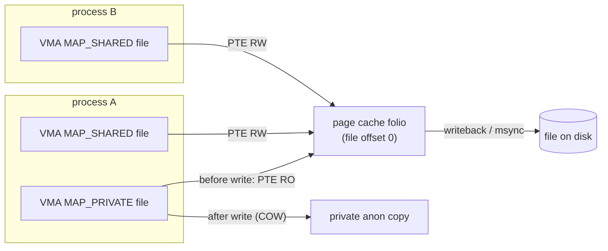

# 09 — `mmap`: file vs anonymous, private vs shared

> Module 04 · Memory Management · Linux v6.18.63 · Farsi: [`09-mmap.fa.md`](09-mmap.fa.md)

## 1. Summary

- `mmap(addr, len, prot, flags, fd, off)` creates one VMA. Two independent choices define its behaviour: **backing** (a file, or anonymous) and **sharing** (`MAP_PRIVATE` = copy-on-write, `MAP_SHARED` = one set of pages for everyone).
- File mappings are windows onto the **page cache**: the same physical pages that `read()`/`write()` use. `MAP_SHARED` writes dirty those pages and reach the file through writeback or `msync()`; `MAP_PRIVATE` writes create anonymous copies that never reach the file.
- `MAP_SHARED | MAP_ANONYMOUS` is backed by an internal shmem (tmpfs) object, which is how related processes share memory after `fork()`.

## 2. Detailed explanation

**The four combinations.**

| Flags | VMA | Read fault | Write fault | After `fork` | Reaches file? |
|---|---|---|---|---|---|
| file, `MAP_PRIVATE` | `vm_file` set, no `VM_SHARED` | map page-cache page RO (`do_read_fault`) | `do_cow_fault`: copy into new anon page | COW | no |
| file, `MAP_SHARED` | `VM_SHARED \| VM_MAYSHARE` | map page-cache page | `do_shared_fault`: page RW + dirty (`->page_mkwrite`) | same pages | yes |
| anon, `MAP_PRIVATE` | no file, `anon_vma` | zero page | `do_anonymous_page` / COW | COW | — |
| anon, `MAP_SHARED` | `vm_file` = shmem object (`shmem_zero_setup`) | shmem page (zeroed) | same page, RW | same pages | — |

`do_mmap()` (walkthrough §4) sets `VM_SHARED | VM_MAYSHARE` for `MAP_SHARED` of a file and **drops `VM_SHARED`/`VM_MAYWRITE` if the file was opened read-only** (`mm/mmap.c` L462–464); then `mmap_region()` inserts the VMA and, for files, calls the filesystem's `->mmap()` (`generic_file_mmap` sets `vm_ops = &generic_file_vm_ops` → `filemap_fault`).

**Why `mmap` a file instead of `read()`?** No copy from page cache to a user buffer; random access without `lseek`; several processes share one copy in RAM (that is how shared libraries work: every process maps the same `libc.so.6` pages). Costs: page faults instead of syscalls, TLB pressure, error handling via `SIGBUS` instead of return codes, and no control over I/O timing.

**Write-back of `MAP_SHARED`.** A write marks the PTE dirty and, via `->page_mkwrite` / `folio_mark_dirty`, the page-cache folio dirty. Writeback threads flush it later (Module 05: `dirty_expire_centisecs`, default 30 s). `msync(MS_SYNC)` forces it now and waits; `munmap` does **not** imply a flush to disk, it only removes the mapping (the data is already in the page cache, so other readers see it immediately).

**Ordering and atomicity.** Mapped memory is ordinary memory for the CPU: two processes incrementing a shared counter need atomics exactly like two threads (Module 03). Lab 03 uses `__atomic_fetch_add`; without it the count would be lost.

**Flags worth knowing.**

| Flag / call | Effect |
|---|---|
| `MAP_FIXED` / `MAP_FIXED_NOREPLACE` | place exactly at `addr` (the first silently replaces existing mappings) |
| `MAP_POPULATE` | pre-fault the whole range now |
| `MAP_NORESERVE` | no commit charge (overcommit) |
| `MAP_HUGETLB` | back by hugetlbfs pages |
| `MAP_STACK`, `MAP_GROWSDOWN` | stack hints |
| `madvise(MADV_DONTNEED)` | drop pages now; private anon reads back as zeros |
| `madvise(MADV_FREE)` | lazy free: reclaim may drop them if still clean |
| `madvise(MADV_SEQUENTIAL / RANDOM / WILLNEED)` | readahead policy |
| `mprotect`, `mremap`, `msync`, `mlock`, `mincore` | change protection, move/resize, flush, pin, query residency |

## 3. Diagram



## 4. Worked example

Lab 03's `mapcount.c`: 4 children × 1 000 000 atomic increments on one `uint64_t` in a mapping of each kind.

```bash
gcc -Wall -Wextra -O2 -o mapcount mapcount.c
./mapcount file-shared  counter.bin ; od -A d -t u8 -N 8 counter.bin
./mapcount file-private counter.bin ; od -A d -t u8 -N 8 counter.bin
./mapcount anon-shared
./mapcount anon-private
```

```
$ ./mapcount file-shared  counter.bin ; od -A d -t u8 -N 8 counter.bin
file-shared  children=4 iters=1000000  expected=4000000  parent sees=4000000  file has=4000000
0000000              4000000
0000008
$ ./mapcount file-private counter.bin ; od -A d -t u8 -N 8 counter.bin
file-private children=4 iters=1000000  expected=4000000  parent sees=0  file has=0
0000000                    0
0000008
$ ./mapcount anon-shared ; ./mapcount anon-private
anon-shared  children=4 iters=1000000  expected=4000000  parent sees=4000000
anon-private children=4 iters=1000000  expected=4000000  parent sees=0
$ strace -f -e trace=mmap,msync ./mapcount file-shared counter.bin 2 10 2>&1 | grep ...
mmap(NULL, 4096, PROT_READ|PROT_WRITE, MAP_SHARED, 3, 0) = 0x72a7b8e96000
msync(0x72a7b8e96000, 4096, MS_SYNC)    = 0
```

Read it: only the two **shared** variants let the parent see 4 000 000. Only `file-shared` changes the file. With `MAP_PRIVATE`, each child's first write COW-copied the page into its own anonymous memory, which vanished at `_exit`.

The flag handling — `linux/mm/mmap.c · do_mmap() · v6.18.63 · L462-468` ([Elixir](https://elixir.bootlin.com/linux/v6.18.63/source/mm/mmap.c#L334)):

```c
			vm_flags |= VM_SHARED | VM_MAYSHARE;
			if (!(file->f_mode & FMODE_WRITE))
				vm_flags &= ~(VM_MAYWRITE | VM_SHARED);
			fallthrough;
		case MAP_PRIVATE:
			if (!(file->f_mode & FMODE_READ))
				return -EACCES;
```

| Line | Meaning |
|---|---|
| `VM_SHARED \| VM_MAYSHARE` | the VMA shares pages; write faults go to `wp_page_shared`/`do_shared_fault`, never COW. |
| `!(f_mode & FMODE_WRITE)` | a read-only fd can still be mapped `MAP_SHARED`, but then it can never become writable (`mprotect(PROT_WRITE)` fails: no `VM_MAYWRITE`). |
| `fallthrough` | both cases then require read permission on the fd. |

## 5. Edge cases & pitfalls

- **Accessing beyond EOF** (file truncated by someone else) → `SIGBUS`, not `SIGSEGV`.
- **`mmap` length is rounded up to pages**; the tail of the last page beyond EOF reads as zeros and writes there are not saved.
- **`MAP_PRIVATE` is not a snapshot.** Pages you have not written still show later changes made to the file by others (until you COW them).
- **`fork` + `MAP_SHARED` anon** is the cheapest IPC, but you must synchronize (atomics, futexes in shared memory with `FUTEX` non-private ops).
- **Huge mmapped files** inflate page tables and TLB misses; consider `MAP_POPULATE`, `madvise(MADV_HUGEPAGE)` (for shmem/tmpfs with `huge=`), or `read()` for streaming.
- **`msync(MS_ASYNC)`** is effectively a no-op on Linux (pages are already queued for writeback).

## 6. Exam-style key points

- Two axes: backing (file/anon) × sharing (private/shared).
- File mappings = page cache; shared writes reach the file via writeback/`msync`; private writes never do.
- Shared anonymous = shmem object; shared across `fork`, not across unrelated processes (use `memfd_create`/`shm_open` for that).
- `mmap` allocates nothing; the fault handlers do (`do_read_fault`, `do_cow_fault`, `do_shared_fault`, `do_anonymous_page`).
- Shared memory needs synchronization like threads.

## 7. Links

- Lesson: [§2.9](../lesson.en.md#29-file-vs-anonymous-private-vs-shared)
- Walkthrough: [§4](../kernel-walkthrough.en.md#4-mmap-only-creates-a-vma--do_mmap)
- Labs: [04.3 mmap shared vs private](../labs/03-mmap-shared/README.md)
- Quiz: Q11, Q13
