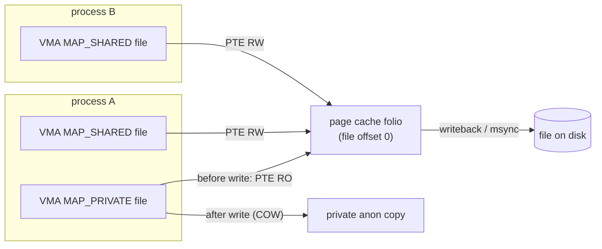

<div dir="rtl">

# ۰۹ — `mmap`: فایل یا ناشناس، خصوصی یا اشتراکی

> ماژول ۰۴ · مدیریت حافظه · Linux v6.18.63 · نسخهٔ انگلیسی: [`09-mmap.en.md`](09-mmap.en.md)

## ۱. خلاصه

- `mmap(addr, len, prot, flags, fd, off)` یک VMA می‌سازد. رفتار آن را دو انتخاب مستقل تعیین می‌کند: **پشتیبان** (فایل یا ناشناس) و **اشتراک** (`MAP_PRIVATE` یعنی copy-on-write، و `MAP_SHARED` یعنی یک مجموعه صفحه برای همه).
- mappingهای فایل پنجره‌ای به **page cache** هستند، یعنی همان صفحه‌های فیزیکی‌ای که `read()` و `write()` به کار می‌برند. نوشتن در `MAP_SHARED` این صفحه‌ها را dirty می‌کند و از راه writeback یا `msync()` به فایل می‌رسد. نوشتن در `MAP_PRIVATE` کپی‌های ناشناسی می‌سازد که هرگز به فایل نمی‌رسند.
- `MAP_SHARED | MAP_ANONYMOUS` را یک شیء shmem داخلی (tmpfs) پشتیبانی می‌کند. پردازه‌های خویشاوند بعد از `fork()` از همین راه حافظه را با هم شریک می‌شوند.

## ۲. توضیح مفصل

**چهار ترکیب.**

| پرچم‌ها | VMA | fault خواندن | fault نوشتن | بعد از `fork` | به فایل می‌رسد؟ |
|---|---|---|---|---|---|
| فایل، `MAP_PRIVATE` | `vm_file` دارد، بدون `VM_SHARED` | صفحهٔ page cache به‌صورت فقط‌خواندنی map می‌شود (`do_read_fault`) | `do_cow_fault`: کپی در صفحهٔ ناشناس تازه | COW | نه |
| فایل، `MAP_SHARED` | `VM_SHARED \| VM_MAYSHARE` | صفحهٔ page cache map می‌شود | `do_shared_fault`: صفحه قابل‌نوشتن و dirty می‌شود (`->page_mkwrite`) | همان صفحه‌ها | بله |
| ناشناس، `MAP_PRIVATE` | بدون فایل، با `anon_vma` | zero page | `do_anonymous_page` یا COW | COW | ندارد |
| ناشناس، `MAP_SHARED` | `vm_file` یک شیء shmem است (`shmem_zero_setup`) | صفحهٔ shmem (صفرشده) | همان صفحه، قابل‌نوشتن | همان صفحه‌ها | ندارد |

`do_mmap()` (گشت در کد، بخش ۴) برای `MAP_SHARED` روی فایل پرچم‌های `VM_SHARED | VM_MAYSHARE` را روشن می‌کند. اما **اگر فایل فقط‌خواندنی باز شده باشد، `VM_SHARED` و `VM_MAYWRITE` را پاک می‌کند** (`mm/mmap.c` خط‌های ۴۶۲ تا ۴۶۴). بعد `mmap_region()` VMA را درج می‌کند و برای فایل‌ها `->mmap()` فایل‌سیستم را صدا می‌زند. `generic_file_mmap` مقدار `vm_ops = &generic_file_vm_ops` را تنظیم می‌کند که fault را به `filemap_fault` می‌فرستد.

**چرا به‌جای `read()` فایل را `mmap` کنیم؟** کپی از page cache به بافر کاربر حذف می‌شود، دسترسی تصادفی بدون `lseek` ممکن است، و چند پردازه یک نسخه در RAM را شریک می‌شوند. کتابخانه‌های اشتراکی دقیقاً همین‌طور کار می‌کنند: همهٔ پردازه‌ها همان صفحه‌های `libc.so.6` را map می‌کنند. هزینه‌هایش این است که page fault جای syscall را می‌گیرد، فشار TLB بیشتر می‌شود، خطاها به‌جای کد برگشتی به شکل `SIGBUS` می‌رسند، و روی زمان I/O کنترلی ندارید.

**Writeback در `MAP_SHARED`.** نوشتن، PTE را dirty می‌کند و از راه `->page_mkwrite` و `folio_mark_dirty` خود folio در page cache هم dirty می‌شود. نخ‌های writeback آن را بعداً flush می‌کنند (ماژول ۰۵: `dirty_expire_centisecs` که پیش‌فرضش ۳۰ ثانیه است). `msync(MS_SYNC)` همین حالا flush می‌کند و منتظر می‌ماند. `munmap` flush به دیسک را **ایجاب نمی‌کند** و فقط mapping را برمی‌دارد. البته داده از قبل در page cache است، پس خواننده‌های دیگر آن را فوراً می‌بینند.

**ترتیب و اتمی بودن.** حافظهٔ map شده برای CPU حافظهٔ معمولی است. دو پردازه که یک شمارندهٔ مشترک را زیاد می‌کنند دقیقاً مثل دو نخ به atomic نیاز دارند (ماژول ۰۳). آزمایش ۰۳ از `__atomic_fetch_add` استفاده می‌کند و بدون آن بخشی از شمارش‌ها گم می‌شد.

**پرچم‌هایی که باید بشناسید.**

| پرچم یا فراخوانی | اثر |
|---|---|
| `MAP_FIXED` / `MAP_FIXED_NOREPLACE` | دقیقاً در `addr` قرار می‌دهد. اولی بی‌صدا mappingهای موجود را جایگزین می‌کند. |
| `MAP_POPULATE` | کل بازه را همین حالا fault می‌کند. |
| `MAP_NORESERVE` | بدون commit charge (overcommit). |
| `MAP_HUGETLB` | پشتیبانی با صفحه‌های hugetlbfs. |
| `MAP_STACK`، `MAP_GROWSDOWN` | راهنمایی‌هایی برای stack. |
| `madvise(MADV_DONTNEED)` | صفحه‌ها را همین حالا دور می‌ریزد. حافظهٔ ناشناس خصوصی بعدش صفر خوانده می‌شود. |
| `madvise(MADV_FREE)` | آزادسازی تنبل: اگر صفحه‌ها هنوز تمیز باشند، reclaim می‌تواند دورشان بریزد. |
| `madvise(MADV_SEQUENTIAL / RANDOM / WILLNEED)` | سیاست readahead. |
| `mprotect`، `mremap`، `msync`، `mlock`، `mincore` | به ترتیب: تغییر دسترسی، جابه‌جایی یا تغییر اندازه، flush، pin کردن، پرسیدن اینکه صفحه در حافظه هست یا نه. |

## ۳. نمودار

</div>



<div dir="rtl">

## ۴. مثال کاربردی

برنامهٔ `mapcount.c` از آزمایش ۰۳: ۴ فرزند، هر کدام ۱ میلیون افزایش اتمی روی یک `uint64_t`، در هر چهار نوع mapping.

</div>

```bash
gcc -Wall -Wextra -O2 -o mapcount mapcount.c
./mapcount file-shared  counter.bin ; od -A d -t u8 -N 8 counter.bin
./mapcount file-private counter.bin ; od -A d -t u8 -N 8 counter.bin
./mapcount anon-shared
./mapcount anon-private
```

```
$ ./mapcount file-shared  counter.bin ; od -A d -t u8 -N 8 counter.bin
file-shared  children=4 iters=1000000  expected=4000000  parent sees=4000000  file has=4000000
0000000              4000000
0000008
$ ./mapcount file-private counter.bin ; od -A d -t u8 -N 8 counter.bin
file-private children=4 iters=1000000  expected=4000000  parent sees=0  file has=0
0000000                    0
0000008
$ ./mapcount anon-shared ; ./mapcount anon-private
anon-shared  children=4 iters=1000000  expected=4000000  parent sees=4000000
anon-private children=4 iters=1000000  expected=4000000  parent sees=0
$ strace -f -e trace=mmap,msync ./mapcount file-shared counter.bin 2 10 2>&1 | grep ...
mmap(NULL, 4096, PROT_READ|PROT_WRITE, MAP_SHARED, 3, 0) = 0x72a7b8e96000
msync(0x72a7b8e96000, 4096, MS_SYNC)    = 0
```

<div dir="rtl">

خواندن خروجی: فقط در دو حالت **اشتراکی** والد عدد ۴٬۰۰۰٬۰۰۰ را می‌بیند، و فقط `file-shared` فایل را تغییر می‌دهد. با `MAP_PRIVATE`، اولین نوشتن هر فرزند صفحه را با COW در حافظهٔ ناشناس خودش کپی کرد و آن کپی هنگام `_exit` از بین رفت.

رسیدگی به پرچم‌ها: `linux/mm/mmap.c · do_mmap() · v6.18.63 · L462-468` ([Elixir](https://elixir.bootlin.com/linux/v6.18.63/source/mm/mmap.c#L334))

</div>

```c
			vm_flags |= VM_SHARED | VM_MAYSHARE;
			if (!(file->f_mode & FMODE_WRITE))
				vm_flags &= ~(VM_MAYWRITE | VM_SHARED);
			fallthrough;
		case MAP_PRIVATE:
			if (!(file->f_mode & FMODE_READ))
				return -EACCES;
```

<div dir="rtl">

| خط | معنی |
|---|---|
| `VM_SHARED \| VM_MAYSHARE` | VMA صفحه‌ها را شریک می‌کند. faultهای نوشتن به `wp_page_shared` یا `do_shared_fault` می‌روند و هرگز COW نمی‌شوند. |
| `!(f_mode & FMODE_WRITE)` | fd فقط‌خواندنی را هم می‌شود با `MAP_SHARED` map کرد، ولی آن mapping هرگز قابل‌نوشتن نمی‌شود: `mprotect(PROT_WRITE)` شکست می‌خورد، چون `VM_MAYWRITE` ندارد. |
| `fallthrough` | هر دو حالت بعد از این به مجوز خواندن روی fd نیاز دارند. |

## ۵. حالت‌های مرزی و دام‌ها

- **دسترسی بعد از EOF** (مثلاً وقتی کس دیگری فایل را کوتاه کرده) به `SIGBUS` می‌رسد، نه `SIGSEGV`.
- **طول `mmap` به اندازهٔ صفحه گرد می‌شود.** دُم صفحهٔ آخر بعد از EOF صفر خوانده می‌شود و نوشتن در آن ذخیره نمی‌شود.
- **`MAP_PRIVATE` عکس لحظه‌ای (snapshot) نیست.** صفحه‌هایی که ننوشته‌اید همچنان تغییراتی را که دیگران بعداً در فایل می‌دهند نشان می‌دهند، تا وقتی که خودتان COW‌شان کنید.
- **`fork` همراه با `MAP_SHARED` ناشناس** ارزان‌ترین IPC است، ولی باید همگام‌سازی کنید: با atomicها، یا با futex در حافظهٔ مشترک و عملیات غیر private آن.
- **فایل‌های بزرگ map شده** page tableها و TLB missها را زیاد می‌کنند. گزینه‌ها: `MAP_POPULATE`، `madvise(MADV_HUGEPAGE)` (برای shmem یا tmpfs با گزینهٔ `huge=`)، یا برای خواندن پیوسته همان `read()`.
- **`msync(MS_ASYNC)`** روی لینوکس عملاً کاری نمی‌کند، چون صفحه‌ها از قبل در صف writeback هستند.

## ۶. نکته‌های امتحانی

- دو محور: پشتیبان (فایل یا ناشناس) و اشتراک (خصوصی یا اشتراکی).
- mapping فایل یعنی page cache. نوشتن اشتراکی از راه writeback یا `msync` به فایل می‌رسد و نوشتن خصوصی هرگز.
- ناشناس اشتراکی یعنی یک شیء shmem. در طول `fork` مشترک است ولی بین پردازه‌های بی‌ربط نه؛ برای آن از `memfd_create` یا `shm_open` استفاده کنید.
- `mmap` چیزی تخصیص نمی‌دهد. fault handlerها تخصیص می‌دهند: `do_read_fault`، `do_cow_fault`، `do_shared_fault` و `do_anonymous_page`.
- حافظهٔ مشترک دقیقاً مثل نخ‌ها به همگام‌سازی نیاز دارد.

## ۷. پیوندها

- درس: [بخش ۲.۹](../lesson.fa.md)
- گشت در کد: [بخش ۴](../kernel-walkthrough.fa.md)
- آزمایش: [04.3، mmap اشتراکی یا خصوصی](../labs/03-mmap-shared/README.md)
- آزمون: پرسش‌های ۱۱ و ۱۳

</div>
