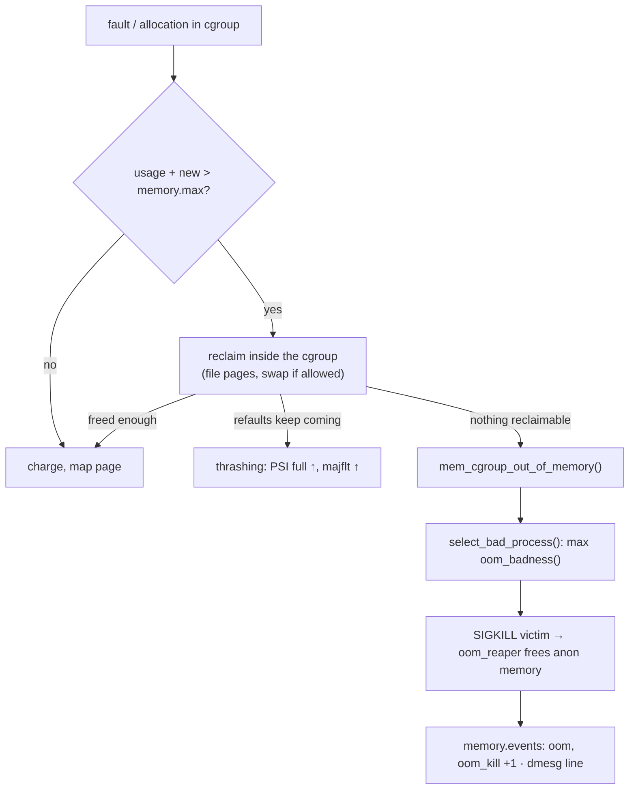

# 10 — Huge pages, NUMA, thrashing and the OOM killer

> Module 04 · Memory Management · Linux v6.18.63 · Farsi: [`10-hugepages-numa-oom.fa.md`](10-hugepages-numa-oom.fa.md)

## 1. Summary

- **Huge pages** (2 MiB PMD, 1 GiB PUD on x86-64) cut page faults and TLB misses by up to 512×; Linux offers them transparently (**THP**, `madvise`/`always`) or explicitly (**hugetlbfs**, a reserved pool).
- On **NUMA** machines each node has its own memory and `kswapd`; allocation prefers the local node, and NUMA balancing samples accesses with hinting faults and migrates pages.
- When the working set exceeds memory the system **thrashes** (refault storm, PSI pressure); when reclaim cannot free anything the **OOM killer** kills the task with the highest `oom_badness()` — inside a cgroup if `memory.max` is the limit hit.

## 2. Detailed explanation

### 2.1 Transparent huge pages

Policy files: `/sys/kernel/mm/transparent_hugepage/enabled` (`always` / `madvise` / `never`) and `defrag` (how hard a fault may compact to get a 2 MiB block). With `madvise`, only VMAs with `MADV_HUGEPAGE` get THP. On a fault in an empty, 2 MiB-aligned, suitable range, `__handle_mm_fault()` calls `create_huge_pmd()` → `do_huge_pmd_anonymous_page()`: one order-9 folio, zeroed, mapped by one PMD entry. `khugepaged` later **collapses** 512 small pages into a huge one in the background. mTHP (6.8+) adds intermediate orders (16 KiB–1 MiB) under `/sys/kernel/mm/transparent_hugepage/hugepages-*kB/enabled`. `VERSION-DEPENDENT`

Costs: zeroing 2 MiB on the fault (latency), compaction stalls when memory is fragmented, **RSS bloat** (touch 1 byte, get 2 MiB), and splits on partial `munmap`/`mprotect`/COW. Databases (Redis, MongoDB historically) recommend `madvise` or `never` for that reason. Watch `AnonHugePages` in `smaps`/`meminfo` and `thp_fault_alloc`, `thp_fault_fallback`, `thp_collapse_alloc` in `/proc/vmstat`.

**hugetlbfs** (`vm.nr_hugepages`, `MAP_HUGETLB`, `/dev/hugepages`): pages reserved up front, never swapped, never split, separate fault path (`hugetlb_fault()`), strict accounting. Used by DPDK, big JVM heaps, VM guest memory (QEMU `-mem-path`).

### 2.2 NUMA

Each node is a `pg_data_t` with its own zones, LRU lists and `kswapd`. Memory policy (`set_mempolicy`, `mbind`, `numactl --membind/--interleave/--preferred`) chooses the node; default is "local node first, fall back by distance" (`numactl -H` prints the distance matrix). **Automatic NUMA balancing** (`kernel.numa_balancing`) periodically turns PTEs of a task into `PROT_NONE` (`change_prot_numa()`); the next access takes a hinting fault (`do_numa_page()`, walkthrough §3), which records which node accessed it and may migrate the page or move the task. Our VM has a single node, so NUMA behaviour is **UNVERIFIED** here; the commands are given for a multi-socket machine.

### 2.3 Thrashing

Denning's working-set model: if the pages a program needs within a time window do not fit in memory, every access evicts something that will be needed soon. Symptoms: high major-fault rate, high `workingset_refault_*` and `pgsteal`, PSI `memory` `full` > 0 (all non-idle tasks stalled on memory), CPU mostly idle while the disk is busy, and throughput collapsing. Fixes: give more memory, shrink the working set, or kill something early (systemd-oomd, `memory.high` throttling). Lab 06 shows it inside a 64 MiB cgroup reading a 128 MiB file — with **zero swap**.

### 2.4 The OOM killer

Triggered from the page allocator (`__alloc_pages_may_oom()` → `out_of_memory()`) or from the fault path (`VM_FAULT_OOM` → `pagefault_out_of_memory()`), or by memcg when `memory.max` is hit and reclaim inside the cgroup fails (`mem_cgroup_out_of_memory()`). `select_bad_process()` iterates the tasks in scope and calls `oom_badness()` (walkthrough §8): RSS + swap entries + page-table pages, plus `oom_score_adj × totalpages / 1000`; `-1000` exempts a task. The victim gets `SIGKILL`; the **OOM reaper** (`oom_reaper` kthread) then unmaps its anonymous memory immediately so memory comes back even if the victim is stuck. `memory.oom.group=1` kills the whole cgroup together. The kernel log line `Memory cgroup out of memory: Killed process …` and `memory.events` `oom_kill` record it. Inspect per-process scores in `/proc/<pid>/oom_score` and `oom_score_adj`.

## 3. Diagram



## 4. Worked example

**THP on the VM, and the OOM badness score of a shell:**

```bash
cat /sys/kernel/mm/transparent_hugepage/enabled /sys/kernel/mm/transparent_hugepage/defrag
grep -E 'AnonHugePages|HugePages_Total|Hugepagesize' /proc/meminfo
grep -E '^thp_(fault_alloc|fault_fallback|collapse_alloc) ' /proc/vmstat
cat /proc/self/oom_score /proc/self/oom_score_adj
```

```
always [madvise] never
always defer defer+madvise [madvise] never
AnonHugePages:         0 kB
HugePages_Total:       0
Hugepagesize:       2048 kB
thp_fault_alloc 384
thp_fault_fallback 0
thp_collapse_alloc 0
$ cat /proc/self/oom_score /proc/self/oom_score_adj
666
0
```

An `oom_score` of 666 for a tiny `cat` is not a bug. `proc_oom_score()` (`fs/proc/base.c` L582–601) reports `(1000 + badness × 1000 / totalpages) × 2 / 3`, so a near-zero badness shows as 666.

**The score** — `linux/mm/oom_kill.c · oom_badness() · v6.18.63 · L231-237` ([Elixir](https://elixir.bootlin.com/linux/v6.18.63/source/mm/oom_kill.c#L202)):

```c
	points = get_mm_rss(p->mm) + get_mm_counter(p->mm, MM_SWAPENTS) +
		mm_pgtables_bytes(p->mm) / PAGE_SIZE;
	task_unlock(p);

	/* Normalize to oom_score_adj units */
	adj *= totalpages / 1000;
	points += adj;
```

| Line | Meaning |
|---|---|
| `get_mm_rss` | resident file + anon + shmem pages. |
| `MM_SWAPENTS` | pages of this mm currently in swap — they still count. |
| `mm_pgtables_bytes / PAGE_SIZE` | page-table pages (note 02). |
| `adj *= totalpages / 1000` | `oom_score_adj` is in ‰ of the memory available to the scope. |

Lab 06 reproduces the cgroup OOM and the thrashing pattern with real numbers.

## 5. Edge cases & pitfalls

- **OOM inside a cgroup ≠ system OOM.** The rest of the machine is unaffected; `dmesg` says "Memory cgroup out of memory". Always use a cgroup on a shared machine.
- **`oom_score_adj=-1000` on everything** makes the OOM killer panic or kill something important; protect only critical daemons.
- **Swap can hide thrashing for a while** and then make it worse (anon refaults are random I/O). Without swap, the OOM kill arrives faster.
- **THP `always` + `fork`-heavy servers** amplify COW (2 MiB copies) — the Redis latency warning.
- **`numactl --membind` + not enough memory on that node** → OOM even when other nodes are free (`CONSTRAINT_MEMORY_POLICY`).
- **hugetlbfs pages are taken from RAM at reservation time**: `nr_hugepages=1000` removes 2 GiB from everything else.

## 6. Exam-style key points

- 2 MiB THP = one PMD, no PTE table; 512× fewer faults, larger TLB reach; costs: zeroing, compaction, bloat, splits.
- THP policy `always`/`madvise`/`never`; khugepaged collapses; hugetlbfs is reserved and separate.
- NUMA: per-node pgdat/kswapd, local-first policy, hinting faults (`PROT_NONE`) drive migration.
- Thrashing signals: majflt, `workingset_refault_*`, PSI `full`.
- `oom_badness` = RSS + swap + page tables (+ adj); victim gets SIGKILL; oom_reaper frees anon memory.
- cgroup v2 `memory.max` scopes reclaim and OOM to the cgroup; `memory.events` counts `oom_kill`.

## 7. Links

- Lesson: [§2.10](../lesson.en.md#210-huge-pages-numa-thrashing-and-oom)
- Walkthrough: [§8](../kernel-walkthrough.en.md#8-reclaim-and-oom)
- Labs: [04.4 TLB and huge pages](../labs/04-tlb-hugepages/README.md), [04.6 thrashing and OOM](../labs/06-oom-thrashing/README.md)
- Quiz: Q9, Q10, Q15
