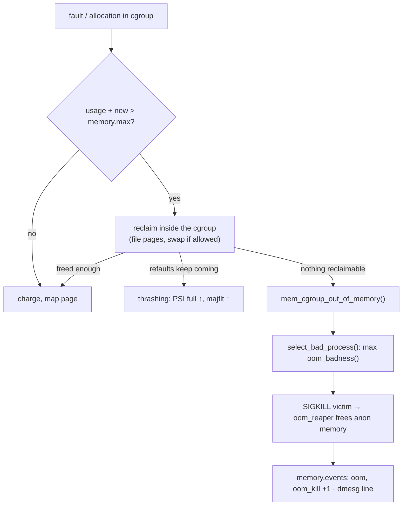

<div dir="rtl">

# ۱۰ — صفحه‌های بزرگ، NUMA، thrashing و OOM killer

> ماژول ۰۴ · مدیریت حافظه · Linux v6.18.63 · نسخهٔ انگلیسی: [`10-hugepages-numa-oom.en.md`](10-hugepages-numa-oom.en.md)

## ۱. خلاصه

- **صفحه‌های بزرگ** در x86-64 دو نوع‌اند: ۲ مگابایتی در سطح PMD و ۱ گیگابایتی در سطح PUD. page faultها و TLB missها را تا ۵۱۲ برابر کم می‌کنند. لینوکس آن‌ها را یا شفاف می‌دهد (**THP**، با `madvise` یا `always`) یا صریح (**hugetlbfs**، از یک مخزن رزروشده).
- در ماشین‌های **NUMA** هر node حافظه و `kswapd` خودش را دارد. تخصیص node محلی را ترجیح می‌دهد و NUMA balancing دسترسی‌ها را با hinting fault نمونه‌برداری می‌کند و صفحه‌ها را جابه‌جا می‌کند.
- وقتی مجموعهٔ کاری از حافظه بزرگ‌تر شود، سیستم **thrash** می‌کند: طوفان refault و فشار PSI. وقتی reclaim نتواند هیچ چیزی آزاد کند، **OOM killer** taskی را می‌کشد که بیشترین `oom_badness()` را دارد. اگر حدی که به آن رسیده‌ایم `memory.max` باشد، این کار داخل همان cgroup انجام می‌شود.

## ۲. توضیح مفصل

### ۲.۱ صفحه‌های بزرگ شفاف (THP)

سیاست با دو فایل تعیین می‌شود: `/sys/kernel/mm/transparent_hugepage/enabled` (مقدارهای `always`، `madvise` یا `never`) و `defrag` (یک fault چقدر برای گرفتن بلوک ۲ مگابایتی compaction کند). با `madvise`، فقط VMAهایی THP می‌گیرند که `MADV_HUGEPAGE` خورده‌اند.

وقتی fault در یک بازهٔ خالی، هم‌تراز با ۲ مگابایت و مناسب رخ دهد، `__handle_mm_fault()` تابع `create_huge_pmd()` و بعد `do_huge_pmd_anonymous_page()` را صدا می‌زند. نتیجه یک folio با order 9 است، صفرشده، که با یک مدخل PMD map می‌شود. `khugepaged` بعداً در پس‌زمینه ۵۱۲ صفحهٔ کوچک را در یک صفحهٔ بزرگ **ادغام** (collapse) می‌کند. mTHP (از ۶٫۸) orderهای میانی ۱۶ کیلوبایت تا ۱ مگابایت را زیر `/sys/kernel/mm/transparent_hugepage/hugepages-*kB/enabled` اضافه می‌کند. `VERSION-DEPENDENT`

هزینه‌ها:
- صفر کردن ۲ مگابایت هنگام fault (تأخیر)؛
- توقف در compaction وقتی حافظه تکه‌تکه است؛
- **باد کردن RSS**: یک بایت لمس کنید و ۲ مگابایت بگیرید؛
- شکستن صفحه هنگام `munmap` یا `mprotect` جزئی، یا COW.

به همین دلیل پایگاه‌های داده (Redis، و در گذشته MongoDB) توصیه می‌کنند THP روی `madvise` یا `never` باشد. `AnonHugePages` را در `smaps` و `meminfo` دنبال کنید، و `thp_fault_alloc`، `thp_fault_fallback` و `thp_collapse_alloc` را در `/proc/vmstat`.

**hugetlbfs** (`vm.nr_hugepages`، `MAP_HUGETLB`، `/dev/hugepages`): صفحه‌ها از قبل رزرو می‌شوند، هرگز swap نمی‌شوند، هرگز شکسته نمی‌شوند، مسیر fault جدا دارند (`hugetlb_fault()`) و حسابداری سخت‌گیرانه دارند. DPDK، heapهای بزرگ JVM و حافظهٔ مهمان VM (گزینهٔ `-mem-path` در QEMU) از آن استفاده می‌کنند.

### ۲.۲ NUMA

هر node یک `pg_data_t` است با zoneها، فهرست‌های LRU و `kswapd` خودش. سیاست حافظه node را انتخاب می‌کند؛ این سیاست با `set_mempolicy`، `mbind` یا `numactl --membind/--interleave/--preferred` تنظیم می‌شود. پیش‌فرض این است: «اول node محلی، بعد بقیه به ترتیب فاصله». `numactl -H` ماتریس فاصله را چاپ می‌کند.

**NUMA balancing خودکار** (`kernel.numa_balancing`) هر از گاهی PTEهای یک task را `PROT_NONE` می‌کند (`change_prot_numa()`). دسترسی بعدی یک hinting fault می‌دهد (`do_numa_page()`، گشت در کد بخش ۳). این fault ثبت می‌کند کدام node دسترسی داشته و ممکن است صفحه را جابه‌جا کند یا task را به node دیگر ببرد.

VM ما فقط یک node دارد، پس رفتار NUMA اینجا **UNVERIFIED** است. دستورها برای ماشین چندسوکتی آورده شده‌اند.

### ۲.۳ Thrashing

طبق مدل مجموعهٔ کاری Denning، اگر صفحه‌هایی که برنامه در یک بازهٔ زمانی لازم دارد در حافظه جا نشوند، هر دسترسی چیزی را بیرون می‌اندازد که به‌زودی دوباره لازم می‌شود.

نشانه‌ها:
- نرخ بالای fault بزرگ؛
- مقدار بالای `workingset_refault_*` و `pgsteal`؛
- مقدار `full` بیشتر از صفر در PSI حافظه، یعنی همهٔ taskهای غیربیکار منتظر حافظه‌اند؛
- CPU بیشتر بیکار است در حالی که دیسک مشغول است؛
- throughput فرو می‌ریزد.

راه‌حل‌ها: حافظهٔ بیشتر بدهید، مجموعهٔ کاری را کوچک کنید، یا زود چیزی را بکشید (systemd-oomd، یا کند کردن با `memory.high`). آزمایش ۰۶ این را داخل cgroupی ۶۴ مگابایتی نشان می‌دهد که فایلی ۱۲۸ مگابایتی را می‌خواند، **بدون هیچ swap**.

### ۲.۴ OOM killer

از سه جا راه می‌افتد:
- از page allocator (`__alloc_pages_may_oom()` ← `out_of_memory()`)؛
- از مسیر fault (`VM_FAULT_OOM` ← `pagefault_out_of_memory()`)؛
- از memcg، وقتی به `memory.max` رسیده‌ایم و reclaim داخل cgroup شکست خورده (`mem_cgroup_out_of_memory()`).

`select_bad_process()` taskهای داخل محدوده را مرور می‌کند و برای هر کدام `oom_badness()` را صدا می‌زند (گشت در کد، بخش ۸). امتیاز برابر است با RSS به‌اضافهٔ swap entryها به‌اضافهٔ صفحه‌های page table، و بعد `oom_score_adj × totalpages / 1000` به آن اضافه می‌شود. مقدار منفی ۱۰۰۰ task را معاف می‌کند.

قربانی `SIGKILL` می‌گیرد. بعد **OOM reaper** (نخ کرنل `oom_reaper`) فوراً حافظهٔ ناشناس آن را unmap می‌کند تا حافظه برگردد، حتی اگر قربانی جایی گیر کرده باشد. با `memory.oom.group=1` کل cgroup با هم کشته می‌شود.

این رویداد در دو جا ثبت می‌شود: خط `Memory cgroup out of memory: Killed process …` در لاگ کرنل، و `oom_kill` در `memory.events`. امتیاز هر پردازه را در `/proc/<pid>/oom_score` و `oom_score_adj` ببینید.

## ۳. نمودار

</div>



<div dir="rtl">

## ۴. مثال کاربردی

**THP روی VM و امتیاز OOM یک shell:**

</div>

```bash
cat /sys/kernel/mm/transparent_hugepage/enabled /sys/kernel/mm/transparent_hugepage/defrag
grep -E 'AnonHugePages|HugePages_Total|Hugepagesize' /proc/meminfo
grep -E '^thp_(fault_alloc|fault_fallback|collapse_alloc) ' /proc/vmstat
cat /proc/self/oom_score /proc/self/oom_score_adj
```

```
always [madvise] never
always defer defer+madvise [madvise] never
AnonHugePages:         0 kB
HugePages_Total:       0
Hugepagesize:       2048 kB
thp_fault_alloc 384
thp_fault_fallback 0
thp_collapse_alloc 0
$ cat /proc/self/oom_score /proc/self/oom_score_adj
666
0
```

<div dir="rtl">

مقدار ۶۶۶ برای `oom_score` یک `cat` کوچک باگ نیست. `proc_oom_score()` (`fs/proc/base.c` خط‌های ۵۸۲ تا ۶۰۱) مقدار `(1000 + badness × 1000 / totalpages) × 2 / 3` را گزارش می‌کند، پس badness نزدیک صفر به شکل ۶۶۶ دیده می‌شود.

</div>

<div dir="rtl">

**امتیاز:** `linux/mm/oom_kill.c · oom_badness() · v6.18.63 · L231-237` ([Elixir](https://elixir.bootlin.com/linux/v6.18.63/source/mm/oom_kill.c#L202))

</div>

```c
	points = get_mm_rss(p->mm) + get_mm_counter(p->mm, MM_SWAPENTS) +
		mm_pgtables_bytes(p->mm) / PAGE_SIZE;
	task_unlock(p);

	/* Normalize to oom_score_adj units */
	adj *= totalpages / 1000;
	points += adj;
```

<div dir="rtl">

| خط | معنی |
|---|---|
| `get_mm_rss` | صفحه‌های ساکن در حافظه از نوع فایل، ناشناس و shmem. |
| `MM_SWAPENTS` | صفحه‌هایی از این mm که الان در swap هستند؛ این‌ها هم حساب می‌شوند. |
| `mm_pgtables_bytes / PAGE_SIZE` | صفحه‌های page table (یادداشت ۰۲). |
| `adj *= totalpages / 1000` | `oom_score_adj` بر حسب هزارم حافظه‌ای است که در اختیار محدوده قرار دارد. |

آزمایش ۰۶ OOM داخل cgroup و الگوی thrashing را با اعداد واقعی بازتولید می‌کند.

## ۵. حالت‌های مرزی و دام‌ها

- **OOM داخل cgroup با OOM کل سیستم فرق دارد.** بقیهٔ ماشین آسیبی نمی‌بیند و `dmesg` می‌گوید «Memory cgroup out of memory». روی ماشین مشترک همیشه از cgroup استفاده کنید.
- **گذاشتن `oom_score_adj=-1000` روی همه چیز** باعث می‌شود OOM killer یا panic کند یا چیز مهمی را بکشد. فقط daemonهای حیاتی را محافظت کنید.
- **swap می‌تواند thrashing را مدتی پنهان کند** و بعد بدترش کند، چون refaultهای ناشناس I/O تصادفی هستند. بدون swap، OOM kill زودتر می‌رسد.
- **THP روی `always` در سرورهایی که زیاد `fork` می‌کنند** COW را بزرگ می‌کند (کپی‌های ۲ مگابایتی). هشدار تأخیر Redis از همین است.
- **`numactl --membind` وقتی آن node حافظهٔ کافی ندارد** به OOM می‌رسد، حتی اگر nodeهای دیگر حافظهٔ آزاد داشته باشند (`CONSTRAINT_MEMORY_POLICY`).
- **صفحه‌های hugetlbfs همان لحظهٔ رزرو از RAM برداشته می‌شوند.** `nr_hugepages=1000` دو گیگابایت را از دسترس بقیه خارج می‌کند.

## ۶. نکته‌های امتحانی

- THP دو مگابایتی یعنی یک PMD و بدون جدول PTE: ۵۱۲ برابر fault کمتر و برد TLB بیشتر. هزینه‌ها: صفر کردن، compaction، باد کردن RSS و شکستن.
- سیاست THP یکی از `always`، `madvise` یا `never` است. khugepaged صفحه‌ها را ادغام می‌کند. hugetlbfs رزروی و جداست.
- NUMA: pgdat و kswapd برای هر node، سیاست «اول محلی»، و hinting faultها (`PROT_NONE`) که مهاجرت را هدایت می‌کنند.
- نشانه‌های thrashing: majflt، `workingset_refault_*` و `full` در PSI.
- `oom_badness` برابر RSS به‌اضافهٔ swap به‌اضافهٔ page tableها (و adj) است. قربانی SIGKILL می‌گیرد و oom_reaper حافظهٔ ناشناسش را آزاد می‌کند.
- `memory.max` در cgroup v2، reclaim و OOM را به همان cgroup محدود می‌کند و `memory.events` تعداد `oom_kill` را می‌شمارد.

## ۷. پیوندها

- درس: [بخش ۲.۱۰](../lesson.fa.md)
- گشت در کد: [بخش ۸](../kernel-walkthrough.fa.md)
- آزمایش‌ها: [04.4، TLB و صفحه‌های بزرگ](../labs/04-tlb-hugepages/README.md) و [04.6، thrashing و OOM](../labs/06-oom-thrashing/README.md)
- آزمون: پرسش‌های ۹، ۱۰ و ۱۵

</div>
