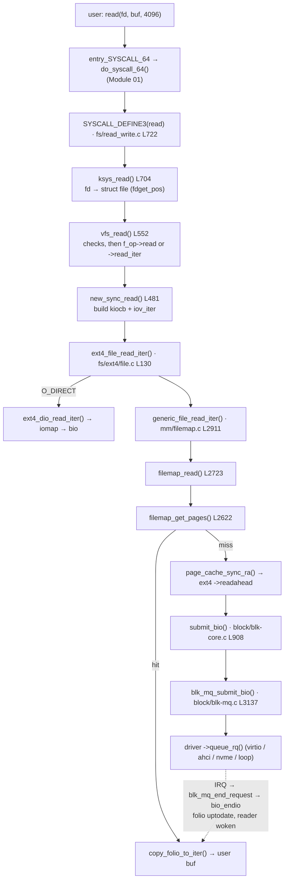

# Module 05 — Kernel walkthrough: one `read()` from syscall to disk, and back

> Linux **v6.18.63** (`_shared/sources/linux`) · OpenBSD **`8cada8c`** (`_shared/sources/openbsd`) · `ARCH-SPECIFIC (x86-64)` for the entry path only
> Every excerpt below was printed with `bash _shared/sources/cite.sh <repo> <path> <symbol|Lnnn>` and is copied exactly (`/* ... */` marks lines left out).
> Farsi: [`kernel-walkthrough.fa.md`](kernel-walkthrough.fa.md) · Lesson: [`lesson.en.md`](lesson.en.md)

## 0. The call chain



Verify it yourself on the VM (Lab 05.1): `sudo timeout 10 trace-cmd record -p function_graph -g vfs_read -l vfs_read -l ext4_file_read_iter -l filemap_read -l filemap_get_pages --max-graph-depth 6 -F ./readone data.bin; sudo trace-cmd reset` (always filter ftrace: an unfiltered function_graph soft-locked the course VM).

---

## 1. Entry: `read(2)` → `ksys_read()`

**File:** `fs/read_write.c` · **Why it matters:** this is where the fd number becomes a `struct file` and where the file offset is read and written back.
Elixir: <https://elixir.bootlin.com/linux/v6.18.63/source/fs/read_write.c#L704>

```c
// linux/fs/read_write.c · ksys_read() · v6.18.63 · L704-725
ssize_t ksys_read(unsigned int fd, char __user *buf, size_t count)
{
	CLASS(fd_pos, f)(fd);
	ssize_t ret = -EBADF;

	if (!fd_empty(f)) {
		loff_t pos, *ppos = file_ppos(fd_file(f));
		if (ppos) {
			pos = *ppos;
			ppos = &pos;
		}
		ret = vfs_read(fd_file(f), buf, count, ppos);
		if (ret >= 0 && ppos)
			fd_file(f)->f_pos = pos;
	}
	return ret;
}

SYSCALL_DEFINE3(read, unsigned int, fd, char __user *, buf, size_t, count)
{
	return ksys_read(fd, buf, count);
}
```

| Line | Explanation |
|---|---|
| 706 | `CLASS(fd_pos, f)(fd)` is a scope-based guard (`include/linux/cleanup.h`): it calls `fdget_pos(fd)` now and `fdput_pos()` automatically when `f` goes out of scope. `fdget_pos` takes `f_pos_lock` if the file is shared (note 03). |
| 709 | `fd_empty()`: bad fd → stays `-EBADF`. |
| 710 | `file_ppos()` returns `&file->f_pos`, or `NULL` for stream files (pipes, sockets) that have no position. |
| 711–714 | Work on a **local copy** of the offset, so `vfs_read()` and the filesystem never touch `f_pos` directly. |
| 715 | Into the VFS proper. |
| 716–717 | Publish the new offset only on success. |
| 722–725 | `SYSCALL_DEFINE3` generates `__x64_sys_read`, the symbol the syscall table points to (`ARCH-SPECIFIC`). It is only a wrapper, which is why you `grep` for the macro, not for `sys_read(`. |

`pread64()` uses the same `vfs_read()` with an explicit position and never touches `f_pos`.

## 2. `vfs_read()`: the polymorphic dispatch

**File:** `fs/read_write.c` · Elixir: <https://elixir.bootlin.com/linux/v6.18.63/source/fs/read_write.c#L552>

```c
// linux/fs/read_write.c · vfs_read() · v6.18.63 · L552-581
ssize_t vfs_read(struct file *file, char __user *buf, size_t count, loff_t *pos)
{
	ssize_t ret;

	if (!(file->f_mode & FMODE_READ))
		return -EBADF;
	if (!(file->f_mode & FMODE_CAN_READ))
		return -EINVAL;
	if (unlikely(!access_ok(buf, count)))
		return -EFAULT;

	ret = rw_verify_area(READ, file, pos, count);
	if (ret)
		return ret;
	if (count > MAX_RW_COUNT)
		count =  MAX_RW_COUNT;

	if (file->f_op->read)
		ret = file->f_op->read(file, buf, count, pos);
	else if (file->f_op->read_iter)
		ret = new_sync_read(file, buf, count, pos);
	else
		ret = -EINVAL;
	if (ret > 0) {
		fsnotify_access(file);
		add_rchar(current, ret);
	}
	inc_syscr(current);
	return ret;
}
```

| Line | Explanation |
|---|---|
| 556–557 | Opened without read access (`O_WRONLY`) → `EBADF`, as POSIX requires. |
| 558–559 | `FMODE_CAN_READ` is set at open time (`fs/open.c` L972) only if `f_op` has `read` or `read_iter`; a file type with neither gets `EINVAL`. Directories do have one: ext4's `ext4_dir_operations.read = generic_read_dir` (`fs/ext4/dir.c` L701), which just returns `-EISDIR`. |
| 560–561 | `access_ok()`: is `[buf, buf+count)` a user-space range at all? It does **not** check that pages are mapped; a fault during the copy is handled later (Module 04). |
| 563 | `rw_verify_area()`: negative or overflowing offsets, mandatory locks, and the LSM hook `security_file_permission()` (Module 07). |
| 566–567 | `MAX_RW_COUNT` = `INT_MAX & PAGE_MASK` (~2 GiB): one `read()` never transfers more, so callers must loop. |
| 569–574 | **The dispatch.** Old-style `.read` (still used by simple char drivers like `/dev/null`, note 09) wins; otherwise the iterator-based `.read_iter` through `new_sync_read()`. Every disk filesystem implements only `.read_iter`. |
| 575–579 | Accounting: inotify/fanotify `IN_ACCESS` event, and the `rchar`/`syscr` counters you see in `/proc/PID/io`. |

`new_sync_read()` (L481) wraps the user buffer into an `iov_iter` (`ITER_DEST`) and a synchronous `kiocb` (position, flags), calls `filp->f_op->read_iter(&kiocb, &iter)`, and asserts the result is not `-EIOCBQUEUED`: a synchronous caller cannot accept "queued, will complete later". io_uring uses the same `->read_iter` with an async kiocb (§7).

## 3. Path lookup, briefly

Before any `read()` there was an `open()`. The walk is described in note 02; the two key excerpts:

```c
// linux/fs/namei.c · do_filp_open() · v6.18.63 · L4163-4168
	set_nameidata(&nd, dfd, pathname, NULL);
	filp = path_openat(&nd, op, flags | LOOKUP_RCU);
	if (unlikely(filp == ERR_PTR(-ECHILD)))
		filp = path_openat(&nd, op, flags);
	if (unlikely(filp == ERR_PTR(-ESTALE)))
		filp = path_openat(&nd, op, flags | LOOKUP_REVAL);
```

Elixir: <https://elixir.bootlin.com/linux/v6.18.63/source/fs/namei.c#L4156>. RCU-walk first, ref-walk if RCU-walk gives up (`-ECHILD`), revalidate-everything walk on `-ESTALE`.

```c
// linux/fs/namei.c · walk_component() · v6.18.63 · L2146-2157
	dentry = lookup_fast(nd);
	if (IS_ERR(dentry))
		return ERR_CAST(dentry);
	if (unlikely(!dentry)) {
		dentry = lookup_slow(&nd->last, nd->path.dentry, nd->flags);
		if (IS_ERR(dentry))
			return ERR_CAST(dentry);
	}
	if (!(flags & WALK_MORE) && nd->depth)
		put_link(nd);
	return step_into(nd, flags, dentry);
```

Elixir: <https://elixir.bootlin.com/linux/v6.18.63/source/fs/namei.c#L2134>. `lookup_fast()` = dcache; `lookup_slow()` = `inode->i_op->lookup()` under the directory's inode lock (ext4: `ext4_lookup()`, `fs/ext4/namei.c` L1764); `step_into()` handles mount points and symlinks.

## 4. ext4 → page cache: `filemap_read()`

```c
// linux/fs/ext4/file.c · ext4_file_read_iter() · v6.18.63 · L130-148
static ssize_t ext4_file_read_iter(struct kiocb *iocb, struct iov_iter *to)
{
	struct inode *inode = file_inode(iocb->ki_filp);

	if (unlikely(ext4_forced_shutdown(inode->i_sb)))
		return -EIO;

	if (!iov_iter_count(to))
		return 0; /* skip atime */

#ifdef CONFIG_FS_DAX
	if (IS_DAX(inode))
		return ext4_dax_read_iter(iocb, to);
#endif
	if (iocb->ki_flags & IOCB_DIRECT)
		return ext4_dio_read_iter(iocb, to);

	return generic_file_read_iter(iocb, to);
}
```

Elixir: <https://elixir.bootlin.com/linux/v6.18.63/source/fs/ext4/file.c#L130>

| Line | Explanation |
|---|---|
| 134–135 | After `ext4_forced_shutdown` (ioctl `EXT4_IOC_SHUTDOWN` or fatal error), all I/O fails. |
| 137–138 | Zero-length read: return without updating atime. |
| 140–143 | DAX (persistent memory): no page cache, copy directly from the device mapping. |
| 144–145 | `O_DIRECT` (`IOCB_DIRECT`) bypasses the page cache through iomap. |
| 147 | Everything else: the **generic** page-cache read. ext4 adds nothing to buffered reads; block mapping happens only on a miss, inside `->readahead`. |

`generic_file_read_iter()` (`mm/filemap.c` L2911) handles `IOCB_DIRECT` for simpler filesystems and ends with `return filemap_read(iocb, iter, retval);` (L2952). The core loop of `filemap_read()`:

```c
// linux/mm/filemap.c · filemap_read() · v6.18.63 · L2747-2762 and L2811-2815
	do {
		cond_resched();
		/* ... IOCB_WAITQ / NOWAIT adjustment ... */
		if (unlikely(iocb->ki_pos >= i_size_read(inode)))
			break;

		error = filemap_get_pages(iocb, iter->count, &fbatch, false);
		if (error < 0)
			break;
		/* ... i_size re-check, mark accessed, per-folio loop: ... */
			copied = copy_folio_to_iter(folio, offset, bytes, iter);

			already_read += copied;
			iocb->ki_pos += copied;
			last_pos = iocb->ki_pos;
```

Elixir: <https://elixir.bootlin.com/linux/v6.18.63/source/mm/filemap.c#L2723>

- `cond_resched()`: a 2 GiB read from cache is pure CPU work; give the scheduler a chance (Module 02).
- Stop at EOF (`i_size`). i_size is read **again after** the folios are uptodate, because a concurrent truncate could have shrunk the file.
- `filemap_get_pages()` returns a batch of uptodate folios (hit, or after readahead I/O): note 04 §4 explains the miss branch line by line.
- `copy_folio_to_iter()`: the actual `copy_to_user`. A fault here (unmapped `buf`) returns fewer bytes → `-EFAULT` if nothing was copied.

## 5. Block layer: `submit_bio()` → `blk_mq_submit_bio()`

```c
// linux/block/blk-core.c · submit_bio() · v6.18.63 · L908-919 (excerpt)
void submit_bio(struct bio *bio)
{
	if (bio_op(bio) == REQ_OP_READ) {
		task_io_account_read(bio->bi_iter.bi_size);
		count_vm_events(PGPGIN, bio_sectors(bio));
	} else if (bio_op(bio) == REQ_OP_WRITE) {
		count_vm_events(PGPGOUT, bio_sectors(bio));
	}

	bio_set_ioprio(bio);
	submit_bio_noacct(bio);
}
```

Elixir: <https://elixir.bootlin.com/linux/v6.18.63/source/block/blk-core.c#L908>. The accounting here is what `vmstat`'s `bi`/`bo` and `/proc/PID/io` `read_bytes` report: real device I/O, not page-cache hits (compare `rchar` from §2). `submit_bio_noacct()` handles stacking (dm, md) and calls `blk_mq_submit_bio()` for blk-mq devices.

The dispatch decision at the end of `blk_mq_submit_bio()` (L3236-3254) is quoted and explained in note 05 §4: flush machinery → plug list → scheduler insert → or direct issue to `->queue_rq()`. The mq-deadline dispatch logic is in note 06 §4.

## 6. Durability: `fsync()` → ext4 → jbd2

```c
// linux/fs/ext4/fsync.c · ext4_sync_file() · v6.18.63 · L164-183
	ret = file_write_and_wait_range(file, start, end);
	if (ret)
		goto out;

	/*
	 *  The caller's filemap_fdatawrite()/wait will sync the data.
	 *  Metadata is in the journal, we wait for proper transaction to
	 *  commit here.
	 */
	ret = ext4_fsync_journal(inode, datasync, &needs_barrier);

issue_flush:
	if (needs_barrier) {
		err = blkdev_issue_flush(inode->i_sb->s_bdev);
		if (!ret)
			ret = err;
	}
out:
	err = file_check_and_advance_wb_err(file);
	if (ret == 0)
		ret = err;
```

Elixir: <https://elixir.bootlin.com/linux/v6.18.63/source/fs/ext4/fsync.c#L141>

| Line | Explanation |
|---|---|
| 164 | `file_write_and_wait_range()` (`mm/filemap.c` L789): start writeback of dirty folios in the range and wait for completion. This is where delalloc blocks get allocated. |
| 172 | Wait for (or force) the jbd2 commit of the transaction that contains this inode's metadata. |
| 175–179 | If the commit did not already flush the device cache (e.g. only data changed), send an explicit `FLUSH`. |
| 181–183 | Report a writeback error that happened since this `struct file` last checked (`errseq_t`), even if it was caused by another process's writeback. |

The journal side (`fs/jbd2/commit.c` L546: data first; L874: commit record last) is in note 07 §4. Elixir: <https://elixir.bootlin.com/linux/v6.18.63/source/fs/jbd2/commit.c#L348>

## 7. io_uring: the same `->read_iter`, no syscall per op

```c
// linux/io_uring/io_uring.c · io_submit_sqes() · v6.18.63 · L2575-2594
	do {
		const struct io_uring_sqe *sqe;
		struct io_kiocb *req;

		if (unlikely(!io_alloc_req(ctx, &req)))
			break;
		if (unlikely(!io_get_sqe(ctx, &sqe))) {
			io_req_add_to_cache(req, ctx);
			break;
		}

		/*
		 * Continue submitting even for sqe failure if the
		 * ring was setup with IORING_SETUP_SUBMIT_ALL
		 */
		if (unlikely(io_submit_sqe(ctx, req, sqe)) &&
		    !(ctx->flags & IORING_SETUP_SUBMIT_ALL)) {
			left--;
			break;
		}
	} while (--left);
```

Elixir: <https://elixir.bootlin.com/linux/v6.18.63/source/io_uring/io_uring.c#L2560>

- One `io_uring_enter()` runs this loop `left` times: one syscall, many operations.
- `io_alloc_req()` takes a `struct io_kiocb` from a per-ring cache; no slab allocation per op in steady state.
- `io_get_sqe()` reads the shared ring (note 08 §4).
- An invalid SQE stops the batch unless `IORING_SETUP_SUBMIT_ALL`; its error is posted as a CQE.

`io_submit_sqe()` → `io_queue_sqe()` → `io_issue_sqe()` (L1963) → `io_issue_defs[IORING_OP_READ].issue = io_read` (`io_uring/opdef.c` L242–254) → `__io_read()` sets `IOCB_NOWAIT` (`io_uring/rw.c` L934–941) → `io_iter_do_read()` → **`file->f_op->read_iter()`** (L828), i.e. the same `ext4_file_read_iter()` as §4.

## 8. Character devices: how `/dev/null` gets its own `f_op`

```c
// linux/fs/inode.c · init_special_inode() · v6.18.63 · L2548-2563
void init_special_inode(struct inode *inode, umode_t mode, dev_t rdev)
{
	inode->i_mode = mode;
	switch (inode->i_mode & S_IFMT) {
	case S_IFCHR:
		inode->i_fop = &def_chr_fops;
		inode->i_rdev = rdev;
		break;
	case S_IFBLK:
		if (IS_ENABLED(CONFIG_BLOCK))
			inode->i_fop = &def_blk_fops;
		inode->i_rdev = rdev;
		break;
	case S_IFIFO:
		inode->i_fop = &pipefifo_fops;
		break;
```

Elixir: <https://elixir.bootlin.com/linux/v6.18.63/source/fs/inode.c#L2548>. `def_chr_fops` contains only `.open = chrdev_open` (`fs/char_dev.c` L452); `chrdev_open()` (L373) finds the driver's `cdev` and calls `replace_fops()`. Full excerpt in note 09 §4.

---

## 9. OpenBSD comparison: `read(2)` on FFS

OpenBSD has the same shape (syscall → file ops → vnode ops → filesystem → block cache → driver) with different choices at each layer.

### 9.1 Side by side: the dispatch

<table>
<tr><th>Linux · <code>fs/read_write.c</code> · <code>vfs_read()</code> · v6.18.63</th><th>OpenBSD · <code>sys/kern/sys_generic.c</code> + <code>vfs_vnops.c</code> · 8cada8c</th></tr>
<tr><td>

```c
	if (file->f_op->read)
		ret = file->f_op->read(file, buf,
				count, pos);
	else if (file->f_op->read_iter)
		ret = new_sync_read(file, buf,
				count, pos);
	else
		ret = -EINVAL;
```

</td><td>

```c
// dofilereadv(), L252
	error = (*fp->f_ops->fo_read)(fp, uio, flags);

// vn_read(), L347-357
	KERNEL_LOCK();

	vn_lock(vp, LK_EXCLUSIVE | LK_RETRY);
	/* ... */
	error = VOP_READ(vp, uio,
	    (fp->f_flag & FNONBLOCK) ? IO_NDELAY : 0,
```

</td></tr></table>

(Long lines wrapped to fit the table; the unwrapped originals are at the cited lines. Elixir is Linux-only; OpenBSD: <https://github.com/openbsd/src/blob/8cada8c/sys/kern/vfs_vnops.c#L347>.)

- OpenBSD has **two** tables: `struct fileops` per file type (`vnops`, sockets, pipes, kqueue) and the vnode-op vector `VOP_*` per filesystem. Linux folds both into `struct file_operations`, reached directly from `struct file`.
- `vn_read()` takes the **big kernel lock** and an **exclusive vnode lock** for every read. Linux's buffered read path takes no inode lock at all on a cache hit (RCU xarray lookup, §4). Parallel readers of one file scale on Linux and serialize on OpenBSD.
- OpenBSD passes a `struct uio` (like Linux's `iov_iter`, older design); there is no async variant like `kiocb` with `IOCB_NOWAIT`.

### 9.2 Side by side: where file data is cached

<table>
<tr><th>Linux · <code>mm/filemap.c</code> · <code>filemap_get_pages()</code> L2640-2651</th><th>OpenBSD · <code>sys/ufs/ffs/ffs_vnops.c</code> · <code>ffs_read()</code> L216-235</th></tr>
<tr><td>

```c
	filemap_get_read_batch(mapping, index,
			last_index - 1, fbatch);
	if (!folio_batch_count(fbatch)) {
		DEFINE_READAHEAD(ractl, filp,
			&filp->f_ra, mapping, index);
		/* ... NOIO / NOWAIT checks ... */
		page_cache_sync_ra(&ractl,
			last_index - index);
		/* ... */
		filemap_get_read_batch(mapping, index,
			last_index - 1, fbatch);
	}
```

</td><td>

```c
	for (error = 0, bp = NULL; uio->uio_resid > 0; bp = NULL) {
		/* ... */
		lbn = lblkno(fs, uio->uio_offset);
		nextlbn = lbn + 1;
		size = fs->fs_bsize;
		/* ... */
		if (lblktosize(fs, nextlbn) >= DIP(ip, size))
			error = bread(vp, lbn, size, &bp);
		else if (lbn - 1 == ip->i_ci.ci_lastr ||
		    uio->uio_resid > xfersize) {
			error = bread_cluster(vp, lbn, size, &bp);
		} else
			error = bread(vp, lbn, size, &bp);
```

</td></tr></table>

- Linux caches **pages of the file** (folios in the inode's `address_space`), so a hit never asks the filesystem anything.
- OpenBSD FFS caches **filesystem blocks** in the buffer cache (`buf(9)`): `bread(vp, lbn, ...)` → `bio_doread()` → `getblk()` → on a miss `VOP_STRATEGY()` (`sys/kern/vfs_bio.c` L290–310). The filesystem is in the loop on every read, and data is copied out of the buffer with `uiomove()`.
- Readahead: Linux has an adaptive per-file window (`f_ra`). FFS uses `bread_cluster()` when it sees sequential access (`ci_lastr`).
- Cache sizing: Linux's page cache uses any free memory and is reclaimed by the LRU (Module 04). OpenBSD's buffer cache is a fixed share: `bufinit()` falls back to `bufcachepercent = 10` % of DMA-able memory when MD code sets nothing (`vfs_bio.c` L140–150), tunable with `sysctl kern.bufcachepercent` (5–90). Pages used by `mmap` live separately in UVM (`sys/uvm/uvm_vnode.c`).

### 9.3 Disk scheduling and crash consistency

```c
// openbsd/sys/kern/kern_bufq.c · bufq_nscan_dequeue() · 8cada8c · L416-429
struct buf *
bufq_nscan_dequeue(void *vdata)
{
	struct bufq_nscan_data *data = vdata;
	struct bufq_nscan_head *sorted = &data->sorted;
	struct buf	*bp;

	if (SIMPLEQ_FIRST(sorted) == NULL)
		bufq_nscan_resort(data);

	bp = SIMPLEQ_FIRST(sorted);
	if (bp != NULL)
		SIMPLEQ_REMOVE_HEAD(sorted, dsentries);

	return (bp);
}
```

- OpenBSD's default disk queue is **N-step SCAN** (`BUFQ_DEFAULT = BUFQ_NSCAN`, `BUFQ_NSCAN_N = 128`, `sys/sys/buf.h` L56–60): take up to 128 buffers from the FIFO, sort them by block number, serve that sorted batch, repeat. Bounded unfairness without per-request deadlines. Linux's mq-deadline keeps sector order *and* per-request expiry, prefers reads, and is optional per device.
- OpenBSD FFS has **no journal** in this tree, and soft updates are gone (`sys/ufs/ffs/ffs_softdep.c` does not exist at 8cada8c; no `softdep` in `ffs_vfsops.c`). After a crash, `fsck` repairs metadata at boot. ext4 replays a journal in seconds.

### 9.4 Trade-off table

| Design choice | Linux v6.18.63 | OpenBSD 8cada8c | Trade-off |
|---|---|---|---|
| File-op dispatch | one `file_operations` table per file | `fileops` per file type + `VOP_*` vector per fs | Linux: one indirection, more fields; OpenBSD: classic BSD layering, easier to read |
| Read-path locking | no inode lock on cache hit; RCU xarray | `KERNEL_LOCK()` + exclusive vnode lock | Linux scales parallel readers; OpenBSD simpler, easier to audit, serializes |
| File data cache | page cache (per-inode folios), unified with `mmap` | buffer cache of fs blocks (`buf(9)`), UVM separate for `mmap` | Linux: no double caching, hit path skips the fs; OpenBSD: fs-block granularity, fixed size |
| Cache size | all free memory, LRU reclaim | `kern.bufcachepercent` (fallback 10 %) | Linux adapts; OpenBSD predictable |
| Path lookup | lock-free RCU-walk, fall back to ref-walk | lock each directory vnode, `VOP_LOOKUP` + name cache | Linux: speed and scale, very complex code; OpenBSD: straightforward |
| Disk scheduling | blk-mq + pluggable elevators per device | one bufq per disk, N-step SCAN (128) | Linux: tunable for any device; OpenBSD: one reasonable default |
| Crash consistency | jbd2 journal, ordered data | none in-kernel; `fsck` at boot | Linux: fast recovery, more code; OpenBSD: simple, slow recovery on large disks |
| Async I/O | io_uring, shared rings | `kqueue` readiness; no completion-based file AIO | Linux: high throughput, large attack surface; OpenBSD: small surface (fits its security goals) |

## 10. How to re-verify

```bash
cd _shared/sources
bash cite.sh linux fs/read_write.c vfs_read
bash cite.sh linux mm/filemap.c filemap_get_pages 40
bash cite.sh linux block/blk-mq.c L3236 19
bash cite.sh openbsd sys/kern/vfs_vnops.c vn_read 30
bash cite.sh openbsd sys/ufs/ffs/ffs_vnops.c L216 20
```

Line numbers drift between kernel versions; function names are the stable handle (`VERSION-DEPENDENT`).
