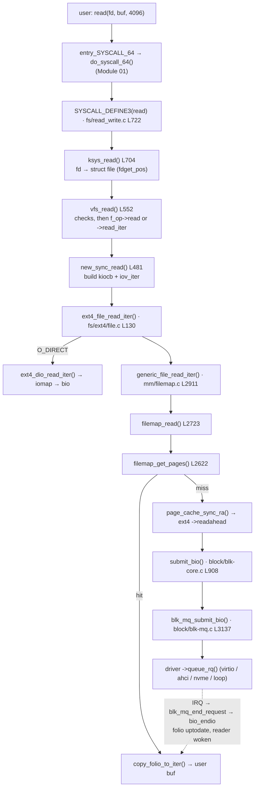

<div dir="rtl">

# ماژول ۰۵ — مرور کد کرنل: یک `read()` از syscall تا دیسک و برگشت

> Linux **v6.18.63** (`_shared/sources/linux`) · OpenBSD **`8cada8c`** (`_shared/sources/openbsd`) · `ARCH-SPECIFIC (x86-64)` فقط برای مسیر ورود
> همهٔ تکه‌کدهای زیر با `bash _shared/sources/cite.sh <repo> <path> <symbol|Lnnn>` چاپ شده‌اند و دقیقاً کپی شده‌اند (`/* ... */` یعنی خط‌هایی حذف شده‌اند).
> نسخهٔ انگلیسی: [`kernel-walkthrough.en.md`](kernel-walkthrough.en.md) · درس: [`lesson.fa.md`](lesson.fa.md)

## ۰. زنجیرهٔ فراخوانی

</div>



<div dir="rtl">

خودتان روی VM بررسی کنید (آزمایش ۰۵.۱): <span dir="ltr">`sudo timeout 10 trace-cmd record -p function_graph -g vfs_read -l vfs_read -l ext4_file_read_iter -l filemap_read -l filemap_get_pages --max-graph-depth 6 -F ./readone data.bin; sudo trace-cmd reset`</span>.

---

## ۱. ورود: `read(2)` ← `ksys_read()`

**فایل:** `fs/read_write.c` · **چرا مهم است:** اینجا شمارهٔ fd به یک `struct file` تبدیل می‌شود و offset فایل خوانده و دوباره نوشته می‌شود.
Elixir: <https://elixir.bootlin.com/linux/v6.18.63/source/fs/read_write.c#L704>

</div>

```c
// linux/fs/read_write.c · ksys_read() · v6.18.63 · L704-725
ssize_t ksys_read(unsigned int fd, char __user *buf, size_t count)
{
	CLASS(fd_pos, f)(fd);
	ssize_t ret = -EBADF;

	if (!fd_empty(f)) {
		loff_t pos, *ppos = file_ppos(fd_file(f));
		if (ppos) {
			pos = *ppos;
			ppos = &pos;
		}
		ret = vfs_read(fd_file(f), buf, count, ppos);
		if (ret >= 0 && ppos)
			fd_file(f)->f_pos = pos;
	}
	return ret;
}

SYSCALL_DEFINE3(read, unsigned int, fd, char __user *, buf, size_t, count)
{
	return ksys_read(fd, buf, count);
}
```

<div dir="rtl">

| خط | توضیح |
|---|---|
| 706 | `CLASS(fd_pos, f)(fd)` یک guard مبتنی بر scope است (`include/linux/cleanup.h`): همین الان `fdget_pos(fd)` را صدا می‌زند و وقتی `f` از scope بیرون رفت، `fdput_pos()` را خودکار اجرا می‌کند. اگر فایل اشتراکی باشد، `fdget_pos` قفل `f_pos_lock` را می‌گیرد ([یادداشت ۰۳](notes/03-fd-tables.fa.md)). |
| 709 | `fd_empty()`: اگر fd نامعتبر باشد، مقدار همان `-EBADF` می‌ماند. |
| 710 | `file_ppos()` آدرس `&file->f_pos` را برمی‌گرداند، یا برای فایل‌های جریانی (pipe و socket) که موقعیت ندارند `NULL` می‌دهد. |
| 711–714 | کار روی یک **کپی محلی** از offset انجام می‌شود تا نه `vfs_read()` و نه فایل‌سیستم هرگز مستقیم به `f_pos` دست نزنند. |
| 715 | ورود به خود VFS. |
| 716–717 | offset جدید فقط در صورت موفقیت منتشر می‌شود. |
| 722–725 | `SYSCALL_DEFINE3` تابع `__x64_sys_read` را می‌سازد، یعنی نمادی که جدول syscall به آن اشاره می‌کند (`ARCH-SPECIFIC`). این فقط یک wrapper است و به همین دلیل برای ماکرو `grep` می‌کنید، نه برای `sys_read(`. |

`pread64()` از همان `vfs_read()` با موقعیت صریح استفاده می‌کند و هیچ‌وقت به `f_pos` دست نمی‌زند.

## ۲. `vfs_read()`: dispatch چندریختی

**فایل:** `fs/read_write.c` · Elixir: <https://elixir.bootlin.com/linux/v6.18.63/source/fs/read_write.c#L552>

</div>

```c
// linux/fs/read_write.c · vfs_read() · v6.18.63 · L552-581
ssize_t vfs_read(struct file *file, char __user *buf, size_t count, loff_t *pos)
{
	ssize_t ret;

	if (!(file->f_mode & FMODE_READ))
		return -EBADF;
	if (!(file->f_mode & FMODE_CAN_READ))
		return -EINVAL;
	if (unlikely(!access_ok(buf, count)))
		return -EFAULT;

	ret = rw_verify_area(READ, file, pos, count);
	if (ret)
		return ret;
	if (count > MAX_RW_COUNT)
		count =  MAX_RW_COUNT;

	if (file->f_op->read)
		ret = file->f_op->read(file, buf, count, pos);
	else if (file->f_op->read_iter)
		ret = new_sync_read(file, buf, count, pos);
	else
		ret = -EINVAL;
	if (ret > 0) {
		fsnotify_access(file);
		add_rchar(current, ret);
	}
	inc_syscr(current);
	return ret;
}
```

<div dir="rtl">

| خط | توضیح |
|---|---|
| 556–557 | فایل بدون دسترسی خواندن باز شده (`O_WRONLY`)، پس طبق POSIX خطای `EBADF` برمی‌گردد. |
| 558–559 | `FMODE_CAN_READ` هنگام open تنظیم می‌شود (`fs/open.c` L972)، آن هم فقط اگر `f_op` یکی از `read` یا `read_iter` را داشته باشد؛ نوع فایلی که هیچ‌کدام را ندارد `EINVAL` می‌گیرد. دایرکتوری‌ها یکی دارند: در ext4، `ext4_dir_operations.read = generic_read_dir` (`fs/ext4/dir.c` L701) که فقط `-EISDIR` برمی‌گرداند. |
| 560–561 | `access_ok()`: آیا `[buf, buf+count)` اصلاً یک بازهٔ user-space است؟ این تابع **بررسی نمی‌کند** که صفحه‌ها map شده باشند؛ fault در حین کپی بعداً رسیدگی می‌شود (ماژول ۰۴). |
| 563 | `rw_verify_area()`: offset منفی یا سرریزکننده، قفل‌های اجباری (mandatory lock) و hook امنیتی LSM یعنی `security_file_permission()` (ماژول ۰۷). |
| 566–567 | `MAX_RW_COUNT` برابر `INT_MAX & PAGE_MASK` است (حدود ۲ GiB): یک `read()` هرگز بیشتر از این منتقل نمی‌کند، پس فراخواننده باید حلقه بزند. |
| 569–574 | **خود dispatch.** `.read` به سبک قدیم (که هنوز درایورهای کاراکتری ساده مثل `/dev/null` از آن استفاده می‌کنند، [یادداشت ۰۹](notes/09-device-drivers-char-devices.fa.md)) اولویت دارد؛ وگرنه `.read_iter` مبتنی بر iterator از طریق `new_sync_read()` صدا زده می‌شود. همهٔ فایل‌سیستم‌های دیسکی فقط `.read_iter` را پیاده می‌کنند. |
| 575–579 | حسابداری: رویداد `IN_ACCESS` برای inotify/fanotify، و شمارنده‌های `rchar`/`syscr` که در `/proc/PID/io` می‌بینید. |

`new_sync_read()` (L481) بافر کاربر را در یک `iov_iter` (`ITER_DEST`) و یک `kiocb` همگام (موقعیت و flagها) می‌پیچد، `filp->f_op->read_iter(&kiocb, &iter)` را صدا می‌زند و assert می‌کند که نتیجه `-EIOCBQUEUED` نباشد: فراخوانندهٔ همگام نمی‌تواند «در صف رفت، بعداً تمام می‌شود» را بپذیرد. io_uring همان `->read_iter` را با یک kiocb ناهمگام به کار می‌برد (§۷).

## ۳. path lookup، به‌اختصار

قبل از هر `read()` یک `open()` بوده است. مسیر پیمایش در [یادداشت ۰۲](notes/02-path-lookup.fa.md) شرح داده شده؛ دو تکهٔ کلیدی:

</div>

```c
// linux/fs/namei.c · do_filp_open() · v6.18.63 · L4163-4168
	set_nameidata(&nd, dfd, pathname, NULL);
	filp = path_openat(&nd, op, flags | LOOKUP_RCU);
	if (unlikely(filp == ERR_PTR(-ECHILD)))
		filp = path_openat(&nd, op, flags);
	if (unlikely(filp == ERR_PTR(-ESTALE)))
		filp = path_openat(&nd, op, flags | LOOKUP_REVAL);
```

<div dir="rtl">

Elixir: <https://elixir.bootlin.com/linux/v6.18.63/source/fs/namei.c#L4156>. اول RCU-walk؛ اگر RCU-walk کنار بکشد (`-ECHILD`)، ref-walk؛ و در صورت `-ESTALE`، پیمایشی که همه‌چیز را دوباره اعتبارسنجی می‌کند.

</div>

```c
// linux/fs/namei.c · walk_component() · v6.18.63 · L2146-2157
	dentry = lookup_fast(nd);
	if (IS_ERR(dentry))
		return ERR_CAST(dentry);
	if (unlikely(!dentry)) {
		dentry = lookup_slow(&nd->last, nd->path.dentry, nd->flags);
		if (IS_ERR(dentry))
			return ERR_CAST(dentry);
	}
	if (!(flags & WALK_MORE) && nd->depth)
		put_link(nd);
	return step_into(nd, flags, dentry);
```

<div dir="rtl">

Elixir: <https://elixir.bootlin.com/linux/v6.18.63/source/fs/namei.c#L2134>. `lookup_fast()` یعنی dcache؛ `lookup_slow()` یعنی `inode->i_op->lookup()` زیر قفل inode دایرکتوری (در ext4: `ext4_lookup()`، `fs/ext4/namei.c` L1764)؛ `step_into()` نقطه‌های mount و symlinkها را رسیدگی می‌کند.

## ۴. ext4 ← page cache: `filemap_read()`

</div>

```c
// linux/fs/ext4/file.c · ext4_file_read_iter() · v6.18.63 · L130-148
static ssize_t ext4_file_read_iter(struct kiocb *iocb, struct iov_iter *to)
{
	struct inode *inode = file_inode(iocb->ki_filp);

	if (unlikely(ext4_forced_shutdown(inode->i_sb)))
		return -EIO;

	if (!iov_iter_count(to))
		return 0; /* skip atime */

#ifdef CONFIG_FS_DAX
	if (IS_DAX(inode))
		return ext4_dax_read_iter(iocb, to);
#endif
	if (iocb->ki_flags & IOCB_DIRECT)
		return ext4_dio_read_iter(iocb, to);

	return generic_file_read_iter(iocb, to);
}
```

<div dir="rtl">

Elixir: <https://elixir.bootlin.com/linux/v6.18.63/source/fs/ext4/file.c#L130>

| خط | توضیح |
|---|---|
| 134–135 | بعد از `ext4_forced_shutdown` (با ioctl `EXT4_IOC_SHUTDOWN` یا یک خطای مهلک)، همهٔ I/Oها شکست می‌خورند. |
| 137–138 | خواندن با طول صفر: بدون به‌روزکردن atime برمی‌گردد. |
| 140–143 | DAX (حافظهٔ ماندگار): page cache در کار نیست و داده مستقیم از mapping دستگاه کپی می‌شود. |
| 144–145 | `O_DIRECT` (`IOCB_DIRECT`) از طریق iomap، page cache را دور می‌زند. |
| 147 | بقیهٔ حالت‌ها: خواندن **عمومی** از page cache. ext4 در خواندن بافرشده هیچ چیزی اضافه نمی‌کند؛ نگاشت بلوک‌ها فقط هنگام miss و داخل `->readahead` انجام می‌شود. |

`generic_file_read_iter()` (`mm/filemap.c` L2911) حالت `IOCB_DIRECT` را برای فایل‌سیستم‌های ساده‌تر رسیدگی می‌کند و با `return filemap_read(iocb, iter, retval);` (L2952) تمام می‌شود. حلقهٔ اصلی `filemap_read()`:

</div>

```c
// linux/mm/filemap.c · filemap_read() · v6.18.63 · L2747-2762 and L2811-2815
	do {
		cond_resched();
		/* ... IOCB_WAITQ / NOWAIT adjustment ... */
		if (unlikely(iocb->ki_pos >= i_size_read(inode)))
			break;

		error = filemap_get_pages(iocb, iter->count, &fbatch, false);
		if (error < 0)
			break;
		/* ... i_size re-check, mark accessed, per-folio loop: ... */
			copied = copy_folio_to_iter(folio, offset, bytes, iter);

			already_read += copied;
			iocb->ki_pos += copied;
			last_pos = iocb->ki_pos;
```

<div dir="rtl">

Elixir: <https://elixir.bootlin.com/linux/v6.18.63/source/mm/filemap.c#L2723>

- `cond_resched()`: خواندن ۲ GiB از cache کار خالص CPU است؛ پس به زمان‌بند فرصت بدهید (ماژول ۰۲).
- در EOF (`i_size`) متوقف می‌شود. i_size **دوباره بعد از** uptodate شدن folioها خوانده می‌شود، چون یک truncate هم‌زمان ممکن است فایل را کوتاه کرده باشد.
- `filemap_get_pages()` دسته‌ای از folioهای uptodate برمی‌گرداند (در hit، یا بعد از I/O خواندن پیش‌دستانه): [یادداشت ۰۴](notes/04-page-cache-writeback.fa.md) §۴ شاخهٔ miss را خط به خط توضیح می‌دهد.
- `copy_folio_to_iter()`: همان `copy_to_user` واقعی. fault در اینجا (`buf` نگاشت‌نشده) بایت‌های کمتری برمی‌گرداند و اگر هیچ چیز کپی نشده باشد نتیجه `-EFAULT` است.

## ۵. لایهٔ بلوک: `submit_bio()` ← `blk_mq_submit_bio()`

</div>

```c
// linux/block/blk-core.c · submit_bio() · v6.18.63 · L908-919 (excerpt)
void submit_bio(struct bio *bio)
{
	if (bio_op(bio) == REQ_OP_READ) {
		task_io_account_read(bio->bi_iter.bi_size);
		count_vm_events(PGPGIN, bio_sectors(bio));
	} else if (bio_op(bio) == REQ_OP_WRITE) {
		count_vm_events(PGPGOUT, bio_sectors(bio));
	}

	bio_set_ioprio(bio);
	submit_bio_noacct(bio);
}
```

<div dir="rtl">

Elixir: <https://elixir.bootlin.com/linux/v6.18.63/source/block/blk-core.c#L908>. حسابداری همین‌جا همان چیزی است که ستون‌های `bi`/`bo` در `vmstat` و `read_bytes` در `/proc/PID/io` گزارش می‌کنند: I/O واقعی دستگاه، نه hitهای page cache (با `rchar` در §۲ مقایسه کنید). `submit_bio_noacct()` لایه‌های پشته‌ای (dm و md) را رسیدگی می‌کند و برای دستگاه‌های blk-mq، `blk_mq_submit_bio()` را صدا می‌زند.

تصمیم dispatch در انتهای `blk_mq_submit_bio()` (L3236-3254) در [یادداشت ۰۵](notes/05-block-layer-blk-mq.fa.md) §۴ نقل و توضیح داده شده است: سازوکار flush ← فهرست plug ← درج در scheduler ← یا ارسال مستقیم به `->queue_rq()`. منطق dispatch در mq-deadline در [یادداشت ۰۶](notes/06-io-schedulers.fa.md) §۴ آمده است.

## ۶. ماندگاری: `fsync()` ← ext4 ← jbd2

</div>

```c
// linux/fs/ext4/fsync.c · ext4_sync_file() · v6.18.63 · L164-183
	ret = file_write_and_wait_range(file, start, end);
	if (ret)
		goto out;

	/*
	 *  The caller's filemap_fdatawrite()/wait will sync the data.
	 *  Metadata is in the journal, we wait for proper transaction to
	 *  commit here.
	 */
	ret = ext4_fsync_journal(inode, datasync, &needs_barrier);

issue_flush:
	if (needs_barrier) {
		err = blkdev_issue_flush(inode->i_sb->s_bdev);
		if (!ret)
			ret = err;
	}
out:
	err = file_check_and_advance_wb_err(file);
	if (ret == 0)
		ret = err;
```

<div dir="rtl">

Elixir: <https://elixir.bootlin.com/linux/v6.18.63/source/fs/ext4/fsync.c#L141>

| خط | توضیح |
|---|---|
| 164 | `file_write_and_wait_range()` (`mm/filemap.c` L789): writeback folioهای dirty در این بازه را شروع می‌کند و منتظر تمام‌شدنش می‌ماند. بلوک‌های delalloc همین‌جا تخصیص داده می‌شوند. |
| 172 | منتظر commit تراکنش jbd2 می‌ماند (یا آن را اجبار می‌کند) که metadata این inode در آن است. |
| 175–179 | اگر commit خودش cache دستگاه را flush نکرده باشد (مثلاً وقتی فقط داده تغییر کرده)، یک `FLUSH` صریح می‌فرستد. |
| 181–183 | خطای writeback را که از آخرین بررسی این `struct file` رخ داده گزارش می‌کند (`errseq_t`)، حتی اگر علتش writeback یک پردازهٔ دیگر بوده باشد. |

سمت journal (`fs/jbd2/commit.c` L546: اول داده؛ L874: رکورد commit در آخر) در [یادداشت ۰۷](notes/07-journaling-crash-consistency.fa.md) §۴ آمده است. Elixir: <https://elixir.bootlin.com/linux/v6.18.63/source/fs/jbd2/commit.c#L348>

## ۷. io_uring: همان `->read_iter`، بدون یک syscall برای هر عملیات

</div>

```c
// linux/io_uring/io_uring.c · io_submit_sqes() · v6.18.63 · L2575-2594
	do {
		const struct io_uring_sqe *sqe;
		struct io_kiocb *req;

		if (unlikely(!io_alloc_req(ctx, &req)))
			break;
		if (unlikely(!io_get_sqe(ctx, &sqe))) {
			io_req_add_to_cache(req, ctx);
			break;
		}

		/*
		 * Continue submitting even for sqe failure if the
		 * ring was setup with IORING_SETUP_SUBMIT_ALL
		 */
		if (unlikely(io_submit_sqe(ctx, req, sqe)) &&
		    !(ctx->flags & IORING_SETUP_SUBMIT_ALL)) {
			left--;
			break;
		}
	} while (--left);
```

<div dir="rtl">

Elixir: <https://elixir.bootlin.com/linux/v6.18.63/source/io_uring/io_uring.c#L2560>

- یک `io_uring_enter()` این حلقه را `left` بار اجرا می‌کند: یک syscall، چندین عملیات.
- `io_alloc_req()` یک `struct io_kiocb` از cache مخصوص هر ring برمی‌دارد؛ در حالت پایدار برای هر عملیات تخصیص slab انجام نمی‌شود.
- `io_get_sqe()` از ring اشتراکی می‌خواند ([یادداشت ۰۸](notes/08-io-uring.fa.md) §۴).
- یک SQE نامعتبر دسته را متوقف می‌کند، مگر اینکه `IORING_SETUP_SUBMIT_ALL` تنظیم شده باشد؛ خطای آن به‌صورت یک CQE ثبت می‌شود.

<span dir="ltr">`io_submit_sqe()` → `io_queue_sqe()` → `io_issue_sqe()` (L1963) → `io_issue_defs[IORING_OP_READ].issue = io_read` (`io_uring/opdef.c` L242–254) → `__io_read()`</span> که `IOCB_NOWAIT` را تنظیم می‌کند (`io_uring/rw.c` L934–941) ← `io_iter_do_read()` ← **`file->f_op->read_iter()`** (L828)، یعنی همان `ext4_file_read_iter()` در §۴.

## ۸. دستگاه‌های کاراکتری: `/dev/null` چطور `f_op` خودش را می‌گیرد

</div>

```c
// linux/fs/inode.c · init_special_inode() · v6.18.63 · L2548-2563
void init_special_inode(struct inode *inode, umode_t mode, dev_t rdev)
{
	inode->i_mode = mode;
	switch (inode->i_mode & S_IFMT) {
	case S_IFCHR:
		inode->i_fop = &def_chr_fops;
		inode->i_rdev = rdev;
		break;
	case S_IFBLK:
		if (IS_ENABLED(CONFIG_BLOCK))
			inode->i_fop = &def_blk_fops;
		inode->i_rdev = rdev;
		break;
	case S_IFIFO:
		inode->i_fop = &pipefifo_fops;
		break;
```

<div dir="rtl">

Elixir: <https://elixir.bootlin.com/linux/v6.18.63/source/fs/inode.c#L2548>. `def_chr_fops` فقط `.open = chrdev_open` را دارد (`fs/char_dev.c` L452)؛ `chrdev_open()` (L373) `cdev` درایور را پیدا می‌کند و `replace_fops()` را صدا می‌زند. تکهٔ کامل در [یادداشت ۰۹](notes/09-device-drivers-char-devices.fa.md) §۴ آمده است.

---

## ۹. مقایسه با OpenBSD: `read(2)` روی FFS

OpenBSD همان شکل کلی را دارد (syscall ← file ops ← vnode ops ← فایل‌سیستم ← block cache ← درایور)، اما در هر لایه انتخاب‌های متفاوتی کرده است.

### ۹.۱ کنار هم: dispatch

</div>

<table>
<tr><th>Linux · <code>fs/read_write.c</code> · <code>vfs_read()</code> · v6.18.63</th><th>OpenBSD · <code>sys/kern/sys_generic.c</code> + <code>vfs_vnops.c</code> · 8cada8c</th></tr>
<tr><td>

```c
	if (file->f_op->read)
		ret = file->f_op->read(file, buf,
				count, pos);
	else if (file->f_op->read_iter)
		ret = new_sync_read(file, buf,
				count, pos);
	else
		ret = -EINVAL;
```

</td><td>

```c
// dofilereadv(), L252
	error = (*fp->f_ops->fo_read)(fp, uio, flags);

// vn_read(), L347-357
	KERNEL_LOCK();

	vn_lock(vp, LK_EXCLUSIVE | LK_RETRY);
	/* ... */
	error = VOP_READ(vp, uio,
	    (fp->f_flag & FNONBLOCK) ? IO_NDELAY : 0,
```

</td></tr></table>

<div dir="rtl">

(خط‌های بلند برای جا شدن در جدول شکسته شده‌اند؛ نسخهٔ اصلی و نشکسته در خط‌های ارجاع‌شده است. Elixir فقط برای لینوکس است؛ OpenBSD: <https://github.com/openbsd/src/blob/8cada8c/sys/kern/vfs_vnops.c#L347>.)

- OpenBSD **دو** جدول دارد: `struct fileops` برای هر نوع فایل (`vnops`، socketها، pipeها، kqueue) و بردار عملیات vnode یعنی `VOP_*` برای هر فایل‌سیستم. لینوکس هر دو را در `struct file_operations` ادغام کرده که مستقیم از `struct file` در دسترس است.
- `vn_read()` برای هر خواندن **قفل بزرگ کرنل** (big kernel lock) و یک **قفل انحصاری vnode** می‌گیرد. مسیر خواندن بافرشدهٔ لینوکس در cache hit اصلاً هیچ قفل inode نمی‌گیرد (جستجوی RCU در xarray، §۴). خواننده‌های موازی یک فایل در لینوکس مقیاس‌پذیرند و در OpenBSD پشت سر هم اجرا می‌شوند.
- OpenBSD یک `struct uio` پاس می‌دهد (شبیه `iov_iter` لینوکس، با طراحی قدیمی‌تر)؛ نسخهٔ ناهمگامی مثل `kiocb` با `IOCB_NOWAIT` وجود ندارد.

### ۹.۲ کنار هم: دادهٔ فایل کجا cache می‌شود

</div>

<table>
<tr><th>Linux · <code>mm/filemap.c</code> · <code>filemap_get_pages()</code> L2640-2651</th><th>OpenBSD · <code>sys/ufs/ffs/ffs_vnops.c</code> · <code>ffs_read()</code> L216-235</th></tr>
<tr><td>

```c
	filemap_get_read_batch(mapping, index,
			last_index - 1, fbatch);
	if (!folio_batch_count(fbatch)) {
		DEFINE_READAHEAD(ractl, filp,
			&filp->f_ra, mapping, index);
		/* ... NOIO / NOWAIT checks ... */
		page_cache_sync_ra(&ractl,
			last_index - index);
		/* ... */
		filemap_get_read_batch(mapping, index,
			last_index - 1, fbatch);
	}
```

</td><td>

```c
	for (error = 0, bp = NULL; uio->uio_resid > 0; bp = NULL) {
		/* ... */
		lbn = lblkno(fs, uio->uio_offset);
		nextlbn = lbn + 1;
		size = fs->fs_bsize;
		/* ... */
		if (lblktosize(fs, nextlbn) >= DIP(ip, size))
			error = bread(vp, lbn, size, &bp);
		else if (lbn - 1 == ip->i_ci.ci_lastr ||
		    uio->uio_resid > xfersize) {
			error = bread_cluster(vp, lbn, size, &bp);
		} else
			error = bread(vp, lbn, size, &bp);
```

</td></tr></table>

<div dir="rtl">

- لینوکس **صفحه‌های فایل** را cache می‌کند (folioها در `address_space` همان inode)، پس در hit هیچ چیزی از فایل‌سیستم پرسیده نمی‌شود.
- FFS در OpenBSD **بلوک‌های فایل‌سیستم** را در buffer cache (`buf(9)`) نگه می‌دارد: <span dir="ltr">`bread(vp, lbn, ...)` → `bio_doread()` → `getblk()`</span> و در صورت miss، `VOP_STRATEGY()` (`sys/kern/vfs_bio.c` L290–310). فایل‌سیستم در هر خواندن درگیر است و داده با `uiomove()` از بافر بیرون کپی می‌شود.
- readahead: لینوکس برای هر فایل یک پنجرهٔ تطبیقی دارد (`f_ra`). FFS وقتی دسترسی ترتیبی ببیند (`ci_lastr`) از `bread_cluster()` استفاده می‌کند.
- اندازهٔ cache: page cache لینوکس از هر حافظهٔ آزادی استفاده می‌کند و LRU آن را پس می‌گیرد (ماژول ۰۴). buffer cache در OpenBSD سهم ثابتی دارد: اگر کد وابسته به ماشین (MD) چیزی تنظیم نکند، `bufinit()` به `bufcachepercent = 10` درصد از حافظهٔ قابل DMA برمی‌گردد (`vfs_bio.c` L140–150)، و با `sysctl kern.bufcachepercent` (بین ۵ تا ۹۰) قابل تنظیم است. صفحه‌هایی که `mmap` استفاده می‌کند جداگانه در UVM (`sys/uvm/uvm_vnode.c`) نگه داشته می‌شوند.

### ۹.۳ زمان‌بندی دیسک و سازگاری پس از crash

</div>

```c
// openbsd/sys/kern/kern_bufq.c · bufq_nscan_dequeue() · 8cada8c · L416-429
struct buf *
bufq_nscan_dequeue(void *vdata)
{
	struct bufq_nscan_data *data = vdata;
	struct bufq_nscan_head *sorted = &data->sorted;
	struct buf	*bp;

	if (SIMPLEQ_FIRST(sorted) == NULL)
		bufq_nscan_resort(data);

	bp = SIMPLEQ_FIRST(sorted);
	if (bp != NULL)
		SIMPLEQ_REMOVE_HEAD(sorted, dsentries);

	return (bp);
}
```

<div dir="rtl">

- صف پیش‌فرض دیسک در OpenBSD، **N-step SCAN** است (`BUFQ_DEFAULT = BUFQ_NSCAN`، `BUFQ_NSCAN_N = 128`، `sys/sys/buf.h` L56–60): تا ۱۲۸ بافر از FIFO برمی‌دارد، آن‌ها را بر اساس شمارهٔ بلوک مرتب می‌کند، همان دستهٔ مرتب را سرویس می‌دهد و دوباره تکرار می‌کند. بی‌انصافی محدود، بدون deadline برای هر درخواست. mq-deadline لینوکس هم ترتیب sectorها *و* انقضای هر درخواست را نگه می‌دارد، خواندن را ترجیح می‌دهد و برای هر دستگاه اختیاری است.
- FFS در OpenBSD در این درخت **هیچ journal ندارد** و soft updates هم حذف شده است (`sys/ufs/ffs/ffs_softdep.c` در 8cada8c وجود ندارد؛ هیچ `softdep` در `ffs_vfsops.c` نیست). بعد از crash، `fsck` هنگام بوت metadata را تعمیر می‌کند. ext4 در چند ثانیه journal را replay می‌کند.

### ۹.۴ جدول بده‌بستان‌ها

| انتخاب طراحی | Linux v6.18.63 | OpenBSD 8cada8c | بده‌بستان |
|---|---|---|---|
| dispatch عملیات فایل | یک جدول `file_operations` برای هر فایل | `fileops` برای هر نوع فایل + بردار `VOP_*` برای هر fs | لینوکس: یک سطح indirection، فیلدهای بیشتر؛ OpenBSD: لایه‌بندی کلاسیک BSD، خواناتر |
| قفل‌گذاری در مسیر خواندن | بدون قفل inode در cache hit؛ RCU روی xarray | `KERNEL_LOCK()` + قفل انحصاری vnode | لینوکس خواننده‌های موازی را مقیاس می‌دهد؛ OpenBSD ساده‌تر و راحت‌تر برای audit، ولی سریالی |
| cache دادهٔ فایل | page cache (folioهای هر inode)، یکپارچه با `mmap` | buffer cache از بلوک‌های fs (`buf(9)`)، UVM جدا برای `mmap` | لینوکس: بدون cache دوبل، مسیر hit از fs نمی‌گذرد؛ OpenBSD: دانه‌بندی در حد بلوک fs، اندازهٔ ثابت |
| اندازهٔ cache | همهٔ حافظهٔ آزاد، بازپس‌گیری با LRU | `kern.bufcachepercent` (پیش‌فرض جایگزین ۱۰٪) | لینوکس تطبیق می‌یابد؛ OpenBSD پیش‌بینی‌پذیر |
| path lookup | RCU-walk بدون قفل، با بازگشت به ref-walk | قفل هر vnode دایرکتوری، `VOP_LOOKUP` + name cache | لینوکس: سرعت و مقیاس، کد بسیار پیچیده؛ OpenBSD: سرراست |
| زمان‌بندی دیسک | blk-mq + elevatorهای قابل تعویض برای هر دستگاه | یک bufq برای هر دیسک، N-step SCAN (۱۲۸) | لینوکس: قابل تنظیم برای هر دستگاهی؛ OpenBSD: یک پیش‌فرض معقول |
| سازگاری پس از crash | journal با jbd2، حالت ordered data | هیچ چیز داخل کرنل؛ `fsck` هنگام بوت | لینوکس: بازیابی سریع، کد بیشتر؛ OpenBSD: ساده، بازیابی کند روی دیسک‌های بزرگ |
| I/O ناهمگام | io_uring، ringهای اشتراکی | آمادگی با `kqueue`؛ بدون AIO فایل مبتنی بر completion | لینوکس: توان عملیاتی بالا، سطح حملهٔ بزرگ؛ OpenBSD: سطح حملهٔ کوچک (هم‌خوان با هدف‌های امنیتی‌اش) |

## ۱۰. چطور دوباره بررسی کنیم

</div>

```bash
cd _shared/sources
bash cite.sh linux fs/read_write.c vfs_read
bash cite.sh linux mm/filemap.c filemap_get_pages 40
bash cite.sh linux block/blk-mq.c L3236 19
bash cite.sh openbsd sys/kern/vfs_vnops.c vn_read 30
bash cite.sh openbsd sys/ufs/ffs/ffs_vnops.c L216 20
```

<div dir="rtl">

شمارهٔ خط‌ها بین نسخه‌های کرنل جابه‌جا می‌شوند؛ نام توابع دستگیرهٔ پایدار است (`VERSION-DEPENDENT`).

</div>
