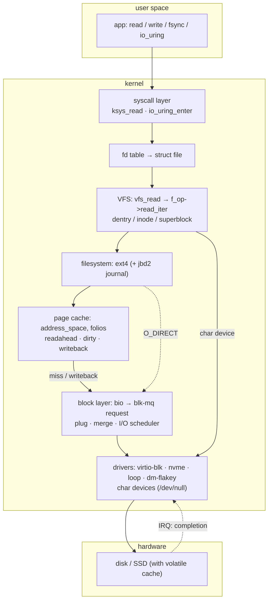

# 05 — File Systems & I/O

> Advanced Operating Systems · Term 1 · Linux **v6.18.63**, OpenBSD **`8cada8c`** · x86-64 · ~16 h
> Farsi: [`lesson.fa.md`](lesson.fa.md) · Notes: [`notes/INDEX.en.md`](notes/INDEX.en.md) · Walkthrough: [`kernel-walkthrough.en.md`](kernel-walkthrough.en.md) · Labs: [`labs/`](labs/) · Quiz: [`quiz.en.md`](quiz.en.md) · Slides: [`slides/`](slides/)

**Depends on:** Module 01 (syscall entry, user/kernel boundary, `do_syscall_64`), Module 03 (RCU, seqcounts, spinlocks: path lookup and the fd table use them), Module 04 (folios, LRU, reclaim, page faults: the page cache *is* memory management). Module 07 picks up io_uring security and LSM hooks in `rw_verify_area()`.

## 1. Learning objectives

- Follow one `read()` from `SYSCALL_DEFINE3(read)` to the driver and back, naming every layer and the function where control passes.
- Explain the four VFS objects and predict, for `fork()`, `dup()` and two `open()`s, which ones are shared.
- Measure a page-cache hit vs miss and the cost of `fsync()` on a real machine, without disturbing other users.
- Choose and justify an I/O scheduler for a given device and workload, using measurements.
- State exactly what ext4 `data=ordered` guarantees after a crash, and write the durable-replace sequence.
- Explain why io_uring needs fewer syscalls than `read()`/`write()` and where its requests run when they would block.

## 2. Glossary

| Term | Definition |
|---|---|
| **VFS** | The generic file layer: common objects (`super_block`, `inode`, `dentry`, `file`) plus per-filesystem function tables. |
| **inode** | One file object (regular file, dir, device…): metadata + pointer to its data/page cache. Has no name. |
| **dentry** | A cached name in a directory → inode binding; can be *negative* ("does not exist"). |
| **`struct file`** | One open of an inode: offset `f_pos`, mode, flags, credentials, `f_op`. |
| **fd** | Index into the process's fd table (`files_struct->fdt->fd[]`). |
| **dcache** | Hash table of dentries; path lookup hits it for almost every component. |
| **RCU-walk** | Lock-free path lookup mode (`LOOKUP_RCU`), validated by seqcounts; falls back to ref-walk. |
| **page cache** | RAM copies of file data, per inode (`address_space`, an xarray of folios). |
| **folio** | A power-of-two group of pages handled as a unit (Module 04). |
| **readahead** | Reading more than requested in anticipation of sequential access. |
| **dirty / writeback** | A modified cached folio not yet on disk / the process of writing it. |
| **`fsync`** | Make a file's data and metadata durable before returning. |
| **bio** | Block I/O descriptor: sectors + memory segments. |
| **request** | blk-mq's unit of work sent to a driver, identified by a tag. |
| **blk-mq** | Multi-queue block layer: per-CPU software queues → per-device hardware queues. |
| **I/O scheduler (elevator)** | Optional blk-mq stage that reorders requests: `none`, `mq-deadline`, `bfq`, `kyber`. |
| **journal (jbd2)** | Write-ahead log for ext4 metadata; transactions become durable at the commit record. |
| **`data=ordered`** | ext4 default: data blocks are written before the metadata transaction that references them commits. |
| **delalloc** | Delayed allocation: disk blocks chosen at writeback, not at `write()`. |
| **io_uring** | Async I/O via submission/completion rings shared with the kernel. |
| **SQE / CQE** | Submission / completion queue entry. |
| **io-wq** | io_uring's kernel worker pool for operations that must block. |
| **character device** | Device accessed as a byte stream via a driver's `file_operations`; identified by major:minor. |
| **dm-flakey** | Device-mapper target that drops or corrupts I/O on a schedule; used to simulate power loss. |

## 3. Big picture

Colours on the slides follow the course roles: user space = teal, kernel = amber, hardware = violet, data/memory = green.

## 4. Concepts

### 4.1 What is a file descriptor, and what does `read(3, buf, 4096)` look up?

`3` is an index into `current->files->fdt->fd[]`, which holds a `struct file *`. The file points to a dentry (the name used to open it) and an inode (the object), and carries `f_op`, the filesystem's function table. `vfs_read()` checks the mode and calls `f_op->read` or `f_op->read_iter`. Offsets live in `struct file`, so `fork()`/`dup()` share them and two `open()`s do not.

| Call | New fd? | New `struct file`? | Shared offset? |
|---|---|---|---|
| `open()` twice | yes | yes | no |
| `dup(fd)` | yes | no | yes |
| `fork()` | (copy of table) | no | yes |
| thread (`CLONE_FILES`) | same table | no | yes |

Details: [notes/01](notes/01-vfs-objects.en.md), [notes/03](notes/03-fd-tables.en.md).

### 4.2 How does `open("/usr/lib/os-release")` find the file without touching the disk?

Path lookup walks one component at a time and finds each in the **dcache**. The first try is **RCU-walk**: no locks, no reference counts, sequence counters to detect concurrent renames. If anything is missing or would block, it returns `-ECHILD` and the walk restarts in **ref-walk**, which may call `ext4_lookup()`. Failed lookups leave **negative dentries**, so the next miss is cheap too. [notes/02](notes/02-path-lookup.en.md)

### 4.3 Why is the second read of a file 5–10× faster, and when does a write reach the disk?

Both go through the **page cache**. A read hit is an RCU lookup in the inode's xarray plus a memcpy; a miss triggers readahead and sleeps until the block I/O completes. A write copies into the cache and marks folios dirty; the disk sees it when the flusher runs (10 % dirty or 30 s old), when the writer is throttled (20 %), or on `fsync()`. Lab 05.2 measures hit vs miss on one file using `POSIX_FADV_DONTNEED`, never global `drop_caches`. Lab 05.3 measures `fsync`. [notes/04](notes/04-page-cache-writeback.en.md)

| Write policy (Lab 05.3, 2000 × 4 KiB) | What reaches the disk before return |
|---|---|
| buffered `write()` | nothing |
| `fdatasync()` each / `O_DSYNC` | data + size-changing metadata + device flush |
| `fsync()` each / `O_SYNC` | data + all metadata + journal commit + flush |

### 4.4 How does a bio become a hardware command, and who decides the order?

The filesystem builds a **bio**; `blk_mq_submit_bio()` merges or splits it, attaches a **tag**, and either puts it on the task's **plug** list, inserts it into an **I/O scheduler**, or issues it directly to the driver's `queue_rq()`. Schedulers: `none` (fastest on NVMe), `mq-deadline` (read preference + deadlines, the default for single-queue devices), `bfq` (per-process fairness, idling), `kyber` (latency targets). Lab 05.4 compares them on a loop device. [notes/05](notes/05-block-layer-blk-mq.en.md), [notes/06](notes/06-io-schedulers.en.md)

### 4.5 What survives a power cut?

ext4's **jbd2** journal makes metadata updates atomic: a transaction counts only once its commit block is on disk; mount replays committed transactions. `data=ordered` writes a file's newly allocated data blocks *before* that commit, so metadata never points at garbage. But data that was only `write()`n, never synced, may be gone (delalloc). Durable replace = write tmp, `fsync(tmp)`, `rename`, `fsync(dir)`. Lab 05.6 cuts the power with `dm-flakey`. [notes/07](notes/07-journaling-crash-consistency.en.md)

### 4.6 How can I/O need fewer syscalls than operations?

**io_uring** shares two rings with the kernel. The app writes many SQEs, and one `io_uring_enter()` submits them all and waits for the CQEs (or a kernel thread polls with SQPOLL, and no syscall is needed at all). Each op first tries a non-blocking issue on the same `->read_iter`; if that would block, it continues via async page-cache callbacks, poll, or an **io-wq** worker. Lab 05.5 counts syscalls and tracepoints. [notes/08](notes/08-io-uring.en.md)

### 4.7 How does `open("/dev/null")` reach a driver?

The inode is `S_IFCHR` with `i_rdev = 1:3`. `init_special_inode()` gave it `def_chr_fops`, whose `open` is `chrdev_open()`. That looks up the registered `cdev` for 1:3 and **replaces `file->f_op`** with `null_fops`. From then on `vfs_read()` calls `read_null()`, which returns 0. Block drivers instead sit under blk-mq (`blk_mq_ops->queue_rq`). [notes/09](notes/09-device-drivers-char-devices.en.md)

## 5. Where this lives in Linux

| Topic | Files (v6.18.63) | Walkthrough |
|---|---|---|
| `read(2)`, `vfs_read` | `fs/read_write.c` (L552, L704, L722) | [§1–2](kernel-walkthrough.en.md#1-entry-read2--ksys_read) |
| path lookup | `fs/namei.c`, `fs/dcache.c` | [§3](kernel-walkthrough.en.md#3-path-lookup-briefly) |
| fd table, open | `include/linux/fdtable.h`, `fs/file.c`, `fs/open.c` | notes/03 |
| page cache | `mm/filemap.c`, `mm/readahead.c`, `mm/page-writeback.c` | [§4](kernel-walkthrough.en.md#4-ext4--page-cache-filemap_read) |
| block layer | `block/blk-core.c`, `block/blk-mq.c`, `block/mq-deadline.c` | [§5](kernel-walkthrough.en.md#5-block-layer-submit_bio--blk_mq_submit_bio) |
| ext4 + journal | `fs/ext4/file.c`, `fs/ext4/fsync.c`, `fs/jbd2/commit.c` | [§6](kernel-walkthrough.en.md#6-durability-fsync--ext4--jbd2) |
| io_uring | `io_uring/io_uring.c`, `io_uring/rw.c`, `io_uring/opdef.c` | [§7](kernel-walkthrough.en.md#7-io_uring-the-same--read_iter-no-syscall-per-op) |
| char devices | `fs/char_dev.c`, `fs/inode.c`, `drivers/char/mem.c` | [§8](kernel-walkthrough.en.md#8-character-devices-how-devnull-gets-its-own-f_op) |
| OpenBSD | `sys/kern/vfs_vnops.c`, `sys/kern/vfs_bio.c`, `sys/ufs/ffs/ffs_vnops.c`, `sys/kern/kern_bufq.c` | [§9](kernel-walkthrough.en.md#9-openbsd-comparison-read2-on-ffs) |

## 6. Labs

| Lab | Goal | VM only? |
|---|---|---|
| [05.1 read() call chain](labs/01-read-call-chain/) | see `vfs_read → filemap_read` with ftrace and bpftrace | no (sudo) |
| [05.2 page cache](labs/02-page-cache/) | hit vs miss on one file, per-file eviction | no |
| [05.3 fsync & writeback](labs/03-fsync-writeback/) | cost of durability; per-BDI dirty limits | loop device: yes |
| [05.4 I/O schedulers](labs/04-io-schedulers/) | none / mq-deadline / bfq / kyber with fio | yes |
| [05.5 io_uring copy](labs/05-io-uring-copy/) | `read`/`write` loop vs liburing | no |
| [05.6 ext4 crash](labs/06-ext4-crash/) | power cut with dm-flakey, journal replay | **yes** |

## 7. Common misconceptions

- **"`write()` returned, so the data is on disk."** It is in the page cache. Only `fsync`/`fdatasync`/`O_SYNC`/`O_DSYNC` (and a device that honours flushes) make it durable.
- **"The journal protects my file contents."** In `data=ordered` it protects *metadata* and orders data; unsynced data can be lost.
- **"`close()` flushes."** It does not make data durable. (ext4 may *start* writeback on close after a truncate-and-rewrite, the `auto_da_alloc` heuristic, but does not wait for it.)
- **"The page cache wastes RAM."** It is reclaimable; `MemAvailable` counts it.
- **"An fd is a file."** It is an index; the offset belongs to the `struct file`, which can be shared.
- **"I/O schedulers always help."** On NVMe, `none` is usually best; schedulers cost CPU and add latency.
- **"io_uring is always faster."** For a cache-hot copy with big blocks the work is memcpy; io_uring wins on many small ops, deep queues, and networking.
- **"`echo 3 > drop_caches` is a harmless benchmark step."** On a shared machine it evicts everyone's cache; evict your file only.

## 8. Self-check questions

1. Which objects are shared after `fork()`, after `dup()`, and after two `open()`s of the same path?
2. What does `-ECHILD` mean inside path lookup, and who handles it?
3. A `read()` misses the page cache. Name, in order, the functions from `filemap_get_pages()` to the driver.
4. Why can a `write()` that returned success later fail, and where is that error reported?
5. Which scheduler is the default for a virtio disk with one queue, and for an NVMe device? Why?
6. In `data=ordered`, after a crash, can a file contain blocks of another deleted file? In `data=writeback`?
7. What makes io_uring submission lock-free between user space and the kernel?
8. Why does `vfs_read()` call `read_null()` directly instead of `new_sync_read()` for `/dev/null`?
