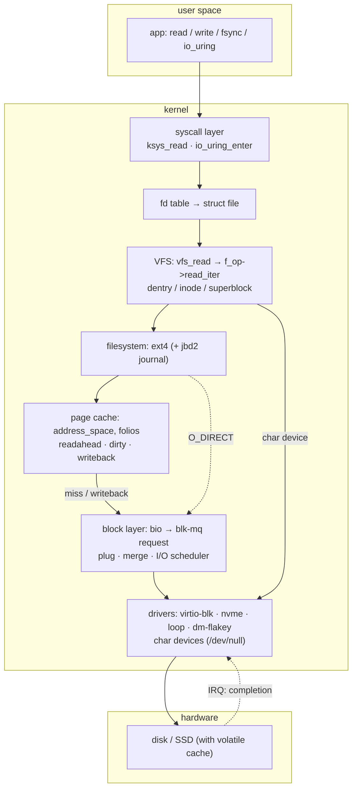

# ۰۵ — فایل‌سیستم‌ها و I/O

> درس: سیستم‌عامل پیشرفته · ترم ۱ · نسخه‌های ثابت: Linux **v6.18.63** و OpenBSD **`8cada8c`** · معماری: **x86-64** · زمان: حدود ۱۶ ساعت
> نسخهٔ انگلیسی: [`lesson.en.md`](lesson.en.md) · یادداشت‌ها: [`notes/INDEX.fa.md`](notes/INDEX.fa.md) · گام‌به‌گام کرنل: [`kernel-walkthrough.fa.md`](kernel-walkthrough.fa.md) · آزمایش‌ها: [`labs/`](labs/) · آزمون: [`quiz.fa.md`](quiz.fa.md) · اسلایدها: [`slides/`](slides/)

**پیش‌نیاز:** ماژول ۰۱ (ورود syscall، مرز کاربر و کرنل، `do_syscall_64`)، ماژول ۰۳ (RCU، seqcountها و spinlockها؛ path lookup و جدول fd از آن‌ها استفاده می‌کنند)، ماژول ۰۴ (folioها، LRU، reclaim و page fault؛ page cache *خودِ* مدیریت حافظه است). ماژول ۰۷ امنیت io_uring و hookهای LSM در `rw_verify_area()` را ادامه می‌دهد.

## ۱. هدف‌های یادگیری

- یک `read()` را از `SYSCALL_DEFINE3(read)` تا درایور و برگشت دنبال کنید و هر لایه و تابعی را که کنترل در آن دست‌به‌دست می‌شود نام ببرید.
- چهار شیء VFS را توضیح دهید و پیش‌بینی کنید که بعد از `fork()`، `dup()` و دو `open()` کدام‌یک مشترک است.
- روی یک ماشین واقعی، و بدون مزاحمت برای کاربران دیگر، تفاوت hit و miss در page cache و هزینهٔ `fsync()` را اندازه بگیرید.
- برای یک دستگاه و بار کاری مشخص، I/O scheduler مناسب را با اندازه‌گیری انتخاب و توجیه کنید.
- دقیقاً بگویید ext4 با `data=ordered` بعد از crash چه چیزی را تضمین می‌کند، و دنبالهٔ جایگزینی پایدار (durable replace) را بنویسید.
- توضیح دهید چرا io_uring به syscall کمتری از `read()`/`write()` نیاز دارد و درخواست‌هایش وقتی باید block شوند کجا اجرا می‌شوند.

## ۲. واژه‌نامه

| اصطلاح | تعریف |
|---|---|
| **VFS** | لایهٔ عمومی فایل در کرنل: اشیای مشترک (`super_block`، `inode`، `dentry`، `file`) به‌اضافهٔ جدول توابعی که هر فایل‌سیستم پر می‌کند. |
| **inode** | یک شیء فایل (فایل معمولی، دایرکتوری، دستگاه و…): metadata به‌اضافهٔ اشاره‌گر به داده و page cache آن. inode نام ندارد. |
| **dentry** | نامی کش‌شده در یک دایرکتوری که به یک inode وصل است؛ می‌تواند *منفی* باشد، یعنی «این نام وجود ندارد». |
| **`struct file`** | یک بار باز شدن یک inode: offset (`f_pos`)، mode، flagها، credentialها و `f_op`. |
| **fd** | اندیسی در جدول fd پردازه (`files_struct->fdt->fd[]`). |
| **dcache** | جدول hash از dentryها؛ path lookup تقریباً برای هر جزء مسیر به آن می‌خورد. |
| **RCU-walk** | حالت بدون قفل path lookup (`LOOKUP_RCU`) که با seqcountها اعتبارسنجی می‌شود و در صورت شکست به ref-walk برمی‌گردد. |
| **page cache** | نسخه‌های دادهٔ فایل در RAM، برای هر inode جدا (`address_space`، یک xarray از folioها). |
| **folio** | گروهی از صفحه‌ها با اندازهٔ توانی از دو که یکجا مدیریت می‌شوند (ماژول ۰۴). |
| **readahead** | خواندن بیش از مقدار درخواستی، به انتظار دسترسی ترتیبی. |
| **dirty / writeback** | dirty: folio کش‌شده‌ای که تغییر کرده و هنوز روی دیسک نرفته است. writeback: فرایند نوشتن آن روی دیسک. |
| **`fsync`** | پیش از برگشت، دادهٔ فایل و metadata آن را پایدار (durable) می‌کند. |
| **bio** | توصیف‌گر block I/O: سکتورها به‌اضافهٔ قطعه‌های حافظه. |
| **request** | واحد کاری که blk-mq به درایور می‌فرستد و با یک tag شناخته می‌شود. |
| **blk-mq** | لایهٔ block چندصفی: صف‌های نرم‌افزاری برای هر CPU که به صف‌های سخت‌افزاری هر دستگاه نگاشت می‌شوند. |
| **I/O scheduler (elevator)** | مرحلهٔ اختیاری در blk-mq که ترتیب requestها را عوض می‌کند: `none`، `mq-deadline`، `bfq`، `kyber`. |
| **journal (jbd2)** | لاگ write-ahead برای metadata در ext4؛ هر transaction وقتی commit record آن روی دیسک برود پایدار می‌شود. |
| **`data=ordered`** | حالت پیش‌فرض ext4: بلوک‌های داده پیش از commit شدن transaction متادیتایی که به آن‌ها اشاره می‌کند نوشته می‌شوند. |
| **delalloc** | تخصیص تأخیری: بلوک‌های دیسک هنگام writeback انتخاب می‌شوند، نه هنگام `write()`. |
| **io_uring** | I/O ناهمگام با حلقه‌های submission و completion که با کرنل مشترک‌اند. |
| **SQE / CQE** | مدخل صف submission / مدخل صف completion. |
| **io-wq** | استخر workerهای کرنلی io_uring برای عملیاتی که ناچار باید block شوند. |
| **character device** | دستگاهی که مثل جریان بایت و از طریق `file_operations` درایور در دسترس است؛ با major:minor شناخته می‌شود. |
| **dm-flakey** | target در device-mapper که طبق یک زمان‌بندی I/O را دور می‌ریزد یا خراب می‌کند؛ برای شبیه‌سازی قطع برق به کار می‌رود. |

## ۳. تصویر کلی

رنگ‌ها در اسلایدها از نقش‌های درس پیروی می‌کنند: فضای کاربر فیروزه‌ای، کرنل کهربایی، سخت‌افزار بنفش، و داده/حافظه سبز.

## ۴. مفاهیم

### ۴.۱ file descriptor چیست و `read(3, buf, 4096)` چه چیزی را جستجو می‌کند؟

عدد `3` اندیسی در `current->files->fdt->fd[]` است که یک `struct file *` در خود دارد. این file به یک dentry (نامی که با آن باز شده) و یک inode (خودِ شیء) اشاره می‌کند و `f_op`، یعنی جدول توابع فایل‌سیستم، را با خود دارد. `vfs_read()` مجوز mode را بررسی می‌کند و `f_op->read` یا `f_op->read_iter` را صدا می‌زند. offset در `struct file` نگه داشته می‌شود؛ پس `fork()` و `dup()` آن را مشترک می‌کنند و دو `open()` نه.

| فراخوانی | fd جدید؟ | `struct file` جدید؟ | offset مشترک؟ |
|---|---|---|---|
| دو بار `open()` | بله | بله | نه |
| `dup(fd)` | بله | نه | بله |
| `fork()` | (کپی جدول) | نه | بله |
| نخ (`CLONE_FILES`) | همان جدول | نه | بله |

جزئیات: [notes/01](notes/01-vfs-objects.fa.md)، [notes/03](notes/03-fd-tables.fa.md).

### ۴.۲ `open("/usr/lib/os-release")` چطور بدون دست زدن به دیسک فایل را پیدا می‌کند؟

path lookup مسیر را جزء به جزء طی می‌کند و هر جزء را در **dcache** پیدا می‌کند. تلاش اول **RCU-walk** است: بدون قفل، بدون شمارش ارجاع، و با شمارنده‌های ترتیبی برای تشخیص rename هم‌زمان. اگر چیزی در کش نباشد یا کاری نیاز به block شدن داشته باشد، `-ECHILD` برمی‌گردد و جستجو از نو در حالت **ref-walk** شروع می‌شود که ممکن است `ext4_lookup()` را صدا بزند. جستجوهای ناموفق **dentry منفی** به جا می‌گذارند تا miss بعدی هم ارزان باشد. [notes/02](notes/02-path-lookup.fa.md)

### ۴.۳ چرا خواندن دوم یک فایل ۵ تا ۱۰ برابر سریع‌تر است، و write کی به دیسک می‌رسد؟

هر دو از **page cache** می‌گذرند. hit در خواندن یعنی یک lookup با RCU در xarray مربوط به inode و سپس یک memcpy؛ miss باعث readahead می‌شود و تا تمام شدن block I/O می‌خوابد. write داده را در کش کپی می‌کند و folioها را dirty علامت می‌زند؛ دیسک وقتی آن را می‌بیند که flusher اجرا شود (۱۰ درصد dirty یا ۳۰ ثانیه عمر)، که نویسنده throttle شود (۲۰ درصد)، یا که `fsync()` صدا زده شود. آزمایش ۰۵.۲ با `POSIX_FADV_DONTNEED` روی یک فایل hit و miss را اندازه می‌گیرد و هرگز از `drop_caches` سراسری استفاده نمی‌کند. آزمایش ۰۵.۳ هزینهٔ `fsync` را می‌سنجد. [notes/04](notes/04-page-cache-writeback.fa.md)

| سیاست نوشتن (آزمایش ۰۵.۳، 2000 × 4 KiB) | چه چیزی پیش از برگشت به دیسک می‌رسد |
|---|---|
| `write()` بافرشده | هیچ |
| `fdatasync()` بعد از هر نوشتن / `O_DSYNC` | داده + metadataای که اندازه را تغییر می‌دهد + flush دستگاه |
| `fsync()` بعد از هر نوشتن / `O_SYNC` | داده + همهٔ metadata + commit ژورنال + flush |

### ۴.۴ یک bio چطور به فرمان سخت‌افزاری تبدیل می‌شود، و چه کسی ترتیب را تعیین می‌کند؟

فایل‌سیستم یک **bio** می‌سازد؛ `blk_mq_submit_bio()` آن را merge یا split می‌کند، یک **tag** به آن می‌دهد، و یا آن را در فهرست **plug** همان task می‌گذارد، یا وارد یک **I/O scheduler** می‌کند، یا مستقیم به `queue_rq()` درایور می‌فرستد. schedulerها: `none` (سریع‌ترین روی NVMe)، `mq-deadline` (اولویت با خواندن و مهلت‌ها؛ پیش‌فرض دستگاه‌های تک‌صفی)، `bfq` (انصاف بین پردازه‌ها و idling)، `kyber` (هدف‌های تأخیر). آزمایش ۰۵.۴ آن‌ها را روی یک loop device مقایسه می‌کند. [notes/05](notes/05-block-layer-blk-mq.fa.md)، [notes/06](notes/06-io-schedulers.fa.md)

### ۴.۵ بعد از قطع برق چه چیزی باقی می‌ماند؟

ژورنال **jbd2** در ext4 به‌روزرسانی‌های metadata را اتمی می‌کند: یک transaction فقط وقتی حساب می‌شود که commit block آن روی دیسک باشد، و هنگام mount، transactionهای commitشده دوباره اجرا (replay) می‌شوند. `data=ordered` بلوک‌های دادهٔ تازه‌تخصیص‌یافتهٔ فایل را *پیش از* همان commit می‌نویسد، پس metadata هرگز به زباله اشاره نمی‌کند. اما داده‌ای که فقط `write()` شده و هرگز sync نشده ممکن است از دست برود (delalloc). جایگزینی پایدار یعنی: نوشتن فایل موقت، `fsync(tmp)`، `rename`، و `fsync(dir)`. آزمایش ۰۵.۶ با `dm-flakey` برق را قطع می‌کند. [notes/07](notes/07-journaling-crash-consistency.fa.md)

### ۴.۶ چطور ممکن است I/O به syscall کمتری از تعداد عملیات نیاز داشته باشد؟

**io_uring** دو حلقه را با کرنل به اشتراک می‌گذارد. برنامه چندین SQE می‌نویسد و یک `io_uring_enter()` همه را submit می‌کند و منتظر CQEها می‌ماند (یا با SQPOLL یک نخ کرنلی poll می‌کند و اصلاً syscall لازم نیست). هر عملیات اول روی همان `->read_iter` یک issue غیر blocking را امتحان می‌کند؛ اگر قرار باشد block شود، از طریق callbackهای ناهمگام page cache، poll، یا یک worker در **io-wq** ادامه پیدا می‌کند. آزمایش ۰۵.۵ تعداد syscallها و tracepointها را می‌شمارد. [notes/08](notes/08-io-uring.fa.md)

### ۴.۷ `open("/dev/null")` چطور به یک درایور می‌رسد؟

inode از نوع `S_IFCHR` است با `i_rdev = 1:3`. `init_special_inode()` به آن `def_chr_fops` داده که `open` آن `chrdev_open()` است. این تابع `cdev` ثبت‌شده برای 1:3 را پیدا می‌کند و **`file->f_op` را با `null_fops` جایگزین می‌کند**. از آن به بعد `vfs_read()` مستقیم `read_null()` را صدا می‌زند که 0 برمی‌گرداند. درایورهای block به جای این، زیر blk-mq قرار می‌گیرند (`blk_mq_ops->queue_rq`). [notes/09](notes/09-device-drivers-char-devices.fa.md)

## ۵. این‌ها در لینوکس کجا هستند

| موضوع | فایل‌ها (v6.18.63) | گام‌به‌گام |
|---|---|---|
| `read(2)`، `vfs_read` | `fs/read_write.c` (L552, L704, L722) | [§۱–۲](kernel-walkthrough.fa.md) |
| path lookup | `fs/namei.c`، `fs/dcache.c` | [§۳](kernel-walkthrough.fa.md) |
| جدول fd، open | `include/linux/fdtable.h`، `fs/file.c`، `fs/open.c` | notes/03 |
| page cache | `mm/filemap.c`، `mm/readahead.c`، `mm/page-writeback.c` | [§۴](kernel-walkthrough.fa.md) |
| لایهٔ block | `block/blk-core.c`، `block/blk-mq.c`، `block/mq-deadline.c` | [§۵](kernel-walkthrough.fa.md) |
| ext4 + ژورنال | `fs/ext4/file.c`، `fs/ext4/fsync.c`، `fs/jbd2/commit.c` | [§۶](kernel-walkthrough.fa.md) |
| io_uring | `io_uring/io_uring.c`، `io_uring/rw.c`، `io_uring/opdef.c` | [§۷](kernel-walkthrough.fa.md) |
| character deviceها | `fs/char_dev.c`، `fs/inode.c`، `drivers/char/mem.c` | [§۸](kernel-walkthrough.fa.md) |
| OpenBSD | `sys/kern/vfs_vnops.c`، `sys/kern/vfs_bio.c`، `sys/ufs/ffs/ffs_vnops.c`، `sys/kern/kern_bufq.c` | [§۹](kernel-walkthrough.fa.md) |

## ۶. آزمایش‌ها

| آزمایش | هدف | فقط VM؟ |
|---|---|---|
| [05.1 read() call chain](labs/01-read-call-chain/) | دیدن `vfs_read → filemap_read` با ftrace و bpftrace | نه (با sudo) |
| [05.2 page cache](labs/02-page-cache/) | hit و miss روی یک فایل، بیرون‌انداختن از کش برای هر فایل | نه |
| [05.3 fsync & writeback](labs/03-fsync-writeback/) | هزینهٔ پایداری؛ حد dirty برای هر BDI | برای loop device: بله |
| [05.4 I/O schedulers](labs/04-io-schedulers/) | none / mq-deadline / bfq / kyber با fio | بله |
| [05.5 io_uring copy](labs/05-io-uring-copy/) | حلقهٔ `read`/`write` در برابر liburing | نه |
| [05.6 ext4 crash](labs/06-ext4-crash/) | قطع برق با dm-flakey و replay ژورنال | **بله** |

## ۷. برداشت‌های نادرست رایج

- **«`write()` برگشت، پس داده روی دیسک است.»** داده در page cache است. فقط `fsync`/`fdatasync`/`O_SYNC`/`O_DSYNC` (و دستگاهی که flush را رعایت کند) آن را پایدار می‌کنند.
- **«ژورنال از محتوای فایل من محافظت می‌کند.»** در `data=ordered` از *metadata* محافظت می‌کند و ترتیب داده را حفظ می‌کند؛ دادهٔ sync‌نشده می‌تواند از دست برود.
- **«`close()` داده را flush می‌کند.»** داده را پایدار نمی‌کند. (ext4 ممکن است بعد از truncate و بازنویسی، هنگام close writeback را *شروع* کند — heuristic موسوم به `auto_da_alloc` — اما منتظر تمام شدنش نمی‌ماند.)
- **«page cache رم را هدر می‌دهد.»** قابل reclaim است و `MemAvailable` آن را حساب می‌کند.
- **«fd همان فایل است.»** fd فقط یک اندیس است؛ offset مال `struct file` است که می‌تواند مشترک باشد.
- **«I/O schedulerها همیشه کمک می‌کنند.»** روی NVMe معمولاً `none` بهترین است؛ schedulerها CPU مصرف می‌کنند و تأخیر اضافه می‌کنند.
- **«io_uring همیشه سریع‌تر است.»** در کپی‌ای که از کش داغ با بلوک‌های بزرگ انجام می‌شود، کار اصلی memcpy است؛ io_uring در عملیات کوچکِ زیاد، صف‌های عمیق و شبکه برنده است.
- **«`echo 3 > drop_caches` یک مرحلهٔ بی‌خطر در benchmark است.»** روی ماشین مشترک، کش همه را بیرون می‌اندازد؛ فقط فایل خودتان را از کش خارج کنید.

## ۸. پرسش‌های خودسنجی

۱. بعد از `fork()`، بعد از `dup()` و بعد از دو `open()` روی یک مسیر، کدام اشیا مشترک‌اند؟
۲. `-ECHILD` در path lookup چه معنایی دارد و چه کسی به آن رسیدگی می‌کند؟
۳. یک `read()` در page cache پیدا نمی‌شود (miss). توابع را به ترتیب، از `filemap_get_pages()` تا درایور، نام ببرید.
۴. چرا `write()`ای که با موفقیت برگشته ممکن است بعداً شکست بخورد، و این خطا کجا گزارش می‌شود؟
۵. scheduler پیش‌فرض برای دیسک virtio با یک صف چیست، و برای دستگاه NVMe چه؟ چرا؟
۶. در `data=ordered`، بعد از crash، آیا یک فایل ممکن است بلوک‌هایی از فایل حذف‌شدهٔ دیگری داشته باشد؟ در `data=writeback` چطور؟
۷. چه چیزی submission در io_uring را بین فضای کاربر و کرنل بدون قفل می‌کند؟
۸. چرا `vfs_read()` برای `/dev/null` به جای `new_sync_read()` مستقیم `read_null()` را صدا می‌زند؟

