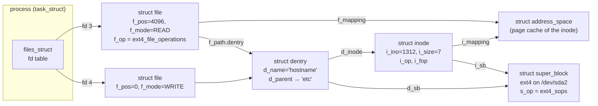

# 01 — VFS objects: superblock, inode, dentry, file

> Module 05 · File Systems & I/O · Linux v6.18.63 · Farsi: [`01-vfs-objects.fa.md`](01-vfs-objects.fa.md)

## 1. Summary

- The **VFS** (Virtual File System) is the layer that lets one `read()` work on ext4, tmpfs, procfs, a pipe or `/dev/null`. It does this with four object types and a table of function pointers on each.
- **superblock** = one mounted filesystem; **inode** = one file object on it (size, owner, blocks); **dentry** = one *name* in a directory that points at an inode; **file** = one *open* of an inode, with its own offset and flags.
- Every filesystem fills in operation tables (`super_operations`, `inode_operations`, `file_operations`, `address_space_operations`). The VFS calls through them and never knows which filesystem it is talking to.

## 2. Detailed explanation

### 2.1 The question

When you run `cat /etc/hostname` and then `cat /proc/uptime`, the same `read()` system call reads from a disk filesystem and from a file that is generated on the fly by kernel code. Neither `cat` nor the syscall entry code knows the difference. Something in between has to turn "read 4096 bytes from fd 3" into "call ext4's read function" or "call procfs's read function". That something is the VFS.

### 2.2 Intuition: object-oriented C

The kernel is written in C, but the VFS is object-oriented. Each object is a `struct` with data fields plus a pointer to a `const struct ..._operations` table, which is a struct full of function pointers. This is a hand-written vtable. A filesystem "subclasses" the VFS by providing its own tables. ext4's regular-file table is `ext4_file_operations` (`fs/ext4/file.c` L970), with `.read_iter = ext4_file_read_iter`, `.write_iter = ext4_file_write_iter`, `.fsync = ext4_sync_file`, and so on.

### 2.3 The four objects

| Object | Represents | Lifetime | Key fields (v6.18.63) | Ops table |
|---|---|---|---|---|
| `struct super_block` | one mounted filesystem instance | mount → umount | `s_op`, `s_bdev`, `s_root`, `s_maxbytes` | `super_operations` |
| `struct inode` | one file object (regular, dir, device, fifo, symlink) | while referenced or cached | `i_mode`, `i_ino`, `i_size`, `i_op`, `i_fop`, `i_mapping`, `i_rdev` | `inode_operations` (+ default `i_fop`) |
| `struct dentry` | one path component: a (parent, name) → inode binding | cached in the dcache, can be *negative* | `d_parent`, `d_name`, `d_inode`, `d_op`, `d_sb` | `dentry_operations` |
| `struct file` | one open() call | open → last close (refcounted) | `f_mode`, `f_op`, `f_mapping`, `f_inode`, `f_path`, `f_pos` | `file_operations` |

Two more objects complete the picture: `struct address_space` (`include/linux/fs.h` L506), which is the page cache of one inode (note 04), and `struct vfsmount`, which glues a superblock into the mount tree.

### 2.4 Why separate dentry and inode?

An inode has no name. Names live in directories, and one inode can have several names (hard links) or none (an unlinked file that is still open). The dentry is the cached result of "look up name X in directory Y". Splitting them lets the kernel cache *names* (including names that do **not** exist: negative dentries) without loading the inode, and lets hard links share one inode.

### 2.5 Why separate file and inode?

Two processes that open the same file need different offsets and different access modes (`O_RDONLY` vs `O_WRONLY|O_APPEND`). That per-open state lives in `struct file`. The inode holds what is shared: size, permissions, data. After `fork()`, parent and child share one `struct file` (and therefore one offset). Two separate `open()` calls create two `struct file` objects that point at one inode. Note 03 covers this.

## 3. Diagram



## 4. Worked example (real code)

The open file object, from the pinned source:

```c
// linux/include/linux/fs.h · struct file · v6.18.63 · L1213-1235
struct file {
	spinlock_t			f_lock;
	fmode_t				f_mode;
	const struct file_operations	*f_op;
	struct address_space		*f_mapping;
	void				*private_data;
	struct inode			*f_inode;
	unsigned int			f_flags;
	unsigned int			f_iocb_flags;
	const struct cred		*f_cred;
	struct fown_struct		*f_owner;
	/* --- cacheline 1 boundary (64 bytes) --- */
	union {
		const struct path	f_path;
		struct path		__f_path;
	};
	union {
		/* regular files (with FMODE_ATOMIC_POS) and directories */
		struct mutex		f_pos_lock;
		/* pipes */
		u64			f_pipe;
	};
	loff_t				f_pos;
```

Line by line:

- `f_mode`: checked first by `vfs_read()` (`FMODE_READ`, `FMODE_CAN_READ`). It is derived from the `open()` flags once, so the hot path tests bits instead of parsing flags.
- `f_op`: the function table. For an ext4 regular file it is `&ext4_file_operations`; for `/dev/null` it is `null_fops` (`drivers/char/mem.c` L644).
- `f_mapping`: shortcut to the inode's page cache, so `filemap_read()` does not have to go through the inode.
- `f_inode`: the inode this open refers to.
- `f_cred`: the credentials of the opener, saved at open time. Permission was checked at open; later reads use this, not the current credentials.
- The cacheline comments show the layout was tuned so the hot read-path fields sit in the first 64 bytes.
- `f_path`: `{vfsmount, dentry}` pair, i.e. *which name in which mount* was opened.
- `f_pos_lock` / `f_pos`: the shared file offset and the mutex that makes `read()` on a shared `struct file` update it atomically (`FMODE_ATOMIC_POS`).

Real VM check (inode number and the device that holds the superblock):

```bash
stat -c 'inode=%i dev=%D links=%h size=%s %n' /etc/hostname /proc/uptime /dev/null
```

The output (Lab 05.1 captures it) shows three different superblocks: ext4 on the root disk, `proc`, and `devtmpfs`, each with its own inode numbering.

## 5. Edge cases & pitfalls

- **"An inode is a file on disk."** Only for disk filesystems. procfs, sysfs, pipes and sockets have in-memory inodes with no on-disk copy. ext4 also has its own `struct ext4_inode_info` that *embeds* the VFS inode (`container_of` pattern).
- **Negative dentries** are real cached objects. A failed `stat("/usr/lib/libfoo.so")` caches "does not exist", so the next failed lookup does not hit the disk. Millions of negative dentries can use a lot of memory (`/proc/sys/fs/dentry-state`).
- **Unlinked but open:** `rm` removes the dentry; the inode and its blocks stay until the last `struct file` is closed. This is why `df` and `du` disagree when a log file is deleted while a daemon still holds it.
- **`f_op` can change after open.** For character devices the inode's default `def_chr_fops` has only `.open = chrdev_open`, which replaces `f_op` with the driver's table (`replace_fops`, note 09).
- Device inodes have `i_rdev` (major:minor) instead of data blocks.

## 6. Exam-style key points

- VFS = common objects + function-pointer tables; filesystems implement the tables.
- superblock (mount) · inode (object) · dentry (name → inode) · file (one open).
- dentries are cached in the dcache, including negative ones; inodes are cached in the icache.
- `struct file` holds per-open state: offset, mode, credentials, `f_op`; shared after `fork()` and `dup()`.
- One inode can have 0..N dentries (hard links, unlinked-but-open).
- `address_space` = per-inode page cache, referenced by both `inode->i_mapping` and `file->f_mapping`.

## 7. Links

- Lesson: [`../lesson.en.md`](../lesson.en.md) §4.1 · Walkthrough: [`../kernel-walkthrough.en.md`](../kernel-walkthrough.en.md) §2
- Lab: [`../labs/01-read-call-chain/`](../labs/01-read-call-chain/) (step 4, `stat` on three filesystems)
- Quiz: [`../quiz.en.md`](../quiz.en.md) Q1, Q7
- Next note: [`02-path-lookup.en.md`](02-path-lookup.en.md)
