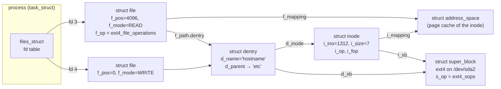

<div dir="rtl">

# ۰۱ — اشیای VFS: superblock، inode، dentry، file

> ماژول ۰۵ · فایل‌سیستم‌ها و ورودی/خروجی · Linux v6.18.63 · نسخهٔ انگلیسی: [`01-vfs-objects.en.md`](01-vfs-objects.en.md)

## ۱. خلاصه

- **VFS** (Virtual File System) لایه‌ای است که باعث می‌شود یک `read()` روی ext4، tmpfs، procfs، pipe یا `/dev/null` یکسان کار کند. این کار را با چهار نوع شیء و یک جدول اشاره‌گر تابع روی هر کدام انجام می‌دهد.
- **superblock** یعنی یک فایل‌سیستم mount‌شده؛ **inode** یعنی یک شیء فایل روی آن (اندازه، مالک، بلوک‌ها)؛ **dentry** یعنی یک *نام* در یک دایرکتوری که به یک inode اشاره می‌کند؛ **file** یعنی یک بار *باز کردن* یک inode، با offset و flagهای مخصوص خودش.
- هر فایل‌سیستم جدول‌های عملیات را پر می‌کند (`super_operations`، `inode_operations`، `file_operations`، `address_space_operations`). VFS فقط از طریق این جدول‌ها صدا می‌زند و هرگز نمی‌داند با کدام فایل‌سیستم طرف است.

## ۲. توضیح کامل

### ۲.۱ پرسش

وقتی `cat /etc/hostname` و بعد `cat /proc/uptime` را اجرا می‌کنید، همان system call یعنی `read()` یک بار از فایل‌سیستم دیسکی می‌خواند و یک بار از فایلی که کد کرنل همان لحظه تولیدش می‌کند. نه `cat` فرقی می‌فهمد و نه کد ورودی syscall. چیزی در این میان باید «۴۰۹۶ بایت از fd 3 بخوان» را به «تابع read مربوط به ext4 را صدا بزن» یا «تابع read مربوط به procfs را صدا بزن» تبدیل کند. آن چیز VFS است.

### ۲.۲ شهود: C شیءگرا

کرنل به زبان C نوشته شده، ولی VFS شیءگراست. هر شیء یک `struct` است با فیلدهای داده به‌اضافهٔ اشاره‌گری به یک جدول `const struct ..._operations`، یعنی struct‌ای پر از اشاره‌گر تابع. این همان vtable دست‌نویس است. هر فایل‌سیستم با ارائهٔ جدول‌های خودش از VFS «ارث‌بری» می‌کند. جدول فایل‌های معمولی ext4 همان `ext4_file_operations` است (`fs/ext4/file.c` L970) با `.read_iter = ext4_file_read_iter`، `.write_iter = ext4_file_write_iter`، `.fsync = ext4_sync_file` و غیره.

### ۲.۳ چهار شیء

| شیء | نمایندهٔ چه چیزی | طول عمر | فیلدهای کلیدی (v6.18.63) | جدول ops |
|---|---|---|---|---|
| `struct super_block` | یک نمونهٔ فایل‌سیستم mount‌شده | از mount تا umount | `s_op`، `s_bdev`، `s_root`، `s_maxbytes` | `super_operations` |
| `struct inode` | یک شیء فایل (معمولی، دایرکتوری، دستگاه، fifo، symlink) | تا وقتی ارجاعی به آن هست یا در cache مانده | `i_mode`، `i_ino`، `i_size`، `i_op`، `i_fop`، `i_mapping`، `i_rdev` | `inode_operations` (به‌اضافهٔ `i_fop` پیش‌فرض) |
| `struct dentry` | یک جزء مسیر: پیوند (parent، name) به inode | در dcache نگه داشته می‌شود و می‌تواند *منفی* باشد | `d_parent`، `d_name`، `d_inode`، `d_op`، `d_sb` | `dentry_operations` |
| `struct file` | یک فراخوانی open() | از open تا آخرین close (با شمارندهٔ ارجاع) | `f_mode`، `f_op`، `f_mapping`، `f_inode`، `f_path`، `f_pos` | `file_operations` |

دو شیء دیگر تصویر را کامل می‌کنند: `struct address_space` (`include/linux/fs.h` L506) که page cache یک inode است (یادداشت ۰۴)، و `struct vfsmount` که یک superblock را به درخت mount وصل می‌کند.

### ۲.۴ چرا dentry و inode جدا هستند؟

inode نام ندارد. نام‌ها در دایرکتوری‌ها هستند و یک inode می‌تواند چند نام داشته باشد (hard link) یا هیچ نامی نداشته باشد (فایلی که unlink شده ولی هنوز باز است). dentry نتیجهٔ cache‌شدهٔ «نام X را در دایرکتوری Y پیدا کن» است. این جداسازی به کرنل اجازه می‌دهد *نام‌ها* را بدون بارگذاری inode در cache نگه دارد (حتی نام‌هایی که وجود **ندارند**: dentryهای منفی)، و hard linkها یک inode مشترک داشته باشند.

### ۲.۵ چرا file و inode جدا هستند؟

دو process که یک فایل را باز می‌کنند به offset و حالت دسترسی متفاوت نیاز دارند (`O_RDONLY` در برابر `O_WRONLY|O_APPEND`). این وضعیتِ مخصوص هر open در `struct file` است. inode چیزهای مشترک را نگه می‌دارد: اندازه، مجوزها، داده. بعد از `fork()`، والد و فرزند یک `struct file` مشترک دارند (و در نتیجه یک offset). دو فراخوانی جداگانهٔ `open()` دو شیء `struct file` می‌سازند که هر دو به یک inode اشاره می‌کنند. یادداشت ۰۳ این را پوشش می‌دهد.

## ۳. نمودار

</div>



<div dir="rtl">

## ۴. مثال عملی (کد واقعی)

شیء فایل باز، از سورس نسخهٔ ثابت:

</div>

```c
// linux/include/linux/fs.h · struct file · v6.18.63 · L1213-1235
struct file {
	spinlock_t			f_lock;
	fmode_t				f_mode;
	const struct file_operations	*f_op;
	struct address_space		*f_mapping;
	void				*private_data;
	struct inode			*f_inode;
	unsigned int			f_flags;
	unsigned int			f_iocb_flags;
	const struct cred		*f_cred;
	struct fown_struct		*f_owner;
	/* --- cacheline 1 boundary (64 bytes) --- */
	union {
		const struct path	f_path;
		struct path		__f_path;
	};
	union {
		/* regular files (with FMODE_ATOMIC_POS) and directories */
		struct mutex		f_pos_lock;
		/* pipes */
		u64			f_pipe;
	};
	loff_t				f_pos;
```

<div dir="rtl">

خط به خط:

- `f_mode`: اولین چیزی که `vfs_read()` بررسی می‌کند (`FMODE_READ`، `FMODE_CAN_READ`). یک بار از flagهای `open()` ساخته می‌شود تا مسیر داغ به‌جای تجزیهٔ flagها فقط چند بیت را تست کند.
- `f_op`: جدول توابع. برای یک فایل معمولی ext4 برابر `&ext4_file_operations` است؛ برای `/dev/null` برابر `null_fops` (`drivers/char/mem.c` L644).
- `f_mapping`: میان‌بری به page cache مربوط به inode، تا `filemap_read()` مجبور نباشد از inode عبور کند.
- `f_inode`: inodeای که این open به آن ارجاع دارد.
- `f_cred`: اعتبارنامه‌های (credentials) کسی که فایل را باز کرده، که موقع open ذخیره می‌شود. مجوز موقع open بررسی شده؛ readهای بعدی از همین استفاده می‌کنند، نه از credentials فعلی.
- توضیح‌های cacheline نشان می‌دهند چیدمان طوری تنظیم شده که فیلدهای داغ مسیر read در ۶۴ بایت اول بنشینند.
- `f_path`: جفت `{vfsmount, dentry}`، یعنی *کدام نام در کدام mount* باز شده است.
- `f_pos_lock` / `f_pos`: offset مشترک فایل و mutexای که باعث می‌شود `read()` روی یک `struct file` مشترک آن را به‌صورت اتمی به‌روز کند (`FMODE_ATOMIC_POS`).

بررسی واقعی روی VM (شمارهٔ inode و دستگاهی که superblock روی آن است):

</div>

```bash
stat -c 'inode=%i dev=%D links=%h size=%s %n' /etc/hostname /proc/uptime /dev/null
```

<div dir="rtl">

خروجی (که آزمایش ۰۵.۱ ثبتش می‌کند) سه superblock متفاوت نشان می‌دهد: ext4 روی دیسک ریشه، `proc` و `devtmpfs`، که هر کدام شماره‌گذاری inode خودشان را دارند.

## ۵. حالت‌های خاص و دام‌ها

- **«inode یعنی فایلی روی دیسک.»** فقط برای فایل‌سیستم‌های دیسکی درست است. procfs، sysfs، pipeها و socketها inodeهای درون حافظه دارند که هیچ نسخه‌ای روی دیسک ندارند. ext4 هم `struct ext4_inode_info` خودش را دارد که inode مربوط به VFS را *درون خود جا داده* است (الگوی `container_of`).
- **dentryهای منفی** اشیای واقعیِ cache‌شده هستند. یک `stat("/usr/lib/libfoo.so")` ناموفق «وجود ندارد» را cache می‌کند، پس lookup ناموفق بعدی سراغ دیسک نمی‌رود. میلیون‌ها dentry منفی می‌توانند حافظهٔ زیادی بگیرند (`/proc/sys/fs/dentry-state`).
- **unlink‌شده ولی باز:** `rm` فقط dentry را حذف می‌کند؛ inode و بلوک‌هایش تا بسته شدن آخرین `struct file` می‌مانند. به همین دلیل وقتی یک فایل log پاک می‌شود ولی daemon هنوز آن را نگه داشته، `df` و `du` با هم نمی‌خوانند.
- **`f_op` بعد از open می‌تواند عوض شود.** برای دستگاه‌های کاراکتری، `def_chr_fops` پیش‌فرض inode فقط `.open = chrdev_open` دارد که `f_op` را با جدول درایور جایگزین می‌کند (`replace_fops`، یادداشت ۰۹).
- inodeهای دستگاه به‌جای بلوک داده، `i_rdev` (major:minor) دارند.

## ۶. نکته‌های امتحانی

- VFS = اشیای مشترک + جدول‌های اشاره‌گر تابع؛ فایل‌سیستم‌ها این جدول‌ها را پیاده‌سازی می‌کنند.
- superblock (mount) · inode (شیء) · dentry (نام ← inode) · file (یک open).
- dentryها در dcache نگه داشته می‌شوند، از جمله dentryهای منفی؛ inodeها در icache.
- `struct file` وضعیت هر open را نگه می‌دارد: offset، mode، credentials، `f_op`؛ بعد از `fork()` و `dup()` مشترک است.
- یک inode می‌تواند <span dir="ltr">0..N</span> dentry داشته باشد (hard link، unlink‌شده ولی باز).
- `address_space` = page cache هر inode، که هم `inode->i_mapping` و هم `file->f_mapping` به آن ارجاع می‌دهند.

## ۷. پیوندها

- درس: [`../lesson.fa.md`](../lesson.fa.md) §۴.۱ · مرور کرنل: [`../kernel-walkthrough.fa.md`](../kernel-walkthrough.fa.md) §۲
- آزمایش: [`../labs/01-read-call-chain/`](../labs/01-read-call-chain/) (گام ۴، `stat` روی سه فایل‌سیستم)
- آزمونک: [`../quiz.fa.md`](../quiz.fa.md) پرسش ۱ و ۷
- یادداشت بعدی: [`02-path-lookup.fa.md`](02-path-lookup.fa.md)

</div>
