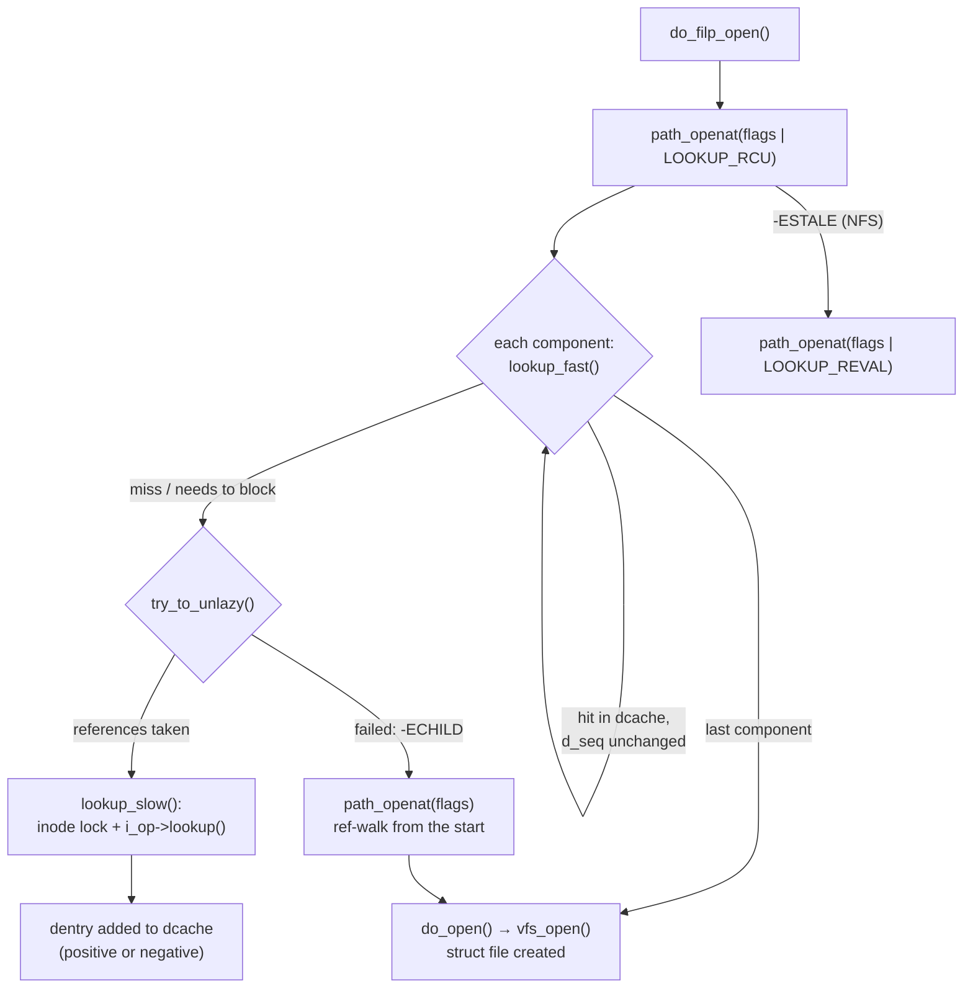

# 02 — Path lookup: `namei`, RCU-walk and ref-walk

> Module 05 · File Systems & I/O · Linux v6.18.63 · Farsi: [`02-path-lookup.fa.md`](02-path-lookup.fa.md)

## 1. Summary

- `open("/usr/lib/os-release")` must turn a string into a `struct dentry` + `struct vfsmount`. The kernel walks it one component at a time (`link_path_walk()` → `walk_component()`), and almost always finds each component in the **dcache** (a hash table of dentries).
- The first attempt is **RCU-walk** (`LOOKUP_RCU`): no reference counts, no locks, only sequence-count checks. If anything changes or a component is missing, it falls back to **ref-walk** (`-ECHILD`), which takes references and may call the filesystem's `->lookup()`.
- That is why a warm `stat()` costs hundreds of nanoseconds and scales on many CPUs, while a cold one may wait for disk I/O.

## 2. Detailed explanation

### 2.1 The question

`openat(AT_FDCWD, "/usr/lib/os-release", O_RDONLY)` returns `3`. Between the string and the `3` the kernel must: copy the path from user memory, find a free fd, resolve `/` → `usr` → `lib` → `os-release` (following the symlink if it is one), check permission on every directory (`MAY_EXEC`), create a `struct file`, and install it. The code path is:

```
SYSCALL openat → do_sys_openat2() → get_unused_fd_flags()
                                 → do_filp_open() → path_openat()
                                       → path_init() → link_path_walk() → walk_component() × N
                                       → open_last_lookups() → do_open() → vfs_open()
                                 → fd_install()
```

### 2.2 Component by component

`link_path_walk()` (`fs/namei.c` L2441) loops over the components. For each one it hashes the name (word-at-a-time on x86-64), checks `MAY_EXEC` on the current directory, and calls `walk_component()` (L2134). `walk_component()` treats `.` and `..` specially (`handle_dots()`), otherwise:

1. `lookup_fast()`: look the (parent, name) pair up in the dcache hash.
2. If not cached: `lookup_slow()`: lock the directory inode and call `dir->i_op->lookup()`, the filesystem's own directory search (ext4 reads directory blocks, possibly using its htree index). The result, positive or **negative**, is inserted into the dcache.
3. `step_into()`: move to the new dentry, crossing a mount point if one is mounted here, or start following a symlink (limited to 40 nested links, `MAXSYMLINKS`).

### 2.3 Why two modes?

A ref-walk takes a reference count (`d_lockref`) on every dentry it passes and drops it after. On a 64-CPU machine where every thread opens files under `/usr/lib`, every thread writes the same cache line of the `usr` and `lib` dentries. That cache line bounces between CPUs and lookups stop scaling.

**RCU-walk** avoids writes completely. Inside `rcu_read_lock()`, dentries cannot be freed (Module 03, RCU). The walker reads the dentry's sequence counter `d_seq`, does the lookup, and re-checks the counter. If a rename or unlink happened in between, the counter changed and the lookup is retried in ref-walk mode. No shared cache line is written, so lookups scale.

The fallback is cheap and explicit: anything RCU-walk cannot do without blocking (a dcache miss, a filesystem that needs `->d_revalidate()` with I/O, an NFS mount) returns `-ECHILD`, and `do_filp_open()` reruns the whole walk without `LOOKUP_RCU`. A third pass with `LOOKUP_REVAL` handles `-ESTALE` from network filesystems.

`try_to_unlazy()` is the in-place upgrade: it tries to take real references on everything the RCU walk has touched so far ("legitimize"). If that works, the walk continues in ref-walk mode without restarting.

## 3. Diagram



## 4. Worked example (real code)

The three-pass strategy is visible in nine lines:

```c
// linux/fs/namei.c · do_filp_open() · v6.18.63 · L4156-4171
struct file *do_filp_open(int dfd, struct filename *pathname,
		const struct open_flags *op)
{
	struct nameidata nd;
	int flags = op->lookup_flags;
	struct file *filp;

	set_nameidata(&nd, dfd, pathname, NULL);
	filp = path_openat(&nd, op, flags | LOOKUP_RCU);
	if (unlikely(filp == ERR_PTR(-ECHILD)))
		filp = path_openat(&nd, op, flags);
	if (unlikely(filp == ERR_PTR(-ESTALE)))
		filp = path_openat(&nd, op, flags | LOOKUP_REVAL);
	restore_nameidata();
	return filp;
}
```

- `set_nameidata()`: `struct nameidata` is the walker's state (current path, flags, symlink stack, `seq`). It is stored on the stack and linked from `current` so nested walks (symlinks) can find it.
- Pass 1 adds `LOOKUP_RCU`: lock-free, the common case.
- Pass 2 only if pass 1 returned exactly `-ECHILD`: "I could not finish without blocking".
- Pass 3 only on `-ESTALE`: the server says a cached handle is stale, so revalidate everything.

And the RCU branch inside `lookup_fast()`:

```c
// linux/fs/namei.c · lookup_fast() · v6.18.63 · L1749-1763
	if (nd->flags & LOOKUP_RCU) {
		dentry = __d_lookup_rcu(parent, &nd->last, &nd->next_seq);
		if (unlikely(!dentry)) {
			if (!try_to_unlazy(nd))
				return ERR_PTR(-ECHILD);
			return NULL;
		}

		/*
		 * This sequence count validates that the parent had no
		 * changes while we did the lookup of the dentry above.
		 */
		if (read_seqcount_retry(&parent->d_seq, nd->seq))
			return ERR_PTR(-ECHILD);
```

- `__d_lookup_rcu()` searches the dcache hash without taking any lock and returns the child's sequence number in `nd->next_seq`.
- Miss → try to switch to ref-walk in place; `NULL` tells `walk_component()` to call `lookup_slow()`.
- `read_seqcount_retry()` detects a concurrent rename of the parent; the only safe answer is to start over in ref-walk.

Measure it on the VM: the negative-dentry effect of a missing file.

```bash
# 1st stat of a missing name goes to ext4 (->lookup), the next ones hit a negative dentry
sudo bpftrace -e 'kprobe:ext4_lookup /comm == "stat"/ { @ext4_lookup = count(); }' \
  -c 'sh -c "for i in 1 2 3 4 5; do stat /etc/no-such-file-$$ 2>/dev/null; done"'
```

Expected shape: `@ext4_lookup` is about 1 (only the first `stat` reached the filesystem), even though five processes looked the name up. The captured output is in Lab 05.1's README.

## 5. Edge cases & pitfalls

- **`..` is not just `d_parent`.** At a mount root it must step to the parent mount, and inside a chroot or with `RESOLVE_BENEATH` (`openat2(2)`) it must not escape. `handle_dots()` deals with this; it is a classic source of security bugs.
- **Symlinks are walked by the kernel**, not by libc. The last component is followed unless `O_NOFOLLOW`; intermediate symlinks are always followed. More than 40 → `ELOOP`.
- **Permission is checked on every directory**, with `MAY_EXEC` (search). A file with mode 0644 in a 0700 directory you don't own is unreachable.
- **Negative dentries can be wrong** on network filesystems; `->d_revalidate()` exists for that, and it is why NFS often forces ref-walk.
- **TOCTOU:** the path is resolved again on each call. `stat(path)` then `open(path)` can resolve to different inodes. Use `openat()` with directory fds, `O_PATH`, or `openat2()` `RESOLVE_*` flags.
- `strace` shows only the syscall; the number of components and cache hits is invisible to it. Use bpftrace/ftrace.

## 6. Exam-style key points

- Path walk = `link_path_walk()` loop; per component: `lookup_fast()` (dcache) → else `lookup_slow()` (`i_op->lookup`, inode lock).
- RCU-walk: no refcounts, no locks; correctness from `rcu_read_lock()` + `d_seq` seqcounts.
- `-ECHILD` = "RCU-walk cannot continue"; `do_filp_open()` retries in ref-walk; `-ESTALE` → `LOOKUP_REVAL`.
- `try_to_unlazy()` upgrades an RCU walk to ref-walk in place.
- Negative dentries cache "does not exist".
- Every directory needs `MAY_EXEC`; symlink depth ≤ 40.

## 7. Links

- Lesson: [`../lesson.en.md`](../lesson.en.md) §4.2 · Walkthrough: [`../kernel-walkthrough.en.md`](../kernel-walkthrough.en.md) §3
- Lab: [`../labs/01-read-call-chain/`](../labs/01-read-call-chain/) (step 5: negative dentry)
- Quiz: [`../quiz.en.md`](../quiz.en.md) Q8
- Previous: [`01-vfs-objects.en.md`](01-vfs-objects.en.md) · Next: [`03-fd-tables.en.md`](03-fd-tables.en.md)
