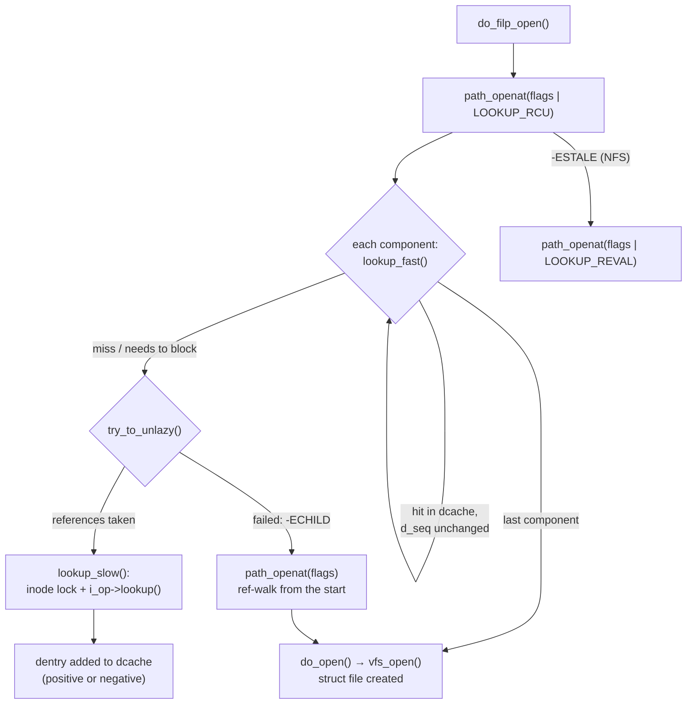

<div dir="rtl">

# ۰۲ — جستجوی مسیر: `namei`، RCU-walk و ref-walk

> ماژول ۰۵ · فایل‌سیستم‌ها و ورودی/خروجی · Linux v6.18.63 · نسخهٔ انگلیسی: [`02-path-lookup.en.md`](02-path-lookup.en.md)

## ۱. خلاصه

- <span dir="ltr">`open("/usr/lib/os-release")`</span> باید یک رشته را به یک `struct dentry` به‌اضافهٔ یک `struct vfsmount` تبدیل کند. کرنل مسیر را جزء به جزء طی می‌کند (`link_path_walk()` ← `walk_component()`) و تقریباً همیشه هر جزء را در **dcache** (یک hash table از dentryها) پیدا می‌کند.
- تلاش اول **RCU-walk** است (`LOOKUP_RCU`): بدون شمارندهٔ ارجاع، بدون قفل، فقط با بررسی sequence count. اگر چیزی تغییر کند یا جزئی در cache نباشد، به **ref-walk** برمی‌گردد (`-ECHILD`) که ارجاع می‌گیرد و ممکن است `->lookup()` فایل‌سیستم را صدا بزند.
- به همین دلیل یک `stat()` گرم چند صد نانوثانیه طول می‌کشد و روی CPUهای زیاد مقیاس‌پذیر است، در حالی که یک `stat()` سرد ممکن است منتظر I/O دیسک بماند.

## ۲. توضیح کامل

### ۲.۱ پرسش

<span dir="ltr">`openat(AT_FDCWD, "/usr/lib/os-release", O_RDONLY)`</span> مقدار `3` را برمی‌گرداند. بین رشته و `3` کرنل باید: مسیر را از حافظهٔ کاربر کپی کند، یک fd آزاد پیدا کند، `/` ← `usr` ← `lib` ← `os-release` را resolve کند (و اگر symlink بود دنبالش برود)، روی هر دایرکتوری مجوز (`MAY_EXEC`) را بررسی کند، یک `struct file` بسازد و آن را نصب کند. مسیر کد این است:

</div>

```
SYSCALL openat → do_sys_openat2() → get_unused_fd_flags()
                                 → do_filp_open() → path_openat()
                                       → path_init() → link_path_walk() → walk_component() × N
                                       → open_last_lookups() → do_open() → vfs_open()
                                 → fd_install()
```

<div dir="rtl">

### ۲.۲ جزء به جزء

`link_path_walk()` (`fs/namei.c` L2441) روی اجزا حلقه می‌زند. برای هر جزء نام را hash می‌کند (روی x86-64 به‌صورت word-at-a-time)، `MAY_EXEC` را روی دایرکتوری فعلی بررسی می‌کند و `walk_component()` (L2134) را صدا می‌زند. `walk_component()` با `.` و `..` رفتار ویژه دارد (`handle_dots()`)، و در غیر این صورت:

۱. `lookup_fast()`: جفت (parent، name) را در hash مربوط به dcache جستجو می‌کند.
۲. اگر در cache نبود: `lookup_slow()`: inode دایرکتوری را قفل می‌کند و `dir->i_op->lookup()` را صدا می‌زند، یعنی جستجوی دایرکتوری خود فایل‌سیستم (ext4 بلوک‌های دایرکتوری را می‌خواند و شاید از ایندکس htree استفاده کند). نتیجه، چه مثبت چه **منفی**، در dcache درج می‌شود.
۳. `step_into()`: به dentry جدید می‌رود؛ اگر اینجا چیزی mount شده باشد از نقطهٔ mount عبور می‌کند، یا دنبال کردن یک symlink را شروع می‌کند (حداکثر ۴۰ لینک تودرتو، `MAXSYMLINKS`).

### ۲.۳ چرا دو حالت؟

ref-walk روی هر dentry که از آن رد می‌شود یک شمارندهٔ ارجاع (`d_lockref`) می‌گیرد و بعد رهایش می‌کند. روی ماشینی با ۶۴ CPU که همهٔ threadها فایل‌هایی زیر `/usr/lib` باز می‌کنند، همهٔ threadها روی همان cache line از dentryهای `usr` و `lib` می‌نویسند. آن cache line مدام بین CPUها جابه‌جا می‌شود و lookupها دیگر مقیاس‌پذیر نیستند.

**RCU-walk** کاملاً از نوشتن پرهیز می‌کند. داخل `rcu_read_lock()`، dentryها آزاد نمی‌شوند (ماژول ۰۳، RCU). پیمایشگر شمارندهٔ ترتیب dentry یعنی `d_seq` را می‌خواند، lookup را انجام می‌دهد و دوباره شمارنده را بررسی می‌کند. اگر در این فاصله rename یا unlink رخ داده باشد، شمارنده تغییر کرده و lookup در حالت ref-walk تکرار می‌شود. هیچ cache line مشترکی نوشته نمی‌شود، پس lookupها مقیاس‌پذیرند.

برگشت ارزان و صریح است: هر کاری که RCU-walk نتواند بدون block شدن انجام دهد (miss در dcache، فایل‌سیستمی که به `->d_revalidate()` همراه با I/O نیاز دارد، یک mount از نوع NFS) مقدار `-ECHILD` برمی‌گرداند و `do_filp_open()` کل پیمایش را بدون `LOOKUP_RCU` دوباره اجرا می‌کند. گذر سوم با `LOOKUP_REVAL` خطای `-ESTALE` فایل‌سیستم‌های شبکه‌ای را مدیریت می‌کند.

`try_to_unlazy()` ارتقای درجا است: سعی می‌کند روی هر چیزی که RCU-walk تا اینجا لمس کرده ارجاع واقعی بگیرد («legitimize»). اگر موفق شود، پیمایش بدون شروع دوباره در حالت ref-walk ادامه پیدا می‌کند.

## ۳. نمودار

</div>



<div dir="rtl">

## ۴. مثال عملی (کد واقعی)

راهبرد سه‌گذره در نُه خط دیده می‌شود:

</div>

```c
// linux/fs/namei.c · do_filp_open() · v6.18.63 · L4156-4171
struct file *do_filp_open(int dfd, struct filename *pathname,
		const struct open_flags *op)
{
	struct nameidata nd;
	int flags = op->lookup_flags;
	struct file *filp;

	set_nameidata(&nd, dfd, pathname, NULL);
	filp = path_openat(&nd, op, flags | LOOKUP_RCU);
	if (unlikely(filp == ERR_PTR(-ECHILD)))
		filp = path_openat(&nd, op, flags);
	if (unlikely(filp == ERR_PTR(-ESTALE)))
		filp = path_openat(&nd, op, flags | LOOKUP_REVAL);
	restore_nameidata();
	return filp;
}
```

<div dir="rtl">

- `set_nameidata()`: `struct nameidata` وضعیت پیمایشگر است (مسیر فعلی، flagها، پشتهٔ symlink، `seq`). روی stack ذخیره می‌شود و از `current` به آن پیوند داده می‌شود تا پیمایش‌های تودرتو (symlinkها) پیدایش کنند.
- گذر ۱ مقدار `LOOKUP_RCU` را اضافه می‌کند: بدون قفل، حالت رایج.
- گذر ۲ فقط اگر گذر ۱ دقیقاً `-ECHILD` برگرداند: «نتوانستم بدون block شدن تمامش کنم».
- گذر ۳ فقط روی `-ESTALE`: سرور می‌گوید یک handle در cache کهنه شده، پس همه چیز را دوباره اعتبارسنجی کن.

و شاخهٔ RCU داخل `lookup_fast()`:

</div>

```c
// linux/fs/namei.c · lookup_fast() · v6.18.63 · L1749-1763
	if (nd->flags & LOOKUP_RCU) {
		dentry = __d_lookup_rcu(parent, &nd->last, &nd->next_seq);
		if (unlikely(!dentry)) {
			if (!try_to_unlazy(nd))
				return ERR_PTR(-ECHILD);
			return NULL;
		}

		/*
		 * This sequence count validates that the parent had no
		 * changes while we did the lookup of the dentry above.
		 */
		if (read_seqcount_retry(&parent->d_seq, nd->seq))
			return ERR_PTR(-ECHILD);
```

<div dir="rtl">

- `__d_lookup_rcu()` بدون گرفتن هیچ قفلی hash مربوط به dcache را جستجو می‌کند و شمارهٔ ترتیب فرزند را در `nd->next_seq` برمی‌گرداند.
- miss ← سعی در تغییر درجا به ref-walk؛ `NULL` به `walk_component()` می‌گوید `lookup_slow()` را صدا بزند.
- `read_seqcount_retry()` یک rename هم‌زمان روی parent را تشخیص می‌دهد؛ تنها پاسخ امن شروع دوباره در ref-walk است.

روی VM اندازه بگیرید: اثر dentry منفی برای یک فایل ناموجود.

</div>

```bash
# 1st stat of a missing name goes to ext4 (->lookup), the next ones hit a negative dentry
sudo bpftrace -e 'kprobe:ext4_lookup /comm == "stat"/ { @ext4_lookup = count(); }' \
  -c 'sh -c "for i in 1 2 3 4 5; do stat /etc/no-such-file-$$ 2>/dev/null; done"'
```

<div dir="rtl">

شکل مورد انتظار: `@ext4_lookup` حدود ۱ است (فقط اولین `stat` به فایل‌سیستم رسید)، با اینکه پنج process آن نام را جستجو کردند. خروجی ثبت‌شده در README آزمایش ۰۵.۱ است.

## ۵. حالت‌های خاص و دام‌ها

- **`..` فقط `d_parent` نیست.** در ریشهٔ یک mount باید به mount والد برود، و داخل chroot یا با `RESOLVE_BENEATH` (<span dir="ltr">`openat2(2)`</span>) نباید بیرون بزند. `handle_dots()` این را مدیریت می‌کند و منبع کلاسیک باگ‌های امنیتی است.
- **symlinkها را کرنل دنبال می‌کند**، نه libc. جزء آخر دنبال می‌شود مگر با `O_NOFOLLOW`؛ symlinkهای میانی همیشه دنبال می‌شوند. بیش از ۴۰ تا ← `ELOOP`.
- **مجوز روی هر دایرکتوری بررسی می‌شود**، با `MAY_EXEC` (جستجو). فایلی با mode 0644 در دایرکتوری 0700 که مال شما نیست دست‌نیافتنی است.
- **dentryهای منفی ممکن است اشتباه باشند** روی فایل‌سیستم‌های شبکه‌ای؛ `->d_revalidate()` برای همین وجود دارد و دلیل این است که NFS اغلب ref-walk را تحمیل می‌کند.
- **TOCTOU:** مسیر در هر فراخوانی دوباره resolve می‌شود. `stat(path)` و بعد `open(path)` ممکن است به inodeهای متفاوتی برسند. از `openat()` با fd دایرکتوری، `O_PATH` یا flagهای `RESOLVE_*` در `openat2()` استفاده کنید.
- `strace` فقط syscall را نشان می‌دهد؛ تعداد اجزا و hitهای cache برایش نامرئی است. از bpftrace/ftrace استفاده کنید.

## ۶. نکته‌های امتحانی

- پیمایش مسیر = حلقهٔ `link_path_walk()`؛ برای هر جزء: `lookup_fast()` (dcache) ← وگرنه `lookup_slow()` (`i_op->lookup`، قفل inode).
- RCU-walk: بدون refcount، بدون قفل؛ درستی از `rcu_read_lock()` به‌اضافهٔ seqcountهای `d_seq` می‌آید.
- `-ECHILD` یعنی «RCU-walk نمی‌تواند ادامه دهد»؛ `do_filp_open()` در ref-walk دوباره تلاش می‌کند؛ `-ESTALE` ← `LOOKUP_REVAL`.
- `try_to_unlazy()` یک RCU walk را درجا به ref-walk ارتقا می‌دهد.
- dentryهای منفی «وجود ندارد» را cache می‌کنند.
- هر دایرکتوری `MAY_EXEC` لازم دارد؛ عمق symlink حداکثر ۴۰.

## ۷. پیوندها

- درس: [`../lesson.fa.md`](../lesson.fa.md) §۴.۲ · مرور کرنل: [`../kernel-walkthrough.fa.md`](../kernel-walkthrough.fa.md) §۳
- آزمایش: [`../labs/01-read-call-chain/`](../labs/01-read-call-chain/) (گام ۵: dentry منفی)
- آزمونک: [`../quiz.fa.md`](../quiz.fa.md) پرسش ۸
- قبلی: [`01-vfs-objects.fa.md`](01-vfs-objects.fa.md) · بعدی: [`03-fd-tables.fa.md`](03-fd-tables.fa.md)

</div>
