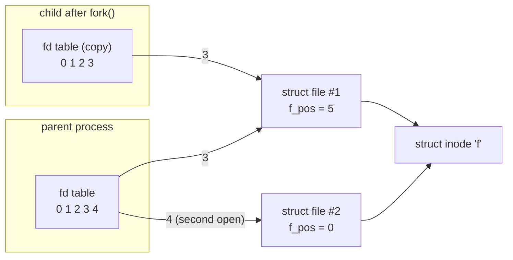

# 03 — File descriptor tables and `struct file`

> Module 05 · File Systems & I/O · Linux v6.18.63 · Farsi: [`03-fd-tables.fa.md`](03-fd-tables.fa.md)

## 1. Summary

- A file descriptor is just an **index** into the per-process array `files_struct->fdt->fd[]`, whose entries point at `struct file`. The number means nothing outside that process.
- `open()` takes the **lowest free** index (`alloc_fd()`), builds a `struct file`, and publishes it with `fd_install()`. `read(fd)` turns the index back into a pointer with an RCU-protected, Spectre-safe array lookup.
- `dup()` and `fork()` copy *pointers*, so both descriptors share one `struct file` and therefore **one offset**. Two `open()` calls create two `struct file`s with independent offsets.

## 2. Detailed explanation

### 2.1 The question

Why does this print `hello` and then `world`, not `hello` twice?

```bash
printf 'helloworld' > f; ( exec 3<f; head -c5 <&3; echo; ( head -c5 <&3; echo ) )
```

The inner subshell is a forked child. It inherited fd 3, and fd 3 in both processes points to **the same** `struct file`, whose `f_pos` the parent already advanced to 5. File offsets belong to the open file, not to the descriptor and not to the inode.

### 2.2 Three levels

| Level | Structure | Shared by | Holds |
|---|---|---|---|
| per process (or per thread group) | `struct files_struct` | threads (`CLONE_FILES`); copied on `fork()` | the fd table, `next_fd` hint, lock |
| per open | `struct file` | all fds that came from one `open()` via `dup`/`fork`/`SCM_RIGHTS` | `f_pos`, `f_flags` (`O_APPEND`, `O_NONBLOCK`), `f_mode`, `f_cred`, `f_op` |
| per object | `struct inode` | every open of the file | size, mode, owner, page cache |

`fcntl(F_SETFL, O_NONBLOCK)` changes `struct file`, so it affects every dup'ed descriptor. `FD_CLOEXEC` is a per-*descriptor* flag stored in the `close_on_exec` bitmap of the table, so it does not.

### 2.3 The table itself

`struct files_struct` (`include/linux/fdtable.h` L38) embeds a small default table (`fd_array[NR_OPEN_DEFAULT]`, 64 entries on 64-bit) so most processes never allocate one. When a process needs more, `expand_files()` allocates a bigger `struct fdtable`, copies the pointers, and publishes it with `rcu_assign_pointer()`; readers that are still using the old table finish safely under RCU and the old one is freed after a grace period.

The bitmaps make allocation fast: `open_fds` has one bit per fd, and `full_fds_bits` has one bit per *word* of `open_fds` that is completely full, so `alloc_fd()` can skip 64 used descriptors at a time when it searches for the lowest free one. "Lowest free" is POSIX-required, and it is what makes `close(1); open(...)` redirect stdout.

### 2.4 Lookup on every syscall

Every `read(fd, ...)` starts with `fdget_pos(fd)` (via `CLASS(fd_pos, f)` in `ksys_read()`). Underneath is `files_lookup_fd_raw()`. If the process is single-threaded (`files->count == 1`), `fdget()` skips taking a reference on the `struct file` because nobody else can close it concurrently. That saves an atomic operation per syscall. Multi-threaded processes pay for `get_file_rcu()`.

The `_pos` variant also takes `f_pos_lock` when the file is shared and has `FMODE_ATOMIC_POS`, so two threads reading the same fd do not both read at offset 0.

## 3. Diagram



## 4. Worked example (real code)

```c
// linux/include/linux/fdtable.h · files_lookup_fd_raw() · v6.18.63 · L72-85
static inline struct file *files_lookup_fd_raw(struct files_struct *files, unsigned int fd)
{
	struct fdtable *fdt = rcu_dereference_raw(files->fdt);
	unsigned long mask = array_index_mask_nospec(fd, fdt->max_fds);
	struct file *needs_masking;

	/*
	 * 'mask' is zero for an out-of-bounds fd, all ones for ok.
	 * 'fd&mask' is 'fd' for ok, or 0 for out of bounds.
	 *
	 * Accessing fdt->fd[0] is ok, but needs masking of the result.
	 */
	needs_masking = rcu_dereference_raw(fdt->fd[fd&mask]);
	return (struct file *)(mask & (unsigned long)needs_masking);
```

- `rcu_dereference_raw(files->fdt)`: the table pointer can be replaced by `expand_files()`; RCU makes the old table stay valid while we use it.
- `array_index_mask_nospec()`: **Spectre v1** hardening. A plain `if (fd < max_fds)` could be speculatively bypassed, loading `fdt->fd[huge]` and leaking memory through the cache. The mask is computed without a branch, so even speculation reads index 0 for a bad fd.
- The final `mask &` turns the result into `NULL` for an out-of-range fd: the caller sees "no such fd" (`-EBADF`).

`open()` then `fd_install()`:

```c
// linux/fs/open.c · do_sys_openat2() · v6.18.63 · L1435-1444
	fd = get_unused_fd_flags(how->flags);
	if (likely(fd >= 0)) {
		struct file *f = do_filp_open(dfd, tmp, &op);
		if (IS_ERR(f)) {
			put_unused_fd(fd);
			fd = PTR_ERR(f);
		} else {
			fd_install(fd, f);
		}
	}
```

The fd number is **reserved first** (bit set in `open_fds`, slot still `NULL`), then the path walk runs, and only then is the pointer published. Another thread calling `read(fd)` in between sees `NULL` → `EBADF`, never a half-built file.

Inspect it on a live process (output captured in Lab 05.1):

```bash
exec 3</etc/hostname; head -c3 <&3 >/dev/null
cat /proc/$$/fdinfo/3      # pos: 3, flags: 0100000 (O_LARGEFILE), mnt_id, ino
ls -l /proc/$$/fd/3        # symlink to the path of f_path
```

## 5. Edge cases & pitfalls

- **Deleted but open:** `ls -l /proc/PID/fd` shows `/var/log/x (deleted)`. The disk space is released only at the last `fput()`. Fix a full disk by truncating through the fd (`: > /proc/PID/fd/N`) or restarting the holder, not by deleting more files.
- **`O_APPEND` on a shared file** makes every write seek to EOF atomically, so two processes appending to one log don't overwrite each other. Without it, a shared `f_pos` still serializes, but separate opens race.
- **`close()` does not guarantee durability** and may return errors from deferred writeback on NFS. Data safety needs `fsync()` (note 04).
- **`close()` in one thread while another thread is blocked in `read()` on the same fd** does not interrupt the read; the `struct file` lives until the read drops its reference.
- `ulimit -n` (RLIMIT_NOFILE) limits the highest fd number, not the number of open files system-wide (`/proc/sys/fs/file-max`, `file-nr`).
- fd passing over UNIX sockets (`SCM_RIGHTS`) shares the `struct file` across processes, exactly like `dup()`.

## 6. Exam-style key points

- fd → `files_struct->fdt->fd[fd]` → `struct file *`; lowest free index (POSIX).
- Offset and status flags live in `struct file`; `FD_CLOEXEC` lives in the table bitmap.
- `fork`/`dup`/`SCM_RIGHTS` share a `struct file`; separate `open()`s do not.
- Table grows by RCU-replacing `fdt`; lookups use `array_index_mask_nospec` (Spectre v1).
- `get_unused_fd_flags()` reserves → `do_filp_open()` → `fd_install()` publishes.
- Single-threaded `fdget()` skips the refcount.

## 7. Links

- Lesson: [`../lesson.en.md`](../lesson.en.md) §4.1 · Walkthrough: [`../kernel-walkthrough.en.md`](../kernel-walkthrough.en.md) §1
- Lab: [`../labs/01-read-call-chain/`](../labs/01-read-call-chain/) (step 4: `fdinfo`)
- Quiz: [`../quiz.en.md`](../quiz.en.md) Q6, Q11
- Previous: [`02-path-lookup.en.md`](02-path-lookup.en.md) · Next: [`04-page-cache-writeback.en.md`](04-page-cache-writeback.en.md)
