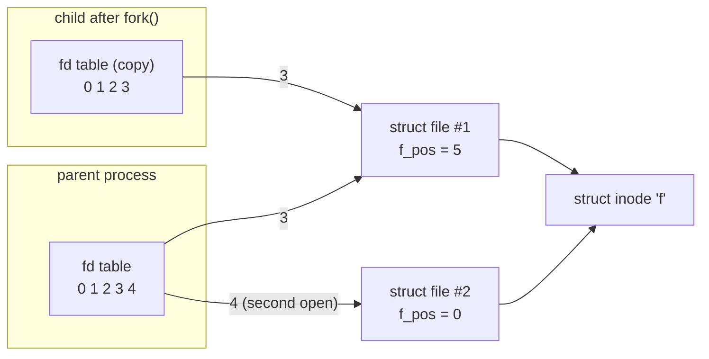

<div dir="rtl">

# ۰۳ — جدول‌های file descriptor و `struct file`

> ماژول ۰۵ · فایل‌سیستم‌ها و ورودی/خروجی · Linux v6.18.63 · نسخهٔ انگلیسی: [`03-fd-tables.en.md`](03-fd-tables.en.md)

## ۱. خلاصه

- یک file descriptor فقط یک **اندیس** در آرایهٔ مخصوص هر process یعنی `files_struct->fdt->fd[]` است که خانه‌هایش به `struct file` اشاره می‌کنند. این عدد بیرون از آن process هیچ معنایی ندارد.
- `open()` **کوچک‌ترین** اندیس آزاد را می‌گیرد (`alloc_fd()`)، یک `struct file` می‌سازد و با `fd_install()` منتشرش می‌کند. `read(fd)` اندیس را با یک جستجوی آرایه‌ایِ محافظت‌شده با RCU و امن در برابر Spectre دوباره به اشاره‌گر تبدیل می‌کند.
- `dup()` و `fork()` *اشاره‌گرها* را کپی می‌کنند، پس هر دو descriptor یک `struct file` مشترک و در نتیجه **یک offset** دارند. دو فراخوانی `open()` دو `struct file` با offsetهای مستقل می‌سازند.

## ۲. توضیح کامل

### ۲.۱ پرسش

چرا این دستور اول `hello` و بعد `world` چاپ می‌کند، نه دو بار `hello`؟

</div>

```bash
printf 'helloworld' > f; ( exec 3<f; head -c5 <&3; echo; ( head -c5 <&3; echo ) )
```

<div dir="rtl">

subshell داخلی یک فرزندِ fork‌شده است. fd 3 را به ارث برده، و fd 3 در هر دو process به **همان** `struct file` اشاره می‌کند که والد `f_pos` آن را قبلاً به ۵ رسانده است. offset فایل متعلق به فایل باز است، نه به descriptor و نه به inode.

### ۲.۲ سه سطح

| سطح | ساختار | مشترک بین | چه چیزی نگه می‌دارد |
|---|---|---|---|
| هر process (یا هر thread group) | `struct files_struct` | threadها (`CLONE_FILES`)؛ در `fork()` کپی می‌شود | جدول fd، راهنمای `next_fd`، قفل |
| هر open | `struct file` | همهٔ fdهایی که از یک `open()` از راه `dup`/`fork`/`SCM_RIGHTS` آمده‌اند | `f_pos`، `f_flags` (`O_APPEND`، `O_NONBLOCK`)، `f_mode`، `f_cred`، `f_op` |
| هر شیء | `struct inode` | همهٔ openهای آن فایل | اندازه، mode، مالک، page cache |

<span dir="ltr">`fcntl(F_SETFL, O_NONBLOCK)`</span> روی `struct file` اثر می‌گذارد، پس همهٔ descriptorهای dup‌شده را تغییر می‌دهد. `FD_CLOEXEC` یک flag مخصوص *descriptor* است که در bitmap به نام `close_on_exec` در جدول ذخیره می‌شود، پس این‌طور نیست.

### ۲.۳ خود جدول

`struct files_struct` (`include/linux/fdtable.h` L38) یک جدول پیش‌فرض کوچک (`fd_array[NR_OPEN_DEFAULT]`، روی ۶۴ بیتی ۶۴ خانه) را درون خودش دارد، پس بیشتر processها هیچ‌وقت جدولی allocate نمی‌کنند. وقتی process به خانهٔ بیشتری نیاز دارد، `expand_files()` یک `struct fdtable` بزرگ‌تر می‌سازد، اشاره‌گرها را کپی می‌کند و با `rcu_assign_pointer()` منتشرش می‌کند؛ readerهایی که هنوز از جدول قدیمی استفاده می‌کنند زیر RCU با خیال راحت کارشان را تمام می‌کنند و جدول قدیمی بعد از یک grace period آزاد می‌شود.

bitmapها تخصیص را سریع می‌کنند: `open_fds` برای هر fd یک بیت دارد و `full_fds_bits` برای هر *word* از `open_fds` که کاملاً پر است یک بیت، پس `alloc_fd()` هنگام جستجوی کوچک‌ترین fd آزاد می‌تواند ۶۴ descriptor استفاده‌شده را یک‌جا رد کند. «کوچک‌ترین آزاد» الزام POSIX است و همان چیزی است که باعث می‌شود <span dir="ltr">`close(1); open(...)`</span> خروجی استاندارد را redirect کند.

### ۲.۴ جستجو در هر syscall

هر <span dir="ltr">`read(fd, ...)`</span> با `fdget_pos(fd)` شروع می‌شود (از راه `CLASS(fd_pos, f)` در `ksys_read()`). زیر آن `files_lookup_fd_raw()` است. اگر process تک‌threadی باشد (`files->count == 1`)، `fdget()` گرفتن ارجاع روی `struct file` را رد می‌کند چون هیچ‌کس دیگری نمی‌تواند هم‌زمان آن را ببندد. این در هر syscall یک عملیات اتمی صرفه‌جویی می‌کند. processهای چندthreadی هزینهٔ `get_file_rcu()` را می‌پردازند.

نسخهٔ `_pos` همچنین وقتی فایل مشترک است و `FMODE_ATOMIC_POS` دارد قفل `f_pos_lock` را می‌گیرد، تا دو thread که از یک fd می‌خوانند هر دو از offset صفر نخوانند.

## ۳. نمودار

</div>



<div dir="rtl">

## ۴. مثال عملی (کد واقعی)

</div>

```c
// linux/include/linux/fdtable.h · files_lookup_fd_raw() · v6.18.63 · L72-85
static inline struct file *files_lookup_fd_raw(struct files_struct *files, unsigned int fd)
{
	struct fdtable *fdt = rcu_dereference_raw(files->fdt);
	unsigned long mask = array_index_mask_nospec(fd, fdt->max_fds);
	struct file *needs_masking;

	/*
	 * 'mask' is zero for an out-of-bounds fd, all ones for ok.
	 * 'fd&mask' is 'fd' for ok, or 0 for out of bounds.
	 *
	 * Accessing fdt->fd[0] is ok, but needs masking of the result.
	 */
	needs_masking = rcu_dereference_raw(fdt->fd[fd&mask]);
	return (struct file *)(mask & (unsigned long)needs_masking);
```

<div dir="rtl">

- `rcu_dereference_raw(files->fdt)`: اشاره‌گر جدول ممکن است با `expand_files()` عوض شود؛ RCU باعث می‌شود جدول قدیمی تا وقتی از آن استفاده می‌کنیم معتبر بماند.
- `array_index_mask_nospec()`: مقاوم‌سازی در برابر **Spectre v1**. یک <span dir="ltr">`if (fd < max_fds)`</span> ساده ممکن است به‌صورت speculative دور زده شود، `fdt->fd[huge]` بارگذاری شود و حافظه از راه cache نشت کند. mask بدون branch محاسبه می‌شود، پس حتی در اجرای speculative برای fd نامعتبر اندیس ۰ خوانده می‌شود.
- `mask &` پایانی نتیجه را برای fd خارج از محدوده به `NULL` تبدیل می‌کند: فراخواننده «چنین fdای وجود ندارد» (`-EBADF`) را می‌بیند.

`open()` و بعد `fd_install()`:

</div>

```c
// linux/fs/open.c · do_sys_openat2() · v6.18.63 · L1435-1444
	fd = get_unused_fd_flags(how->flags);
	if (likely(fd >= 0)) {
		struct file *f = do_filp_open(dfd, tmp, &op);
		if (IS_ERR(f)) {
			put_unused_fd(fd);
			fd = PTR_ERR(f);
		} else {
			fd_install(fd, f);
		}
	}
```

<div dir="rtl">

شمارهٔ fd **اول رزرو می‌شود** (بیت در `open_fds` روشن می‌شود ولی خانه هنوز `NULL` است)، بعد پیمایش مسیر اجرا می‌شود و فقط پس از آن اشاره‌گر منتشر می‌شود. thread دیگری که در این فاصله `read(fd)` را صدا بزند `NULL` ← `EBADF` می‌بیند، هرگز یک فایلِ نیمه‌ساخته.

روی یک process زنده بررسی کنید (خروجی در آزمایش ۰۵.۱ ثبت شده):

</div>

```bash
exec 3</etc/hostname; head -c3 <&3 >/dev/null
cat /proc/$$/fdinfo/3      # pos: 3, flags: 0100000 (O_LARGEFILE), mnt_id, ino
ls -l /proc/$$/fd/3        # symlink to the path of f_path
```

<div dir="rtl">

## ۵. حالت‌های خاص و دام‌ها

- **پاک‌شده ولی باز:** `ls -l /proc/PID/fd` نشان می‌دهد <span dir="ltr">`/var/log/x (deleted)`</span>. فضای دیسک فقط در آخرین `fput()` آزاد می‌شود. دیسک پر را با truncate کردن از راه fd (<span dir="ltr">`: > /proc/PID/fd/N`</span>) یا restart کردن نگه‌دارنده درست کنید، نه با پاک کردن فایل‌های بیشتر.
- **`O_APPEND` روی فایل مشترک** باعث می‌شود هر write به‌صورت اتمی به EOF برود، پس دو process که به یک log اضافه می‌کنند روی هم نمی‌نویسند. بدون آن، `f_pos` مشترک باز هم ترتیب را حفظ می‌کند، ولی openهای جداگانه race دارند.
- **`close()` ماندگاری را تضمین نمی‌کند** و روی NFS ممکن است خطاهای writeback تأخیری را برگرداند. امنیت داده به `fsync()` نیاز دارد (یادداشت ۰۴).
- **`close()` در یک thread وقتی thread دیگری روی همان fd در `read()` بلاک شده** آن read را قطع نمی‌کند؛ `struct file` تا وقتی read ارجاعش را رها کند زنده می‌ماند.
- `ulimit -n` (RLIMIT_NOFILE) بزرگ‌ترین شمارهٔ fd را محدود می‌کند، نه تعداد فایل‌های باز در کل سیستم (`/proc/sys/fs/file-max`، `file-nr`).
- ارسال fd روی socketهای UNIX (`SCM_RIGHTS`) یک `struct file` را دقیقاً مثل `dup()` بین processها به اشتراک می‌گذارد.

## ۶. نکته‌های امتحانی

- fd ← `files_struct->fdt->fd[fd]` ← <span dir="ltr">`struct file *`</span>؛ کوچک‌ترین اندیس آزاد (POSIX).
- offset و status flagها در `struct file` هستند؛ `FD_CLOEXEC` در bitmap جدول.
- `fork`/`dup`/`SCM_RIGHTS` یک `struct file` را به اشتراک می‌گذارند؛ `open()`های جداگانه نه.
- جدول با جایگزینی `fdt` از راه RCU بزرگ می‌شود؛ جستجوها از `array_index_mask_nospec` استفاده می‌کنند (Spectre v1).
- `get_unused_fd_flags()` رزرو می‌کند ← `do_filp_open()` ← `fd_install()` منتشر می‌کند.
- `fdget()` در process تک‌threadی refcount را رد می‌کند.

## ۷. پیوندها

- درس: [`../lesson.fa.md`](../lesson.fa.md) §۴.۱ · مرور کرنل: [`../kernel-walkthrough.fa.md`](../kernel-walkthrough.fa.md) §۱
- آزمایش: [`../labs/01-read-call-chain/`](../labs/01-read-call-chain/) (گام ۴: `fdinfo`)
- آزمونک: [`../quiz.fa.md`](../quiz.fa.md) پرسش ۶ و ۱۱
- قبلی: [`02-path-lookup.fa.md`](02-path-lookup.fa.md) · بعدی: [`04-page-cache-writeback.fa.md`](04-page-cache-writeback.fa.md)

</div>
