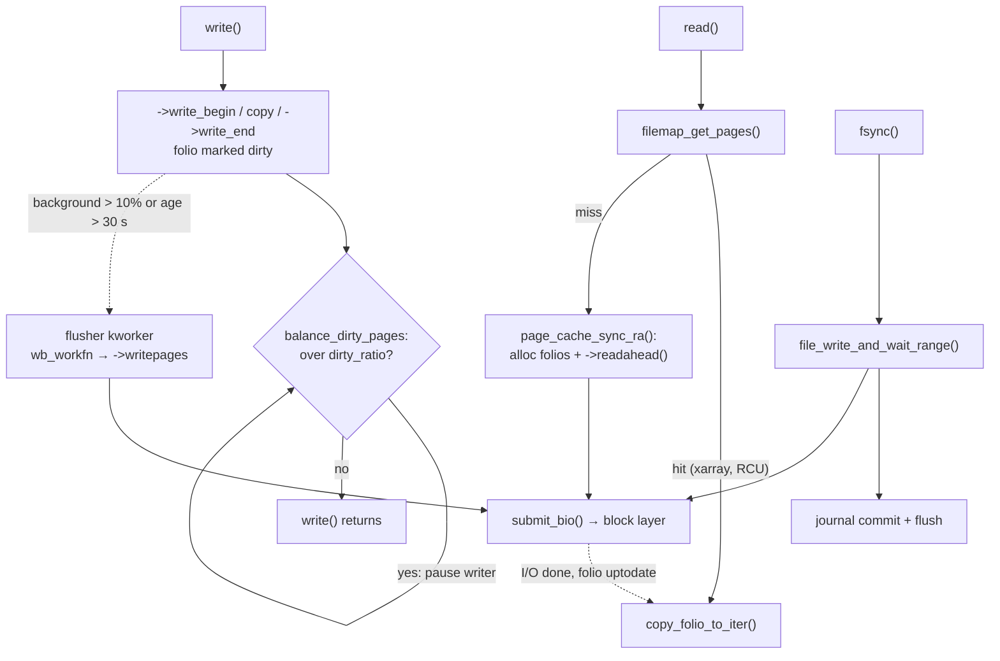

# 04 — Page cache and writeback

> Module 05 · File Systems & I/O · Linux v6.18.63 · Farsi: [`04-page-cache-writeback.fa.md`](04-page-cache-writeback.fa.md)
> Depends on Module 04 (folios, LRU, reclaim).

## 1. Summary

- Every buffered `read()` and `write()` goes through the **page cache**: per-inode RAM copies of file data, kept in `inode->i_mapping` (`struct address_space`) as an **xarray of folios** indexed by file offset / page size.
- A read that finds the folio is a memory copy (**hit**). A miss allocates folios, starts **readahead**, and sleeps until the block layer has filled them. A write only copies into the cache and marks the folio **dirty**; it returns before anything reaches the disk.
- **Writeback** later sends dirty folios to disk: in the background (flusher threads, `dirty_background_ratio`, `dirty_expire_centisecs`), by throttling writers (`balance_dirty_pages()`, `dirty_ratio`), or on demand (`fsync()`).

## 2. Detailed explanation

### 2.1 The question

Read a 256 MiB file twice. In Lab 05.2 the first read on the VM ran at 344 MiB/s and the second at about 1.6–3.3 GiB/s, 5–10× faster. No user-space cache was involved. The second `read()` never reached ext4's block-mapping code at all; it found every folio in the inode's xarray.

### 2.2 Read path

`ext4_file_read_iter()` → `generic_file_read_iter()` → `filemap_read()` (`mm/filemap.c` L2723). In a loop, until the user buffer is full:

1. `filemap_get_pages()` (L2622) asks `filemap_get_read_batch()` for the folios covering the requested range. That walk runs under `rcu_read_lock()` over `mapping->i_pages` and takes a reference with `folio_try_get()`. No lock is held for a hit.
2. Nothing found → `page_cache_sync_ra()`: **synchronous readahead**. It allocates folios for this range plus a readahead window, adds them to the xarray (tracepoint `filemap:mm_filemap_add_to_page_cache`), and calls the filesystem's `->readahead()` to build bios. The folios are locked and *not uptodate* until the I/O completes.
3. A found folio flagged `PG_readahead` → `filemap_readahead()` starts **asynchronous readahead** of the next window before the reader needs it. Sequential readers almost never wait.
4. Folio not uptodate → `filemap_update_page()` sleeps on the folio lock until the read I/O finishes.
5. `copy_folio_to_iter()` copies to user memory; `folio_mark_accessed()` tells the LRU (Module 04) this folio is in use.

The readahead window starts small and doubles on sequential hits up to `read_ahead_kb` of the device (`/sys/block/<dev>/queue/read_ahead_kb`). `posix_fadvise(POSIX_FADV_RANDOM)` disables it; `POSIX_FADV_SEQUENTIAL` doubles it.

### 2.3 Write path

`ext4_file_write_iter()` → `generic_perform_write()`: for each chunk, `->write_begin()` finds or creates the folio (reading it first if the write is partial and the folio is not uptodate), copies user data in, `->write_end()` marks it dirty and updates `i_size`. Then `balance_dirty_pages_ratelimited()` checks whether this task has dirtied too much.

With ext4's default **delayed allocation**, no disk blocks are even allocated at `write()` time. They are chosen at writeback, which gives better (contiguous) placement and is why a crash right after `write()` can lose the file's data completely (note 07).

### 2.4 Writeback: three triggers

| Trigger | Knob (default, `mm/page-writeback.c`) | Who writes | Writer blocked? |
|---|---|---|---|
| Too many dirty pages globally | `dirty_background_ratio` = 10 % of dirtyable memory | flusher kworker (`wb_workfn`) per BDI | no |
| Dirty for too long | `dirty_expire_centisecs` = 3000 (30 s), checked every `dirty_writeback_centisecs` = 500 (5 s) | flusher | no |
| Way too many dirty pages | `dirty_ratio` = 20 % | the writing task is **paused** in `balance_dirty_pages()` | yes, sleeps |
| Explicit | `fsync`, `fdatasync`, `sync_file_range`, `O_SYNC`, `O_DSYNC` | the caller | yes, until done |

The throttling is proportional, not a cliff: `balance_dirty_pages()` computes a pause for each writer from the dirty rate and the device's measured write bandwidth, so a fast producer is slowed to what the disk can absorb. Each backing device (BDI) gets a share of the global limit; `/sys/class/bdi/<maj:min>/max_ratio`, `max_bytes` and `strict_limit` cap one device without touching the global sysctls. Lab 05.3 uses exactly that on a loop device.

### 2.5 `fsync()` semantics

`fsync(fd)` → `vfs_fsync_range()` → `f_op->fsync` (ext4: `ext4_sync_file()`):

1. `file_write_and_wait_range()`: start writeback of the dirty folios and wait for it.
2. Commit the journal transaction that holds the inode's metadata (`ext4_fsync_journal()`).
3. `blkdev_issue_flush()` if needed: tell the device to empty its volatile write cache (a `REQ_PREFLUSH`).
4. `file_check_and_advance_wb_err()`: report writeback errors *once per open file* (`errseq_t f_wb_err`).

`fdatasync()` skips metadata that is not needed to read the data back (mtime), but still writes size changes. `O_DSYNC`/`O_SYNC` do the same on every `write()`.

## 3. Diagram



## 4. Worked example (real code)

The miss branch of `filemap_get_pages()`:

```c
// linux/mm/filemap.c · filemap_get_pages() · v6.18.63 · L2640-2659
	filemap_get_read_batch(mapping, index, last_index - 1, fbatch);
	if (!folio_batch_count(fbatch)) {
		DEFINE_READAHEAD(ractl, filp, &filp->f_ra, mapping, index);

		if (iocb->ki_flags & IOCB_NOIO)
			return -EAGAIN;
		if (iocb->ki_flags & IOCB_NOWAIT)
			flags = memalloc_noio_save();
		if (iocb->ki_flags & IOCB_DONTCACHE)
			ractl.dropbehind = 1;
		page_cache_sync_ra(&ractl, last_index - index);
		if (iocb->ki_flags & IOCB_NOWAIT)
			memalloc_noio_restore(flags);
		filemap_get_read_batch(mapping, index, last_index - 1, fbatch);
	}
	if (!folio_batch_count(fbatch)) {
		err = filemap_create_folio(iocb, fbatch);
		if (err == AOP_TRUNCATED_PAGE)
			goto retry;
		return err;
	}
```

- First lookup in the cache; an empty batch means a miss.
- `ractl` carries the per-file readahead state `filp->f_ra`, so readahead is adaptive *per open file*.
- `IOCB_NOIO`: the caller (e.g. a page-fault fast path) said "never start I/O", so give up.
- `IOCB_NOWAIT`: used by io_uring's first, non-blocking attempt (note 08). Allocations must not recurse into I/O.
- `IOCB_DONTCACHE` (`RWF_DONTCACHE`, merged for Linux 6.14, `VERSION-DEPENDENT`): read through the cache but drop the folios afterwards, i.e. uncached buffered I/O.
- `page_cache_sync_ra()` then a second lookup: the folios now exist (maybe still under I/O).
- If readahead could not allocate (memory pressure), `filemap_create_folio()` allocates a single folio and reads it with `->read_folio()`.

Real numbers from the VM (Lab 05.2, one 256 MiB file, evicted with `POSIX_FADV_DONTNEED` only for that file):

```text
$ ./pcache evict big.bin && ./pcache resident big.bin
resident: 0/65536 pages (0.0%), 0 KiB of 262144 KiB
$ ./pcache read big.bin          # cold: 1 sync + 34 async readaheads, 1049 folios added
read: 256 MiB in 0.745 s = 344 MiB/s
$ ./pcache read big.bin          # warm: 0 folios added
read: 256 MiB in 0.079 s = 3256 MiB/s
```

## 5. Edge cases & pitfalls

- **"`free` says no memory left."** Page cache is reclaimable. Look at `MemAvailable`, not `MemFree`.
- **`echo 3 > drop_caches` on a shared machine** throws away everyone's cache and causes an I/O storm. To make one file cold, use `posix_fadvise(DONTNEED)`, `dd iflag=nocache count=0`, or `vmtouch -e`. `DONTNEED` does not drop dirty or mapped pages.
- **Write errors are reported late.** A `write()` that succeeded can fail at writeback; the error appears at the next `fsync()` or `close()` (sometimes). If you never call `fsync()`, you never learn about it. After an error the dirty data may be dropped, so retrying `fsync()` does not mean the data is safe (the 2018 "fsyncgate" discussion around PostgreSQL).
- **Direct I/O (`O_DIRECT`)** bypasses the cache but must be aligned (logical block size) and still needs `fsync()`/`O_DSYNC` for metadata and the device cache.
- **mmap writes** dirty folios without any syscall; they are written back the same way and need `msync()`.
- The VM's virtual disk has its own host-side cache, so a "cold" read may be faster than real hardware.

## 6. Exam-style key points

- Page cache = per-inode `address_space`, xarray of folios; lookups are RCU, lock-free on hit.
- Miss → sync readahead; `PG_readahead` marker → async readahead of the next window.
- `write()` = copy + mark dirty; blocks allocated later (delalloc).
- Background writeback at 10 % / 30 s, writer throttling at 20 % in `balance_dirty_pages()`.
- `fsync` = write + wait + journal commit + device flush + error report.
- Evict one file with `POSIX_FADV_DONTNEED`, never global `drop_caches` in a loop.

## 7. Links

- Lesson: [`../lesson.en.md`](../lesson.en.md) §4.3 · Walkthrough: [`../kernel-walkthrough.en.md`](../kernel-walkthrough.en.md) §4
- Labs: [`../labs/02-page-cache/`](../labs/02-page-cache/), [`../labs/03-fsync-writeback/`](../labs/03-fsync-writeback/)
- Quiz: [`../quiz.en.md`](../quiz.en.md) Q4, Q13
- Previous: [`03-fd-tables.en.md`](03-fd-tables.en.md) · Next: [`05-block-layer-blk-mq.en.md`](05-block-layer-blk-mq.en.md)
