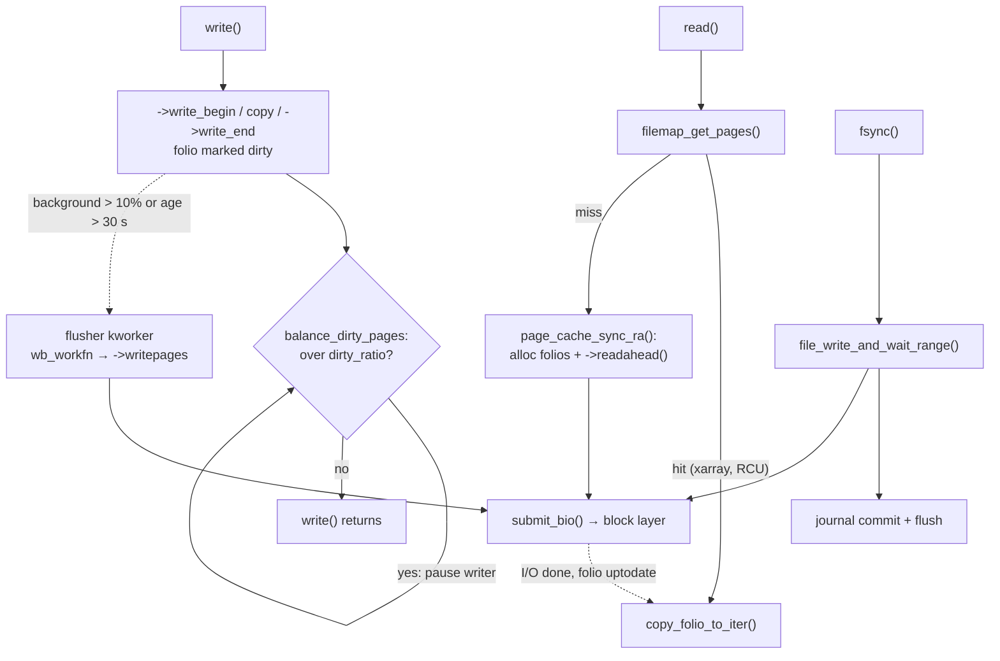

<div dir="rtl">

# ۰۴ — page cache و writeback

> ماژول ۰۵ · فایل‌سیستم‌ها و I/O · Linux v6.18.63 · نسخهٔ انگلیسی: [`04-page-cache-writeback.en.md`](04-page-cache-writeback.en.md)
> پیش‌نیاز: ماژول ۰۴ (folioها، LRU، reclaim).

## ۱. خلاصه

- هر `read()` و `write()` بافرشده از **page cache** می‌گذرد: کپی داده‌های فایل در RAM، جدا برای هر inode، که در `inode->i_mapping` (`struct address_space`) به‌شکل یک **xarray از folioها** نگه داشته می‌شود و اندیسش آفست فایل تقسیم بر اندازهٔ صفحه است.
- خواندنی که folio را پیدا کند فقط یک کپی حافظه است (**hit**). در حالت miss، folio تخصیص داده می‌شود، **readahead** شروع می‌شود و فرایند می‌خوابد تا لایهٔ بلاک folioها را پر کند. نوشتن فقط داده را در cache کپی می‌کند و folio را **dirty** علامت می‌زند؛ قبل از آنکه چیزی به دیسک برسد برمی‌گردد.
- **writeback** بعداً folioهای dirty را به دیسک می‌فرستد: در پس‌زمینه (نخ‌های flusher، `dirty_background_ratio`، `dirty_expire_centisecs`)، با کندکردن نویسنده‌ها (`balance_dirty_pages()`، `dirty_ratio`)، یا به درخواست (`fsync()`).

## ۲. توضیح کامل

### ۲.۱ پرسش

یک فایل 256 MiB را دو بار بخوانید. در آزمایش ۰۵.۲ روی VM، خواندن اول با سرعت 344 MiB/s انجام شد و دومی با حدود 1.6 تا 3.3 GiB/s، یعنی ۵ تا ۱۰ برابر سریع‌تر. هیچ cache‌ای در فضای کاربر در کار نبود. `read()` دوم اصلاً به کد نگاشت بلاک ext4 نرسید؛ همهٔ folioها را در xarray همان inode پیدا کرد.

### ۲.۲ مسیر خواندن

`ext4_file_read_iter()` ← `generic_file_read_iter()` ← `filemap_read()` (`mm/filemap.c` L2723). در یک حلقه، تا وقتی بافر کاربر پر شود:

۱. `filemap_get_pages()` (L2622) از `filemap_get_read_batch()` folioهای بازهٔ درخواستی را می‌خواهد. این پیمایش زیر `rcu_read_lock()` روی `mapping->i_pages` انجام می‌شود و با `folio_try_get()` ارجاع می‌گیرد. برای hit هیچ قفلی گرفته نمی‌شود.
۲. چیزی پیدا نشد ← `page_cache_sync_ra()`: **readahead همگام**. برای این بازه به‌اضافهٔ یک پنجرهٔ readahead، folio تخصیص می‌دهد، آن‌ها را به xarray اضافه می‌کند (tracepoint `filemap:mm_filemap_add_to_page_cache`) و `->readahead()` فایل‌سیستم را صدا می‌زند تا bio بسازد. folioها تا پایان I/O قفل‌اند و *uptodate نیستند*.
۳. folio پیداشده پرچم `PG_readahead` دارد ← `filemap_readahead()` **readahead ناهمگام** پنجرهٔ بعدی را پیش از آنکه خواننده لازمش داشته باشد شروع می‌کند. خواننده‌های ترتیبی تقریباً هیچ‌وقت منتظر نمی‌مانند.
۴. folio هنوز uptodate نیست ← `filemap_update_page()` روی قفل folio می‌خوابد تا I/O خواندن تمام شود.
۵. `copy_folio_to_iter()` داده را به حافظهٔ کاربر کپی می‌کند؛ `folio_mark_accessed()` به LRU (ماژول ۰۴) می‌گوید این folio در حال استفاده است.

پنجرهٔ readahead کوچک شروع می‌شود و با hitهای ترتیبی دو برابر می‌شود تا سقف `read_ahead_kb` دستگاه (`/sys/block/<dev>/queue/read_ahead_kb`). `posix_fadvise(POSIX_FADV_RANDOM)` آن را خاموش می‌کند و `POSIX_FADV_SEQUENTIAL` دو برابرش می‌کند.

### ۲.۳ مسیر نوشتن

`ext4_file_write_iter()` ← `generic_perform_write()`: برای هر تکه، `->write_begin()` folio را پیدا می‌کند یا می‌سازد (اگر نوشتن جزئی باشد و folio uptodate نباشد، اول آن را می‌خواند)، دادهٔ کاربر کپی می‌شود و `->write_end()` آن را dirty علامت می‌زند و `i_size` را به‌روز می‌کند. سپس `balance_dirty_pages_ratelimited()` بررسی می‌کند که آیا این task بیش از حد dirty کرده است یا نه.

با **delayed allocation** که پیش‌فرض ext4 است، هنگام `write()` حتی بلاک دیسکی هم تخصیص داده نمی‌شود. بلاک‌ها هنگام writeback انتخاب می‌شوند؛ این جای‌گذاری بهتر (پیوسته) می‌دهد و دلیلش هم همین است که crash درست بعد از `write()` می‌تواند دادهٔ فایل را کاملاً از بین ببرد (یادداشت ۰۷).

### ۲.۴ writeback: سه محرک

| محرک | تنظیم (پیش‌فرض، `mm/page-writeback.c`) | چه کسی می‌نویسد | نویسنده مسدود می‌شود؟ |
|---|---|---|---|
| صفحه‌های dirty زیاد در کل سیستم | `dirty_background_ratio` = 10 % از حافظهٔ قابل‌dirty | kworker از نوع flusher (`wb_workfn`) برای هر BDI | نه |
| dirty برای مدت طولانی | `dirty_expire_centisecs` = 3000 (30 s)، هر `dirty_writeback_centisecs` = 500 (5 s) بررسی می‌شود | flusher | نه |
| صفحه‌های dirty خیلی زیاد | `dirty_ratio` = 20 % | خودِ task نویسنده در `balance_dirty_pages()` **مکث** می‌کند | بله، می‌خوابد |
| صریح | `fsync`، `fdatasync`، `sync_file_range`، `O_SYNC`، `O_DSYNC` | فراخواننده | بله، تا پایان کار |

کندسازی تدریجی است، نه یک‌باره: `balance_dirty_pages()` برای هر نویسنده از روی نرخ dirtyشدن و پهنای باند نوشتن اندازه‌گیری‌شدهٔ دستگاه یک مکث حساب می‌کند، تا تولیدکنندهٔ سریع به اندازهٔ توان دیسک کند شود. هر دستگاه پشتیبان (BDI) سهمی از سقف کلی دارد؛ `/sys/class/bdi/<maj:min>/max_ratio`، `max_bytes` و `strict_limit` بدون دست زدن به sysctlهای کلی، یک دستگاه را محدود می‌کنند. آزمایش ۰۵.۳ دقیقاً همین را روی یک loop device به کار می‌برد.

### ۲.۵ معنای `fsync()`

`fsync(fd)` ← `vfs_fsync_range()` ← `f_op->fsync` (در ext4: `ext4_sync_file()`):

۱. `file_write_and_wait_range()`: writeback folioهای dirty را شروع می‌کند و منتظر پایانش می‌ماند.
۲. تراکنش journal که metadata این inode را دارد commit می‌شود (`ext4_fsync_journal()`).
۳. در صورت نیاز `blkdev_issue_flush()`: به دستگاه گفته می‌شود write cache فرّارش را خالی کند (یک `REQ_PREFLUSH`).
۴. `file_check_and_advance_wb_err()`: خطاهای writeback را *برای هر فایل باز یک بار* گزارش می‌کند (`errseq_t f_wb_err`).

`fdatasync()` از metadataای که برای خواندن دوبارهٔ داده لازم نیست (mtime) می‌گذرد، ولی تغییر اندازه را همچنان می‌نویسد. `O_DSYNC`/`O_SYNC` همین کار را در هر `write()` انجام می‌دهند.

## ۳. نمودار

</div>



<div dir="rtl">

## ۴. مثال عملی (کد واقعی)

شاخهٔ miss در `filemap_get_pages()`:

</div>

```c
// linux/mm/filemap.c · filemap_get_pages() · v6.18.63 · L2640-2659
	filemap_get_read_batch(mapping, index, last_index - 1, fbatch);
	if (!folio_batch_count(fbatch)) {
		DEFINE_READAHEAD(ractl, filp, &filp->f_ra, mapping, index);

		if (iocb->ki_flags & IOCB_NOIO)
			return -EAGAIN;
		if (iocb->ki_flags & IOCB_NOWAIT)
			flags = memalloc_noio_save();
		if (iocb->ki_flags & IOCB_DONTCACHE)
			ractl.dropbehind = 1;
		page_cache_sync_ra(&ractl, last_index - index);
		if (iocb->ki_flags & IOCB_NOWAIT)
			memalloc_noio_restore(flags);
		filemap_get_read_batch(mapping, index, last_index - 1, fbatch);
	}
	if (!folio_batch_count(fbatch)) {
		err = filemap_create_folio(iocb, fbatch);
		if (err == AOP_TRUNCATED_PAGE)
			goto retry;
		return err;
	}
```

<div dir="rtl">

- اولین جستجو در cache؛ batch خالی یعنی miss.
- `ractl` وضعیت readahead هر فایل یعنی `filp->f_ra` را با خود دارد، پس readahead *برای هر فایل باز* جداگانه تطبیق پیدا می‌کند.
- `IOCB_NOIO`: فراخواننده (مثلاً مسیر سریع page fault) گفته «هرگز I/O شروع نکن»، پس کار رها می‌شود.
- `IOCB_NOWAIT`: در تلاش اول و غیرمسدودکنندهٔ io_uring به کار می‌رود (یادداشت ۰۸). تخصیص‌ها نباید دوباره به I/O برسند.
- `IOCB_DONTCACHE` (`RWF_DONTCACHE`، ادغام‌شده در Linux 6.14، `VERSION-DEPENDENT`): از مسیر cache بخوان ولی بعد folioها را دور بینداز؛ یعنی I/O بافرشدهٔ بدون cache.
- `page_cache_sync_ra()` و بعد جستجوی دوم: حالا folioها وجود دارند (شاید هنوز زیر I/O باشند).
- اگر readahead نتوانست تخصیص دهد (فشار حافظه)، `filemap_create_folio()` یک folio تکی تخصیص می‌دهد و با `->read_folio()` آن را می‌خواند.

عددهای واقعی از VM (آزمایش ۰۵.۲، یک فایل 256 MiB که فقط خودش با `POSIX_FADV_DONTNEED` از cache بیرون شده):

</div>

```text
$ ./pcache evict big.bin && ./pcache resident big.bin
resident: 0/65536 pages (0.0%), 0 KiB of 262144 KiB
$ ./pcache read big.bin          # cold: 1 sync + 34 async readaheads, 1049 folios added
read: 256 MiB in 0.745 s = 344 MiB/s
$ ./pcache read big.bin          # warm: 0 folios added
read: 256 MiB in 0.079 s = 3256 MiB/s
```

<div dir="rtl">

## ۵. حالت‌های خاص و دام‌ها

- **«`free` می‌گوید حافظه تمام شده.»** page cache قابل reclaim است. به `MemAvailable` نگاه کنید، نه `MemFree`.
- **`echo 3 > drop_caches` روی ماشین مشترک** cache همه را دور می‌ریزد و طوفان I/O راه می‌اندازد. برای سردکردن یک فایل از `posix_fadvise(DONTNEED)`، `dd iflag=nocache count=0` یا `vmtouch -e` استفاده کنید. `DONTNEED` صفحه‌های dirty یا mapشده را دور نمی‌ریزد.
- **خطاهای نوشتن دیر گزارش می‌شوند.** `write()`ای که موفق بوده ممکن است در writeback شکست بخورد؛ خطا در `fsync()` بعدی یا (گاهی) در `close()` ظاهر می‌شود. اگر هیچ‌وقت `fsync()` نزنید، هرگز از آن باخبر نمی‌شوید. بعد از خطا ممکن است دادهٔ dirty دور ریخته شود، پس تکرار `fsync()` به معنای امن‌بودن داده نیست (بحث «fsyncgate» در سال ۲۰۱۸ دربارهٔ PostgreSQL).
- **Direct I/O (`O_DIRECT`)** از cache عبور نمی‌کند ولی باید هم‌تراز (به اندازهٔ logical block size) باشد و برای metadata و cache دستگاه همچنان به `fsync()`/`O_DSYNC` نیاز دارد.
- **نوشتن از طریق mmap** بدون هیچ syscallی folioها را dirty می‌کند؛ همان‌طور writeback می‌شوند و به `msync()` نیاز دارند.
- دیسک مجازی VM در سمت میزبان cache خودش را دارد، پس خواندن «سرد» ممکن است از سخت‌افزار واقعی سریع‌تر باشد.

## ۶. نکته‌های امتحانی

- page cache = `address_space` هر inode، یک xarray از folioها؛ جستجو با RCU و در hit بدون قفل.
- miss ← readahead همگام؛ نشانگر `PG_readahead` ← readahead ناهمگام پنجرهٔ بعدی.
- `write()` = کپی + علامت dirty؛ بلاک‌ها بعداً تخصیص داده می‌شوند (delalloc).
- writeback پس‌زمینه در ۱۰٪ / ۳۰ ثانیه، کندسازی نویسنده در ۲۰٪ داخل `balance_dirty_pages()`.
- `fsync` = نوشتن + انتظار + commit journal + flush دستگاه + گزارش خطا.
- یک فایل را با `POSIX_FADV_DONTNEED` بیرون کنید، هرگز `drop_caches` سراسری در یک حلقه.

## ۷. پیوندها

- درس: [`../lesson.fa.md`](../lesson.fa.md) §۴.۳ · بررسی کد کرنل: [`../kernel-walkthrough.fa.md`](../kernel-walkthrough.fa.md) §۴
- آزمایش‌ها: [`../labs/02-page-cache/`](../labs/02-page-cache/)، [`../labs/03-fsync-writeback/`](../labs/03-fsync-writeback/)
- آزمونک: [`../quiz.fa.md`](../quiz.fa.md) پرسش‌های ۴ و ۱۳
- قبلی: [`03-fd-tables.fa.md`](03-fd-tables.fa.md) · بعدی: [`05-block-layer-blk-mq.fa.md`](05-block-layer-blk-mq.fa.md)

</div>
