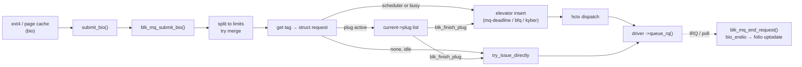

# 05 — The block layer and `blk-mq`

> Module 05 · File Systems & I/O · Linux v6.18.63 · Farsi: [`05-block-layer-blk-mq.fa.md`](05-block-layer-blk-mq.fa.md)

## 1. Summary

- Filesystems describe I/O as a **`struct bio`**: "read/write these memory segments at this sector of this block device". `submit_bio()` hands it to the block layer.
- **blk-mq** (multi-queue block layer) turns bios into **`struct request`s** using per-CPU *software* queues and per-device *hardware* queues (`blk_mq_hw_ctx`), with a preallocated **tag** per in-flight request. Merging, **plugging** and an optional **I/O scheduler** sit in between.
- The driver gets requests through `blk_mq_ops->queue_rq()` and reports completion with `blk_mq_end_request()`, usually from an interrupt. Since Linux 5.0 this is the *only* request path; the legacy single-queue path is gone.

## 2. Detailed explanation

### 2.1 The question

An NVMe SSD can do over a million 4 KiB IOPS across 64 hardware queues. The old block layer had one request queue with one lock per device, and that lock became the bottleneck at a few hundred thousand IOPS. blk-mq (Linux 3.13, Bjørling, Axboe et al., SYSTOR 2013) removed the shared lock by giving each CPU its own submission context and mapping CPUs onto the device's hardware queues.

### 2.2 bio vs request

| | `struct bio` | `struct request` |
|---|---|---|
| Built by | filesystem / page cache / direct I/O | blk-mq, from one or more bios |
| Describes | a contiguous range of sectors + a vector of memory pages (`bio_vec`) | what the driver will send as one command |
| Limits | none, can be huge | split to the device's `max_sectors_kb`, `max_segments` |
| Identity | pointer | a **tag** (index into a preallocated array, also the NVMe command ID) |

`__bio_split_to_limits()` cuts bios that are too big; `blk_mq_attempt_bio_merge()` glues a bio onto an adjacent request (front or back merge) so two 4 KiB writes to neighbouring sectors become one 8 KiB command.

### 2.3 Queues

```
CPU 0 ─┐                       ┌─ hctx 0 ─ NVMe SQ/CQ pair 0
CPU 1 ─┤ software ctx (per CPU)├─ hctx 1 ─ NVMe SQ/CQ pair 1
 ...   ┘  (+ optional elevator)└─ ...
```

- **Software staging queues** (`blk_mq_ctx`, one per CPU): where requests wait if they cannot go straight to the device.
- **Hardware dispatch queues** (`blk_mq_hw_ctx`, one per device queue): a virtio disk or a loop device usually has one, an NVMe device one per CPU (or fewer).
- **Tags** (`blk_mq_tags`): a bitmap allocator sized to the device's queue depth (`nr_requests`). No free tag → the submitter sleeps. This is the natural back-pressure.

### 2.4 Plugging

A task that is about to issue many I/Os calls `blk_start_plug()`. Requests are collected on the on-stack `current->plug` list instead of being dispatched one at a time, and `blk_finish_plug()` (or the task going to sleep) flushes the whole batch. Batching lets adjacent requests merge and amortizes the driver's doorbell write. Readahead, writeback and io_uring submission all plug.

### 2.5 Two ways into the driver

At the end of `blk_mq_submit_bio()`:

- If there is an **I/O scheduler** (`RQF_USE_SCHED`) or the hardware queue is busy, the request is **inserted** (`blk_mq_insert_request()`) and the queue is run, possibly asynchronously from a kworker.
- Otherwise, `blk_mq_try_issue_directly()` calls the driver's `queue_rq()` immediately, on the submitting CPU. On fast NVMe with scheduler `none`, a read can go from `submit_bio()` to the doorbell without touching any shared lock.

Completion: the device raises an interrupt (or is **polled**, `REQ_POLLED` / io_uring `IORING_SETUP_IOPOLL`), the driver calls `blk_mq_end_request()`, every bio's `bi_end_io` runs, and the page cache marks the folios uptodate and wakes the reader.

## 3. Diagram



## 4. Worked example (real code)

The tail of `blk_mq_submit_bio()`, where the path is chosen:

```c
// linux/block/blk-mq.c · blk_mq_submit_bio() · v6.18.63 · L3236-3254
	if (op_is_flush(bio->bi_opf) && blk_insert_flush(rq))
		return;

	if (plug) {
		blk_add_rq_to_plug(plug, rq);
		return;
	}

	hctx = rq->mq_hctx;
	if ((rq->rq_flags & RQF_USE_SCHED) ||
	    (hctx->dispatch_busy && (q->nr_hw_queues == 1 || !is_sync))) {
		blk_mq_insert_request(rq, 0);
		blk_mq_run_hw_queue(hctx, true);
	} else {
		blk_mq_run_dispatch_ops(q, blk_mq_try_issue_directly(hctx, rq));
	}
	return;
```

- `op_is_flush()`: `REQ_PREFLUSH`/`REQ_FUA` requests (from `fsync`, journal commits) go to the flush state machine, which sequences "flush cache → write → flush" correctly.
- `plug`: under a plug the request just goes onto the task's list; dispatch happens later in a batch.
- `RQF_USE_SCHED`: set when the queue has an elevator. The scheduler gets to reorder, so the request must be inserted, not issued.
- `dispatch_busy`: the driver recently returned "busy"; insert instead of hammering it. On a single-queue device or for async I/O it is better to queue.
- Otherwise issue directly on this CPU: the fast path for NVMe with `none`.

The loop driver used in Labs 05.4 and 05.6 is a blk-mq driver too:

```c
// linux/drivers/block/loop.c · loop_mq_ops · v6.18.63 · L1994-1997
static const struct blk_mq_ops loop_mq_ops = {
	.queue_rq       = loop_queue_rq,
	.complete	= lo_complete_rq,
};
```

`loop_queue_rq()` calls `blk_mq_start_request()` and queues the work to a kworker that turns the request into `read_iter`/`write_iter` on the backing file. So a loop device is "a block device whose hardware is a file".

On the VM:

```bash
cat /sys/block/sda/queue/{scheduler,nr_requests,max_sectors_kb,rotational}
ls /sys/block/sda/mq/          # one directory per hardware queue
```

```text
$ cat /sys/block/sda/queue/{scheduler,nr_requests,max_sectors_kb,rotational}
none [mq-deadline]
64
4096
1
$ ls /sys/block/sda/mq/
0
$ cat /sys/block/sda/device/model
VBOX HARDDISK
```

Real output from `aos-lab` (2026-11-15). The VirtualBox SATA disk has **one** hardware queue (`mq/0`), 64 tags, and reports itself as rotational, so `elevator_set_default()` picked `mq-deadline` (note 06).

## 5. Edge cases & pitfalls

- **`iostat` `%util` lies on blk-mq devices with many queues.** It measures "time with at least one request in flight", so 100 % on an NVMe device can still mean plenty of spare capacity. Look at `r_await`/`w_await` and `aqu-sz`.
- **Tag exhaustion looks like latency.** If `nr_requests` tags are all in flight, submitters sleep in `blk_mq_get_tag()`. bpftrace on `block:block_rq_issue`/`block_rq_complete` shows the queue depth.
- **Merging needs adjacency and time.** Without plugging, two sequential 4 KiB writes may be dispatched before they could merge.
- **Flushes are expensive** on devices with a volatile cache. `fsync()` storms show up as `FLUSH` requests in `blktrace` (`F` in the RWBS column).
- **Stacked devices** (dm, md, loop) have their own queue and limits; `dm-flakey` in Lab 05.6 is a bio-based device-mapper target sitting on the loop device.

## 6. Exam-style key points

- bio (fs-level, arbitrary size) → request (driver-level, tagged, split to limits).
- blk-mq: per-CPU software queues → per-device hardware queues; tags = in-flight slots.
- Plugging batches submissions per task; merge happens at submit and in the scheduler.
- With an elevator → insert + run queue; with `none` and idle hw queue → issue directly.
- Completion via IRQ or polling → `blk_mq_end_request()` → `bio_endio()`.
- Legacy single-queue path removed in 5.0; all drivers are blk-mq or bio-based.

## 7. Links

- Lesson: [`../lesson.en.md`](../lesson.en.md) §4.4 · Walkthrough: [`../kernel-walkthrough.en.md`](../kernel-walkthrough.en.md) §5
- Labs: [`../labs/04-io-schedulers/`](../labs/04-io-schedulers/), [`../labs/01-read-call-chain/`](../labs/01-read-call-chain/) (step 3, bio count)
- Quiz: [`../quiz.en.md`](../quiz.en.md) Q14
- Previous: [`04-page-cache-writeback.en.md`](04-page-cache-writeback.en.md) · Next: [`06-io-schedulers.en.md`](06-io-schedulers.en.md)
