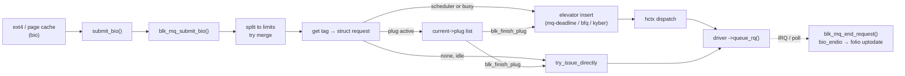

<div dir="rtl">

# ۰۵ — لایهٔ بلاک و `blk-mq`

> ماژول ۰۵ · فایل‌سیستم‌ها و I/O · Linux v6.18.63 · نسخهٔ انگلیسی: [`05-block-layer-blk-mq.en.md`](05-block-layer-blk-mq.en.md)

## ۱. خلاصه

- فایل‌سیستم‌ها I/O را به‌صورت یک **`struct bio`** توصیف می‌کنند: «این قطعه‌های حافظه را در این sector از این block device بخوان/بنویس». `submit_bio()` آن را به لایهٔ بلاک می‌دهد.
- **blk-mq** (لایهٔ بلاک چندصفی) bioها را به **`struct request`** تبدیل می‌کند؛ با صف‌های *نرم‌افزاری* برای هر CPU و صف‌های *سخت‌افزاری* برای هر دستگاه (`blk_mq_hw_ctx`)، و یک **tag** ازپیش‌تخصیص‌یافته برای هر request در جریان. merge، **plugging** و یک **I/O scheduler** اختیاری بین این دو قرار دارند.
- درایور requestها را از طریق `blk_mq_ops->queue_rq()` می‌گیرد و پایان کار را با `blk_mq_end_request()` گزارش می‌کند، معمولاً از داخل یک وقفه. از Linux 5.0 این *تنها* مسیر request است؛ مسیر قدیمی تک‌صفی حذف شده است.

## ۲. توضیح کامل

### ۲.۱ پرسش

یک SSD از نوع NVMe می‌تواند روی ۶۴ صف سخت‌افزاری بیش از یک میلیون IOPS با اندازهٔ 4 KiB انجام دهد. لایهٔ بلاک قدیمی برای هر دستگاه یک request queue با یک قفل داشت و آن قفل در چند صد هزار IOPS گلوگاه می‌شد. blk-mq (Linux 3.13، Bjørling، Axboe و همکاران، SYSTOR 2013) قفل مشترک را حذف کرد: به هر CPU زمینهٔ ارسال خودش را داد و CPUها را روی صف‌های سخت‌افزاری دستگاه نگاشت کرد.

### ۲.۲ bio در برابر request

| | `struct bio` | `struct request` |
|---|---|---|
| سازنده | فایل‌سیستم / page cache / direct I/O | blk-mq، از یک یا چند bio |
| چه چیزی را توصیف می‌کند | یک بازهٔ پیوسته از sectorها + برداری از صفحه‌های حافظه (`bio_vec`) | آنچه درایور به‌صورت یک فرمان می‌فرستد |
| محدودیت | ندارد، می‌تواند خیلی بزرگ باشد | به اندازهٔ `max_sectors_kb` و `max_segments` دستگاه شکسته می‌شود |
| شناسه | اشاره‌گر | یک **tag** (اندیس در آرایه‌ای ازپیش‌تخصیص‌یافته، که شناسهٔ فرمان NVMe هم هست) |

`__bio_split_to_limits()` bioهای خیلی بزرگ را می‌شکند؛ `blk_mq_attempt_bio_merge()` یک bio را به request مجاور می‌چسباند (front merge یا back merge)، تا دو نوشتن 4 KiB روی sectorهای کنار هم یک فرمان 8 KiB شوند.

### ۲.۳ صف‌ها

</div>

```
CPU 0 ─┐                       ┌─ hctx 0 ─ NVMe SQ/CQ pair 0
CPU 1 ─┤ software ctx (per CPU)├─ hctx 1 ─ NVMe SQ/CQ pair 1
 ...   ┘  (+ optional elevator)└─ ...
```

<div dir="rtl">

- **صف‌های میانی نرم‌افزاری** (`blk_mq_ctx`، یکی برای هر CPU): جایی که requestها اگر نتوانند مستقیم به دستگاه بروند منتظر می‌مانند.
- **صف‌های ارسال سخت‌افزاری** (`blk_mq_hw_ctx`، یکی برای هر صف دستگاه): دیسک virtio یا loop device معمولاً یکی دارد و دستگاه NVMe یکی برای هر CPU (یا کمتر).
- **tagها** (`blk_mq_tags`): یک تخصیص‌دهندهٔ bitmap به اندازهٔ عمق صف دستگاه (`nr_requests`). tag آزاد نباشد ← فرستنده می‌خوابد. این همان back-pressure طبیعی است.

### ۲.۴ plugging

taskی که می‌خواهد چندین I/O بفرستد `blk_start_plug()` را صدا می‌زند. requestها به‌جای ارسال تک‌تک، روی لیست `current->plug` (روی پشته) جمع می‌شوند و `blk_finish_plug()` (یا به خواب رفتن task) کل دسته را یک‌جا خالی می‌کند. دسته‌کردن اجازه می‌دهد requestهای مجاور merge شوند و هزینهٔ نوشتن doorbell درایور سرشکن شود. readahead، writeback و ارسال io_uring همه plug می‌کنند.

### ۲.۵ دو راه ورود به درایور

در انتهای `blk_mq_submit_bio()`:

- اگر **I/O scheduler** وجود داشته باشد (`RQF_USE_SCHED`) یا صف سخت‌افزاری مشغول باشد، request **درج** می‌شود (`blk_mq_insert_request()`) و صف اجرا می‌شود، شاید به‌صورت ناهمگام از یک kworker.
- در غیر این صورت، `blk_mq_try_issue_directly()` همان لحظه و روی همان CPU فرستنده `queue_rq()` درایور را صدا می‌زند. روی NVMe سریع با scheduler از نوع `none`، یک خواندن می‌تواند از `submit_bio()` تا doorbell برود بدون اینکه به هیچ قفل مشترکی دست بزند.

پایان کار: دستگاه یک وقفه می‌فرستد (یا **poll** می‌شود: `REQ_POLLED` / در io_uring `IORING_SETUP_IOPOLL`)، درایور `blk_mq_end_request()` را صدا می‌زند، `bi_end_io` هر bio اجرا می‌شود و page cache folioها را uptodate علامت می‌زند و خواننده را بیدار می‌کند.

## ۳. نمودار

</div>



<div dir="rtl">

## ۴. مثال عملی (کد واقعی)

انتهای `blk_mq_submit_bio()`، جایی که مسیر انتخاب می‌شود:

</div>

```c
// linux/block/blk-mq.c · blk_mq_submit_bio() · v6.18.63 · L3236-3254
	if (op_is_flush(bio->bi_opf) && blk_insert_flush(rq))
		return;

	if (plug) {
		blk_add_rq_to_plug(plug, rq);
		return;
	}

	hctx = rq->mq_hctx;
	if ((rq->rq_flags & RQF_USE_SCHED) ||
	    (hctx->dispatch_busy && (q->nr_hw_queues == 1 || !is_sync))) {
		blk_mq_insert_request(rq, 0);
		blk_mq_run_hw_queue(hctx, true);
	} else {
		blk_mq_run_dispatch_ops(q, blk_mq_try_issue_directly(hctx, rq));
	}
	return;
```

<div dir="rtl">

- `op_is_flush()`: requestهای `REQ_PREFLUSH`/`REQ_FUA` (از `fsync` و commit‌های journal) به ماشین حالت flush می‌روند که ترتیب «flush cache ← نوشتن ← flush» را درست اجرا می‌کند.
- `plug`: زیر plug، request فقط به لیست task اضافه می‌شود؛ ارسال بعداً به‌صورت دسته‌ای انجام می‌شود.
- `RQF_USE_SCHED`: وقتی صف elevator دارد تنظیم می‌شود. scheduler باید بتواند ترتیب را عوض کند، پس request باید درج شود، نه مستقیم ارسال.
- `dispatch_busy`: درایور اخیراً «busy» برگردانده؛ به‌جای فشار آوردن به آن، درج کن. روی دستگاه تک‌صفی یا برای I/O ناهمگام، صف‌کردن بهتر است.
- در غیر این صورت مستقیم روی همین CPU ارسال کن: مسیر سریع برای NVMe با `none`.

درایور loop که در آزمایش‌های ۰۵.۴ و ۰۵.۶ استفاده می‌شود هم یک درایور blk-mq است:

</div>

```c
// linux/drivers/block/loop.c · loop_mq_ops · v6.18.63 · L1994-1997
static const struct blk_mq_ops loop_mq_ops = {
	.queue_rq       = loop_queue_rq,
	.complete	= lo_complete_rq,
};
```

<div dir="rtl">

`loop_queue_rq()` تابع `blk_mq_start_request()` را صدا می‌زند و کار را به یک kworker می‌سپارد که request را به `read_iter`/`write_iter` روی فایل پشتیبان تبدیل می‌کند. پس loop device یعنی «block deviceای که سخت‌افزارش یک فایل است».

روی VM:

</div>

```bash
cat /sys/block/sda/queue/{scheduler,nr_requests,max_sectors_kb,rotational}
ls /sys/block/sda/mq/          # one directory per hardware queue
```

```text
$ cat /sys/block/sda/queue/{scheduler,nr_requests,max_sectors_kb,rotational}
none [mq-deadline]
64
4096
1
$ ls /sys/block/sda/mq/
0
$ cat /sys/block/sda/device/model
VBOX HARDDISK
```

<div dir="rtl">

خروجی واقعی از `aos-lab` (۲۰۲۶-۱۱-۱۵). دیسک SATA در VirtualBox فقط **یک** صف سخت‌افزاری (`mq/0`) و ۶۴ tag دارد و خودش را rotational معرفی می‌کند؛ برای همین `elevator_set_default()` زمان‌بند `mq-deadline` را انتخاب کرده است (یادداشت ۰۶).

</div>

<div dir="rtl">

## ۵. حالت‌های خاص و دام‌ها

- **`%util` در `iostat` روی دستگاه‌های blk-mq با صف‌های زیاد گمراه‌کننده است.** این عدد «زمانی که حداقل یک request در جریان بوده» را می‌سنجد، پس ۱۰۰٪ روی یک دستگاه NVMe هنوز می‌تواند به معنای ظرفیت خالی فراوان باشد. به `r_await`/`w_await` و `aqu-sz` نگاه کنید.
- **تمام‌شدن tagها شبیه تأخیر به نظر می‌رسد.** اگر همهٔ `nr_requests` tag در جریان باشند، فرستنده‌ها در `blk_mq_get_tag()` می‌خوابند. bpftrace روی `block:block_rq_issue`/`block_rq_complete` عمق صف را نشان می‌دهد.
- **merge به مجاورت و زمان نیاز دارد.** بدون plugging، دو نوشتن ترتیبی 4 KiB ممکن است پیش از آنکه بتوانند merge شوند ارسال شوند.
- **flushها گران‌اند** روی دستگاه‌هایی که cache فرّار دارند. طوفان `fsync()` در `blktrace` به‌صورت requestهای `FLUSH` دیده می‌شود (`F` در ستون RWBS).
- **دستگاه‌های پشته‌ای** (dm، md، loop) صف و محدودیت‌های خودشان را دارند؛ `dm-flakey` در آزمایش ۰۵.۶ یک target از نوع device-mapper و bio-based است که روی loop device نشسته.

## ۶. نکته‌های امتحانی

- bio (سطح فایل‌سیستم، اندازهٔ دلخواه) ← request (سطح درایور، با tag، شکسته به اندازهٔ محدودیت‌ها).
- blk-mq: صف‌های نرم‌افزاری برای هر CPU ← صف‌های سخت‌افزاری برای هر دستگاه؛ tagها = جایگاه‌های در جریان.
- plugging ارسال‌ها را برای هر task دسته می‌کند؛ merge هنگام ارسال و در scheduler رخ می‌دهد.
- با elevator ← درج + اجرای صف؛ با `none` و صف سخت‌افزاری بیکار ← ارسال مستقیم.
- پایان کار با IRQ یا polling ← `blk_mq_end_request()` ← `bio_endio()`.
- مسیر قدیمی تک‌صفی در 5.0 حذف شد؛ همهٔ درایورها یا blk-mq هستند یا bio-based.

## ۷. پیوندها

- درس: [`../lesson.fa.md`](../lesson.fa.md) §۴.۴ · بررسی کد کرنل: [`../kernel-walkthrough.fa.md`](../kernel-walkthrough.fa.md) §۵
- آزمایش‌ها: [`../labs/04-io-schedulers/`](../labs/04-io-schedulers/)، [`../labs/01-read-call-chain/`](../labs/01-read-call-chain/) (گام ۳، شمارش bio)
- آزمونک: [`../quiz.fa.md`](../quiz.fa.md) پرسش ۱۴
- قبلی: [`04-page-cache-writeback.fa.md`](04-page-cache-writeback.fa.md) · بعدی: [`06-io-schedulers.fa.md`](06-io-schedulers.fa.md)

</div>
