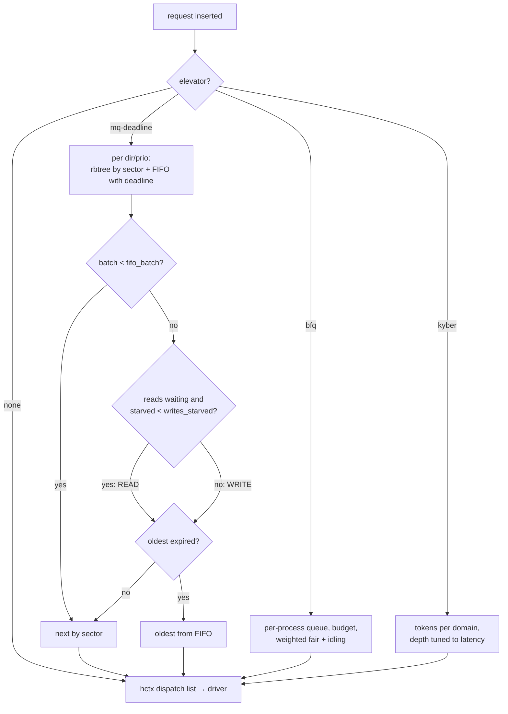

# 06 — I/O schedulers: `none`, `mq-deadline`, `bfq`, `kyber`

> Module 05 · File Systems & I/O · Linux v6.18.63 · Farsi: [`06-io-schedulers.fa.md`](06-io-schedulers.fa.md)

## 1. Summary

- An I/O scheduler ("elevator") is an optional blk-mq stage that **holds and reorders requests** before dispatch. It trades CPU time and a little latency for one of: seek reduction, read latency bounds, fairness between processes, or latency targets.
- Linux 6.18 ships four choices per device: `none` (FIFO, nothing held), `mq-deadline` (sorted + per-request deadlines, reads preferred), `bfq` (per-process budgets, proportional share, best for desktops and slow disks), `kyber` (token-based, targets read and write latency, for fast devices).
- The kernel default (`elevator_set_default()`) is **mq-deadline for single-hardware-queue devices and `none` for multi-queue devices** such as NVMe. Distribution udev rules may override it. Change it per device in `/sys/block/<dev>/queue/scheduler`.

## 2. Detailed explanation

### 2.1 The question

You have a database doing small random reads and a backup job streaming big writes to the same disk. Without a scheduler, a read that arrives behind 64 queued 1 MiB writes waits for all of them. Which policy fixes that, and what does it cost on an NVMe drive that has no seek time at all?

### 2.2 Why schedulers existed, and why they matter less now

On a rotating disk a seek costs ~5–10 ms, so sorting requests by sector (the "elevator" algorithm: sweep up, sweep down) multiplies throughput. On SSD/NVMe there is no seek, the device has its own internal queue and scheduler, and every microsecond of CPU spent in the kernel shows up in latency. That is why multi-queue devices default to `none`. Schedulers still matter for **fairness** (bfq, with cgroup `io.weight`) and **read-vs-write latency** (mq-deadline, kyber) even on flash.

### 2.3 The four schedulers

| | `none` | `mq-deadline` | `bfq` | `kyber` |
|---|---|---|---|---|
| Idea | pass-through | sorted by sector + FIFO per direction with deadlines | per-process queues, served in budgets (sectors) with weighted fair queuing (B-WF2Q+) | limit in-flight requests per class with tokens, tune depth to hit latency targets |
| Key defaults (v6.18.63) | — | `read_expire` = HZ/2 (500 ms), `write_expire` = 5 s, `writes_starved` = 2, `fifo_batch` = 16 | `slice_idle` = 8 ms, `timeout_sync` = HZ/8 | read target 2 ms, write target 10 ms |
| Good for | NVMe, fast virtual disks | single-queue SSD/HDD, servers | HDD, desktops, interactive + fairness, cgroups | fast multi-queue devices under mixed load |
| CPU cost | lowest | low | highest (per-request bookkeeping, idling) | low |
| Source | — | `block/mq-deadline.c` | `block/bfq-iosched.c` | `block/kyber-iosched.c` |

### 2.4 mq-deadline in detail

Each direction (read, write) and each I/O priority class has **two** queues: an rbtree sorted by sector (`sort_list`) and a FIFO ordered by arrival (`fifo_list`) with an expiry time per request (`rq->fifo_time = jiffies + fifo_expire[dir]`). Dispatch:

1. If in a **batch** (fewer than `fifo_batch` requests dispatched in this direction), continue with the next request in sector order.
2. Otherwise choose a direction: **reads win**, unless writes are waiting and reads have already been preferred `writes_starved` times in a row.
3. In that direction, if the oldest request has expired, jump to it (deadline); otherwise continue in sector order.

So reads get a soft 500 ms guarantee, writes a soft 5 s one, and sequential runs are kept together for throughput.

### 2.5 bfq in one paragraph

Each process (or cgroup) gets its own queue and a **budget** in sectors. The scheduler serves one queue at a time until its budget is used or it times out, and picks the next queue by virtual finish time weighted by `ioprio`/`io.weight`. For a synchronous reader that has just gone idle, bfq **waits** (`slice_idle`) for its next request instead of switching away, because on a disk the next read is probably adjacent. That idling is what gives interactive programs low latency under a heavy writer, and also what costs throughput on fast devices.

### 2.6 kyber in one paragraph

kyber does not reorder much. It splits requests into domains (read, write, discard, other), gives each domain a number of **tokens** (`kyber_depth`: 256 / 128 / 64 / 16), and measures completion latency. If reads miss their 2 ms target, it shrinks the write depth, which reduces device-internal queueing in front of the reads.

## 3. Diagram



## 4. Worked example (real code)

The direction choice in mq-deadline:

```c
// linux/block/mq-deadline.c · __dd_dispatch_request() · v6.18.63 · L350-372
	if (!list_empty(&per_prio->fifo_list[DD_READ])) {
		BUG_ON(RB_EMPTY_ROOT(&per_prio->sort_list[DD_READ]));

		if (deadline_fifo_request(dd, per_prio, DD_WRITE) &&
		    (dd->starved++ >= dd->writes_starved))
			goto dispatch_writes;

		data_dir = DD_READ;

		goto dispatch_find_request;
	}

	/*
	 * there are either no reads or writes have been starved
	 */

	if (!list_empty(&per_prio->fifo_list[DD_WRITE])) {
dispatch_writes:
		BUG_ON(RB_EMPTY_ROOT(&per_prio->sort_list[DD_WRITE]));

		dd->starved = 0;

		data_dir = DD_WRITE;
```

- Reads pending → prefer reads, but count how often writes were skipped (`dd->starved++`).
- After `writes_starved` (2) skips, one write batch goes, and the counter resets.
- Every request lives in both the rbtree and the FIFO (`BUG_ON` checks they agree), so it can be found by sector or by age.

Change and inspect on the VM (never on a disk others depend on; Lab 05.4 uses a loop device):

```bash
cat /sys/block/loop0/queue/scheduler            # [none] mq-deadline ...
echo mq-deadline | sudo tee /sys/block/loop0/queue/scheduler
ls /sys/block/loop0/queue/iosched/              # read_expire write_expire fifo_batch ...
```

Results from the VM (Lab 05.4, 512 MiB loop device with direct I/O, fio):

```text
scheduler        A:IOPS    A:p99(us) |   B:rd p50(us)   B:rd p99(us)   B:wr MiB/s
none               3988        14877 |          17170         101188        609.7
mq-deadline        4643        12386 |          43778         219152        208.4
bfq                4310        15008 |            522           1057         10.6
kyber              4108        14746 |          23724         223347        373.3
(second of two runs; in the first, bfq did not protect the reader: p50 13.7 ms, writer 649 MiB/s. Full output: Lab 05.4 README)
```

## 5. Edge cases & pitfalls

- **Benchmarking a scheduler on a virtual disk measures two schedulers**: the guest's and the host's. VirtualBox on Hyper-V adds its own queueing, so absolute numbers on the course VM say little about real hardware; compare shapes, not values.
- **bfq's idling hurts parallel throughput** on SSDs. `echo 0 > iosched/slice_idle` disables it (and most of its guarantees).
- **`ionice` only matters with a scheduler that honours priorities** (bfq; mq-deadline has per-priority queues and `prio_aging_expire`). With `none` it does nothing.
- **Changing the scheduler drains the queue**: in-flight requests finish first. Do it at boot (udev rule `ACTION=="add|change", KERNEL=="sd*", ATTR{queue/scheduler}="bfq"`) for permanence.
- **Merging still happens with `none`** (at submit time, `blk_mq_attempt_bio_merge()`), so "no scheduler" is not "no merging".

## 6. Exam-style key points

- Default: mq-deadline if one hw queue (or shared tags), else none (`elevator_set_default()`).
- mq-deadline: sorted rbtree + FIFO per direction; read_expire 500 ms, write_expire 5 s, writes_starved 2, fifo_batch 16.
- bfq: per-process budgets + weighted fair queueing + idling → fairness and interactivity, higher CPU cost.
- kyber: token depth per domain to meet 2 ms read / 10 ms write latency targets.
- Fast flash: the scheduler's CPU cost and added latency usually outweigh reordering gains.

## 7. Links

- Lesson: [`../lesson.en.md`](../lesson.en.md) §4.4 · Walkthrough: [`../kernel-walkthrough.en.md`](../kernel-walkthrough.en.md) §5
- Lab: [`../labs/04-io-schedulers/`](../labs/04-io-schedulers/)
- Quiz: [`../quiz.en.md`](../quiz.en.md) Q5, Q10
- Previous: [`05-block-layer-blk-mq.en.md`](05-block-layer-blk-mq.en.md) · Next: [`07-journaling-crash-consistency.en.md`](07-journaling-crash-consistency.en.md)
