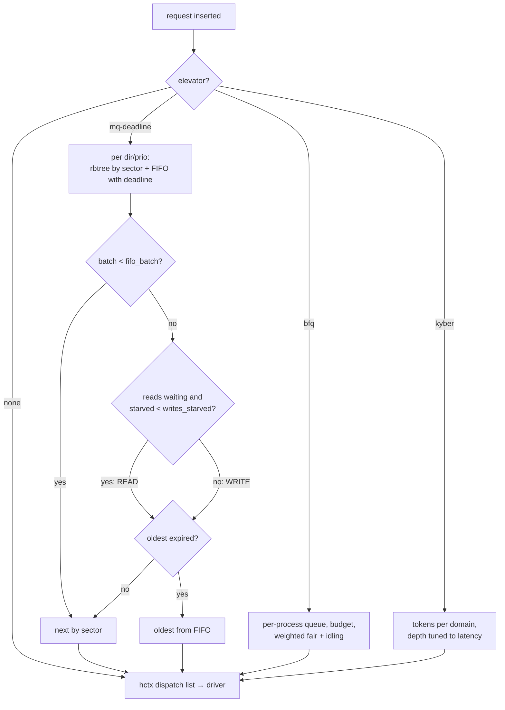

<div dir="rtl">

# ۰۶ — I/O schedulerها: `none`، `mq-deadline`، `bfq`، `kyber`

> ماژول ۰۵ · فایل‌سیستم‌ها و I/O · Linux v6.18.63 · نسخهٔ انگلیسی: [`06-io-schedulers.en.md`](06-io-schedulers.en.md)

## ۱. خلاصه

- I/O scheduler (یا «elevator») یک مرحلهٔ اختیاری در blk-mq است که requestها را پیش از ارسال **نگه می‌دارد و ترتیبشان را عوض می‌کند**. در ازای کمی زمان CPU و کمی تأخیر، یکی از این‌ها را می‌دهد: کاهش seek، سقف تأخیر برای خواندن، عدالت بین فرایندها، یا رسیدن به هدف‌های تأخیر.
- Linux 6.18 برای هر دستگاه چهار گزینه دارد: `none` (FIFO، هیچ چیز نگه داشته نمی‌شود)، `mq-deadline` (مرتب‌شده + deadline برای هر request، با اولویت خواندن)، `bfq` (بودجه برای هر فرایند، سهم متناسب، بهترین برای دسکتاپ و دیسک‌های کند)، `kyber` (مبتنی بر token، با هدف تأخیر برای خواندن و نوشتن، برای دستگاه‌های سریع).
- پیش‌فرض کرنل (`elevator_set_default()`) برای **دستگاه‌های تک‌صف سخت‌افزاری mq-deadline و برای دستگاه‌های چندصفی مثل NVMe، `none`** است. قانون‌های udev توزیع‌ها ممکن است آن را تغییر دهند. برای هر دستگاه در `/sys/block/<dev>/queue/scheduler` عوضش کنید.

## ۲. توضیح کامل

### ۲.۱ پرسش

یک پایگاه داده دارید که خواندن‌های کوچک تصادفی انجام می‌دهد و یک کار پشتیبان‌گیری که نوشتن‌های بزرگ را پشت‌سرهم روی همان دیسک می‌ریزد. بدون scheduler، خواندنی که پشت ۶۴ نوشتن 1 MiB در صف برسد باید منتظر همهٔ آن‌ها بماند. کدام سیاست این را درست می‌کند، و روی یک درایو NVMe که اصلاً زمان seek ندارد چه هزینه‌ای دارد؟

### ۲.۲ چرا schedulerها به وجود آمدند و چرا حالا کمتر مهم‌اند

روی دیسک چرخان هر seek حدود ۵ تا ۱۰ میلی‌ثانیه طول می‌کشد، پس مرتب‌کردن requestها بر اساس sector (الگوریتم «elevator»: بالا رفتن، پایین آمدن) توان عملیاتی را چند برابر می‌کند. روی SSD/NVMe هیچ seekای نیست، دستگاه صف و scheduler داخلی خودش را دارد، و هر میکروثانیه CPU که در کرنل خرج شود در تأخیر دیده می‌شود. به همین دلیل پیش‌فرض دستگاه‌های چندصفی `none` است. schedulerها حتی روی flash هنوز برای **عدالت** (bfq، همراه با `io.weight` در cgroup) و **تأخیر خواندن در برابر نوشتن** (mq-deadline، kyber) اهمیت دارند.

### ۲.۳ چهار scheduler

| | `none` | `mq-deadline` | `bfq` | `kyber` |
|---|---|---|---|---|
| ایده | عبور مستقیم | مرتب‌شده بر اساس sector + FIFO برای هر جهت با deadline | صف جدا برای هر فرایند، سرویس در قالب بودجه (sector) با weighted fair queuing (B-WF2Q+) | محدودکردن requestهای در جریان در هر کلاس با token، تنظیم عمق برای رسیدن به هدف تأخیر |
| پیش‌فرض‌های کلیدی (v6.18.63) | — | `read_expire` = HZ/2 (500 ms)، `write_expire` = 5 s، `writes_starved` = 2، `fifo_batch` = 16 | `slice_idle` = 8 ms، `timeout_sync` = HZ/8 | هدف خواندن 2 ms، هدف نوشتن 10 ms |
| مناسب برای | NVMe، دیسک‌های مجازی سریع | SSD/HDD تک‌صفی، سرورها | HDD، دسکتاپ، کار تعاملی + عدالت، cgroupها | دستگاه‌های چندصفی سریع زیر بار ترکیبی |
| هزینهٔ CPU | کمترین | کم | بیشترین (حساب‌وکتاب برای هر request، idling) | کم |
| سورس | — | `block/mq-deadline.c` | `block/bfq-iosched.c` | `block/kyber-iosched.c` |

### ۲.۴ جزئیات mq-deadline

هر جهت (خواندن، نوشتن) و هر کلاس اولویت I/O **دو** صف دارد: یک rbtree مرتب‌شده بر اساس sector (`sort_list`) و یک FIFO به ترتیب ورود (`fifo_list`) با زمان انقضا برای هر request (`rq->fifo_time = jiffies + fifo_expire[dir]`). ارسال:

۱. اگر داخل یک **batch** هستیم (کمتر از `fifo_batch` request در این جهت ارسال شده)، با request بعدی به ترتیب sector ادامه بده.
۲. وگرنه یک جهت انتخاب کن: **خواندن برنده است**، مگر اینکه نوشتن‌هایی منتظر باشند و خواندن همین حالا `writes_starved` بار پشت‌سرهم ترجیح داده شده باشد.
۳. در آن جهت، اگر قدیمی‌ترین request منقضی شده، به سراغ آن برو (deadline)؛ وگرنه به ترتیب sector ادامه بده.

پس خواندن‌ها یک تضمین نرم 500 ms و نوشتن‌ها یک تضمین نرم 5 s می‌گیرند، و دنباله‌های ترتیبی برای توان عملیاتی کنار هم می‌مانند.

### ۲.۵ bfq در یک پاراگراف

هر فرایند (یا cgroup) صف خودش و یک **بودجه** بر حسب sector دارد. scheduler هر بار یک صف را سرویس می‌دهد تا بودجه‌اش تمام شود یا وقتش سر برسد، و صف بعدی را بر اساس virtual finish time که با `ioprio`/`io.weight` وزن‌دهی شده انتخاب می‌کند. برای یک خوانندهٔ همگام که تازه بیکار شده، bfq به‌جای رفتن سراغ صف دیگر، برای request بعدی‌اش **صبر می‌کند** (`slice_idle`)، چون روی دیسک خواندن بعدی احتمالاً مجاور است. همین idling است که به برنامه‌های تعاملی زیر بار یک نویسندهٔ سنگین تأخیر کم می‌دهد، و همین است که روی دستگاه‌های سریع از توان عملیاتی کم می‌کند.

### ۲.۶ kyber در یک پاراگراف

kyber ترتیب را زیاد عوض نمی‌کند. requestها را به چند domain تقسیم می‌کند (read، write، discard، other)، به هر domain تعدادی **token** می‌دهد (`kyber_depth`: 256 / 128 / 64 / 16) و تأخیر پایان کار را اندازه می‌گیرد. اگر خواندن‌ها از هدف 2 ms خود عقب بمانند، عمق نوشتن را کم می‌کند تا صف‌شدن داخل دستگاه جلوی خواندن‌ها کمتر شود.

## ۳. نمودار

</div>



<div dir="rtl">

## ۴. مثال عملی (کد واقعی)

انتخاب جهت در mq-deadline:

</div>

```c
// linux/block/mq-deadline.c · __dd_dispatch_request() · v6.18.63 · L350-372
	if (!list_empty(&per_prio->fifo_list[DD_READ])) {
		BUG_ON(RB_EMPTY_ROOT(&per_prio->sort_list[DD_READ]));

		if (deadline_fifo_request(dd, per_prio, DD_WRITE) &&
		    (dd->starved++ >= dd->writes_starved))
			goto dispatch_writes;

		data_dir = DD_READ;

		goto dispatch_find_request;
	}

	/*
	 * there are either no reads or writes have been starved
	 */

	if (!list_empty(&per_prio->fifo_list[DD_WRITE])) {
dispatch_writes:
		BUG_ON(RB_EMPTY_ROOT(&per_prio->sort_list[DD_WRITE]));

		dd->starved = 0;

		data_dir = DD_WRITE;
```

<div dir="rtl">

- خواندن در انتظار است ← خواندن را ترجیح بده، ولی بشمار که نوشتن‌ها چند بار کنار گذاشته شده‌اند (`dd->starved++`).
- بعد از `writes_starved` (۲) بار کنار گذاشتن، یک batch نوشتن ارسال می‌شود و شمارنده صفر می‌شود.
- هر request هم در rbtree هست و هم در FIFO (`BUG_ON` هماهنگی آن‌ها را بررسی می‌کند)، پس هم بر اساس sector و هم بر اساس سن پیدا می‌شود.

تغییر و بررسی روی VM (هرگز روی دیسکی که دیگران به آن وابسته‌اند؛ آزمایش ۰۵.۴ از یک loop device استفاده می‌کند):

</div>

```bash
cat /sys/block/loop0/queue/scheduler            # [none] mq-deadline ...
echo mq-deadline | sudo tee /sys/block/loop0/queue/scheduler
ls /sys/block/loop0/queue/iosched/              # read_expire write_expire fifo_batch ...
```

<div dir="rtl">

نتیجه‌ها از VM (آزمایش ۰۵.۴، loop device با اندازهٔ 512 MiB با direct I/O، ابزار fio):

</div>

```text
scheduler        A:IOPS    A:p99(us) |   B:rd p50(us)   B:rd p99(us)   B:wr MiB/s
none               3988        14877 |          17170         101188        609.7
mq-deadline        4643        12386 |          43778         219152        208.4
bfq                4310        15008 |            522           1057         10.6
kyber              4108        14746 |          23724         223347        373.3
(second of two runs; in the first, bfq did not protect the reader: p50 13.7 ms, writer 649 MiB/s. Full output: Lab 05.4 README)
```

<div dir="rtl">

## ۵. حالت‌های خاص و دام‌ها

- **بنچمارک یک scheduler روی دیسک مجازی در واقع دو scheduler را می‌سنجد**: مال مهمان و مال میزبان. VirtualBox روی Hyper-V صف‌بندی خودش را اضافه می‌کند، پس عددهای مطلق روی VM درس چیز زیادی دربارهٔ سخت‌افزار واقعی نمی‌گویند؛ شکل نتیجه‌ها را مقایسه کنید، نه مقدارها را.
- **idling در bfq به توان عملیاتی موازی** روی SSD آسیب می‌زند. `echo 0 > iosched/slice_idle` آن را خاموش می‌کند (و بیشتر تضمین‌هایش را هم).
- **`ionice` فقط با schedulerی اثر دارد که اولویت‌ها را رعایت کند** (bfq؛ mq-deadline هم صف‌های جدا برای هر اولویت و `prio_aging_expire` دارد). با `none` هیچ اثری ندارد.
- **عوض‌کردن scheduler صف را خالی می‌کند**: اول requestهای در جریان تمام می‌شوند. برای دائمی‌کردن، این کار را هنگام بوت انجام دهید (قانون udev به شکل `ACTION=="add|change", KERNEL=="sd*", ATTR{queue/scheduler}="bfq"`).
- **merge با `none` هم انجام می‌شود** (هنگام ارسال، در `blk_mq_attempt_bio_merge()`)، پس «بدون scheduler» به معنای «بدون merge» نیست.

## ۶. نکته‌های امتحانی

- پیش‌فرض: اگر یک صف سخت‌افزاری (یا tagهای مشترک) باشد mq-deadline، وگرنه none (`elevator_set_default()`).
- mq-deadline: rbtree مرتب‌شده + FIFO برای هر جهت؛ read_expire 500 ms، write_expire 5 s، writes_starved 2، fifo_batch 16.
- bfq: بودجه برای هر فرایند + weighted fair queueing + idling ← عدالت و پاسخ‌گویی تعاملی، با هزینهٔ CPU بیشتر.
- kyber: عمق token برای هر domain تا به هدف تأخیر 2 ms برای خواندن و 10 ms برای نوشتن برسد.
- روی flash سریع: هزینهٔ CPU و تأخیر اضافهٔ scheduler معمولاً از سود مرتب‌سازی بیشتر است.

## ۷. پیوندها

- درس: [`../lesson.fa.md`](../lesson.fa.md) §۴.۴ · بررسی کد کرنل: [`../kernel-walkthrough.fa.md`](../kernel-walkthrough.fa.md) §۵
- آزمایش: [`../labs/04-io-schedulers/`](../labs/04-io-schedulers/)
- آزمونک: [`../quiz.fa.md`](../quiz.fa.md) پرسش‌های ۵ و ۱۰
- قبلی: [`05-block-layer-blk-mq.fa.md`](05-block-layer-blk-mq.fa.md) · بعدی: [`07-journaling-crash-consistency.fa.md`](07-journaling-crash-consistency.fa.md)

</div>
