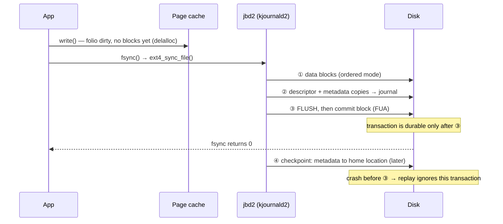

# 07 — Journaling and crash consistency (ext4 / jbd2)

> Module 05 · File Systems & I/O · Linux v6.18.63 · Farsi: [`07-journaling-crash-consistency.fa.md`](07-journaling-crash-consistency.fa.md)

## 1. Summary

- One logical change (append a block to a file) needs several disk writes: the data block, the block bitmap, the inode (size, extent), sometimes a directory block. A power cut between them leaves the filesystem **inconsistent** (leaked or double-used blocks, garbage in files).
- ext4 uses **write-ahead journaling** (the jbd2 layer): metadata changes are first written to a journal as a transaction ending in a **commit record**, and only then to their home location. After a crash, mount **replays** committed transactions and drops uncommitted ones. Recovery takes seconds instead of a full `fsck`.
- The journal protects **filesystem metadata**. Your file's *contents* are protected only according to the data mode (`data=ordered` by default) and only after **`fsync()`**. An unsynced `write()` can vanish completely.

## 2. Detailed explanation

### 2.1 The question

An editor saves `config` by writing `config.tmp` and renaming it over `config`, without `fsync()`. Power fails one second later. After reboot, is `config` the old version, the new version, or empty? On ext2 the answer was "any of them, plus maybe a corrupted directory". On ext4 with `data=ordered` the filesystem is always consistent, and for this exact pattern ext4 even adds a heuristic. Lab 05.6 tests it with a simulated power cut.

### 2.2 The crash-consistency problem (OSTEP ch. 42)

| Approach | Idea | Used by |
|---|---|---|
| fsck after crash | write in place, scan the whole fs at boot to repair | ext2, OpenBSD FFS |
| journaling (WAL) | write intent to a log, commit, then checkpoint in place | ext3/ext4 (jbd2), XFS, NTFS |
| copy-on-write | never overwrite; write new tree, flip the root pointer atomically | Btrfs, ZFS, APFS |
| soft updates | order metadata writes so any crash state is repairable in the background | FreeBSD UFS |

### 2.3 jbd2 transactions

ext4 does not write one journal transaction per syscall. All metadata changes during a commit interval (default **5 s**, `JBD2_DEFAULT_MAX_COMMIT_AGE`, mount option `commit=`) join one **running transaction** through *handles* (`ext4_journal_start()` / `ext4_journal_stop()`). The journal thread (`kjournald2()`, visible as `jbd2/<dev>-8` in `ps`) then commits it in phases; the states are `T_RUNNING → T_LOCKED → T_SWITCH → T_FLUSH → T_COMMIT → T_COMMIT_DFLUSH → T_COMMIT_JFLUSH → T_COMMIT_CALLBACK → T_FINISHED` (`include/linux/jbd2.h` L566):

1. Lock the transaction (no new handles), wait for open handles to finish.
2. **Ordered mode: write the data blocks** of inodes in this transaction (`journal_submit_data_buffers()`).
3. Write descriptor blocks + copies of every modified metadata block into the journal.
4. Wait for data and journal writes, issue a **cache flush**, then write the **commit block** (with `REQ_FUA`/flush). A transaction counts only if its commit block is on disk. That single sector write is the atomic point.
5. Later, **checkpoint**: write the metadata to its real location and free the journal space.

### 2.4 Data modes

| Mode | Data written | Guarantee after crash | Cost |
|---|---|---|---|
| `data=journal` | into the journal too, then in place | data and metadata consistent; data written twice | ~2× write traffic, disables delalloc and DIO |
| `data=ordered` (default) | in place, **before** the commit of the metadata that points to it | metadata never points at stale/garbage blocks; unsynced data may be lost | small |
| `data=writeback` | in place, no ordering | consistent fs, but a file may show **old blocks' contents** after a crash | lowest |

Ordered mode is not "data is journaled". It only guarantees *ordering*: a newly allocated block's contents reach the disk before the inode that references it. Combined with **delayed allocation**, data that was written but never allocated is simply not in any transaction and is lost.

ext4 has one safety heuristic, `auto_da_alloc` (default on): renaming over an existing file, or truncating a file to 0 and rewriting it, forces block allocation for the new data (`ext4_alloc_da_blocks()` in `ext4_rename()`), so the data is written before the rename commits. It is a workaround for applications, not a POSIX promise.

### 2.5 What applications must do

Durable replace, the only portable pattern:

```c
fd = open("config.tmp", O_WRONLY|O_CREAT|O_TRUNC, 0644);
write(fd, buf, len);
fsync(fd);                      /* 1. data + inode of the new file on disk */
close(fd);
rename("config.tmp", "config"); /* 2. atomic switch of the name */
dfd = open(".", O_RDONLY|O_DIRECTORY);
fsync(dfd);                     /* 3. the directory entry change on disk */
```

Skipping (1) → the name may point at an empty file. Skipping (3) → after a crash the old name may come back.

## 3. Diagram



## 4. Worked example (real code)

The ordering in `jbd2_journal_commit_transaction()`:

```c
// linux/fs/jbd2/commit.c · jbd2_journal_commit_transaction() · v6.18.63 · L540-548
	jbd2_debug(3, "JBD2: commit phase 2a\n");

	/*
	 * Now start flushing things to disk, in the order they appear
	 * on the transaction lists.  Data blocks go first.
	 */
	err = journal_submit_data_buffers(journal, commit_transaction);
	if (err)
		jbd2_journal_abort(journal, err);
```

- Phase 2a is the ordered-mode promise in code: data before metadata.
- `journal_submit_data_buffers()` (L211) walks `t_inode_list` and, for every inode flagged `JI_WRITE_DATA`, calls ext4's `j_submit_inode_data_buffers` callback, i.e. starts writeback of that inode's dirty ranges.
- A data write error does not stop the commit; it aborts the journal, which makes ext4 go read-only (or panic, per `errors=`).

And the commit record comes last (`L874-878`):

```c
	if (!jbd2_has_feature_async_commit(journal)) {
		err = journal_submit_commit_record(journal, commit_transaction,
						&cbh, crc32_sum);
		if (err)
			jbd2_journal_abort(journal, err);
	}
```

Without `async_commit`, the commit block is only written after the data and journal blocks completed (phase 5, `T_COMMIT_JFLUSH`).

Real result on the VM (Lab 05.6: ext4 on `dm-flakey` on a loop file; writes dropped from the "power cut" on):

```text
$ bash crash-demo.sh            # data=ordered
== before the crash:
  A        19 bytes: A: written + fsync
  B        21 bytes: B: written, no fsync
  config   13 bytes: new contents
== kernel log at remount (journal replay):
  EXT4-fs (dm-0): recovery complete
== after the crash:
  A        19 bytes: A: written + fsync
  B       MISSING
  config   13 bytes: old contents
```

## 5. Edge cases & pitfalls

- **`sync` on the command line is not a test.** It flushes everything, so you never see the crash window. Use dm-flakey (`drop_writes`), `dm-log-writes`, or a VM snapshot.
- **Disk write caches lie.** Without flushes (`barrier=0`/`nobarrier`, or a device that ignores FLUSH), the commit block can be on disk before the data. ext4's default is barriers on.
- **Journal checksums** (`metadata_csum`, `journal_checksum`) detect torn or misordered journal writes during replay.
- **fast_commit** (ext4 feature, 5.10+) logs small logical deltas for `fsync()` between full commits; it makes fsync-heavy workloads faster without changing the guarantees.
- **Rename atomicity ≠ durability.** `rename()` is atomic (readers see old or new), but without `fsync` of the directory it may not survive a crash.
- **Errors after the fact:** an `fsync()` that failed (EIO) may already have dropped the dirty pages. Re-calling `fsync()` and getting 0 does not mean the data is on disk.

## 6. Exam-style key points

- Crash consistency: several writes per logical update; journal makes them atomic via a commit record.
- jbd2 commit: data (ordered) → journal metadata → flush → commit block → later checkpoint.
- `data=journal` / `ordered` (default) / `writeback`: what is ordered or journaled, and the price.
- Ordered ≠ data journaling; unsynced, unallocated (delalloc) data is lost.
- Durable replace = write tmp + fsync tmp + rename + fsync dir.
- Default commit interval 5 s (`commit=`), barriers on.

## 7. Links

- Lesson: [`../lesson.en.md`](../lesson.en.md) §4.5 · Walkthrough: [`../kernel-walkthrough.en.md`](../kernel-walkthrough.en.md) §6
- Lab: [`../labs/06-ext4-crash/`](../labs/06-ext4-crash/) (and [`../labs/03-fsync-writeback/`](../labs/03-fsync-writeback/) for the cost)
- Quiz: [`../quiz.en.md`](../quiz.en.md) Q3, Q12
- Previous: [`06-io-schedulers.en.md`](06-io-schedulers.en.md) · Next: [`08-io-uring.en.md`](08-io-uring.en.md)
