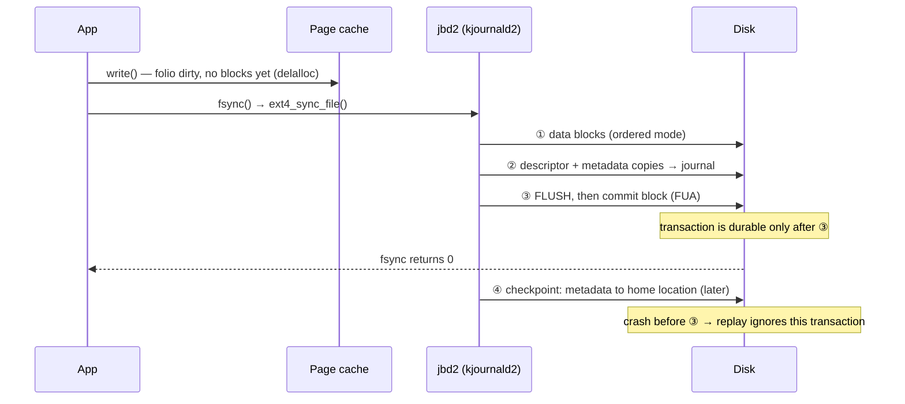

<div dir="rtl">

# ۰۷ — Journaling و سازگاری پس از crash <span dir="ltr">(ext4 / jbd2)</span>

> ماژول ۰۵ · فایل‌سیستم‌ها و I/O · Linux v6.18.63 · نسخهٔ انگلیسی: [`07-journaling-crash-consistency.en.md`](07-journaling-crash-consistency.en.md)

## ۱. خلاصه

- یک تغییر منطقی (اضافه‌کردن یک بلوک به فایل) چند نوشتن روی دیسک لازم دارد: بلوک داده، block bitmap، inode (اندازه و extent) و گاهی یک بلوک دایرکتوری. قطع برق بین این نوشتن‌ها فایل‌سیستم را **ناسازگار** می‌کند (بلوک‌های گم‌شده یا دوبار استفاده‌شده، زباله داخل فایل‌ها).
- ext4 از **write-ahead journaling** (لایهٔ jbd2) استفاده می‌کند: تغییرهای metadata اول به‌صورت یک transaction که با یک **commit record** تمام می‌شود در journal نوشته می‌شوند و فقط بعد از آن در جای اصلی‌شان. بعد از crash، هنگام mount، transactionهای commit‌شده **replay** می‌شوند و بقیه دور ریخته می‌شوند. بازیابی چند ثانیه طول می‌کشد، نه یک `fsck` کامل.
- journal از **metadata فایل‌سیستم** محافظت می‌کند. *محتوای* فایل شما فقط به اندازهٔ data mode (پیش‌فرض `data=ordered`) و فقط بعد از **`fsync()`** محافظت می‌شود. یک `write()` که sync نشده ممکن است کاملاً ناپدید شود.

## ۲. توضیح کامل

### ۲.۱ پرسش

یک ویرایشگر `config` را این‌طور ذخیره می‌کند: `config.tmp` را می‌نویسد و آن را روی `config` rename می‌کند، بدون `fsync()`. یک ثانیه بعد برق قطع می‌شود. بعد از reboot، `config` نسخهٔ قدیمی است، نسخهٔ جدید، یا خالی؟ در ext2 جواب این بود: «هر کدام، به‌اضافهٔ احتمالاً یک دایرکتوری خراب». در ext4 با `data=ordered` فایل‌سیستم همیشه سازگار است، و ext4 برای همین الگوی خاص یک heuristic هم اضافه کرده است. آزمایش ۰۵.۶ این را با قطع برق شبیه‌سازی‌شده می‌سنجد.

### ۲.۲ مسئلهٔ crash consistency <span dir="ltr">(OSTEP ch. 42)</span>

| روش | ایده | استفاده در |
|---|---|---|
| fsck بعد از crash | نوشتن درجا، و اسکن کل فایل‌سیستم هنگام بوت برای تعمیر | ext2، OpenBSD FFS |
| journaling (WAL) | نوشتن قصد در یک log، commit، سپس checkpoint درجا | <span dir="ltr">ext3/ext4 (jbd2)</span>، XFS، NTFS |
| copy-on-write | هرگز بازنویسی نکن؛ درخت جدید بنویس و اشاره‌گر ریشه را اتمیک عوض کن | Btrfs، ZFS، APFS |
| soft updates | ترتیب‌دادن نوشتن‌های metadata طوری که هر حالت crash در پس‌زمینه قابل تعمیر باشد | FreeBSD UFS |

### ۲.۳ transactionهای jbd2

ext4 برای هر syscall یک transaction جدا در journal نمی‌نویسد. همهٔ تغییرهای metadata در یک بازهٔ commit (پیش‌فرض **۵ ثانیه**، `JBD2_DEFAULT_MAX_COMMIT_AGE`، گزینهٔ mount به نام `commit=`) از طریق *handle*ها (`ext4_journal_start()` / `ext4_journal_stop()`) به یک **running transaction** می‌پیوندند. سپس thread مربوط به journal (`kjournald2()`، که در `ps` به شکل `jbd2/<dev>-8` دیده می‌شود) آن را در چند مرحله commit می‌کند؛ حالت‌ها این‌ها هستند: <span dir="ltr">`T_RUNNING → T_LOCKED → T_SWITCH → T_FLUSH → T_COMMIT → T_COMMIT_DFLUSH → T_COMMIT_JFLUSH → T_COMMIT_CALLBACK → T_FINISHED`</span> (`include/linux/jbd2.h` L566):

۱. transaction قفل می‌شود (handle جدید پذیرفته نمی‌شود) و منتظر می‌ماند handleهای باز تمام شوند.

۲. **در ordered mode: بلوک‌های داده** inodeهای این transaction نوشته می‌شوند (`journal_submit_data_buffers()`).

۳. descriptor blockها و کپی هر بلوک metadata تغییرکرده در journal نوشته می‌شوند.

۴. منتظر نوشتن داده و journal می‌ماند، یک **cache flush** می‌فرستد و سپس **commit block** را می‌نویسد (با <span dir="ltr">`REQ_FUA`/flush</span>). یک transaction فقط وقتی حساب می‌شود که commit block آن روی دیسک باشد. همین نوشتن یک sector نقطهٔ اتمیک است.

۵. بعداً، **checkpoint**: metadata در جای واقعی‌اش نوشته می‌شود و فضای journal آزاد می‌شود.

### ۲.۴ data modeها

| حالت | دادهٔ نوشته‌شده | تضمین بعد از crash | هزینه |
|---|---|---|---|
| `data=journal` | اول در journal، بعد درجا | داده و metadata سازگار؛ داده دو بار نوشته می‌شود | حدود ۲ برابر ترافیک نوشتن، delalloc و DIO را خاموش می‌کند |
| `data=ordered` (پیش‌فرض) | درجا، **پیش از** commit شدن metadataای که به آن اشاره می‌کند | metadata هرگز به بلوک کهنه یا زباله اشاره نمی‌کند؛ دادهٔ sync‌نشده ممکن است از دست برود | کم |
| `data=writeback` | درجا، بدون ترتیب | فایل‌سیستم سازگار، ولی ممکن است فایل بعد از crash **محتوای بلوک‌های قدیمی** را نشان دهد | کمترین |

ordered mode یعنی «داده journal می‌شود» نیست. فقط *ترتیب* را تضمین می‌کند: محتوای بلوکی که تازه تخصیص داده شده، پیش از inodeای که به آن ارجاع می‌دهد به دیسک می‌رسد. در کنار **delayed allocation**، داده‌ای که نوشته شده ولی هنوز بلوکی برایش تخصیص نیافته اصلاً در هیچ transactionی نیست و از دست می‌رود.

ext4 یک heuristic ایمنی دارد به نام `auto_da_alloc` (پیش‌فرض روشن): rename کردن روی یک فایل موجود، یا truncate کردن فایل به ۰ و نوشتن دوباره، تخصیص بلوک برای دادهٔ جدید را اجباری می‌کند (`ext4_alloc_da_blocks()` در `ext4_rename()`)، پس داده پیش از commit شدن rename نوشته می‌شود. این یک راه‌حل موقت برای برنامه‌هاست، نه وعدهٔ POSIX.

### ۲.۵ برنامه‌ها چه باید بکنند

جایگزینی پایدار (durable replace)، تنها الگوی قابل‌حمل:

</div>

```c
fd = open("config.tmp", O_WRONLY|O_CREAT|O_TRUNC, 0644);
write(fd, buf, len);
fsync(fd);                      /* 1. data + inode of the new file on disk */
close(fd);
rename("config.tmp", "config"); /* 2. atomic switch of the name */
dfd = open(".", O_RDONLY|O_DIRECTORY);
fsync(dfd);                     /* 3. the directory entry change on disk */
```

<div dir="rtl">

اگر (۱) را جا بیندازید، ممکن است نام به یک فایل خالی اشاره کند. اگر (۳) را جا بیندازید، ممکن است بعد از crash نام قدیمی برگردد.

## ۳. نمودار

</div>



<div dir="rtl">

## ۴. مثال عملی (کد واقعی)

ترتیب در `jbd2_journal_commit_transaction()`:

</div>

```c
// linux/fs/jbd2/commit.c · jbd2_journal_commit_transaction() · v6.18.63 · L540-548
	jbd2_debug(3, "JBD2: commit phase 2a\n");

	/*
	 * Now start flushing things to disk, in the order they appear
	 * on the transaction lists.  Data blocks go first.
	 */
	err = journal_submit_data_buffers(journal, commit_transaction);
	if (err)
		jbd2_journal_abort(journal, err);
```

<div dir="rtl">

- phase 2a همان وعدهٔ ordered mode به زبان کد است: داده پیش از metadata.
- `journal_submit_data_buffers()` (L211) روی `t_inode_list` حرکت می‌کند و برای هر inode که پرچم `JI_WRITE_DATA` دارد، callback مربوط به ext4 یعنی `j_submit_inode_data_buffers` را صدا می‌زند؛ یعنی writeback بازه‌های dirty آن inode را شروع می‌کند.
- خطای نوشتن داده commit را متوقف نمی‌کند؛ journal را abort می‌کند و ext4 در نتیجه read-only می‌شود (یا بسته به `errors=`، panic می‌کند).

و commit record در آخر می‌آید (`L874-878`):

</div>

```c
	if (!jbd2_has_feature_async_commit(journal)) {
		err = journal_submit_commit_record(journal, commit_transaction,
						&cbh, crc32_sum);
		if (err)
			jbd2_journal_abort(journal, err);
	}
```

<div dir="rtl">

بدون `async_commit`، commit block فقط بعد از تمام شدن نوشتن بلوک‌های داده و journal نوشته می‌شود (phase 5، `T_COMMIT_JFLUSH`).

نتیجهٔ واقعی روی VM (آزمایش ۰۵.۶: ext4 روی `dm-flakey` روی یک loop file؛ از لحظهٔ «قطع برق» به بعد نوشتن‌ها دور ریخته می‌شوند):

</div>

```text
$ bash crash-demo.sh            # data=ordered
== before the crash:
  A        19 bytes: A: written + fsync
  B        21 bytes: B: written, no fsync
  config   13 bytes: new contents
== kernel log at remount (journal replay):
  EXT4-fs (dm-0): recovery complete
== after the crash:
  A        19 bytes: A: written + fsync
  B       MISSING
  config   13 bytes: old contents
```

<div dir="rtl">

## ۵. حالت‌های خاص و دام‌ها

- **اجرای `sync` در خط فرمان آزمون نیست.** همه‌چیز را flush می‌کند، پس هرگز پنجرهٔ crash را نمی‌بینید. از dm-flakey (`drop_writes`)، `dm-log-writes` یا snapshot یک VM استفاده کنید.
- **write cache دیسک دروغ می‌گوید.** بدون flush (<span dir="ltr">`barrier=0`/`nobarrier`</span>، یا دستگاهی که FLUSH را نادیده می‌گیرد)، ممکن است commit block پیش از داده روی دیسک برسد. پیش‌فرض ext4 روشن بودن barrier است.
- **checksumهای journal** (`metadata_csum`، `journal_checksum`) نوشتن‌های ناقص یا بی‌ترتیب journal را هنگام replay تشخیص می‌دهند.
- **fast_commit** (قابلیت ext4، از 5.10 به بعد) برای `fsync()` بین commitهای کامل، تغییرهای منطقی کوچک را log می‌کند؛ بارهای کاری پر از fsync را سریع‌تر می‌کند بدون اینکه تضمین‌ها عوض شوند.
- **اتمیک بودن rename برابر با پایداری نیست.** `rename()` اتمیک است (خواننده یا قدیمی را می‌بیند یا جدید را)، ولی بدون `fsync` روی دایرکتوری ممکن است از crash جان سالم به در نبرد.
- **خطاهای بعد از واقعه:** یک `fsync()` ناموفق (EIO) ممکن است صفحه‌های dirty را دور ریخته باشد. اگر دوباره `fsync()` را صدا بزنید و ۰ بگیرید، معنایش این نیست که داده روی دیسک است.

## ۶. نکته‌های امتحانی

- crash consistency: برای هر به‌روزرسانی منطقی چند نوشتن؛ journal با یک commit record آن‌ها را اتمیک می‌کند.
- commit در jbd2: داده (ordered) ← metadata در journal ← flush ← commit block ← بعداً checkpoint.
- `data=journal` / `ordered` (پیش‌فرض) / `writeback`: چه چیزی مرتب یا journal می‌شود، و به چه قیمتی.
- ordered برابر با data journaling نیست؛ دادهٔ sync‌نشده و تخصیص‌نیافته (delalloc) از دست می‌رود.
- durable replace یعنی: نوشتن tmp + fsync روی tmp + rename + fsync روی دایرکتوری.
- بازهٔ commit پیش‌فرض ۵ ثانیه (`commit=`)، barrier روشن.

## ۷. پیوندها

- درس: [`../lesson.fa.md`](../lesson.fa.md) §۴.۵ · مرور کد کرنل: [`../kernel-walkthrough.fa.md`](../kernel-walkthrough.fa.md) §۶
- آزمایش: [`../labs/06-ext4-crash/`](../labs/06-ext4-crash/) (و [`../labs/03-fsync-writeback/`](../labs/03-fsync-writeback/) برای هزینه)
- آزمونک: [`../quiz.fa.md`](../quiz.fa.md) پرسش‌های ۳ و ۱۲
- قبلی: [`06-io-schedulers.fa.md`](06-io-schedulers.fa.md) · بعدی: [`08-io-uring.fa.md`](08-io-uring.fa.md)

</div>
