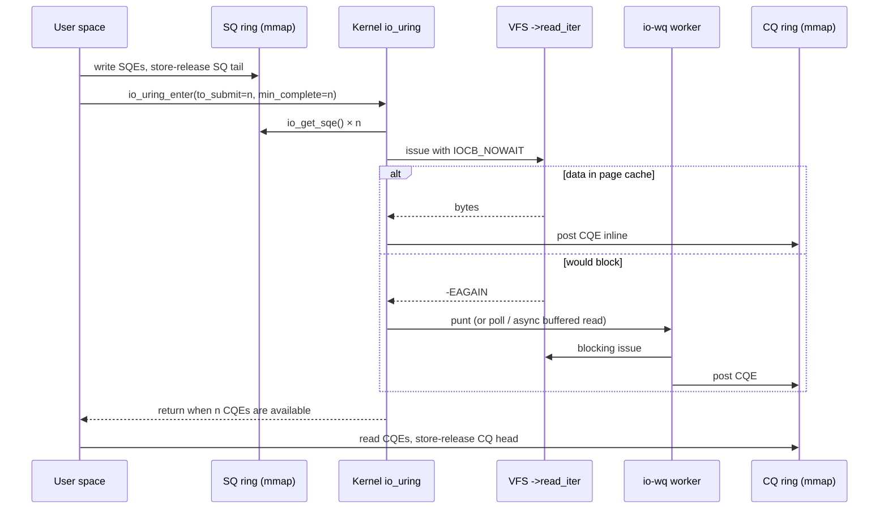

# 08 — `io_uring`: shared rings for asynchronous I/O

> Module 05 · File Systems & I/O · Linux v6.18.63 · Farsi: [`08-io-uring.fa.md`](08-io-uring.fa.md)

## 1. Summary

- `io_uring` (Linux 5.1, Jens Axboe) is an asynchronous I/O interface built on two **ring buffers shared between user space and the kernel** through `mmap`: the **submission queue** (SQ) of `struct io_uring_sqe` and the **completion queue** (CQ) of `struct io_uring_cqe`.
- User space writes SQEs and bumps the SQ tail; one `io_uring_enter()` submits any number of them, and can also wait for completions. With `IORING_SETUP_SQPOLL` a kernel thread polls the SQ, so submission needs **no syscall at all**.
- Inside the kernel, each request first tries a **non-blocking** issue (`IOCB_NOWAIT`) on the normal VFS path (`->read_iter`). If it would block, it is completed later by **poll-based retry** (sockets, pipes), **async buffered read** callbacks (page cache with `FOP_BUFFER_RASYNC`), or a worker thread from **io-wq**.

## 2. Detailed explanation

### 2.1 The question

A `read()`/`write()` copy loop makes two syscalls per block and blocks on each. Before io_uring, Linux had `epoll` (readiness, not completion, and useless for regular files: they are always "ready") and Linux AIO (`io_submit`, only really asynchronous for `O_DIRECT`, a separate code path, and a syscall per batch for both submit and reap). What would a design look like that is completion-based, works for buffered files and sockets, and amortizes syscalls to zero?

### 2.2 The rings

`io_uring_setup(entries, &params)` creates a ring fd and three mmap-able regions: the SQ ring (head, tail, mask, optional index array), the SQE array, and the CQ ring (head, tail, mask, CQEs). Ownership:

| | Producer (writes tail) | Consumer (writes head) |
|---|---|---|
| SQ | user space | kernel (`ctx->cached_sq_head`) |
| CQ | kernel | user space |

Each side only writes its own index, so the protocol needs memory barriers (`smp_store_release` / `smp_load_acquire`) but no locks. An SQE is 64 bytes: `opcode`, `flags`, `fd`, `off`, `addr`, `len`, op-specific flags, and `user_data`, which comes back untouched in the CQE so the application can match completions to requests. A CQE is 16 bytes: `user_data`, `res` (what the syscall would have returned, negative errno on error), `flags`.

### 2.3 Submission inside the kernel

`io_uring_enter(fd, to_submit, min_complete, flags, ...)` → `io_submit_sqes()` (`io_uring/io_uring.c` L2560). For each entry: allocate a `struct io_kiocb` (from a cache), read the SQE (`io_get_sqe()`, L2528), `io_init_req()` + the opcode's `.prep`, then `io_queue_sqe()` → `io_issue_sqe()` (L1963), which calls the opcode table `io_issue_defs[opcode].issue`, e.g. `io_read()`.

`io_read()` → `__io_read()` sets `IOCB_NOWAIT` on the kiocb and calls the file's own `->read_iter()` (`io_iter_do_read()`, `io_uring/rw.c` L828). This is **the same `ext4_file_read_iter()` that `read(2)` uses** (note 04). Outcomes:

- Data is in the page cache → completes inline, CQE posted before `io_uring_enter()` even returns.
- Page-cache miss on a file with `FOP_BUFFER_RASYNC` (ext4, XFS, btrfs) → readahead is started and a wait-queue callback (`IOCB_WAITQ`) re-issues the read from task work when the folio becomes uptodate. No thread blocks.
- `-EAGAIN` and the file can be polled (socket, pipe) → arm an internal poll, retry on readiness.
- Otherwise → punt to **io-wq**, a pool of kernel worker threads (`iou-wrk-<pid>`) that run the operation in blocking mode. Buffered writes on ext4 usually go this way.

### 2.4 Features that matter

| Feature | What it saves |
|---|---|
| batching (many SQEs per `io_uring_enter`) | syscall count |
| `IOSQE_IO_LINK` | user-space round trips for dependent ops (read → write) |
| `IORING_SETUP_SQPOLL` | the submit syscall (a kernel thread polls the SQ) |
| `IORING_SETUP_IOPOLL` | interrupts: completion by polling the NVMe CQ (O_DIRECT only) |
| registered files / buffers (`io_uring_register`) | `fget`/`fput` and page pinning per request |
| multishot accept/recv, provided buffers | re-arming per event (network servers) |

### 2.5 Security note

io_uring has had many privilege-escalation bugs because it is a large, fast-moving surface that bypasses syscall-level filtering (seccomp sees `io_uring_enter`, not the operations inside it). `kernel.io_uring_disabled` (`0` allowed, `1` only for a privileged group, `2` off) exists for that reason (`io_uring/io_uring.c` L147). Container runtimes and some distributions block it by default. Module 07 returns to this.

## 3. Diagram



## 4. Worked example (real code)

Fetching one SQE:

```c
// linux/io_uring/io_uring.c · io_get_sqe() · v6.18.63 · L2528-2558 (comment trimmed)
static bool io_get_sqe(struct io_ring_ctx *ctx, const struct io_uring_sqe **sqe)
{
	unsigned mask = ctx->sq_entries - 1;
	unsigned head = ctx->cached_sq_head++ & mask;

	if (static_branch_unlikely(&io_key_has_sqarray.key) &&
	    (!(ctx->flags & IORING_SETUP_NO_SQARRAY))) {
		head = READ_ONCE(ctx->sq_array[head]);
		if (unlikely(head >= ctx->sq_entries)) {
			WRITE_ONCE(ctx->rings->sq_dropped,
				   READ_ONCE(ctx->rings->sq_dropped) + 1);
			return false;
		}
		head = array_index_nospec(head, ctx->sq_entries);
	}
	/* ... */
	/* double index for 128-byte SQEs, twice as long */
	if (ctx->flags & IORING_SETUP_SQE128)
		head <<= 1;
	*sqe = &ctx->sq_sqes[head];
	return true;
}
```

- `sq_entries` is a power of two, so `& mask` is the ring wrap-around; `cached_sq_head` is the kernel's private copy of the head, published to user space in batches.
- The optional `sq_array` is an indirection (the original 5.1 design); `IORING_SETUP_NO_SQARRAY` removes it.
- `READ_ONCE` because user space can change shared memory at any time; the value is range-checked and then `array_index_nospec` hardened (Spectre v1, as in the fd table, note 03). A bad index is counted in `sq_dropped`, not trusted.
- The returned pointer is into the shared SQE array. `io_init_req()` copies the fields it needs **once**, so user space cannot change them after validation (TOCTOU).

The same VFS entry point as `read(2)`:

```c
// linux/io_uring/rw.c · io_iter_do_read() · v6.18.63 · L828-838
static inline int io_iter_do_read(struct io_rw *rw, struct iov_iter *iter)
{
	struct file *file = rw->kiocb.ki_filp;

	if (likely(file->f_op->read_iter))
		return file->f_op->read_iter(&rw->kiocb, iter);
	else if (file->f_op->read)
		return loop_rw_iter(READ, rw, iter);
	else
		return -EINVAL;
}
```

Lab 05.5 on the VM, copying 512 MiB with 128 KiB blocks:

```text
copy_rw:    512 MiB, block 128 KiB, 8193 read/write syscalls, 0.438 s, 1168 MiB/s
copy_uring: 512 MiB, block 128 KiB, qd 8, 512 io_uring_enter calls, 0.487 s, 1052 MiB/s
# bpftrace on io_uring tracepoints during copy_uring:
@punted_to_io_wq[23]: 4096      # every WRITE went to an io-wq worker
@submitted[23]: 4096
@submitted[22]: 4096            # no READ was punted: async buffered reads
```

## 5. Edge cases & pitfalls

- **CQ overflow:** if the application does not reap fast enough, completions go to an overflow list (`IORING_SQ_CQ_OVERFLOW`); size the CQ (default 2× SQ) for the in-flight count.
- **Completion order is not submission order.** Match by `user_data`, or use `IOSQE_IO_LINK`/`IOSQE_IO_DRAIN` when order matters.
- **A short read breaks a link chain**: the next linked SQE completes with `-ECANCELED` (Lab 05.5 checks for it).
- **Buffers must stay valid until the CQE**, not until `io_uring_enter()` returns.
- **"io_uring is always faster"** is false for a page-cache-hot copy with large blocks: the work is `memcpy`, and the syscall saving is small. It wins on many small ops, high queue depth on fast devices, and network servers.
- `strace` sees only `io_uring_enter`; use the `io_uring:*` tracepoints to see the individual operations.

## 6. Exam-style key points

- Two mmap'ed rings: SQ (user produces) and CQ (kernel produces); lock-free with acquire/release.
- `io_uring_enter` submits a batch and optionally waits; SQPOLL removes even that.
- Issue path: `io_submit_sqes → io_issue_sqe → io_read → ->read_iter` with `IOCB_NOWAIT`.
- Blocking work: async buffered read callback, poll retry, or io-wq worker.
- `user_data` links CQE to SQE; links/drain impose ordering.
- Security: large attack surface; `kernel.io_uring_disabled`.

## 7. Links

- Lesson: [`../lesson.en.md`](../lesson.en.md) §4.6 · Walkthrough: [`../kernel-walkthrough.en.md`](../kernel-walkthrough.en.md) §7
- Lab: [`../labs/05-io-uring-copy/`](../labs/05-io-uring-copy/)
- Quiz: [`../quiz.en.md`](../quiz.en.md) Q2, Q9
- Previous: [`07-journaling-crash-consistency.en.md`](07-journaling-crash-consistency.en.md) · Next: [`09-device-drivers-char-devices.en.md`](09-device-drivers-char-devices.en.md)
