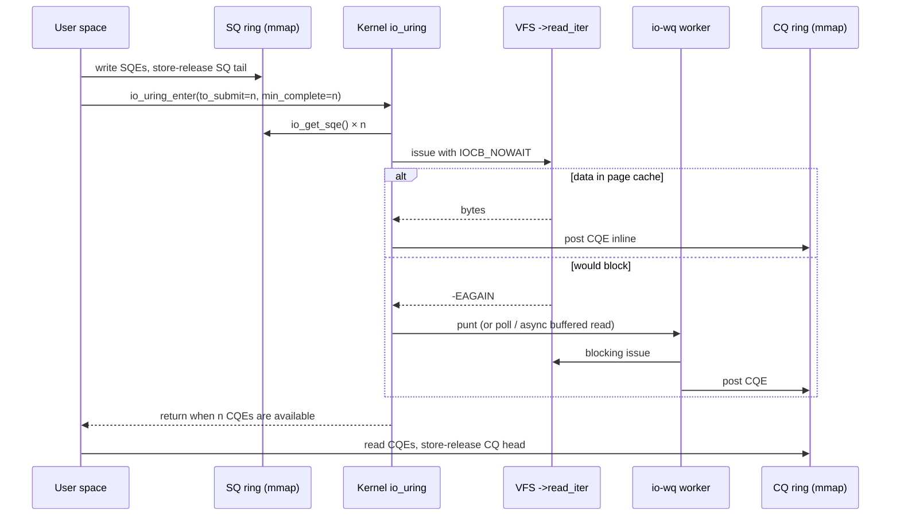

<div dir="rtl">

# ۰۸ — `io_uring`: ringهای مشترک برای I/O ناهمگام

> ماژول ۰۵ · فایل‌سیستم‌ها و I/O · Linux v6.18.63 · نسخهٔ انگلیسی: [`08-io-uring.en.md`](08-io-uring.en.md)

## ۱. خلاصه

- `io_uring` (<span dir="ltr">Linux 5.1</span>، Jens Axboe) یک رابط I/O ناهمگام است که روی دو **ring buffer مشترک بین فضای کاربر و کرنل** ساخته شده و از طریق `mmap` به اشتراک گذاشته می‌شود: **submission queue** (SQ) از `struct io_uring_sqe` و **completion queue** (CQ) از `struct io_uring_cqe`.
- فضای کاربر SQEها را می‌نویسد و tail صف SQ را جلو می‌برد؛ یک `io_uring_enter()` هر تعداد از آن‌ها را submit می‌کند و می‌تواند منتظر completionها هم بماند. با `IORING_SETUP_SQPOLL` یک thread کرنلی SQ را poll می‌کند، پس submit کردن **اصلاً syscall لازم ندارد**.
- داخل کرنل، هر درخواست اول یک issue **غیرمسدودکننده** (`IOCB_NOWAIT`) روی مسیر عادی VFS (`->read_iter`) را امتحان می‌کند. اگر قرار باشد block شود، بعداً با یکی از این راه‌ها تمام می‌شود: **retry مبتنی بر poll** (socket، pipe)، callbackهای **async buffered read** (page cache با `FOP_BUFFER_RASYNC`)، یا یک worker thread از **io-wq**.

## ۲. توضیح کامل

### ۲.۱ پرسش

یک حلقهٔ کپی با `read()`/`write()` برای هر بلوک دو syscall دارد و روی هر کدام block می‌شود. پیش از io_uring، لینوکس `epoll` داشت (آمادگی را گزارش می‌کند نه تکمیل را، و برای فایل‌های معمولی بی‌فایده است چون همیشه «آماده‌اند») و Linux AIO (`io_submit`، که فقط برای `O_DIRECT` واقعاً ناهمگام است، مسیر کد جدایی دارد، و هم برای submit و هم برای جمع‌کردن نتیجه در هر دسته یک syscall می‌خواهد). طراحی‌ای که مبتنی بر completion باشد، برای فایل‌های buffered و socketها کار کند و هزینهٔ syscall را تا صفر سرشکن کند، چه شکلی دارد؟

### ۲.۲ ringها

`io_uring_setup(entries, &params)` یک ring fd و سه ناحیهٔ قابل mmap می‌سازد: SQ ring (head، tail، mask، آرایهٔ index اختیاری)، آرایهٔ SQE، و CQ ring (head، tail، mask، CQEها). مالکیت:

| | تولیدکننده (tail را می‌نویسد) | مصرف‌کننده (head را می‌نویسد) |
|---|---|---|
| SQ | فضای کاربر | کرنل (`ctx->cached_sq_head`) |
| CQ | کرنل | فضای کاربر |

هر طرف فقط index خودش را می‌نویسد، پس پروتکل به memory barrier (`smp_store_release` / `smp_load_acquire`) نیاز دارد ولی به lock نه. هر SQE ۶۴ بایت است: `opcode`، `flags`، `fd`، `off`، `addr`، `len`، پرچم‌های مخصوص هر عملیات، و `user_data` که دست‌نخورده در CQE برمی‌گردد تا برنامه بتواند completionها را با درخواست‌ها جفت کند. هر CQE ۱۶ بایت است: `user_data`، `res` (همان چیزی که syscall برمی‌گرداند؛ در خطا errno منفی) و `flags`.

### ۲.۳ submit داخل کرنل

<span dir="ltr">`io_uring_enter(fd, to_submit, min_complete, flags, ...)` → `io_submit_sqes()`</span> (`io_uring/io_uring.c` L2560). برای هر ورودی: یک `struct io_kiocb` (از cache) تخصیص می‌دهد، SQE را می‌خواند (`io_get_sqe()`، L2528)، `io_init_req()` و سپس `.prep` مربوط به آن opcode را اجرا می‌کند، و بعد <span dir="ltr">`io_queue_sqe()` → `io_issue_sqe()`</span> (L1963) که از جدول opcodeها `io_issue_defs[opcode].issue` را صدا می‌زند، مثلاً `io_read()`.

<span dir="ltr">`io_read()` → `__io_read()`</span> پرچم `IOCB_NOWAIT` را روی kiocb می‌گذارد و `->read_iter()` خود فایل را صدا می‌زند (`io_iter_do_read()`، `io_uring/rw.c` L828). این **همان `ext4_file_read_iter()` است که `read(2)` استفاده می‌کند** (یادداشت ۰۴). نتیجه‌های ممکن:

- داده در page cache است ← درجا تمام می‌شود و CQE حتی پیش از برگشتن `io_uring_enter()` ثبت می‌شود.
- miss در page cache روی فایلی با `FOP_BUFFER_RASYNC` (ext4، XFS، btrfs) ← readahead شروع می‌شود و یک callback روی wait queue (`IOCB_WAITQ`) وقتی folio به‌روز شد، read را از task work دوباره issue می‌کند. هیچ threadی block نمی‌شود.
- `-EAGAIN` و فایل قابل poll است (socket، pipe) ← یک poll داخلی تنظیم می‌شود و با آماده شدن دوباره تلاش می‌شود.
- در غیر این صورت ← به **io-wq** فرستاده می‌شود، مجموعه‌ای از worker threadهای کرنلی (`iou-wrk-<pid>`) که عملیات را در حالت مسدودکننده اجرا می‌کنند. نوشتن‌های buffered روی ext4 معمولاً از همین راه می‌روند.

### ۲.۴ قابلیت‌های مهم

| قابلیت | چه چیزی را صرفه‌جویی می‌کند |
|---|---|
| batching (چند SQE در هر `io_uring_enter`) | تعداد syscall |
| `IOSQE_IO_LINK` | رفت‌وبرگشت به فضای کاربر برای عملیات وابسته (read ← write) |
| `IORING_SETUP_SQPOLL` | syscall مربوط به submit (یک thread کرنلی SQ را poll می‌کند) |
| `IORING_SETUP_IOPOLL` | وقفه‌ها: completion با poll کردن CQ دستگاه NVMe (فقط O_DIRECT) |
| فایل‌ها / بافرهای ثبت‌شده (`io_uring_register`) | `fget`/`fput` و pin کردن صفحه در هر درخواست |
| multishot accept/recv، provided buffers | تنظیم دوباره برای هر رویداد (سرورهای شبکه) |

### ۲.۵ نکتهٔ امنیتی

io_uring باگ‌های privilege-escalation زیادی داشته است، چون سطح بزرگ و پرتغییری است که فیلترکردن در سطح syscall را دور می‌زند (seccomp فقط `io_uring_enter` را می‌بیند، نه عملیات داخل آن را). به همین دلیل `kernel.io_uring_disabled` وجود دارد (`0` مجاز، `1` فقط برای یک گروه privileged، `2` خاموش) (`io_uring/io_uring.c` L147). container runtimeها و برخی توزیع‌ها به‌طور پیش‌فرض آن را مسدود می‌کنند. ماژول ۰۷ به این موضوع برمی‌گردد.

## ۳. نمودار

</div>



<div dir="rtl">

## ۴. مثال عملی (کد واقعی)

برداشتن یک SQE:

</div>

```c
// linux/io_uring/io_uring.c · io_get_sqe() · v6.18.63 · L2528-2558 (comment trimmed)
static bool io_get_sqe(struct io_ring_ctx *ctx, const struct io_uring_sqe **sqe)
{
	unsigned mask = ctx->sq_entries - 1;
	unsigned head = ctx->cached_sq_head++ & mask;

	if (static_branch_unlikely(&io_key_has_sqarray.key) &&
	    (!(ctx->flags & IORING_SETUP_NO_SQARRAY))) {
		head = READ_ONCE(ctx->sq_array[head]);
		if (unlikely(head >= ctx->sq_entries)) {
			WRITE_ONCE(ctx->rings->sq_dropped,
				   READ_ONCE(ctx->rings->sq_dropped) + 1);
			return false;
		}
		head = array_index_nospec(head, ctx->sq_entries);
	}
	/* ... */
	/* double index for 128-byte SQEs, twice as long */
	if (ctx->flags & IORING_SETUP_SQE128)
		head <<= 1;
	*sqe = &ctx->sq_sqes[head];
	return true;
}
```

<div dir="rtl">

- `sq_entries` توانی از ۲ است، پس `& mask` همان چرخش ring است؛ `cached_sq_head` کپی خصوصی کرنل از head است که دسته‌ای به فضای کاربر منتشر می‌شود.
- `sq_array` اختیاری یک لایهٔ indirection است (طراحی اولیهٔ 5.1)؛ `IORING_SETUP_NO_SQARRAY` آن را حذف می‌کند.
- `READ_ONCE` لازم است چون فضای کاربر هر لحظه می‌تواند حافظهٔ مشترک را تغییر دهد؛ مقدار از نظر بازه بررسی می‌شود و سپس با `array_index_nospec` مقاوم می‌شود (Spectre v1، مثل جدول fd در یادداشت ۰۳). index نامعتبر در `sq_dropped` شمرده می‌شود و به آن اعتماد نمی‌شود.
- اشاره‌گر برگشتی به آرایهٔ مشترک SQE اشاره می‌کند. `io_init_req()` فیلدهای لازم را **یک بار** کپی می‌کند تا فضای کاربر نتواند بعد از اعتبارسنجی آن‌ها را عوض کند (TOCTOU).

همان نقطهٔ ورود VFS که `read(2)` دارد:

</div>

```c
// linux/io_uring/rw.c · io_iter_do_read() · v6.18.63 · L828-838
static inline int io_iter_do_read(struct io_rw *rw, struct iov_iter *iter)
{
	struct file *file = rw->kiocb.ki_filp;

	if (likely(file->f_op->read_iter))
		return file->f_op->read_iter(&rw->kiocb, iter);
	else if (file->f_op->read)
		return loop_rw_iter(READ, rw, iter);
	else
		return -EINVAL;
}
```

<div dir="rtl">

آزمایش ۰۵.۵ روی VM، کپی 512 MiB با بلوک‌های 128 KiB:

</div>

```text
copy_rw:    512 MiB, block 128 KiB, 8193 read/write syscalls, 0.438 s, 1168 MiB/s
copy_uring: 512 MiB, block 128 KiB, qd 8, 512 io_uring_enter calls, 0.487 s, 1052 MiB/s
# bpftrace on io_uring tracepoints during copy_uring:
@punted_to_io_wq[23]: 4096      # every WRITE went to an io-wq worker
@submitted[23]: 4096
@submitted[22]: 4096            # no READ was punted: async buffered reads
```

<div dir="rtl">

## ۵. حالت‌های خاص و دام‌ها

- **سرریز CQ:** اگر برنامه completionها را به‌موقع جمع نکند، به یک فهرست overflow می‌روند (`IORING_SQ_CQ_OVERFLOW`)؛ اندازهٔ CQ (پیش‌فرض ۲ برابر SQ) را متناسب با تعداد درخواست‌های در جریان انتخاب کنید.
- **ترتیب completion همان ترتیب submit نیست.** با `user_data` جفت کنید، یا وقتی ترتیب مهم است از <span dir="ltr">`IOSQE_IO_LINK`/`IOSQE_IO_DRAIN`</span> استفاده کنید.
- **یک short read زنجیرهٔ link را می‌شکند**: SQE پیوندخوردهٔ بعدی با `-ECANCELED` تمام می‌شود (آزمایش ۰۵.۵ این را بررسی می‌کند).
- **بافرها باید تا رسیدن CQE معتبر بمانند**، نه فقط تا برگشتن `io_uring_enter()`.
- **«io_uring همیشه سریع‌تر است»** برای کپی‌ای که داده‌اش در page cache است و بلوک‌هایش بزرگ‌اند درست نیست: کار اصلی `memcpy` است و صرفه‌جویی syscall ناچیز. io_uring در عملیات کوچک و زیاد، queue depth بالا روی دستگاه‌های سریع و سرورهای شبکه برنده است.
- `strace` فقط `io_uring_enter` را می‌بیند؛ برای دیدن تک‌تک عملیات از tracepointهای `io_uring:*` استفاده کنید.

## ۶. نکته‌های امتحانی

- دو ring که mmap شده‌اند: SQ (تولید توسط کاربر) و CQ (تولید توسط کرنل)؛ بدون lock با acquire/release.
- `io_uring_enter` یک دسته را submit می‌کند و در صورت نیاز منتظر می‌ماند؛ SQPOLL حتی همین را هم حذف می‌کند.
- مسیر issue: <span dir="ltr">`io_submit_sqes → io_issue_sqe → io_read → ->read_iter`</span> با `IOCB_NOWAIT`.
- کار مسدودکننده: callback مربوط به async buffered read، retry با poll، یا worker در io-wq.
- `user_data` CQE را به SQE وصل می‌کند؛ link و drain ترتیب را تحمیل می‌کنند.
- امنیت: سطح حملهٔ بزرگ؛ `kernel.io_uring_disabled`.

## ۷. پیوندها

- درس: [`../lesson.fa.md`](../lesson.fa.md) §۴.۶ · مرور کد کرنل: [`../kernel-walkthrough.fa.md`](../kernel-walkthrough.fa.md) §۷
- آزمایش: [`../labs/05-io-uring-copy/`](../labs/05-io-uring-copy/)
- آزمونک: [`../quiz.fa.md`](../quiz.fa.md) پرسش‌های ۲ و ۹
- قبلی: [`07-journaling-crash-consistency.fa.md`](07-journaling-crash-consistency.fa.md) · بعدی: [`09-device-drivers-char-devices.fa.md`](09-device-drivers-char-devices.fa.md)

</div>
