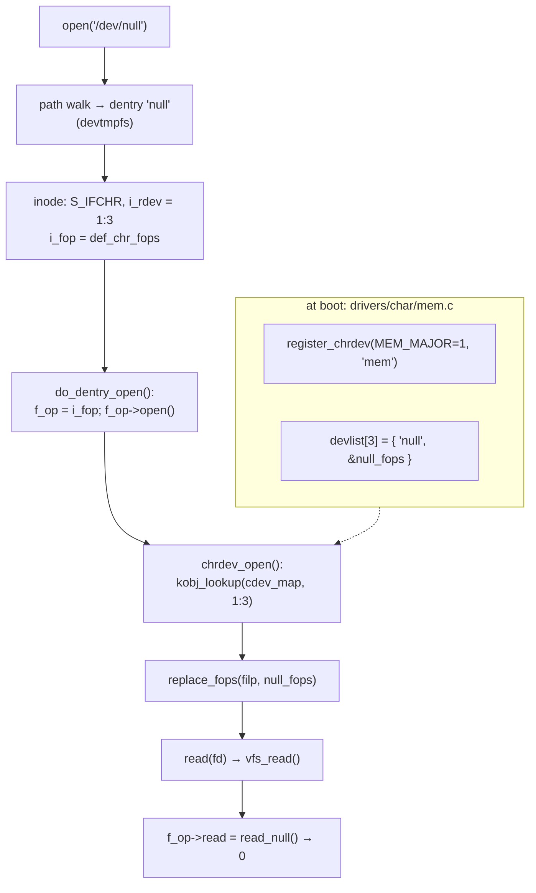

# 09 — Device drivers and character devices

> Module 05 · File Systems & I/O · Linux v6.18.63 · Farsi: [`09-device-drivers-char-devices.fa.md`](09-device-drivers-char-devices.fa.md)

## 1. Summary

- To user space a device is a **special file**: an inode whose type is `S_IFCHR` or `S_IFBLK` and whose `i_rdev` holds a **(major, minor)** number. `open("/dev/null")` walks the path like any file (note 02), and the VFS then routes the open to the driver registered for that number.
- A **character device** driver supplies a `struct file_operations` (`read`, `write`, `ioctl`, `poll`, `mmap`, …) and registers it with `cdev_add()` (or `misc_register()`). `chrdev_open()` looks the number up and **swaps `file->f_op`** to the driver's table, so every later syscall goes straight to the driver.
- A **block device** driver instead supplies `blk_mq_ops` (`queue_rq`) and is reached through the block layer (notes 05, 06). The page cache and filesystems sit on top of it; character devices have no page cache unless the driver provides `mmap`.

## 2. Detailed explanation

### 2.1 The question

`/dev/null` is a file on `devtmpfs`. It has no data blocks, yet `read()` returns 0 and `write()` "succeeds" for any size. Where is the code that does that, and how does `read(fd)` get there through the same `vfs_read()` we followed for ext4?

### 2.2 From name to driver

1. **Device number.** `ls -l /dev/null` shows `crw-rw-rw- 1 root root 1, 3`: character device, major 1, minor 3. `dev_t` packs both (`MAJOR()`, `MINOR()`).
2. **Inode setup.** When a filesystem instantiates a device inode, it calls `init_special_inode()` (`fs/inode.c` L2548). For `S_IFCHR` that sets `inode->i_fop = &def_chr_fops` and `inode->i_rdev = rdev`. For `S_IFBLK`, `def_blk_fops`; for FIFOs, `pipefifo_fops`.
3. **Open.** `do_dentry_open()` copies `inode->i_fop` into `file->f_op` and calls `->open`, which for a char device is `chrdev_open()` (`fs/char_dev.c` L373).
4. **Lookup.** `chrdev_open()` finds the `struct cdev` for `i_rdev` in the `cdev_map` (a kobject map from number ranges to drivers), caches it in `inode->i_cdev`, and calls `replace_fops(filp, p->ops)`.
5. **Driver open.** If the driver's table has its own `->open`, it runs now (e.g. allocate per-open state in `file->private_data`).

From then on, `vfs_read()` sees the driver's `f_op`. The `/dev/null` table (`drivers/char/mem.c` L644) has both `.read = read_null` and `.read_iter`, so `vfs_read()` takes its first branch (`file->f_op->read`), and `read_null()` simply returns 0.

### 2.3 Registering a driver

| API | Use |
|---|---|
| `alloc_chrdev_region(&dev, baseminor, count, name)` | get a free major dynamically (preferred) |
| `register_chrdev_region(from, count, name)` | claim a fixed range |
| `cdev_init(&cdev, &fops)` + `cdev_add(&cdev, dev, count)` | make the range live |
| `misc_register(&miscdevice)` | one-minor device under major 10, auto `/dev` node; the simplest choice |
| `device_create(class, ...)` | emit the uevent so udev / devtmpfs create `/dev/<name>` |

`/proc/devices` lists registered majors; `/sys/dev/char/<maj>:<min>` links each number to its device in the driver model.

### 2.4 What a `read` handler must do

A driver's `read(struct file *f, char __user *buf, size_t count, loff_t *ppos)` runs in **process context** of the caller. It must:

- copy to user memory only with `copy_to_user()` (or an `iov_iter` in `read_iter`), never by dereferencing `buf`, because the pointer is untrusted and may fault (Module 04);
- return the number of bytes copied, 0 for EOF, or a negative errno;
- update `*ppos` if the device is seekable;
- block with a wait queue (or return `-EAGAIN` if `O_NONBLOCK`), and implement `->poll` so `select`/`epoll`/io_uring can wait for it;
- never sleep while holding a spinlock (Module 03).

Interrupt handlers do the hardware side: acknowledge the device, move data into a driver buffer, `wake_up()` the waiting reader. Heavy work goes to a threaded IRQ or a workqueue.

## 3. Diagram



## 4. Worked example (real code)

The switch from the generic table to the driver's table:

```c
// linux/fs/char_dev.c · chrdev_open() · v6.18.63 · L380-417 (excerpt)
	spin_lock(&cdev_lock);
	p = inode->i_cdev;
	if (!p) {
		struct kobject *kobj;
		int idx;
		spin_unlock(&cdev_lock);
		kobj = kobj_lookup(cdev_map, inode->i_rdev, &idx);
		if (!kobj)
			return -ENXIO;
		new = container_of(kobj, struct cdev, kobj);
		/* ... re-check under cdev_lock, cache in inode->i_cdev ... */
	}
	/* ... */
	fops = fops_get(p->ops);
	if (!fops)
		goto out_cdev_put;

	replace_fops(filp, fops);
	if (filp->f_op->open) {
		ret = filp->f_op->open(inode, filp);
		if (ret)
			goto out_cdev_put;
	}
```

- First open of this inode: `kobj_lookup()` maps the device number to the driver's `cdev`. No driver → `-ENXIO` ("No such device or address"), the error you get opening a `/dev` node whose module is not loaded.
- The result is cached in `inode->i_cdev`, so later opens skip the map.
- `fops_get()` takes a reference on the **module** that owns the table, so the driver cannot be unloaded while the file is open.
- `replace_fops()` is the key line: after it, this `struct file` belongs to the driver.

And the driver itself:

```c
// linux/drivers/char/mem.c · read_null() / write_null() · v6.18.63 · L412-422
static ssize_t read_null(struct file *file, char __user *buf,
			 size_t count, loff_t *ppos)
{
	return 0;
}

static ssize_t write_null(struct file *file, const char __user *buf,
			  size_t count, loff_t *ppos)
{
	return count;
}
```

On the VM:

```bash
ls -l /dev/null /dev/zero /dev/loop-control
grep -E '^ *(1|10|7) ' /proc/devices
sudo bpftrace -e 'kprobe:read_null { @[comm] = count(); }' -c 'dd if=/dev/null of=/dev/null count=1'
```

```text
$ ls -l /dev/null /dev/zero /dev/loop-control
crw-rw---- 1 root disk 10, 237 Nov 15 16:50 /dev/loop-control
crw-rw-rw- 1 root root  1,   3 Nov 15 16:50 /dev/null
crw-rw-rw- 1 root root  1,   5 Nov 15 16:50 /dev/zero
$ grep -E '^ *(1|7|10) ' /proc/devices
  1 mem
  7 vcs
 10 misc
  7 loop
$ sudo bpftrace -q -e 'kprobe:read_null /comm == "dd"/ { @read_null[comm] = count(); }' -c 'dd if=/dev/null of=/dev/null count=1 status=none'
@read_null[dd]: 1
```

Real output (aos-lab, Linux 6.18.63, 2026-11-15). Major 7 appears twice because `/proc/devices` lists character majors first (`7 vcs`) and block majors after (`7 loop`); `/dev/loop-control` is a misc device (10:237). One `read()` of `/dev/null` = one call of `read_null()`.

## 5. Edge cases & pitfalls

- **`-ENXIO` vs `-ENODEV`:** `ENXIO` at open = no driver bound to that number; `ENODEV` usually means the operation is not supported by the device.
- **Device numbers are not stable across boots** for dynamically allocated majors. Use udev names or `/dev/disk/by-*`, never hard-coded numbers.
- **A device node on a `nodev` mount does not open.** `mount -o nodev` (common for `/tmp`, containers) blocks `S_IFCHR`/`S_IFBLK` opens; that is a security boundary, not a bug.
- **Block devices have two faces**: `/dev/sda` opened directly uses `def_blk_fops` and the block device's own page cache (`bdev` inode); the filesystem on it uses the same queue but its own inodes.
- **Writing a driver?** Do it in the VM. A bug in `read()` (bad `copy_to_user` length, sleeping in atomic context) is a kernel oops, not a segfault.

## 6. Exam-style key points

- Device = special inode (`S_IFCHR`/`S_IFBLK`) + `i_rdev` (major:minor).
- `init_special_inode()` → `def_chr_fops` → `chrdev_open()` → `kobj_lookup(cdev_map)` → `replace_fops()`.
- Char driver = `file_operations`; block driver = `blk_mq_ops` behind the block layer.
- `copy_to_user`, return bytes/0/-errno, wait queues + `->poll` for blocking.
- `fops_get()` pins the module while the file is open.
- `/proc/devices`, `/sys/dev/char`, devtmpfs + udev create the nodes.

## 7. Links

- Lesson: [`../lesson.en.md`](../lesson.en.md) §4.7 · Walkthrough: [`../kernel-walkthrough.en.md`](../kernel-walkthrough.en.md) §8
- Lab: [`../labs/01-read-call-chain/`](../labs/01-read-call-chain/) (extension: `/dev/null`)
- Quiz: [`../quiz.en.md`](../quiz.en.md) Q7, Q15
- Previous: [`08-io-uring.en.md`](08-io-uring.en.md) · Index: [`INDEX.en.md`](INDEX.en.md)
