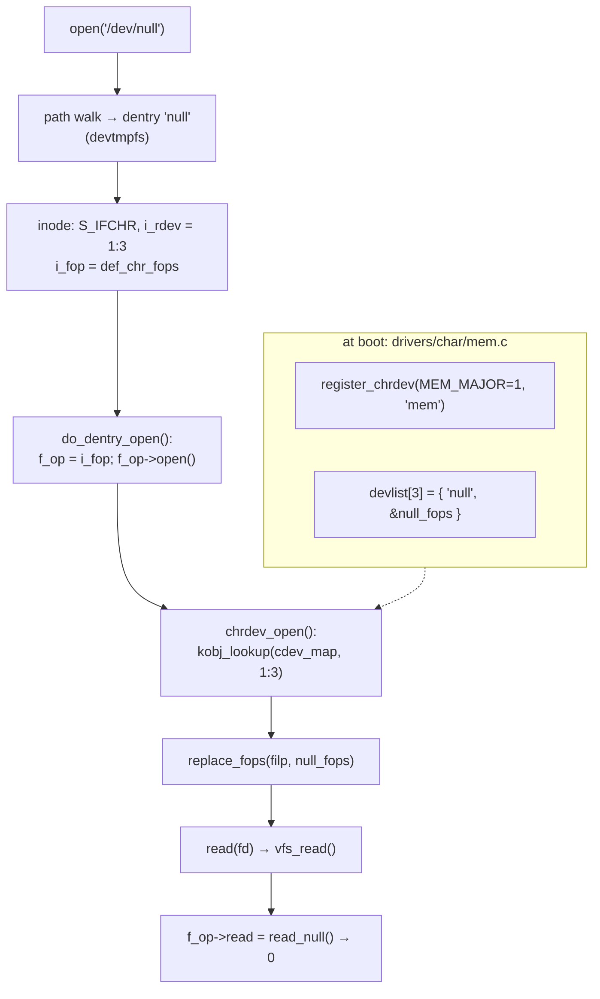

<div dir="rtl">

# ۰۹ — درایورهای دستگاه و character deviceها

> ماژول ۰۵ · فایل‌سیستم‌ها و I/O · Linux v6.18.63 · نسخهٔ انگلیسی: [`09-device-drivers-char-devices.en.md`](09-device-drivers-char-devices.en.md)

## ۱. خلاصه

- از دید فضای کاربر، یک دستگاه یک **فایل ویژه** است: inodeای که نوعش `S_IFCHR` یا `S_IFBLK` است و `i_rdev` آن یک عدد **(major, minor)** را نگه می‌دارد. `open("/dev/null")` مثل هر فایل دیگری مسیر را طی می‌کند (یادداشت ۰۲)، و سپس VFS این open را به درایوری می‌فرستد که برای آن عدد ثبت شده است.
- درایور **character device** یک `struct file_operations` (`read`، `write`، `ioctl`، `poll`، `mmap`، …) فراهم می‌کند و آن را با `cdev_add()` (یا `misc_register()`) ثبت می‌کند. `chrdev_open()` عدد را جستجو می‌کند و **`file->f_op` را با جدول درایور عوض می‌کند**، پس هر syscall بعدی مستقیم به درایور می‌رود.
- درایور **block device** در عوض `blk_mq_ops` (`queue_rq`) فراهم می‌کند و از طریق block layer به آن می‌رسیم (یادداشت‌های ۰۵ و ۰۶). page cache و فایل‌سیستم‌ها روی آن قرار می‌گیرند؛ character deviceها page cache ندارند مگر اینکه درایور `mmap` فراهم کند.

## ۲. توضیح کامل

### ۲.۱ پرسش

`/dev/null` فایلی روی `devtmpfs` است. هیچ بلوک داده‌ای ندارد، ولی `read()` صفر برمی‌گرداند و `write()` برای هر اندازه‌ای «موفق» می‌شود. کدی که این کار را می‌کند کجاست، و `read(fd)` چطور از همان `vfs_read()` که برای ext4 دنبال کردیم به آنجا می‌رسد؟

### ۲.۲ از نام تا درایور

۱. **شمارهٔ دستگاه.** `ls -l /dev/null` نشان می‌دهد <span dir="ltr">`crw-rw-rw- 1 root root 1, 3`</span>: character device، major 1، minor 3. `dev_t` هر دو را در خود جا می‌دهد (`MAJOR()`، `MINOR()`).

۲. **راه‌اندازی inode.** وقتی یک فایل‌سیستم inode یک دستگاه را می‌سازد، `init_special_inode()` را صدا می‌زند (`fs/inode.c` L2548). برای `S_IFCHR` این تابع <span dir="ltr">`inode->i_fop = &def_chr_fops`</span> و <span dir="ltr">`inode->i_rdev = rdev`</span> را تنظیم می‌کند. برای `S_IFBLK` جدول `def_blk_fops` و برای FIFOها `pipefifo_fops`.

۳. **open.** `do_dentry_open()` مقدار `inode->i_fop` را در `file->f_op` کپی می‌کند و `->open` را صدا می‌زند، که برای char device همان `chrdev_open()` است (`fs/char_dev.c` L373).

۴. **جستجو.** `chrdev_open()` آن `struct cdev` را که به `i_rdev` مربوط است در `cdev_map` پیدا می‌کند (یک kobject map از بازه‌های عددی به درایورها)، آن را در `inode->i_cdev` cache می‌کند و `replace_fops(filp, p->ops)` را صدا می‌زند.

۵. **open درایور.** اگر جدول درایور `->open` خودش را داشته باشد، الان اجرا می‌شود (مثلاً state مخصوص هر open را در `file->private_data` تخصیص می‌دهد).

از این به بعد `vfs_read()` همان `f_op` درایور را می‌بیند. جدول `/dev/null` (`drivers/char/mem.c` L644) هم <span dir="ltr">`.read = read_null`</span> دارد و هم `.read_iter`، پس `vfs_read()` شاخهٔ اول خود (`file->f_op->read`) را انتخاب می‌کند و `read_null()` فقط ۰ برمی‌گرداند.

### ۲.۳ ثبت یک درایور

| API | کاربرد |
|---|---|
| `alloc_chrdev_region(&dev, baseminor, count, name)` | گرفتن یک major آزاد به‌صورت پویا (روش ترجیحی) |
| `register_chrdev_region(from, count, name)` | گرفتن یک بازهٔ ثابت |
| `cdev_init(&cdev, &fops)` + `cdev_add(&cdev, dev, count)` | فعال کردن بازه |
| `misc_register(&miscdevice)` | دستگاه تک‌minor زیر major 10 با گرهٔ خودکار در `/dev`؛ ساده‌ترین انتخاب |
| `device_create(class, ...)` | فرستادن uevent تا udev / devtmpfs گرهٔ `/dev/<name>` را بسازند |

`/proc/devices` majorهای ثبت‌شده را فهرست می‌کند؛ `/sys/dev/char/<maj>:<min>` هر عدد را به دستگاهش در driver model پیوند می‌دهد.

### ۲.۴ یک handler برای `read` چه باید بکند

تابع <span dir="ltr">`read(struct file *f, char __user *buf, size_t count, loff_t *ppos)`</span> درایور در **process context** فراخواننده اجرا می‌شود. باید:

- فقط با `copy_to_user()` (یا یک `iov_iter` در `read_iter`) در حافظهٔ کاربر کپی کند، هرگز با dereference مستقیم `buf`، چون این اشاره‌گر قابل‌اعتماد نیست و ممکن است fault بدهد (ماژول ۰۴)؛
- تعداد بایت‌های کپی‌شده، ۰ برای EOF، یا یک errno منفی برگرداند؛
- اگر دستگاه قابل seek است، `*ppos` را به‌روز کند؛
- با یک wait queue منتظر بماند (یا اگر `O_NONBLOCK` است `-EAGAIN` برگرداند) و `->poll` را پیاده کند تا `select`/`epoll`/io_uring بتوانند منتظرش بمانند؛
- هرگز در حالی که یک spinlock را نگه داشته نخوابد (ماژول ۰۳).

handlerهای وقفه سمت سخت‌افزار را انجام می‌دهند: دریافت دستگاه را تأیید می‌کنند (acknowledge)، داده را به بافر درایور منتقل می‌کنند و خوانندهٔ منتظر را با `wake_up()` بیدار می‌کنند. کار سنگین به یک threaded IRQ یا workqueue سپرده می‌شود.

## ۳. نمودار

</div>



<div dir="rtl">

## ۴. مثال عملی (کد واقعی)

جابه‌جایی از جدول عمومی به جدول درایور:

</div>

```c
// linux/fs/char_dev.c · chrdev_open() · v6.18.63 · L380-417 (excerpt)
	spin_lock(&cdev_lock);
	p = inode->i_cdev;
	if (!p) {
		struct kobject *kobj;
		int idx;
		spin_unlock(&cdev_lock);
		kobj = kobj_lookup(cdev_map, inode->i_rdev, &idx);
		if (!kobj)
			return -ENXIO;
		new = container_of(kobj, struct cdev, kobj);
		/* ... re-check under cdev_lock, cache in inode->i_cdev ... */
	}
	/* ... */
	fops = fops_get(p->ops);
	if (!fops)
		goto out_cdev_put;

	replace_fops(filp, fops);
	if (filp->f_op->open) {
		ret = filp->f_op->open(inode, filp);
		if (ret)
			goto out_cdev_put;
	}
```

<div dir="rtl">

- اولین open این inode: `kobj_lookup()` شمارهٔ دستگاه را به `cdev` درایور نگاشت می‌کند. اگر درایوری نباشد ← `-ENXIO` <span dir="ltr">("No such device or address")</span>، همان خطایی که هنگام باز کردن گرهٔ `/dev`ای می‌گیرید که ماژولش بارگذاری نشده است.
- نتیجه در `inode->i_cdev` cache می‌شود، پس openهای بعدی از map رد نمی‌شوند.
- `fops_get()` یک ارجاع روی **ماژولی** که مالک جدول است می‌گیرد، پس تا وقتی فایل باز است نمی‌توان درایور را unload کرد.
- `replace_fops()` خط کلیدی است: بعد از آن، این `struct file` متعلق به درایور است.

و خود درایور:

</div>

```c
// linux/drivers/char/mem.c · read_null() / write_null() · v6.18.63 · L412-422
static ssize_t read_null(struct file *file, char __user *buf,
			 size_t count, loff_t *ppos)
{
	return 0;
}

static ssize_t write_null(struct file *file, const char __user *buf,
			  size_t count, loff_t *ppos)
{
	return count;
}
```

<div dir="rtl">

روی VM (ثبت‌شده در آزمایش ۰۵.۱، بخش تکمیلی):

</div>

```bash
ls -l /dev/null /dev/zero /dev/loop-control
grep -E '^ *(1|10|7) ' /proc/devices
sudo bpftrace -e 'kprobe:read_null { @[comm] = count(); }' -c 'dd if=/dev/null of=/dev/null count=1'
```

```text
$ ls -l /dev/null /dev/zero /dev/loop-control
crw-rw---- 1 root disk 10, 237 Nov 15 16:50 /dev/loop-control
crw-rw-rw- 1 root root  1,   3 Nov 15 16:50 /dev/null
crw-rw-rw- 1 root root  1,   5 Nov 15 16:50 /dev/zero
$ grep -E '^ *(1|7|10) ' /proc/devices
  1 mem
  7 vcs
 10 misc
  7 loop
$ sudo bpftrace -q -e 'kprobe:read_null /comm == "dd"/ { @read_null[comm] = count(); }' -c 'dd if=/dev/null of=/dev/null count=1 status=none'
@read_null[dd]: 1
```

<div dir="rtl">

خروجی واقعی (aos-lab، Linux 6.18.63، ۲۰۲۶-۱۱-۱۵). major شمارهٔ ۷ دو بار آمده، چون `/proc/devices` اول majorهای کاراکتری (`7 vcs`) و بعد majorهای بلاکی (`7 loop`) را فهرست می‌کند؛ `/dev/loop-control` یک misc device است (10:237). هر `read()` از `/dev/null` یعنی یک بار فراخوانی `read_null()`.

</div>

<div dir="rtl">

## ۵. حالت‌های خاص و دام‌ها

- **`-ENXIO` در برابر `-ENODEV`:** `ENXIO` هنگام open یعنی هیچ درایوری به آن عدد وصل نیست؛ `ENODEV` معمولاً یعنی دستگاه آن عملیات را پشتیبانی نمی‌کند.
- **شماره‌های دستگاه برای majorهایی که پویا تخصیص می‌یابند بین بوت‌ها پایدار نیستند.** از نام‌های udev یا `/dev/disk/by-*` استفاده کنید، هرگز از عددهای hard-coded.
- **گرهٔ دستگاه روی mount با `nodev` باز نمی‌شود.** `mount -o nodev` (رایج برای `/tmp` و containerها) جلوی open روی <span dir="ltr">`S_IFCHR`/`S_IFBLK`</span> را می‌گیرد؛ این یک مرز امنیتی است، نه باگ.
- **block deviceها دو چهره دارند**: اگر `/dev/sda` مستقیم باز شود از `def_blk_fops` و page cache خود block device (inode مربوط به `bdev`) استفاده می‌کند؛ فایل‌سیستمِ روی آن از همان صف ولی inodeهای خودش استفاده می‌کند.
- **درایور می‌نویسید؟** در VM این کار را بکنید. باگ در `read()` (طول اشتباه در `copy_to_user`، خوابیدن در atomic context) یک kernel oops است، نه segfault.

## ۶. نکته‌های امتحانی

- دستگاه = inode ویژه (<span dir="ltr">`S_IFCHR`/`S_IFBLK`</span>) + `i_rdev` (major:minor).
- <span dir="ltr">`init_special_inode()` → `def_chr_fops` → `chrdev_open()` → `kobj_lookup(cdev_map)` → `replace_fops()`</span>.
- درایور char یعنی `file_operations`؛ درایور block یعنی `blk_mq_ops` پشت block layer.
- `copy_to_user`، برگرداندن بایت‌ها/۰/<span dir="ltr">-errno</span>، wait queue به‌اضافهٔ `->poll` برای حالت مسدودکننده.
- `fops_get()` تا وقتی فایل باز است ماژول را pin می‌کند.
- `/proc/devices`، `/sys/dev/char`، و devtmpfs به‌همراه udev گره‌ها را می‌سازند.

## ۷. پیوندها

- درس: [`../lesson.fa.md`](../lesson.fa.md) §۴.۷ · مرور کد کرنل: [`../kernel-walkthrough.fa.md`](../kernel-walkthrough.fa.md) §۸
- آزمایش: [`../labs/01-read-call-chain/`](../labs/01-read-call-chain/) (بخش تکمیلی: `/dev/null`)
- آزمونک: [`../quiz.fa.md`](../quiz.fa.md) پرسش‌های ۷ و ۱۵
- قبلی: [`08-io-uring.fa.md`](08-io-uring.fa.md) · فهرست: [`INDEX.fa.md`](INDEX.fa.md)

</div>
