# 06 — Kernel walkthrough: KVM, namespaces, cgroups (and OpenBSD vmm/pledge)

> Pins: Linux **v6.18.63** (`_shared/sources/linux/`), OpenBSD **`8cada8c`** (`_shared/sources/openbsd/`, `sys/dev/vmm` added to the sparse set for this module) · ARCH-SPECIFIC (x86-64, Intel VMX path)
> Every excerpt was printed with `bash _shared/sources/cite.sh <repo> <path> <symbol|Lnnn> <lines>`. Lines marked `/* ... */` were cut for length. Farsi: [`kernel-walkthrough.fa.md`](kernel-walkthrough.fa.md)

## Call chains at a glance

```mermaid
flowchart TB
  subgraph KVMPATH["Lab 06.4: one OUT instruction"]
    U1["VMM: ioctl(vcpufd, KVM_RUN)"] --> K1["kvm_vcpu_ioctl()<br/>virt/kvm/kvm_main.c"]
    K1 --> K2["kvm_arch_vcpu_ioctl_run()<br/>arch/x86/kvm/x86.c"]
    K2 --> K3["vcpu_run() loop"]
    K3 --> K4["vcpu_enter_guest()"]
    K4 --> K5["kvm_x86_call(vcpu_run)<br/>VMRESUME: guest runs"]
    K5 -->|"VM exit: OUT 0x3f8"| K6["kvm_x86_call(handle_exit)<br/>__vmx_handle_exit()"]
    K6 --> K7["kvm_vmx_exit_handlers[]<br/>handle_io()"]
    K7 --> K8["kvm_fast_pio() → kvm_fast_pio_out()<br/>→ emulator_pio_in_out()"]
    K8 -->|"no in-kernel device on port"| K9["exit_reason = KVM_EXIT_IO<br/>return 0"]
    K9 --> U2["KVM_RUN returns to VMM"]
  end
  subgraph NSPATH["Lab 06.3: unshare + cgroup"]
    S1["unshare(CLONE_NEW*)"] --> S2["ksys_unshare()<br/>kernel/fork.c"]
    S2 --> S3["unshare_nsproxy_namespaces()<br/>kernel/nsproxy.c"]
    S3 --> S4["create_new_namespaces()<br/>copy_mnt_ns · copy_utsname · copy_pid_ns ..."]
    S2 --> S5["switch_task_namespaces()"]
    W1["echo PID > cgroup.procs"] --> W2["__cgroup_procs_write()<br/>kernel/cgroup/cgroup.c"]
    W2 --> W3["cgroup_attach_task()"]
  end
```



## 1. KVM_RUN: from ioctl to guest and back

### 1.1 The system fd: `kvm_dev_ioctl()`

`linux/virt/kvm/kvm_main.c · kvm_dev_ioctl() · v6.18.63` · [Elixir L5546](https://elixir.bootlin.com/linux/v6.18.63/source/virt/kvm/kvm_main.c#L5546)

```c
static long kvm_dev_ioctl(struct file *filp,
			  unsigned int ioctl, unsigned long arg)
{
	int r = -EINVAL;

	switch (ioctl) {
	case KVM_GET_API_VERSION:
		if (arg)
			goto out;
		r = KVM_API_VERSION;
		break;
	case KVM_CREATE_VM:
		r = kvm_dev_ioctl_create_vm(arg);
		break;
	case KVM_CHECK_EXTENSION:
		r = kvm_vm_ioctl_check_extension_generic(NULL, arg);
		break;
	case KVM_GET_VCPU_MMAP_SIZE:
		if (arg)
			goto out;
		r = PAGE_SIZE;     /* struct kvm_run */
#ifdef CONFIG_X86
		r += PAGE_SIZE;    /* pio data page */
#endif
```

| Line | Meaning |
|---|---|
| `kvm_dev_ioctl(...)` | Handler for ioctls on the fd from `open("/dev/kvm")`. This fd only creates VMs and answers capability questions. |
| `KVM_GET_API_VERSION` | Returns `KVM_API_VERSION` (12). Our client refuses to continue on any other value. `arg` must be 0. |
| `KVM_CREATE_VM` | Creates `struct kvm` and returns a **new fd** for it. Every later VM-wide ioctl goes to that fd, not to `/dev/kvm`. |
| `KVM_CHECK_EXTENSION` | Feature probing (`KVM_CAP_*`). Real VMMs check dozens of these. |
| `KVM_GET_VCPU_MMAP_SIZE` | How many bytes to `mmap` from a vCPU fd. One page for `struct kvm_run`… |
| `r += PAGE_SIZE` (x86) | …plus one page for PIO data. That is where `run->io.data_offset` points in our client (see §2.3, `KVM_PIO_PAGE_OFFSET`). |

### 1.2 The vCPU fd: `KVM_RUN` in `kvm_vcpu_ioctl()`

`linux/virt/kvm/kvm_main.c · kvm_vcpu_ioctl() · v6.18.63 · L4468-4504` · [Elixir L4471](https://elixir.bootlin.com/linux/v6.18.63/source/virt/kvm/kvm_main.c#L4471)

```c
	if (mutex_lock_killable(&vcpu->mutex))
		return -EINTR;
	switch (ioctl) {
	case KVM_RUN: {
		struct pid *oldpid;
		r = -EINVAL;
		if (arg)
			goto out;
		/* ... comment on vcpu->pid locking ... */
		oldpid = vcpu->pid;
		if (unlikely(oldpid != task_pid(current))) {
			/* The thread running this VCPU changed. */
			struct pid *newpid;

			r = kvm_arch_vcpu_run_pid_change(vcpu);
			if (r)
				break;

			newpid = get_task_pid(current, PIDTYPE_PID);
			write_lock(&vcpu->pid_lock);
			vcpu->pid = newpid;
			write_unlock(&vcpu->pid_lock);
			/* ... put_pid(oldpid) ... */
		}
		vcpu->wants_to_run = !READ_ONCE(vcpu->run->immediate_exit__unsafe);
		r = kvm_arch_vcpu_ioctl_run(vcpu);
		vcpu->wants_to_run = false;

		trace_kvm_userspace_exit(vcpu->run->exit_reason, r);
		break;
	}
```

| Line | Meaning |
|---|---|
| `mutex_lock_killable(&vcpu->mutex)` | One vCPU can be inside `KVM_RUN` on only one thread at a time. A second thread calling it blocks here. |
| `if (arg) goto out` | `KVM_RUN` takes no argument; all input/output goes through the mmap'ed `struct kvm_run`. |
| `oldpid != task_pid(current)` | KVM records **which host thread** runs this vCPU. This is the "vCPU = thread" fact in code: directed yield and `perf kvm` find a vCPU through `vcpu->pid`. |
| `kvm_arch_vcpu_run_pid_change()` | Arch hook when the thread changes (on x86 it updates the PMU and Xen state). |
| `immediate_exit__unsafe` | User space can ask KVM to return at once (used with signals to kick a vCPU out of the guest). |
| `kvm_arch_vcpu_ioctl_run(vcpu)` | The arch-specific part (x86: `arch/x86/kvm/x86.c` L11529). It blocks until an exit needs user space. |
| `trace_kvm_userspace_exit` | The `kvm:kvm_userspace_exit` tracepoint. `perf kvm stat` and `bpftrace` hook here (Lab 06.5 extension). |

### 1.3 The run loop: `vcpu_run()`

`linux/arch/x86/kvm/x86.c · vcpu_run() · v6.18.63 · L11272-11293` · [Elixir L11272](https://elixir.bootlin.com/linux/v6.18.63/source/arch/x86/kvm/x86.c#L11272)

```c
static int vcpu_run(struct kvm_vcpu *vcpu)
{
	int r;

	vcpu->run->exit_reason = KVM_EXIT_UNKNOWN;

	for (;;) {
		/* ... comment on PV TLB flush ... */
		vcpu->arch.at_instruction_boundary = false;
		if (kvm_vcpu_running(vcpu)) {
			r = vcpu_enter_guest(vcpu);
		} else {
			r = vcpu_block(vcpu);
		}

		if (r <= 0)
			break;
```

| Line | Meaning |
|---|---|
| `exit_reason = KVM_EXIT_UNKNOWN` | Default. If the loop ever returns without setting a reason, user space sees "unknown", which signals a KVM bug. |
| `for (;;)` | The **in-kernel** loop. Most exits never leave it: KVM handles them and re-enters the guest. |
| `kvm_vcpu_running()` → `vcpu_enter_guest()` | Load guest state, VM entry, run until VM exit, handle the exit. |
| `vcpu_block()` | The guest executed `HLT` and an in-kernel APIC exists: sleep the host thread until an interrupt arrives. Without an in-kernel irqchip (our client) `HLT` goes to user space instead. |
| `if (r <= 0) break` | The convention for every exit handler: **`1` = handled, re-enter the guest**; **`0` = return to user space** (with `run->exit_reason` set); negative = error. |

Inside `vcpu_enter_guest()` the two lines that matter are the entry and the dispatch ([L11014](https://elixir.bootlin.com/linux/v6.18.63/source/arch/x86/kvm/x86.c#L11014), [L11132](https://elixir.bootlin.com/linux/v6.18.63/source/arch/x86/kvm/x86.c#L11132)):

```c
		exit_fastpath = kvm_x86_call(vcpu_run)(vcpu, run_flags);   /* L11014 */
	/* ... */
	r = kvm_x86_call(handle_exit)(vcpu, exit_fastpath);           /* L11132 */
	return r;
```

`kvm_x86_call(vcpu_run)` is a static call into the vendor module: `vmx_vcpu_run()` on Intel, `svm_vcpu_run()` on AMD. It returns after the VM exit. `handle_exit` dispatches on the exit reason, which is §2.

## 2. One VM exit end to end: `OUT %al, (%dx)` on port 0x3f8

### 2.1 Dispatch table: `kvm_vmx_exit_handlers[]`

`linux/arch/x86/kvm/vmx/vmx.c · kvm_vmx_exit_handlers[] · v6.18.63 · L6092-6107` · [Elixir L6092](https://elixir.bootlin.com/linux/v6.18.63/source/arch/x86/kvm/vmx/vmx.c#L6092)

```c
static int (*kvm_vmx_exit_handlers[])(struct kvm_vcpu *vcpu) = {
	[EXIT_REASON_EXCEPTION_NMI]           = handle_exception_nmi,
	[EXIT_REASON_EXTERNAL_INTERRUPT]      = handle_external_interrupt,
	[EXIT_REASON_TRIPLE_FAULT]            = handle_triple_fault,
	[EXIT_REASON_NMI_WINDOW]	      = handle_nmi_window,
	[EXIT_REASON_IO_INSTRUCTION]          = handle_io,
	[EXIT_REASON_CR_ACCESS]               = handle_cr,
	[EXIT_REASON_DR_ACCESS]               = handle_dr,
	[EXIT_REASON_CPUID]                   = kvm_emulate_cpuid,
	[EXIT_REASON_MSR_READ]                = kvm_emulate_rdmsr,
	[EXIT_REASON_MSR_WRITE]               = kvm_emulate_wrmsr,
	[EXIT_REASON_INTERRUPT_WINDOW]        = handle_interrupt_window,
	[EXIT_REASON_HLT]                     = kvm_emulate_halt,
	[EXIT_REASON_INVD]		      = kvm_emulate_invd,
	[EXIT_REASON_INVLPG]		      = handle_invlpg,
	[EXIT_REASON_RDPMC]                   = kvm_emulate_rdpmc,
```

It is used in `__vmx_handle_exit()` ([L6610-6615](https://elixir.bootlin.com/linux/v6.18.63/source/arch/x86/kvm/vmx/vmx.c#L6610)):

```c
	exit_handler_index = array_index_nospec((u16)exit_reason.basic,
						kvm_vmx_max_exit_handlers);
	if (!kvm_vmx_exit_handlers[exit_handler_index])
		goto unexpected_vmexit;

	return kvm_vmx_exit_handlers[exit_handler_index](vcpu);
```

| Line | Meaning |
|---|---|
| table indexed by `EXIT_REASON_*` | The hardware writes a basic exit reason number into the VMCS; KVM uses it as an array index. This is the trap-and-emulate dispatch. |
| `EXIT_REASON_IO_INSTRUCTION = handle_io` | Our `OUT` lands here (§2.2). |
| `EXIT_REASON_CPUID = kvm_emulate_cpuid` | `CPUID` always exits on VMX. Lab 06.5 measures exactly this path from inside a guest. |
| `EXIT_REASON_HLT = kvm_emulate_halt` | Our final `hlt`. Without an in-kernel LAPIC it becomes `KVM_EXIT_HLT` in user space. |
| `array_index_nospec(...)` | Clamps the index under speculation (Spectre v1). The guest controls when exits happen, so this index is attacker-influenced. |
| `!kvm_vmx_exit_handlers[...]` | Unknown reasons are not guessed at; KVM reports an internal error. |

### 2.2 Decoding the exit: `handle_io()`

`linux/arch/x86/kvm/vmx/vmx.c · handle_io() · v6.18.63 · L5366-5385` · [Elixir L5366](https://elixir.bootlin.com/linux/v6.18.63/source/arch/x86/kvm/vmx/vmx.c#L5366)

```c
static int handle_io(struct kvm_vcpu *vcpu)
{
	unsigned long exit_qualification;
	int size, in, string;
	unsigned port;

	exit_qualification = vmx_get_exit_qual(vcpu);
	string = (exit_qualification & 16) != 0;

	++vcpu->stat.io_exits;

	if (string)
		return kvm_emulate_instruction(vcpu, 0);

	port = exit_qualification >> 16;
	size = (exit_qualification & 7) + 1;
	in = (exit_qualification & 8) != 0;

	return kvm_fast_pio(vcpu, size, port, in);
}
```

| Line | Meaning |
|---|---|
| `vmx_get_exit_qual()` | Reads the VMCS *exit qualification*: the CPU has already decoded the instruction for us. |
| `& 16` → `string` | `INS`/`OUTS` (string I/O) need the full instruction emulator; plain `IN`/`OUT` take the fast path. |
| `++vcpu->stat.io_exits` | The counter you see in `/sys/kernel/debug/kvm/` and in `perf kvm stat`'s event list. |
| `>> 16` → `port` | Bits 31:16 = port number: `0x3f8` for us. |
| `(& 7) + 1` → `size` | Bits 2:0 = size − 1: 1 byte for `out %al`. |
| `& 8` → `in` | Bit 3 = direction. 0 = OUT. |
| `kvm_fast_pio()` | Does the access, then `kvm_skip_emulated_instruction()` to advance RIP past the `OUT`. |

### 2.3 In-kernel device or user space? `emulator_pio_in_out()`

`linux/arch/x86/kvm/x86.c · emulator_pio_in_out() · v6.18.63 · L8047-8087` · [Elixir L8039](https://elixir.bootlin.com/linux/v6.18.63/source/arch/x86/kvm/x86.c#L8039)

```c
	for (i = 0; i < count; i++) {
		if (in)
			r = kvm_io_bus_read(vcpu, KVM_PIO_BUS, port, size, data);
		else
			r = kvm_io_bus_write(vcpu, KVM_PIO_BUS, port, size, data);

		if (r) {
			if (i == 0)
				goto userspace_io;
	/* ... */
userspace_io:
	vcpu->arch.pio.port = port;
	vcpu->arch.pio.in = in;
	vcpu->arch.pio.count = count;
	vcpu->arch.pio.size = size;

	if (in)
		memset(vcpu->arch.pio_data, 0, size * count);
	else
		memcpy(vcpu->arch.pio_data, data, size * count);

	vcpu->run->exit_reason = KVM_EXIT_IO;
	vcpu->run->io.direction = in ? KVM_EXIT_IO_IN : KVM_EXIT_IO_OUT;
	vcpu->run->io.size = size;
	vcpu->run->io.data_offset = KVM_PIO_PAGE_OFFSET * PAGE_SIZE;
	vcpu->run->io.count = count;
	vcpu->run->io.port = port;
	return 0;
```

| Line | Meaning |
|---|---|
| `kvm_io_bus_write(..., KVM_PIO_BUS, ...)` | First try **in-kernel** devices registered on the PIO bus (in-kernel PIT, PIC, or an `ioeventfd` that wakes vhost). No user-space round trip. |
| `goto userspace_io` | Nothing claimed port 0x3f8 (our VM has no in-kernel devices at all), so it must go to user space. |
| `memcpy(vcpu->arch.pio_data, ...)` | For OUT, copy the byte into the PIO page (the second page of the vCPU mmap, see §1.1). |
| `exit_reason = KVM_EXIT_IO` … `io.port = port` | Fill `struct kvm_run`. Our client reads exactly these fields: `run->io.direction`, `size`, `port`, `count`, `data_offset`. |
| `return 0` | Zero propagates up through `vcpu_enter_guest()` → `vcpu_run()` `break` → `KVM_RUN` returns to user space. |

Before the exit returns, `kvm_fast_pio_out()` sets `vcpu->arch.complete_userspace_io = complete_fast_pio_out` ([L9311-9312](https://elixir.bootlin.com/linux/v6.18.63/source/arch/x86/kvm/x86.c#L9292)): on the *next* `KVM_RUN`, KVM first finishes the instruction (for OUT it only has to check RIP), then re-enters the guest. That is why the VMM's only job for OUT is "consume the byte, call `KVM_RUN` again".

## 3. Namespaces: `unshare()` → `create_new_namespaces()`

The syscall is in `kernel/fork.c` (`SYSCALL_DEFINE1(unshare, ...)` at L3211 → `ksys_unshare()` at L3089). The middle of `ksys_unshare()` ([L3136-3165](https://elixir.bootlin.com/linux/v6.18.63/source/kernel/fork.c#L3136)):

```c
	err = unshare_userns(unshare_flags, &new_cred);
	if (err)
		goto bad_unshare_cleanup_fd;
	err = unshare_nsproxy_namespaces(unshare_flags, &new_nsproxy,
					 new_cred, new_fs);
	/* ... set_cred_ucounts, exit_sem/exit_shm for SYSVSEM/NEWIPC ... */
		if (new_nsproxy) {
			switch_task_namespaces(current, new_nsproxy);
			new_nsproxy = NULL;
		}
```

The user namespace is created first (it is part of `struct cred`, not of `nsproxy`), so the others can be owned by it. Then a new `nsproxy` is built and swapped in.

### 3.1 The permission check: `unshare_nsproxy_namespaces()`

`linux/kernel/nsproxy.c · unshare_nsproxy_namespaces() · v6.18.63 · L203-227` · [Elixir L203](https://elixir.bootlin.com/linux/v6.18.63/source/kernel/nsproxy.c#L203)

```c
int unshare_nsproxy_namespaces(unsigned long unshare_flags,
	struct nsproxy **new_nsp, struct cred *new_cred, struct fs_struct *new_fs)
{
	struct user_namespace *user_ns;
	int err = 0;

	if (!(unshare_flags & (CLONE_NEWNS | CLONE_NEWUTS | CLONE_NEWIPC |
			       CLONE_NEWNET | CLONE_NEWPID | CLONE_NEWCGROUP |
			       CLONE_NEWTIME)))
		return 0;

	user_ns = new_cred ? new_cred->user_ns : current_user_ns();
	if (!ns_capable(user_ns, CAP_SYS_ADMIN))
		return -EPERM;

	*new_nsp = create_new_namespaces(unshare_flags, current, user_ns,
					 new_fs ? new_fs : current->fs);
```

| Line | Meaning |
|---|---|
| flag mask | Seven namespace types live in `nsproxy`. `CLONE_NEWUSER` is not in the list: it was handled by `unshare_userns()`. |
| `new_cred ? new_cred->user_ns : current_user_ns()` | If you also asked for a new user namespace, the check is against **that** one, in which you are root. This is how rootless containers work. |
| `ns_capable(user_ns, CAP_SYS_ADMIN)` | Without `CAP_SYS_ADMIN` in the owning user ns: `EPERM`. That is the error you get from `unshare --pid` without `sudo` and without `--user`. |
| `create_new_namespaces(...)` | Builds the new `nsproxy` (§3.2). |

### 3.2 One copy per type: `create_new_namespaces()`

`linux/kernel/nsproxy.c · create_new_namespaces() · v6.18.63 · L67-101` · [Elixir L67](https://elixir.bootlin.com/linux/v6.18.63/source/kernel/nsproxy.c#L67)

```c
	new_nsp = create_nsproxy();
	if (!new_nsp)
		return ERR_PTR(-ENOMEM);

	new_nsp->mnt_ns = copy_mnt_ns(flags, tsk->nsproxy->mnt_ns, user_ns, new_fs);
	if (IS_ERR(new_nsp->mnt_ns)) {
		err = PTR_ERR(new_nsp->mnt_ns);
		goto out_ns;
	}

	new_nsp->uts_ns = copy_utsname(flags, user_ns, tsk->nsproxy->uts_ns);
	/* ... error check ... */
	new_nsp->ipc_ns = copy_ipcs(flags, user_ns, tsk->nsproxy->ipc_ns);
	/* ... error check ... */
	new_nsp->pid_ns_for_children =
		copy_pid_ns(flags, user_ns, tsk->nsproxy->pid_ns_for_children);
	/* ... then copy_cgroup_ns, copy_net_ns, copy_time_ns ... */
```

| Line | Meaning |
|---|---|
| `create_nsproxy()` | A fresh `struct nsproxy` (refcounted, shared by all tasks with the same set of namespaces). |
| `copy_mnt_ns(flags, ...)` | Every `copy_*` follows one pattern: if the flag is **not** set, take a reference on the old namespace; if it is set, create a new one. `copy_mnt_ns` duplicates the whole mount tree, which is why our container must then make `/` private and `pivot_root`. |
| `copy_utsname` / `copy_ipcs` | Hostname and SysV IPC. |
| `pid_ns_for_children` | Note the field name: not `pid_ns`. See §3.3. |

### 3.3 Why `unshare --pid` needs `--fork`: `copy_pid_ns()`

`linux/kernel/pid_namespace.c · copy_pid_ns() · v6.18.63 · L175-183` · [Elixir L175](https://elixir.bootlin.com/linux/v6.18.63/source/kernel/pid_namespace.c#L175)

```c
struct pid_namespace *copy_pid_ns(u64 flags,
	struct user_namespace *user_ns, struct pid_namespace *old_ns)
{
	if (!(flags & CLONE_NEWPID))
		return get_pid_ns(old_ns);
	if (task_active_pid_ns(current) != old_ns)
		return ERR_PTR(-EINVAL);
	return create_pid_namespace(user_ns, old_ns);
}
```

| Line | Meaning |
|---|---|
| `!(flags & CLONE_NEWPID)` → `get_pid_ns` | No flag: share the old one (refcount++). |
| `task_active_pid_ns(current) != old_ns` → `EINVAL` | You can unshare a PID namespace only once before forking: a second `unshare(CLONE_NEWPID)` before any child exists fails. |
| `create_pid_namespace(user_ns, old_ns)` | The new namespace is a **child** of the old one: the host still sees every container PID under its host number. |
| (the result goes to `pid_ns_for_children`) | The caller's own PID cannot change, so the calling process stays where it is. Its **next child** becomes PID 1 of the new namespace. `unshare --fork` does that fork. |

## 4. cgroup v2: moving a task and enforcing limits

### 4.1 `echo $$ > cgroup.procs`: `__cgroup_procs_write()`

`linux/kernel/cgroup/cgroup.c · __cgroup_procs_write() · v6.18.63 · L5390-5434` · [Elixir L5390](https://elixir.bootlin.com/linux/v6.18.63/source/kernel/cgroup/cgroup.c#L5390)

```c
	dst_cgrp = cgroup_kn_lock_live(of->kn, false);
	if (!dst_cgrp)
		return -ENODEV;

	task = cgroup_procs_write_start(buf, threadgroup, &lock_mode);
	ret = PTR_ERR_OR_ZERO(task);
	if (ret)
		goto out_unlock;

	/* find the source cgroup */
	spin_lock_irq(&css_set_lock);
	src_cgrp = task_cgroup_from_root(task, &cgrp_dfl_root);
	spin_unlock_irq(&css_set_lock);
	/* ... comment: check with the opener's credentials ... */
	saved_cred = override_creds(of->file->f_cred);
	ret = cgroup_attach_permissions(src_cgrp, dst_cgrp,
					of->file->f_path.dentry->d_sb,
					threadgroup, ctx->ns);
	revert_creds(saved_cred);
	if (ret)
		goto out_finish;

	ret = cgroup_attach_task(dst_cgrp, task, threadgroup);
```

| Line | Meaning |
|---|---|
| `cgroup_kn_lock_live(of->kn, ...)` | The kernfs node of the file you wrote → the destination cgroup. `ENODEV` if it was removed meanwhile. |
| `cgroup_procs_write_start(buf, ...)` | Parses the PID text you wrote (`0` = yourself) and takes the threadgroup lock so the process can't fork mid-move. |
| `task_cgroup_from_root(..., &cgrp_dfl_root)` | Source cgroup in the v2 (default) hierarchy. |
| `override_creds(of->file->f_cred)` | Permission is checked with the credentials of whoever **opened** the file, not whoever writes it. This blocks the "pass an open fd to a less privileged process" attack. |
| `cgroup_attach_permissions(...)` | Delegation rules: you need write access to the common ancestor's `cgroup.procs`, and both cgroups must be inside your cgroup namespace (`ctx->ns`). |
| `cgroup_attach_task(...)` | Migrates the task's `css_set`. Controllers get `can_attach`/`attach` callbacks here. From now on its new allocations are charged to `dst_cgrp`. |

### 4.2 `echo 64M > memory.max`: `memory_max_write()`

`linux/mm/memcontrol.c · memory_max_write() · v6.18.63 · L4437-4481` · [Elixir L4437](https://elixir.bootlin.com/linux/v6.18.63/source/mm/memcontrol.c#L4437)

```c
	buf = strstrip(buf);
	err = page_counter_memparse(buf, "max", &max);
	if (err)
		return err;

	xchg(&memcg->memory.max, max);

	if (of->file->f_flags & O_NONBLOCK)
		goto out;

	for (;;) {
		unsigned long nr_pages = page_counter_read(&memcg->memory);

		if (max != READ_ONCE(memcg->memory.max))
			break;

		if (nr_pages <= max)
			break;
		/* ... signal_pending, drain_all_stock ... */
		if (nr_reclaims) {
			if (!try_to_free_mem_cgroup_pages(memcg, nr_pages - max,
					GFP_KERNEL, MEMCG_RECLAIM_MAY_SWAP, NULL))
				nr_reclaims--;
			continue;
		}

		memcg_memory_event(memcg, MEMCG_OOM);
```

| Line | Meaning |
|---|---|
| `page_counter_memparse(buf, "max", &max)` | Accepts `64M`, `1G`, or the literal `max` (no limit), converted to pages. |
| `xchg(&memcg->memory.max, max)` | The new limit is visible at once. New charges above it now fail and trigger reclaim in the charging task. |
| `O_NONBLOCK` | Without it, the writer itself works to shrink the group to the new limit. |
| `try_to_free_mem_cgroup_pages(...)` | Reclaim only from this memcg's LRU lists (Module 04). |
| `memcg_memory_event(memcg, MEMCG_OOM)` | Reclaim failed `MAX_RECLAIM_RETRIES` times: count an OOM event (visible in `memory.events`) and next (lines after the cut) call the OOM killer **scoped to this memcg**. Lab 06.3 shows `oom_kill 1` there. |

### 4.3 `fork()` against `pids.max`: `pids_try_charge()`

`linux/kernel/cgroup/pids.c · pids_try_charge() · v6.18.63 · L166-195` · [Elixir L166](https://elixir.bootlin.com/linux/v6.18.63/source/kernel/cgroup/pids.c#L166)

```c
static int pids_try_charge(struct pids_cgroup *pids, int num, struct pids_cgroup **fail)
{
	struct pids_cgroup *p, *q;

	for (p = pids; parent_pids(p); p = parent_pids(p)) {
		int64_t new = atomic64_add_return(num, &p->counter);
		int64_t limit = atomic64_read(&p->limit);
		/* ... comment: PIDS_MAX never fails ... */
		if (new > limit) {
			*fail = p;
			goto revert;
		}
		/* ... */
		pids_update_watermark(p, new);
	}

	return 0;

revert:
	for (q = pids; q != p; q = parent_pids(q))
		pids_cancel(q, num);
	pids_cancel(p, num);
```

| Line | Meaning |
|---|---|
| loop over `parent_pids(p)` | A fork is charged to **every ancestor** up to (not including) the root. A limit high in the tree caps all children together: hierarchical limits. |
| `atomic64_add_return` then compare | Optimistic: add first, then check. No lock on the fork path. |
| `new > limit` → `revert` | Undo the charges already made on the way up, and `fork()` returns `EAGAIN` (the "can't fork" in Lab 06.3). |
| `pids_update_watermark` | Feeds `pids.peak`. |

## 5. OpenBSD comparison

### 5.1 The VMM interface: `/dev/vmm` vs `/dev/kvm`

OpenBSD's `vmm(4)` (in-kernel) plus `vmd(8)` (user-space device emulation) has the same split as KVM plus QEMU. The device entry point:

`openbsd/sys/dev/vmm/vmm.c · vmmioctl() · 8cada8c · L273-302` · [GitHub](https://github.com/openbsd/src/blob/8cada8c/sys/dev/vmm/vmm.c#L273)

```c
vmmioctl(dev_t dev, u_long cmd, caddr_t data, int flag, struct proc *p)
{
	int ret = ENOTTY;

	KERNEL_UNLOCK();

	ret = vmm_dev_enter(1);
	if (ret != 0)
		goto out;

	switch (cmd) {
	case VMM_IOC_CREATE:
		ret = vmm_start();
		if (ret) {
			vmm_stop();
			break;
		}
		ret = vm_create((struct vm_create_params *)data, p);
		/* ... */
	}

	vmm_dev_exit();
out:
	KERNEL_LOCK();
```

and per-VM operations go through `vm_ioctl(struct file *fp, ...)` with `struct vm *vm = (struct vm *)fp->f_data` ([L824-852](https://github.com/openbsd/src/blob/8cada8c/sys/dev/vmm/vmm.c#L824)), where `VMM_IOC_RUN` calls `vm_run()`.

| Line | Meaning |
|---|---|
| `KERNEL_UNLOCK()` … `KERNEL_LOCK()` | `vmm` runs without the big kernel lock. Linux has no BKL; KVM uses per-VM/per-vCPU locks (`vcpu->mutex` in §1.2). |
| `VMM_IOC_CREATE` → `vmm_start()` | VMX/SVM is switched on lazily when the first VM is created. Linux KVM enables virtualization when the first VM is created too (VERSION-DEPENDENT: older kernels did it at module load). |
| `vm_ioctl(fp, ...)` | In this `-current` snapshot, VM operations are on a per-VM file, like KVM's VM fd. There is no separate vCPU fd: `vm_run_params` names the vCPU. |

### 5.2 Exit handling: who emulates the device?

`openbsd/sys/arch/amd64/amd64/vmm_machdep.c · vmx_handle_exit() · 8cada8c · L4786-4812` · [GitHub](https://github.com/openbsd/src/blob/8cada8c/sys/arch/amd64/amd64/vmm_machdep.c#L4777)

```c
	switch (exit_reason) {
	case VMX_EXIT_INT_WINDOW:
		/* ... */
		action = VMM_ACTION_ASSIST;
		break;
	case VMX_EXIT_EPT_VIOLATION:
		action = vmx_handle_np_fault(vcpu);
		break;
	case VMX_EXIT_CPUID:
		action = vmm_handle_cpuid(vcpu);
		break;
	case VMX_EXIT_IO:
		action = vmx_handle_inout(vcpu);
		break;
	case VMX_EXIT_EXTINT:
		action = vmx_handle_intr(vcpu);
		break;
	case VMX_EXIT_CR_ACCESS:
		action = vmx_handle_cr(vcpu);
		break;
	case VMX_EXIT_HLT:
		action = vmx_handle_hlt(vcpu);
		break;
```

and the run loop in `vcpu_run_vmx()` ([L4154-4156](https://github.com/openbsd/src/blob/8cada8c/sys/arch/amd64/amd64/vmm_machdep.c#L4154)):

```c
		case VMM_ACTION_ASSIST:
			ret = EAGAIN;
			goto out;
```

| Line | Meaning |
|---|---|
| `switch (exit_reason)` | A `switch` instead of Linux's function-pointer table: same trap-and-emulate dispatch, different style. |
| `VMX_EXIT_IO` → `vmx_handle_inout()` | It decodes the exit qualification into `vcpu->vc_exit.vei` (port, size, direction) and **always** returns `VMM_ACTION_ASSIST` (`vmm_machdep.c` L5483-5505). |
| `VMM_ACTION_ASSIST` → `EAGAIN` | Leave the kernel and let `vmd` emulate. Every guest port I/O makes a user-space round trip. Linux first tries in-kernel devices on the PIO bus (§2.3). |

### 5.3 Isolation without namespaces: `pledge_syscall()`

OpenBSD has no namespaces and no cgroups. A process limits *itself*: `pledge("stdio rpath", NULL)` keeps only those syscall groups, `unveil("/var/www", "r")` keeps only those paths. The check sits on every syscall:

`openbsd/sys/kern/kern_pledge.c · pledge_syscall() · 8cada8c · L536-554` · [GitHub](https://github.com/openbsd/src/blob/8cada8c/sys/kern/kern_pledge.c#L536)

```c
int
pledge_syscall(struct proc *p, int code, uint64_t *tval)
{
	p->p_pledge_syscall = code;
	*tval = 0;

	if (code < 0 || code > SYS_MAXSYSCALL - 1)
		return (EINVAL);

	if (pledge_syscalls[code] == PLEDGE_ALWAYS)
		return (0);

	p->p_pledge = READ_ONCE(p->p_p->ps_pledge); /* pledge checks are per-thread */
	if (p->p_pledge & pledge_syscalls[code])
		return (0);

	*tval = pledge_syscalls[code];
	return (EPERM);
}
```

called from `sys/sys/syscall_mi.h` L167-170 when `PS_PLEDGE` is set; on failure `pledge_fail()` normally kills the process with `SIGABRT`.

| Line | Meaning |
|---|---|
| `pledge_syscalls[code]` | A static table: syscall number → bitmask of the promise groups that allow it. |
| `PLEDGE_ALWAYS` | Syscalls every process may make (e.g. `exit`). |
| `p->p_pledge & pledge_syscalls[code]` | One AND per syscall. Compare with Linux seccomp-BPF (Module 07): a BPF program per syscall, far more flexible, far more complex. |
| `return (EPERM)` | The caller (`syscall_mi.h`) turns this into `pledge_fail()`, which by default aborts the process. |

### 5.4 Trade-offs

| Design choice | Linux | OpenBSD | Trade-off |
|---|---|---|---|
| Hypervisor in the kernel | KVM, `/dev/kvm`, VM fd + vCPU fd | `vmm(4)`, `/dev/vmm`, per-VM file, no vCPU fd | Linux: richer API (100+ capabilities). OpenBSD: much smaller surface. |
| Device emulation | in-kernel PIO/MMIO bus, ioeventfd, vhost; rest in QEMU | every I/O exit goes to `vmd` (`VMM_ACTION_ASSIST`) | Linux: fewer round trips, faster I/O. OpenBSD: less code in ring 0 (smaller attack surface). |
| Exit dispatch | function-pointer table indexed by exit reason, `array_index_nospec` | `switch (exit_reason)` | Same idea; Linux hardens the indexed load against Spectre v1. |
| Locking | per-vCPU mutex, no BKL | drops `KERNEL_LOCK` around vmm ioctls | OpenBSD is still removing its big lock subsystem by subsystem. |
| Resource views | 8 namespace types, nested, owned by user namespaces | none; `chroot` only for the filesystem | Linux: full containers, but a large shared-kernel attack surface. |
| Resource limits | cgroup v2 hierarchy (memory, pids, cpu, io) | per-process `setrlimit`, login classes | Linux: group-wide, hierarchical, accounted. OpenBSD: per process only. |
| Syscall restriction | seccomp-BPF (imposed, programmable) | `pledge`/`unveil` (self-imposed, fixed groups) | Linux: works on unmodified programs. OpenBSD: easy to get right, but the program must be changed to call it. |
