<div dir="rtl">

# ۰۶ — گشت در کد کرنل: KVM، namespaceها، cgroupها (و vmm/pledge در OpenBSD)

> نسخه‌های ثابت: Linux **v6.18.63** (`_shared/sources/linux/`) و OpenBSD **`8cada8c`** (`_shared/sources/openbsd/`؛ برای این ماژول `sys/dev/vmm` به مجموعهٔ sparse اضافه شد) · ARCH-SPECIFIC (x86-64، مسیر VMX اینتل)
> همهٔ بخش‌های کد با `bash _shared/sources/cite.sh <repo> <path> <symbol|Lnnn> <lines>` چاپ شده‌اند. خط‌هایی که با `/* ... */` آمده‌اند برای کوتاهی حذف شده‌اند. نسخهٔ انگلیسی: [`kernel-walkthrough.en.md`](kernel-walkthrough.en.md)

## زنجیره‌های فراخوانی در یک نگاه

```mermaid
flowchart TB
  subgraph KVMPATH["Lab 06.4: one OUT instruction"]
    U1["VMM: ioctl(vcpufd, KVM_RUN)"] --> K1["kvm_vcpu_ioctl()<br/>virt/kvm/kvm_main.c"]
    K1 --> K2["kvm_arch_vcpu_ioctl_run()<br/>arch/x86/kvm/x86.c"]
    K2 --> K3["vcpu_run() loop"]
    K3 --> K4["vcpu_enter_guest()"]
    K4 --> K5["kvm_x86_call(vcpu_run)<br/>VMRESUME: guest runs"]
    K5 -->|"VM exit: OUT 0x3f8"| K6["kvm_x86_call(handle_exit)<br/>__vmx_handle_exit()"]
    K6 --> K7["kvm_vmx_exit_handlers[]<br/>handle_io()"]
    K7 --> K8["kvm_fast_pio() → kvm_fast_pio_out()<br/>→ emulator_pio_in_out()"]
    K8 -->|"no in-kernel device on port"| K9["exit_reason = KVM_EXIT_IO<br/>return 0"]
    K9 --> U2["KVM_RUN returns to VMM"]
  end
  subgraph NSPATH["Lab 06.3: unshare + cgroup"]
    S1["unshare(CLONE_NEW*)"] --> S2["ksys_unshare()<br/>kernel/fork.c"]
    S2 --> S3["unshare_nsproxy_namespaces()<br/>kernel/nsproxy.c"]
    S3 --> S4["create_new_namespaces()<br/>copy_mnt_ns · copy_utsname · copy_pid_ns ..."]
    S2 --> S5["switch_task_namespaces()"]
    W1["echo PID > cgroup.procs"] --> W2["__cgroup_procs_write()<br/>kernel/cgroup/cgroup.c"]
    W2 --> W3["cgroup_attach_task()"]
  end
```

</div>



<div dir="rtl">

## ۱. KVM_RUN: از ioctl تا مهمان و برگشت

### ۱.۱ fd سیستمی: `kvm_dev_ioctl()`

`linux/virt/kvm/kvm_main.c · kvm_dev_ioctl() · v6.18.63` · [Elixir L5546](https://elixir.bootlin.com/linux/v6.18.63/source/virt/kvm/kvm_main.c#L5546)

</div>

```c
static long kvm_dev_ioctl(struct file *filp,
			  unsigned int ioctl, unsigned long arg)
{
	int r = -EINVAL;

	switch (ioctl) {
	case KVM_GET_API_VERSION:
		if (arg)
			goto out;
		r = KVM_API_VERSION;
		break;
	case KVM_CREATE_VM:
		r = kvm_dev_ioctl_create_vm(arg);
		break;
	case KVM_CHECK_EXTENSION:
		r = kvm_vm_ioctl_check_extension_generic(NULL, arg);
		break;
	case KVM_GET_VCPU_MMAP_SIZE:
		if (arg)
			goto out;
		r = PAGE_SIZE;     /* struct kvm_run */
#ifdef CONFIG_X86
		r += PAGE_SIZE;    /* pio data page */
#endif
```

<div dir="rtl">

| خط | معنا |
|---|---|
| `kvm_dev_ioctl(...)` | handler ioctlها روی fdای که از `open("/dev/kvm")` می‌آید. این fd فقط VM می‌سازد و به پرسش‌های capability جواب می‌دهد. |
| `KVM_GET_API_VERSION` | مقدار `KVM_API_VERSION` (یعنی 12) را برمی‌گرداند. کلاینت ما با هر مقدار دیگری ادامه نمی‌دهد. `arg` باید 0 باشد. |
| `KVM_CREATE_VM` | `struct kvm` را می‌سازد و یک **fd جدید** برای آن برمی‌گرداند. همهٔ ioctlهای بعدی سطح VM به همان fd می‌روند، نه به `/dev/kvm`. |
| `KVM_CHECK_EXTENSION` | پرسیدن ویژگی‌ها (`KVM_CAP_*`). VMMهای واقعی ده‌ها مورد از این را بررسی می‌کنند. |
| `KVM_GET_VCPU_MMAP_SIZE` | چند بایت از fd مربوط به vCPU باید `mmap` شود. یک صفحه برای `struct kvm_run`… |
| `r += PAGE_SIZE` (x86) | …و یک صفحه برای داده‌های PIO. `run->io.data_offset` در کلاینت ما به همین‌جا اشاره می‌کند (بخش ۲.۳، `KVM_PIO_PAGE_OFFSET`). |

### ۱.۲ fd مربوط به vCPU: `KVM_RUN` در `kvm_vcpu_ioctl()`

`linux/virt/kvm/kvm_main.c · kvm_vcpu_ioctl() · v6.18.63 · L4468-4504` · [Elixir L4471](https://elixir.bootlin.com/linux/v6.18.63/source/virt/kvm/kvm_main.c#L4471)

</div>

```c
	if (mutex_lock_killable(&vcpu->mutex))
		return -EINTR;
	switch (ioctl) {
	case KVM_RUN: {
		struct pid *oldpid;
		r = -EINVAL;
		if (arg)
			goto out;
		/* ... comment on vcpu->pid locking ... */
		oldpid = vcpu->pid;
		if (unlikely(oldpid != task_pid(current))) {
			/* The thread running this VCPU changed. */
			struct pid *newpid;

			r = kvm_arch_vcpu_run_pid_change(vcpu);
			if (r)
				break;

			newpid = get_task_pid(current, PIDTYPE_PID);
			write_lock(&vcpu->pid_lock);
			vcpu->pid = newpid;
			write_unlock(&vcpu->pid_lock);
			/* ... put_pid(oldpid) ... */
		}
		vcpu->wants_to_run = !READ_ONCE(vcpu->run->immediate_exit__unsafe);
		r = kvm_arch_vcpu_ioctl_run(vcpu);
		vcpu->wants_to_run = false;

		trace_kvm_userspace_exit(vcpu->run->exit_reason, r);
		break;
	}
```

<div dir="rtl">

| خط | معنا |
|---|---|
| `mutex_lock_killable(&vcpu->mutex)` | هر vCPU در هر لحظه فقط روی یک نخ می‌تواند داخل `KVM_RUN` باشد. نخ دومی که آن را صدا بزند همین‌جا مسدود می‌شود. |
| `if (arg) goto out` | `KVM_RUN` آرگومان ندارد؛ همهٔ ورودی و خروجی از راه `struct kvm_run` نگاشت‌شده رد و بدل می‌شود. |
| `oldpid != task_pid(current)` | KVM ثبت می‌کند **کدام نخ میزبان** این vCPU را اجرا می‌کند. این همان «vCPU = نخ» در کد است: directed yield و `perf kvm` از راه `vcpu->pid` یک vCPU را پیدا می‌کنند. |
| `kvm_arch_vcpu_run_pid_change()` | hook معماری برای وقتی که نخ عوض می‌شود (روی x86 وضعیت PMU و Xen را به‌روز می‌کند). |
| `immediate_exit__unsafe` | فضای کاربر می‌تواند از KVM بخواهد بلافاصله برگردد (همراه signal برای بیرون کشیدن vCPU از مهمان). |
| `kvm_arch_vcpu_ioctl_run(vcpu)` | بخش وابسته به معماری (x86: `arch/x86/kvm/x86.c` خط L11529). تا وقتی exitای به فضای کاربر نیاز پیدا کند مسدود می‌ماند. |
| `trace_kvm_userspace_exit` | tracepoint به نام `kvm:kvm_userspace_exit`. `perf kvm stat` و `bpftrace` به این‌جا hook می‌زنند (تمرین تکمیلی آزمایش ۰۶.۵). |

### ۱.۳ حلقهٔ اجرا: `vcpu_run()`

`linux/arch/x86/kvm/x86.c · vcpu_run() · v6.18.63 · L11272-11293` · [Elixir L11272](https://elixir.bootlin.com/linux/v6.18.63/source/arch/x86/kvm/x86.c#L11272)

</div>

```c
static int vcpu_run(struct kvm_vcpu *vcpu)
{
	int r;

	vcpu->run->exit_reason = KVM_EXIT_UNKNOWN;

	for (;;) {
		/* ... comment on PV TLB flush ... */
		vcpu->arch.at_instruction_boundary = false;
		if (kvm_vcpu_running(vcpu)) {
			r = vcpu_enter_guest(vcpu);
		} else {
			r = vcpu_block(vcpu);
		}

		if (r <= 0)
			break;
```

<div dir="rtl">

| خط | معنا |
|---|---|
| `exit_reason = KVM_EXIT_UNKNOWN` | مقدار پیش‌فرض. اگر حلقه بدون تعیین دلیل برگردد، فضای کاربر «unknown» می‌بیند که نشانهٔ باگ در KVM است. |
| `for (;;)` | حلقهٔ **داخل کرنل**. بیشتر exitها هرگز از آن بیرون نمی‌روند: KVM رسیدگی می‌کند و دوباره وارد مهمان می‌شود. |
| `kvm_vcpu_running()` ← `vcpu_enter_guest()` | بارگذاری وضعیت مهمان، VM entry، اجرا تا VM exit، و رسیدگی به exit. |
| `vcpu_block()` | مهمان `HLT` اجرا کرده و APIC داخل کرنل وجود دارد: نخ میزبان تا رسیدن interrupt می‌خوابد. بدون irqchip داخل کرنل (کلاینت ما) `HLT` به فضای کاربر می‌رود. |
| `if (r <= 0) break` | قرارداد همهٔ handlerهای exit: **`1` = رسیدگی شد، دوباره به مهمان برو**؛ **`0` = به فضای کاربر برگرد** (با `run->exit_reason` تعیین‌شده)؛ منفی = خطا. |

داخل `vcpu_enter_guest()` دو خط مهم، ورود و توزیع‌اند ([L11014](https://elixir.bootlin.com/linux/v6.18.63/source/arch/x86/kvm/x86.c#L11014)، [L11132](https://elixir.bootlin.com/linux/v6.18.63/source/arch/x86/kvm/x86.c#L11132)):

</div>

```c
		exit_fastpath = kvm_x86_call(vcpu_run)(vcpu, run_flags);   /* L11014 */
	/* ... */
	r = kvm_x86_call(handle_exit)(vcpu, exit_fastpath);           /* L11132 */
	return r;
```

<div dir="rtl">

`kvm_x86_call(vcpu_run)` یک static call به ماژول سازنده است: `vmx_vcpu_run()` روی اینتل و `svm_vcpu_run()` روی AMD. پس از VM exit برمی‌گردد. `handle_exit` بر اساس دلیل exit توزیع می‌کند که موضوع بخش ۲ است.

## ۲. یک VM exit از اول تا آخر: `OUT %al, (%dx)` روی پورت 0x3f8

### ۲.۱ جدول توزیع: `kvm_vmx_exit_handlers[]`

`linux/arch/x86/kvm/vmx/vmx.c · kvm_vmx_exit_handlers[] · v6.18.63 · L6092-6107` · [Elixir L6092](https://elixir.bootlin.com/linux/v6.18.63/source/arch/x86/kvm/vmx/vmx.c#L6092)

</div>

```c
static int (*kvm_vmx_exit_handlers[])(struct kvm_vcpu *vcpu) = {
	[EXIT_REASON_EXCEPTION_NMI]           = handle_exception_nmi,
	[EXIT_REASON_EXTERNAL_INTERRUPT]      = handle_external_interrupt,
	[EXIT_REASON_TRIPLE_FAULT]            = handle_triple_fault,
	[EXIT_REASON_NMI_WINDOW]	      = handle_nmi_window,
	[EXIT_REASON_IO_INSTRUCTION]          = handle_io,
	[EXIT_REASON_CR_ACCESS]               = handle_cr,
	[EXIT_REASON_DR_ACCESS]               = handle_dr,
	[EXIT_REASON_CPUID]                   = kvm_emulate_cpuid,
	[EXIT_REASON_MSR_READ]                = kvm_emulate_rdmsr,
	[EXIT_REASON_MSR_WRITE]               = kvm_emulate_wrmsr,
	[EXIT_REASON_INTERRUPT_WINDOW]        = handle_interrupt_window,
	[EXIT_REASON_HLT]                     = kvm_emulate_halt,
	[EXIT_REASON_INVD]		      = kvm_emulate_invd,
	[EXIT_REASON_INVLPG]		      = handle_invlpg,
	[EXIT_REASON_RDPMC]                   = kvm_emulate_rdpmc,
```

<div dir="rtl">

و در `__vmx_handle_exit()` از آن استفاده می‌شود ([L6610-6615](https://elixir.bootlin.com/linux/v6.18.63/source/arch/x86/kvm/vmx/vmx.c#L6610)):

</div>

```c
	exit_handler_index = array_index_nospec((u16)exit_reason.basic,
						kvm_vmx_max_exit_handlers);
	if (!kvm_vmx_exit_handlers[exit_handler_index])
		goto unexpected_vmexit;

	return kvm_vmx_exit_handlers[exit_handler_index](vcpu);
```

<div dir="rtl">

| خط | معنا |
|---|---|
| جدول با اندیس `EXIT_REASON_*` | سخت‌افزار شمارهٔ پایهٔ دلیل exit را در VMCS می‌نویسد و KVM آن را اندیس آرایه می‌کند. این همان توزیع trap-and-emulate است. |
| `EXIT_REASON_IO_INSTRUCTION = handle_io` | دستور `OUT` ما این‌جا فرود می‌آید (بخش ۲.۲). |
| `EXIT_REASON_CPUID = kvm_emulate_cpuid` | `CPUID` روی VMX همیشه exit می‌کند. آزمایش ۰۶.۵ دقیقاً همین مسیر را از داخل مهمان اندازه می‌گیرد. |
| `EXIT_REASON_HLT = kvm_emulate_halt` | `hlt` پایانی ما. بدون LAPIC داخل کرنل تبدیل به `KVM_EXIT_HLT` در فضای کاربر می‌شود. |
| `array_index_nospec(...)` | اندیس را زیر اجرای حدسی (Spectre v1) محدود می‌کند. زمان exitها دست مهمان است، پس این اندیس تحت تأثیر مهاجم است. |
| `!kvm_vmx_exit_handlers[...]` | برای دلیل‌های ناشناخته حدس زده نمی‌شود؛ KVM خطای داخلی گزارش می‌دهد. |

### ۲.۲ رمزگشایی exit: `handle_io()`

`linux/arch/x86/kvm/vmx/vmx.c · handle_io() · v6.18.63 · L5366-5385` · [Elixir L5366](https://elixir.bootlin.com/linux/v6.18.63/source/arch/x86/kvm/vmx/vmx.c#L5366)

</div>

```c
static int handle_io(struct kvm_vcpu *vcpu)
{
	unsigned long exit_qualification;
	int size, in, string;
	unsigned port;

	exit_qualification = vmx_get_exit_qual(vcpu);
	string = (exit_qualification & 16) != 0;

	++vcpu->stat.io_exits;

	if (string)
		return kvm_emulate_instruction(vcpu, 0);

	port = exit_qualification >> 16;
	size = (exit_qualification & 7) + 1;
	in = (exit_qualification & 8) != 0;

	return kvm_fast_pio(vcpu, size, port, in);
}
```

<div dir="rtl">

| خط | معنا |
|---|---|
| `vmx_get_exit_qual()` | *exit qualification* را از VMCS می‌خواند: CPU دستور را از قبل برای ما رمزگشایی کرده است. |
| `& 16` ← `string` | `INS`/`OUTS` (I/O رشته‌ای) به شبیه‌ساز کامل دستور نیاز دارند؛ `IN`/`OUT` ساده از مسیر سریع می‌روند. |
| `++vcpu->stat.io_exits` | شمارنده‌ای که در `/sys/kernel/debug/kvm/` و فهرست رویدادهای `perf kvm stat` می‌بینید. |
| `>> 16` ← `port` | بیت‌های ۳۱ تا ۱۶ = شمارهٔ پورت؛ برای ما `0x3f8`. |
| `(& 7) + 1` ← `size` | بیت‌های ۲ تا ۰ = اندازه منهای یک؛ برای `out %al` یک بایت. |
| `& 8` ← `in` | بیت ۳ = جهت. 0 یعنی OUT. |
| `kvm_fast_pio()` | دسترسی را انجام می‌دهد و بعد `kvm_skip_emulated_instruction()` تا RIP از روی `OUT` جلو برود. |

### ۲.۳ دستگاه داخل کرنل یا فضای کاربر؟ `emulator_pio_in_out()`

`linux/arch/x86/kvm/x86.c · emulator_pio_in_out() · v6.18.63 · L8047-8087` · [Elixir L8039](https://elixir.bootlin.com/linux/v6.18.63/source/arch/x86/kvm/x86.c#L8039)

</div>

```c
	for (i = 0; i < count; i++) {
		if (in)
			r = kvm_io_bus_read(vcpu, KVM_PIO_BUS, port, size, data);
		else
			r = kvm_io_bus_write(vcpu, KVM_PIO_BUS, port, size, data);

		if (r) {
			if (i == 0)
				goto userspace_io;
	/* ... */
userspace_io:
	vcpu->arch.pio.port = port;
	vcpu->arch.pio.in = in;
	vcpu->arch.pio.count = count;
	vcpu->arch.pio.size = size;

	if (in)
		memset(vcpu->arch.pio_data, 0, size * count);
	else
		memcpy(vcpu->arch.pio_data, data, size * count);

	vcpu->run->exit_reason = KVM_EXIT_IO;
	vcpu->run->io.direction = in ? KVM_EXIT_IO_IN : KVM_EXIT_IO_OUT;
	vcpu->run->io.size = size;
	vcpu->run->io.data_offset = KVM_PIO_PAGE_OFFSET * PAGE_SIZE;
	vcpu->run->io.count = count;
	vcpu->run->io.port = port;
	return 0;
```

<div dir="rtl">

| خط | معنا |
|---|---|
| `kvm_io_bus_write(..., KVM_PIO_BUS, ...)` | اول دستگاه‌های **داخل کرنل** روی گذرگاه PIO امتحان می‌شوند (PIT و PIC داخل کرنل، یا `ioeventfd`ای که vhost را بیدار می‌کند). بدون رفت‌وبرگشت به فضای کاربر. |
| `goto userspace_io` | هیچ دستگاهی پورت 0x3f8 را نگرفته (VM ما اصلاً دستگاه داخل کرنل ندارد)، پس باید به فضای کاربر برود. |
| `memcpy(vcpu->arch.pio_data, ...)` | برای OUT، بایت را در صفحهٔ PIO کپی می‌کند (صفحهٔ دوم mmap مربوط به vCPU، بخش ۱.۱). |
| `exit_reason = KVM_EXIT_IO` … `io.port = port` | پر کردن `struct kvm_run`. کلاینت ما دقیقاً همین فیلدها را می‌خواند: `run->io.direction`، `size`، `port`، `count`، `data_offset`. |
| `return 0` | صفر بالا می‌رود: `vcpu_enter_guest()` ← `break` در `vcpu_run()` ← `KVM_RUN` به فضای کاربر برمی‌گردد. |

پیش از برگشتن، `kvm_fast_pio_out()` مقدار `vcpu->arch.complete_userspace_io = complete_fast_pio_out` را تنظیم می‌کند ([L9311-9312](https://elixir.bootlin.com/linux/v6.18.63/source/arch/x86/kvm/x86.c#L9292)): در `KVM_RUN` *بعدی*، KVM اول دستور را تمام می‌کند (برای OUT فقط باید RIP را بررسی کند) و بعد دوباره وارد مهمان می‌شود. به همین دلیل تنها کار VMM برای OUT این است: «بایت را بردار و دوباره `KVM_RUN` را صدا بزن».

## ۳. Namespaceها: `unshare()` ← `create_new_namespaces()`

syscall در `kernel/fork.c` است (`SYSCALL_DEFINE1(unshare, ...)` در L3211 ← `ksys_unshare()` در L3089). میانهٔ `ksys_unshare()` ([L3136-3165](https://elixir.bootlin.com/linux/v6.18.63/source/kernel/fork.c#L3136)):

</div>

```c
	err = unshare_userns(unshare_flags, &new_cred);
	if (err)
		goto bad_unshare_cleanup_fd;
	err = unshare_nsproxy_namespaces(unshare_flags, &new_nsproxy,
					 new_cred, new_fs);
	/* ... set_cred_ucounts, exit_sem/exit_shm for SYSVSEM/NEWIPC ... */
		if (new_nsproxy) {
			switch_task_namespaces(current, new_nsproxy);
			new_nsproxy = NULL;
		}
```

<div dir="rtl">

user namespace اول ساخته می‌شود (بخشی از `struct cred` است، نه `nsproxy`)، تا بقیه بتوانند مالکش باشند. بعد یک `nsproxy` جدید ساخته و جایگزین می‌شود.

### ۳.۱ بررسی مجوز: `unshare_nsproxy_namespaces()`

`linux/kernel/nsproxy.c · unshare_nsproxy_namespaces() · v6.18.63 · L203-227` · [Elixir L203](https://elixir.bootlin.com/linux/v6.18.63/source/kernel/nsproxy.c#L203)

</div>

```c
int unshare_nsproxy_namespaces(unsigned long unshare_flags,
	struct nsproxy **new_nsp, struct cred *new_cred, struct fs_struct *new_fs)
{
	struct user_namespace *user_ns;
	int err = 0;

	if (!(unshare_flags & (CLONE_NEWNS | CLONE_NEWUTS | CLONE_NEWIPC |
			       CLONE_NEWNET | CLONE_NEWPID | CLONE_NEWCGROUP |
			       CLONE_NEWTIME)))
		return 0;

	user_ns = new_cred ? new_cred->user_ns : current_user_ns();
	if (!ns_capable(user_ns, CAP_SYS_ADMIN))
		return -EPERM;

	*new_nsp = create_new_namespaces(unshare_flags, current, user_ns,
					 new_fs ? new_fs : current->fs);
```

<div dir="rtl">

| خط | معنا |
|---|---|
| ماسک پرچم‌ها | هفت نوع namespace در `nsproxy` زندگی می‌کنند. `CLONE_NEWUSER` در فهرست نیست: `unshare_userns()` به آن رسیدگی کرده است. |
| `new_cred ? new_cred->user_ns : current_user_ns()` | اگر user namespace جدید هم خواسته باشید، بررسی در برابر **همان** انجام می‌شود که در آن root هستید. container بدون root این‌طور کار می‌کند. |
| `ns_capable(user_ns, CAP_SYS_ADMIN)` | بدون `CAP_SYS_ADMIN` در user ns مالک: `EPERM`. این همان خطایی است که از `unshare --pid` بدون `sudo` و بدون `--user` می‌گیرید. |
| `create_new_namespaces(...)` | `nsproxy` جدید را می‌سازد (بخش ۳.۲). |

### ۳.۲ یک کپی برای هر نوع: `create_new_namespaces()`

`linux/kernel/nsproxy.c · create_new_namespaces() · v6.18.63 · L67-101` · [Elixir L67](https://elixir.bootlin.com/linux/v6.18.63/source/kernel/nsproxy.c#L67)

</div>

```c
	new_nsp = create_nsproxy();
	if (!new_nsp)
		return ERR_PTR(-ENOMEM);

	new_nsp->mnt_ns = copy_mnt_ns(flags, tsk->nsproxy->mnt_ns, user_ns, new_fs);
	if (IS_ERR(new_nsp->mnt_ns)) {
		err = PTR_ERR(new_nsp->mnt_ns);
		goto out_ns;
	}

	new_nsp->uts_ns = copy_utsname(flags, user_ns, tsk->nsproxy->uts_ns);
	/* ... error check ... */
	new_nsp->ipc_ns = copy_ipcs(flags, user_ns, tsk->nsproxy->ipc_ns);
	/* ... error check ... */
	new_nsp->pid_ns_for_children =
		copy_pid_ns(flags, user_ns, tsk->nsproxy->pid_ns_for_children);
	/* ... then copy_cgroup_ns, copy_net_ns, copy_time_ns ... */
```

<div dir="rtl">

| خط | معنا |
|---|---|
| `create_nsproxy()` | یک `struct nsproxy` تازه (با شمارش ارجاع، و مشترک بین همهٔ taskهایی که مجموعهٔ namespace یکسانی دارند). |
| `copy_mnt_ns(flags, ...)` | همهٔ توابع `copy_*` یک الگو دارند: اگر پرچم **نباشد**، به namespace قبلی ارجاع می‌گیرند؛ اگر باشد، namespace جدید می‌سازند. `copy_mnt_ns` کل درخت mount را تکثیر می‌کند؛ برای همین container ما بعدش باید `/` را خصوصی کند و `pivot_root` بزند. |
| `copy_utsname` / `copy_ipcs` | hostname و SysV IPC. |
| `pid_ns_for_children` | به نام فیلد دقت کنید: `pid_ns` نیست. بخش ۳.۳ را ببینید. |

### ۳.۳ چرا `unshare --pid` به `--fork` نیاز دارد: `copy_pid_ns()`

`linux/kernel/pid_namespace.c · copy_pid_ns() · v6.18.63 · L175-183` · [Elixir L175](https://elixir.bootlin.com/linux/v6.18.63/source/kernel/pid_namespace.c#L175)

</div>

```c
struct pid_namespace *copy_pid_ns(u64 flags,
	struct user_namespace *user_ns, struct pid_namespace *old_ns)
{
	if (!(flags & CLONE_NEWPID))
		return get_pid_ns(old_ns);
	if (task_active_pid_ns(current) != old_ns)
		return ERR_PTR(-EINVAL);
	return create_pid_namespace(user_ns, old_ns);
}
```

<div dir="rtl">

| خط | معنا |
|---|---|
| `!(flags & CLONE_NEWPID)` ← `get_pid_ns` | پرچم نیست: همان قبلی به اشتراک گذاشته می‌شود (refcount++). |
| `task_active_pid_ns(current) != old_ns` ← `EINVAL` | پیش از fork فقط یک بار می‌شود PID namespace را unshare کرد: `unshare(CLONE_NEWPID)` دوم قبل از ساختن هر فرزندی شکست می‌خورد. |
| `create_pid_namespace(user_ns, old_ns)` | namespace جدید **فرزند** قبلی است: میزبان همچنان همهٔ PIDهای container را با شمارهٔ میزبانی‌شان می‌بیند. |
| (نتیجه در `pid_ns_for_children` می‌رود) | PID خود فراخواننده نمی‌تواند عوض شود، پس پردازهٔ فراخواننده سر جایش می‌ماند. **فرزند بعدی‌اش** PID 1 در namespace جدید می‌شود. `unshare --fork` همین fork را انجام می‌دهد. |

## ۴. cgroup v2: انتقال یک task و اعمال محدودیت‌ها

### ۴.۱ `echo $$ > cgroup.procs`: `__cgroup_procs_write()`

`linux/kernel/cgroup/cgroup.c · __cgroup_procs_write() · v6.18.63 · L5390-5434` · [Elixir L5390](https://elixir.bootlin.com/linux/v6.18.63/source/kernel/cgroup/cgroup.c#L5390)

</div>

```c
	dst_cgrp = cgroup_kn_lock_live(of->kn, false);
	if (!dst_cgrp)
		return -ENODEV;

	task = cgroup_procs_write_start(buf, threadgroup, &lock_mode);
	ret = PTR_ERR_OR_ZERO(task);
	if (ret)
		goto out_unlock;

	/* find the source cgroup */
	spin_lock_irq(&css_set_lock);
	src_cgrp = task_cgroup_from_root(task, &cgrp_dfl_root);
	spin_unlock_irq(&css_set_lock);
	/* ... comment: check with the opener's credentials ... */
	saved_cred = override_creds(of->file->f_cred);
	ret = cgroup_attach_permissions(src_cgrp, dst_cgrp,
					of->file->f_path.dentry->d_sb,
					threadgroup, ctx->ns);
	revert_creds(saved_cred);
	if (ret)
		goto out_finish;

	ret = cgroup_attach_task(dst_cgrp, task, threadgroup);
```

<div dir="rtl">

| خط | معنا |
|---|---|
| `cgroup_kn_lock_live(of->kn, ...)` | گرهٔ kernfs فایلی که در آن نوشتید ← cgroup مقصد. اگر در این فاصله حذف شده باشد `ENODEV`. |
| `cgroup_procs_write_start(buf, ...)` | متن PID نوشته‌شده را تجزیه می‌کند (`0` = خودتان) و قفل threadgroup را می‌گیرد تا پردازه وسط انتقال fork نکند. |
| `task_cgroup_from_root(..., &cgrp_dfl_root)` | cgroup مبدأ در سلسله‌مراتب v2 (پیش‌فرض). |
| `override_creds(of->file->f_cred)` | مجوز با اعتبارنامهٔ کسی بررسی می‌شود که فایل را **باز کرده**، نه کسی که می‌نویسد. این جلوی حملهٔ «دادن یک fd باز به پردازهٔ کم‌امتیازتر» را می‌گیرد. |
| `cgroup_attach_permissions(...)` | قواعد delegation: باید روی `cgroup.procs` نیای مشترک حق نوشتن داشته باشید، و هر دو cgroup باید داخل cgroup namespace شما باشند (`ctx->ns`). |
| `cgroup_attach_task(...)` | `css_set` آن task را منتقل می‌کند. controllerها این‌جا callbackهای `can_attach`/`attach` می‌گیرند. از این پس تخصیص‌های جدیدش به حساب `dst_cgrp` نوشته می‌شود. |

### ۴.۲ `echo 64M > memory.max`: `memory_max_write()`

`linux/mm/memcontrol.c · memory_max_write() · v6.18.63 · L4437-4481` · [Elixir L4437](https://elixir.bootlin.com/linux/v6.18.63/source/mm/memcontrol.c#L4437)

</div>

```c
	buf = strstrip(buf);
	err = page_counter_memparse(buf, "max", &max);
	if (err)
		return err;

	xchg(&memcg->memory.max, max);

	if (of->file->f_flags & O_NONBLOCK)
		goto out;

	for (;;) {
		unsigned long nr_pages = page_counter_read(&memcg->memory);

		if (max != READ_ONCE(memcg->memory.max))
			break;

		if (nr_pages <= max)
			break;
		/* ... signal_pending, drain_all_stock ... */
		if (nr_reclaims) {
			if (!try_to_free_mem_cgroup_pages(memcg, nr_pages - max,
					GFP_KERNEL, MEMCG_RECLAIM_MAY_SWAP, NULL))
				nr_reclaims--;
			continue;
		}

		memcg_memory_event(memcg, MEMCG_OOM);
```

<div dir="rtl">

| خط | معنا |
|---|---|
| `page_counter_memparse(buf, "max", &max)` | `64M`، `1G` یا کلمهٔ `max` (بدون محدودیت) را می‌پذیرد و به صفحه تبدیل می‌کند. |
| `xchg(&memcg->memory.max, max)` | سقف جدید فوراً دیده می‌شود. از این به بعد charge بالاتر از آن شکست می‌خورد و در task شارژکننده reclaim راه می‌اندازد. |
| `O_NONBLOCK` | بدون آن، خود نویسنده هم تلاش می‌کند گروه را تا سقف جدید کوچک کند. |
| `try_to_free_mem_cgroup_pages(...)` | reclaim فقط از فهرست‌های LRU همین memcg (ماژول ۰۴). |
| `memcg_memory_event(memcg, MEMCG_OOM)` | reclaim به تعداد `MAX_RECLAIM_RETRIES` بار شکست خورد: یک رویداد OOM شمرده می‌شود (در `memory.events` دیده می‌شود) و بعد (در خط‌های حذف‌شده) OOM killer **فقط در دامنهٔ همین memcg** صدا زده می‌شود. آزمایش ۰۶.۳ آن‌جا `oom_kill 1` را نشان می‌دهد. |

### ۴.۳ `fork()` در برابر `pids.max`: `pids_try_charge()`

`linux/kernel/cgroup/pids.c · pids_try_charge() · v6.18.63 · L166-195` · [Elixir L166](https://elixir.bootlin.com/linux/v6.18.63/source/kernel/cgroup/pids.c#L166)

</div>

```c
static int pids_try_charge(struct pids_cgroup *pids, int num, struct pids_cgroup **fail)
{
	struct pids_cgroup *p, *q;

	for (p = pids; parent_pids(p); p = parent_pids(p)) {
		int64_t new = atomic64_add_return(num, &p->counter);
		int64_t limit = atomic64_read(&p->limit);
		/* ... comment: PIDS_MAX never fails ... */
		if (new > limit) {
			*fail = p;
			goto revert;
		}
		/* ... */
		pids_update_watermark(p, new);
	}

	return 0;

revert:
	for (q = pids; q != p; q = parent_pids(q))
		pids_cancel(q, num);
	pids_cancel(p, num);
```

<div dir="rtl">

| خط | معنا |
|---|---|
| حلقه روی `parent_pids(p)` | هر fork به حساب **همهٔ نیاکان** تا ریشه (بدون خود ریشه) نوشته می‌شود. محدودیتی که بالای درخت باشد مجموع همهٔ فرزندان را محدود می‌کند: محدودیت سلسله‌مراتبی. |
| اول `atomic64_add_return` بعد مقایسه | خوش‌بینانه: اول اضافه کن، بعد بررسی کن. در مسیر fork قفلی نیست. |
| `new > limit` ← `revert` | chargeهایی که در مسیر بالا رفتن انجام شده برگردانده می‌شوند و `fork()` با `EAGAIN` برمی‌گردد (همان «can't fork» در آزمایش ۰۶.۳). |
| `pids_update_watermark` | مقدار `pids.peak` را تغذیه می‌کند. |

## ۵. مقایسه با OpenBSD

### ۵.۱ رابط VMM: `/dev/vmm` در برابر `/dev/kvm`

`vmm(4)` در OpenBSD (داخل کرنل) به‌اضافهٔ `vmd(8)` (شبیه‌سازی دستگاه در فضای کاربر) همان تقسیم KVM و QEMU را دارد. نقطهٔ ورود دستگاه:

`openbsd/sys/dev/vmm/vmm.c · vmmioctl() · 8cada8c · L273-302` · [GitHub](https://github.com/openbsd/src/blob/8cada8c/sys/dev/vmm/vmm.c#L273)

</div>

```c
vmmioctl(dev_t dev, u_long cmd, caddr_t data, int flag, struct proc *p)
{
	int ret = ENOTTY;

	KERNEL_UNLOCK();

	ret = vmm_dev_enter(1);
	if (ret != 0)
		goto out;

	switch (cmd) {
	case VMM_IOC_CREATE:
		ret = vmm_start();
		if (ret) {
			vmm_stop();
			break;
		}
		ret = vm_create((struct vm_create_params *)data, p);
		/* ... */
	}

	vmm_dev_exit();
out:
	KERNEL_LOCK();
```

<div dir="rtl">

و عملیات هر VM از راه `vm_ioctl(struct file *fp, ...)` با `struct vm *vm = (struct vm *)fp->f_data` انجام می‌شود ([L824-852](https://github.com/openbsd/src/blob/8cada8c/sys/dev/vmm/vmm.c#L824))، که در آن `VMM_IOC_RUN` تابع `vm_run()` را صدا می‌زند.

| خط | معنا |
|---|---|
| `KERNEL_UNLOCK()` … `KERNEL_LOCK()` | `vmm` بدون قفل بزرگ کرنل اجرا می‌شود. لینوکس BKL ندارد؛ KVM قفل‌های هر VM و هر vCPU دارد (`vcpu->mutex` در بخش ۱.۲). |
| `VMM_IOC_CREATE` ← `vmm_start()` | VMX/SVM با ساختن اولین VM به‌صورت تنبل روشن می‌شود. KVM لینوکس هم مجازی‌سازی را با ساختن اولین VM روشن می‌کند (VERSION-DEPENDENT: کرنل‌های قدیمی‌تر این کار را هنگام بارگذاری ماژول می‌کردند). |
| `vm_ioctl(fp, ...)` | در این snapshot از `-current`، عملیات VM روی یک فایل مخصوص هر VM است، مثل fd مربوط به VM در KVM. fd جداگانه برای vCPU وجود ندارد: `vm_run_params` شمارهٔ vCPU را می‌گوید. |

### ۵.۲ رسیدگی به exit: چه کسی دستگاه را شبیه‌سازی می‌کند؟

`openbsd/sys/arch/amd64/amd64/vmm_machdep.c · vmx_handle_exit() · 8cada8c · L4786-4812` · [GitHub](https://github.com/openbsd/src/blob/8cada8c/sys/arch/amd64/amd64/vmm_machdep.c#L4777)

</div>

```c
	switch (exit_reason) {
	case VMX_EXIT_INT_WINDOW:
		/* ... */
		action = VMM_ACTION_ASSIST;
		break;
	case VMX_EXIT_EPT_VIOLATION:
		action = vmx_handle_np_fault(vcpu);
		break;
	case VMX_EXIT_CPUID:
		action = vmm_handle_cpuid(vcpu);
		break;
	case VMX_EXIT_IO:
		action = vmx_handle_inout(vcpu);
		break;
	case VMX_EXIT_EXTINT:
		action = vmx_handle_intr(vcpu);
		break;
	case VMX_EXIT_CR_ACCESS:
		action = vmx_handle_cr(vcpu);
		break;
	case VMX_EXIT_HLT:
		action = vmx_handle_hlt(vcpu);
		break;
```

<div dir="rtl">

و حلقهٔ اجرا در `vcpu_run_vmx()` ([L4154-4156](https://github.com/openbsd/src/blob/8cada8c/sys/arch/amd64/amd64/vmm_machdep.c#L4154)):

</div>

```c
		case VMM_ACTION_ASSIST:
			ret = EAGAIN;
			goto out;
```

<div dir="rtl">

| خط | معنا |
|---|---|
| `switch (exit_reason)` | به‌جای جدول اشاره‌گر تابع در لینوکس یک `switch` است: همان توزیع trap-and-emulate با سبکی دیگر. |
| `VMX_EXIT_IO` ← `vmx_handle_inout()` | exit qualification را در `vcpu->vc_exit.vei` (پورت، اندازه، جهت) رمزگشایی می‌کند و **همیشه** `VMM_ACTION_ASSIST` برمی‌گرداند (`vmm_machdep.c` خط‌های L5483-5505). |
| `VMM_ACTION_ASSIST` ← `EAGAIN` | از کرنل خارج شو و بگذار `vmd` شبیه‌سازی کند. هر I/O پورت در مهمان یک رفت‌وبرگشت به فضای کاربر است. لینوکس اول دستگاه‌های داخل کرنل روی گذرگاه PIO را امتحان می‌کند (بخش ۲.۳). |

### ۵.۳ ایزوله‌سازی بدون namespace: `pledge_syscall()`

OpenBSD نه namespace دارد نه cgroup. پردازه *خودش را* محدود می‌کند: `pledge("stdio rpath", NULL)` فقط همان گروه‌های syscall را نگه می‌دارد و `unveil("/var/www", "r")` فقط همان مسیرها را. بررسی روی هر syscall انجام می‌شود:

`openbsd/sys/kern/kern_pledge.c · pledge_syscall() · 8cada8c · L536-554` · [GitHub](https://github.com/openbsd/src/blob/8cada8c/sys/kern/kern_pledge.c#L536)

</div>

```c
int
pledge_syscall(struct proc *p, int code, uint64_t *tval)
{
	p->p_pledge_syscall = code;
	*tval = 0;

	if (code < 0 || code > SYS_MAXSYSCALL - 1)
		return (EINVAL);

	if (pledge_syscalls[code] == PLEDGE_ALWAYS)
		return (0);

	p->p_pledge = READ_ONCE(p->p_p->ps_pledge); /* pledge checks are per-thread */
	if (p->p_pledge & pledge_syscalls[code])
		return (0);

	*tval = pledge_syscalls[code];
	return (EPERM);
}
```

<div dir="rtl">

این تابع وقتی `PS_PLEDGE` روشن باشد از `sys/sys/syscall_mi.h` خط‌های L167-170 صدا زده می‌شود؛ در صورت شکست، `pledge_fail()` معمولاً پردازه را با `SIGABRT` می‌کشد.

| خط | معنا |
|---|---|
| `pledge_syscalls[code]` | یک جدول ثابت: شمارهٔ syscall ← bitmask گروه‌های قولی که اجازه‌اش را می‌دهند. |
| `PLEDGE_ALWAYS` | syscallهایی که هر پردازه‌ای مجاز است (مثل `exit`). |
| `p->p_pledge & pledge_syscalls[code]` | برای هر syscall فقط یک AND. مقایسه کنید با seccomp-BPF در لینوکس (ماژول ۰۷): یک برنامهٔ BPF برای هر syscall، بسیار انعطاف‌پذیرتر و بسیار پیچیده‌تر. |
| `return (EPERM)` | فراخواننده (`syscall_mi.h`) این را به `pledge_fail()` تبدیل می‌کند که به‌طور پیش‌فرض پردازه را abort می‌کند. |

### ۵.۴ بده‌بستان‌ها

| انتخاب طراحی | Linux | OpenBSD | بده‌بستان |
|---|---|---|---|
| hypervisor داخل کرنل | KVM، `/dev/kvm`، fd برای VM و fd برای vCPU | `vmm(4)`، `/dev/vmm`، فایل برای هر VM، بدون fd برای vCPU | لینوکس: API غنی‌تر (بیش از ۱۰۰ capability). OpenBSD: سطح بسیار کوچک‌تر. |
| شبیه‌سازی دستگاه | گذرگاه PIO/MMIO داخل کرنل، ioeventfd، vhost؛ بقیه در QEMU | هر exit مربوط به I/O به `vmd` می‌رود (`VMM_ACTION_ASSIST`) | لینوکس: رفت‌وبرگشت کمتر و I/O سریع‌تر. OpenBSD: کد کمتر در ring 0 (سطح حملهٔ کوچک‌تر). |
| توزیع exit | جدول اشاره‌گر تابع با اندیس دلیل exit و `array_index_nospec` | `switch (exit_reason)` | ایدهٔ یکسان؛ لینوکس بارگذاری اندیس‌دار را در برابر Spectre v1 سخت‌تر کرده است. |
| قفل‌گذاری | mutex برای هر vCPU، بدون BKL | رها کردن `KERNEL_LOCK` دور ioctlهای vmm | OpenBSD هنوز زیرسیستم به زیرسیستم قفل بزرگش را حذف می‌کند. |
| نمای منابع | ۸ نوع namespace، تودرتو، با مالکیت user namespace | هیچ؛ فقط `chroot` برای فایل‌سیستم | لینوکس: container کامل، ولی سطح حملهٔ بزرگ در کرنل مشترک. |
| محدودیت منابع | سلسله‌مراتب cgroup v2 (memory، pids، cpu، io) | `setrlimit` برای هر پردازه، login classها | لینوکس: گروهی، سلسله‌مراتبی و حساب‌شده. OpenBSD: فقط برای هر پردازه. |
| محدود کردن syscall | seccomp-BPF (تحمیلی، برنامه‌پذیر) | `pledge`/`unveil` (خودخواسته، گروه‌های ثابت) | لینوکس: روی برنامه‌های تغییرنیافته کار می‌کند. OpenBSD: درست به کار بردنش آسان است، ولی خود برنامه باید تغییر کند تا صدایش بزند. |

</div>
